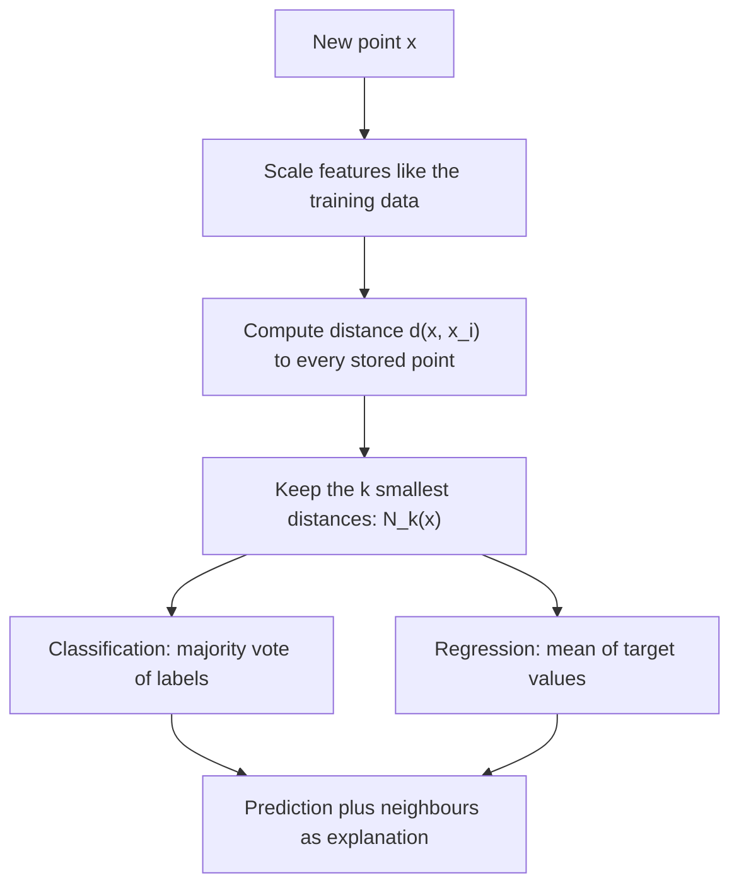

# k-Nearest Neighbors

$$
\hat{y}(x) = \arg\max_{c} \sum_{i \in N_k(x)} \mathbb{1}[y_i = c] \qquad \text{or} \qquad \hat{y}(x) = \frac{1}{k}\sum_{i \in N_k(x)} y_i
$$

, where $N_k(x)$ is the set of the $k$ training points closest to $x$ under a chosen distance $d(x, x_i)$

## Deep Breakdown

What it tells me *(Situation Awareness)*:
k-Nearest Neighbors (kNN) predicts for a new point by looking at the $k$ most similar points it has already seen: majority vote for classification, average for regression. There is no training phase beyond storing the data ("lazy learning"); all the work happens at query time, and all the modelling assumptions live in two choices: the distance (Euclidean, Manhattan, cosine...) and $k$. Geometrically, kNN says "the label surface is locally smooth in this space", so it only works if the feature space is meaningful: features on comparable scales, irrelevant features removed, and not too many dimensions (in high dimension all points become roughly equidistant). Small $k$ gives low bias and high variance (jagged boundaries that memorize noise); large $k$ smooths towards the global majority. In DA/DS: a strong, explainable baseline ("customers like you churned"), lookalike audiences in marketing, item-to-item recommendations ("customers who viewed this also viewed"), missing-value imputation (`KNNImputer`), anomaly detection (distance to the k-th neighbour), and retrieval for semantic search and RAG, where the "training set" is a table of embeddings.

## Flowchart



## Real-world use

### Where it is used

Lookalike modelling (find prospects closest to the best customers); recommender systems (item-item and user-user neighbourhoods); imputation of missing values from similar rows; fraud and anomaly scoring (a transaction far from all its neighbours is suspicious); retrieval over embeddings for semantic search and RAG; quick baselines in Kaggle-style tabular problems.

### Problem it solves

Many relationships are local and irregular: there is no simple formula for "which customers will churn", but similar customers tend to behave similarly. kNN makes predictions without assuming a functional form (no linearity, no distribution), and every prediction comes with concrete evidence: the actual neighbours.

### How it solves the problem

Represent each record as a vector, measure distance in that space, and let the closest $k$ records vote. Optionally weight votes by $1/d$ so closer neighbours count more. The model's flexibility is controlled by $k$, chosen by cross-validation.

### Example in a business

A subscription business wants to flag at-risk customers. Each customer is a vector of standardized features (logins per week, support tickets, tenure, discount used). For a new customer, the analyst finds the 15 most similar existing customers; if 10 of them churned, the predicted churn probability is $10/15 = 0.67$ and the retention team gets a list of the 15 lookalikes to understand *why*, which is easier to explain to account managers than a gradient-boosting score.

## The formula, piece by piece

- $x$: the query point (feature vector) we want to predict for
- $x_i, y_i$: stored training points and their labels/targets
- $d(x, x_i)$: distance function; Euclidean $\lVert x - x_i \rVert_2$ by default (see [[euclidean_norm_l_2_norm]]), Manhattan or general Minkowski (see [[minkowski_distance_l_p_norm]]), or $1 - \cos$ for embeddings (see [[cosine_similarity]])
- $k$: number of neighbours; hyperparameter, usually odd for binary votes to avoid ties
- $N_k(x)$: indices of the $k$ training points with smallest $d(x, x_i)$
- $\mathbb{1}[y_i = c]$: indicator, 1 if neighbour $i$ has class $c$
- $\arg\max_c \sum (\cdot)$: majority vote; the share of votes $\frac{1}{k}\sum \mathbb{1}[y_i = c]$ is a crude class probability
- $\frac{1}{k}\sum y_i$: kNN regression, the average target of the neighbours
- Weighted variant: replace each vote by $w_i = 1/d(x, x_i)$ so closer neighbours count more

## The formula in words

"To predict for a new case, find the $k$ most similar cases I already know and copy their majority answer (or their average)." Tiny example: with $k = 3$, if the three closest customers to a new one are churned, churned, retained, the prediction is "churn" with vote share $2/3 = 0.67$.

## Critical Concepts

- **Scale your features:** distance adds up squared differences, so a feature measured in dollars (range 0 to 10,000) drowns out one measured in logins (range 0 to 20). Standardize (z-score) or min-max scale inside a pipeline, fitted on training data only.
- **Choice of k is bias vs variance:** $k = 1$ memorizes the training set (training accuracy 100%, noisy test performance); $k = n$ predicts the global majority for everyone. Tune with cross-validation; $\sqrt{n}$ is a rough starting point.
- **Curse of dimensionality:** in hundreds of raw dimensions nearest and farthest neighbours end up at similar distances. Reduce dimension (PCA, feature selection) or use learned embeddings with cosine distance.
- **Cost is at query time:** brute-force search is $O(n \cdot d)$ per query. KD-trees/ball trees help in low dimension; for millions of high-dimensional vectors use approximate nearest neighbour indexes (see [[vector_search_approximate_nearest_neighbors]]).
- **Class imbalance:** with 5% churners, most neighbourhoods are dominated by non-churners. Use distance weighting, adjust the vote threshold, or evaluate with precision/recall rather than accuracy.
- **Ties and duplicates:** use odd $k$ for two classes, and decide a tie-breaking rule (closest neighbour wins, or distance weighting).

## Step-by-step calculation (tiny example)

*Five existing customers on two standardized features (activity, tickets): A $(1,1)$ churned, B $(2,1)$ churned, C $(4,4)$ retained, D $(5,4)$ retained, E $(1,2)$ retained. New customer $x = (2,2)$, $k = 3$, Euclidean distance.*

*Step 1: Distances*
$d(x,A) = \sqrt{1^2 + 1^2} = 1.414$
$d(x,B) = \sqrt{0^2 + 1^2} = 1.000$
$d(x,C) = \sqrt{2^2 + 2^2} = 2.828$
$d(x,D) = \sqrt{3^2 + 2^2} = 3.606$
$d(x,E) = \sqrt{1^2 + 0^2} = 1.000$

*Step 2: Sort and keep $k = 3$*
B (1.000, churned), E (1.000, retained), A (1.414, churned).

*Step 3: Vote*
Churned: 2, retained: 1. Prediction: **churn**, vote share $2/3 = 0.667$.

*Step 4: Sensitivity to k*
With $k = 5$ the votes are 2 churned vs 3 retained, so the prediction flips to **retained**: $k$ is a real modelling decision.

## Code examples

### Beginner example (Python)

```python
import numpy as np
from collections import Counter

X_train = np.array([[1, 1], [2, 1], [4, 4], [5, 4], [1, 2]], dtype=float)
y_train = np.array(["churn", "churn", "retain", "retain", "retain"])
names = ["A", "B", "C", "D", "E"]
x_new = np.array([2.0, 2.0])

dist = np.linalg.norm(X_train - x_new, axis=1)
for n, d in zip(names, dist):
    print(f"d(x,{n}) = {d:.3f}")

for k in (3, 5):
    idx = np.argsort(dist, kind="stable")[:k]
    votes = Counter(y_train[idx].tolist())
    label, count = votes.most_common(1)[0]
    print(f"k={k}: neighbours={[names[i] for i in idx]} votes={dict(votes)} -> {label} ({count}/{k})")
```

### Beginner example (R)

```r
X_train <- matrix(c(1, 1, 2, 1, 4, 4, 5, 4, 1, 2), ncol = 2, byrow = TRUE)
y_train <- c("churn", "churn", "retain", "retain", "retain")
x_new <- c(2, 2)
d <- sqrt(rowSums((X_train - matrix(x_new, nrow(X_train), 2, byrow = TRUE))^2))
print(round(d, 3))                         # 1.414 1.000 2.828 3.606 1.000
k <- 3
nn <- order(d)[1:k]
print(table(y_train[nn]))                  # churn 2, retain 1
```

### Professional example (Python)

```python
import numpy as np
from sklearn.datasets import make_classification
from sklearn.model_selection import train_test_split, GridSearchCV
from sklearn.neighbors import KNeighborsClassifier
from sklearn.pipeline import make_pipeline
from sklearn.preprocessing import StandardScaler
from sklearn.metrics import roc_auc_score

# Synthetic churn dataset; one feature is put on a dollar scale to show why scaling matters
X, y = make_classification(n_samples=3_000, n_features=8, n_informative=4, n_redundant=2,
                           weights=[0.8, 0.2], random_state=42)
X[:, 7] = X[:, 7] * 5_000 + 20_000   # e.g. annual spend in dollars (uninformative noise feature)
X_tr, X_te, y_tr, y_te = train_test_split(X, y, test_size=0.25, stratify=y, random_state=42)

raw = KNeighborsClassifier(n_neighbors=15).fit(X_tr, y_tr)
print(f"AUC without scaling: {roc_auc_score(y_te, raw.predict_proba(X_te)[:, 1]):.3f}")

pipe = make_pipeline(StandardScaler(), KNeighborsClassifier())
grid = GridSearchCV(
    pipe,
    {"kneighborsclassifier__n_neighbors": [1, 5, 15, 31, 61],
     "kneighborsclassifier__weights": ["uniform", "distance"]},
    scoring="roc_auc", cv=5,
)
grid.fit(X_tr, y_tr)
best = grid.best_estimator_
print(f"Best params: {grid.best_params_}")
print(f"AUC with scaling + tuned k: {roc_auc_score(y_te, best.predict_proba(X_te)[:, 1]):.3f}")

print("\nCV AUC by k (uniform weights):")
res = grid.cv_results_
for params, score in zip(res["params"], res["mean_test_score"]):
    if params["kneighborsclassifier__weights"] == "uniform":
        print(f"  k={params['kneighborsclassifier__n_neighbors']:>3}: {score:.3f}")

# Explainability: show the neighbours behind one prediction
scaler, knn = best.named_steps["standardscaler"], best.named_steps["kneighborsclassifier"]
dist, idx = knn.kneighbors(scaler.transform(X_te[:1]), n_neighbors=5)
print(f"\nCustomer 0: P(churn)={best.predict_proba(X_te[:1])[0, 1]:.2f}; "
      f"5 closest training labels={y_tr[idx[0]].tolist()}, distances={dist[0].round(2).tolist()}")
```

---

*Source: domain knowledge*
