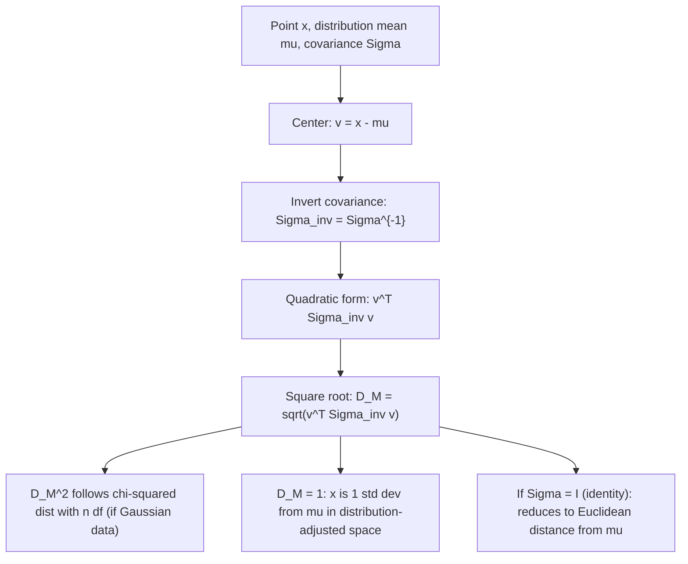

# Mahalanobis Distance

$$
D_M(x) = \sqrt{(x - \mu)^T \Sigma^{-1} (x - \mu)}
$$

## Deep Breakdown

What it tells me *(Situation Awareness)*:
Mahalanobis distance measures how many standard deviations a point $x$ lies from the mean $\mu$ of a distribution, accounting for the full covariance structure $\Sigma$ (correlations between features, and different variances per feature). It is the "distribution-aware" generalization of Euclidean distance: Euclidean assumes all features have equal variance and zero correlation; Mahalanobis corrects both. In DA/DS: Mahalanobis distance is the core of multivariate outlier detection, anomaly scoring, Gaussian discriminant analysis (LDA/QDA), the Hotelling $T^2$ test, and any scenario where features have different scales and/or are correlated.

## Flowchart



## Real-world use

### Where it is used

Multivariate outlier detection (flag observations with $D_M^2 > \chi^2_{0.99, n}$), Gaussian anomaly detection in manufacturing/fraud/network intrusion, Linear Discriminant Analysis (LDA uses class-conditional Mahalanobis distances for classification), Hotelling $T^2$ control charts in quality control, and feature-space distance in Gaussian mixture models.

### Problem it solves

Euclidean distance treats all features equally and assumes they are uncorrelated. In practice: height (cm) and weight (kg) are correlated and have different scales. A point that is "far" in Euclidean space might be completely normal if it lies along a high-variance direction. Mahalanobis rescales by variance and de-correlates, so "far" means genuinely unusual.

### How it solves the problem

$\Sigma^{-1}$ is the precision matrix. Pre-multiplying the centered vector $v = x - \mu$ by $\Sigma^{-1}$ removes the correlation structure and rescales each component by its inverse variance. This is equivalent to computing the Euclidean distance of $x$ after the whitening transform $z = \Sigma^{-1/2}(x - \mu)$: $D_M = \|z\|_2 = \|\Sigma^{-1/2}(x-\mu)\|_2$.

### Example in a business

A DS monitors transaction fraud. Features: transaction amount, velocity (transactions/hour), and account age. These are correlated and on different scales. For each new transaction $x$, they compute $D_M(x)$ from the "normal" transaction distribution $(\mu, \Sigma)$ fitted on historical non-fraud data. Transactions with $D_M^2 > \chi^2_{0.99, 3}$ are flagged for manual review.

## The formula, piece by piece

- $x \in \mathbb{R}^n$: the query point
- $\mu \in \mathbb{R}^n$: the mean vector of the reference distribution
- $\Sigma \in \mathbb{R}^{n \times n}$: the covariance matrix (must be positive definite for $\Sigma^{-1}$ to exist)
- $x - \mu$: centers $x$ relative to the distribution mean
- $\Sigma^{-1}$: precision matrix; scales by inverse variance and removes correlations
- $(x-\mu)^T \Sigma^{-1} (x-\mu)$: the Mahalanobis squared distance $D_M^2$; a quadratic form
- $\sqrt{\cdot}$: take square root to get $D_M$ in the original units
- Special case $\Sigma = I$: $D_M(x) = \|x - \mu\|_2$ (Euclidean distance from mean)
- Two-sample version: $D_M(x, y) = \sqrt{(x-y)^T S^{-1} (x-y)}$ where $S$ is the pooled covariance
- Under multivariate Gaussian: $D_M^2 \sim \chi^2(n)$ — enables principled p-value thresholds

## The formula in words

"Center the point relative to the mean. Stretch and rotate the space to remove correlations and equalize variances (using $\Sigma^{-1}$). Compute the Euclidean length in this corrected space. A large value means the point is genuinely far from the center of the distribution, accounting for the natural spread and correlations." Tiny example: $\mu = (0,0)$, $\Sigma = \begin{pmatrix}4 & 0\\0 & 1\end{pmatrix}$ (feature 1 has 4x more variance).
$x = (2, 0)$: $D_M^2 = (2,0)\begin{pmatrix}1/4&0\\0&1\end{pmatrix}(2,0)^T = 4 \cdot (1/4) = 1$. $D_M = 1$.
$y = (0, 1)$: $D_M^2 = 1 \cdot 1 = 1$. Same Mahalanobis distance!
Euclidean would give $\|x\| = 2 > \|y\| = 1$, wrongly suggesting $x$ is more unusual. $\checkmark$

## Critical Concepts

- **Whitening equivalence:** $D_M(x) = \|W(x - \mu)\|_2$ where $W = \Sigma^{-1/2}$ (Cholesky or SVD-based whitening). Mahalanobis = Euclidean after whitening.
- **Requires $\Sigma$ invertible:** if features are perfectly correlated or $n > \text{(number of samples)}$, $\Sigma$ is singular. Use the pseudo-inverse or regularized covariance ($\Sigma + \lambda I$).
- **$D_M^2 \sim \chi^2(n)$ under Gaussian:** use $\chi^2$ distribution for thresholds. For $n=5$ features, 99% threshold is $\chi^2_{0.99, 5} \approx 15.09$, meaning $D_M \approx 3.88$.
- **Robust estimation:** standard sample covariance is sensitive to outliers. Use Minimum Covariance Determinant (MCD) or other robust estimators for contaminated data.
- **Connection to LDA:** LDA classifies $x$ to the class with the smallest Mahalanobis distance to the class mean (using pooled covariance).
- **Scale invariance:** $D_M$ is invariant to linear transformations of the features.

Rescaling any feature does not change $D_M$ (the covariance matrix absorbs the scaling).

## Step-by-step calculation (tiny example)

*Step 1: Set up the problem*
$\mu = (1, 2)$, $\Sigma = \begin{pmatrix}2 & 1\\1 & 1\end{pmatrix}$, $x = (3, 3)$.
$v = x - \mu = (2, 1)$.

*Step 2: Invert the covariance matrix*
$\det(\Sigma) = 2\cdot1 - 1\cdot1 = 1$.
$\Sigma^{-1} = \begin{pmatrix}1 & -1\\-1 & 2\end{pmatrix}$.

*Step 3: Compute the quadratic form and take square root*
$v^T \Sigma^{-1} v = (2, 1) \begin{pmatrix}1 & -1\\-1 & 2\end{pmatrix} \begin{pmatrix}2\\1\end{pmatrix}$.
$= (2, 1) \begin{pmatrix}2-1\\-2+2\end{pmatrix} = (2,1)(1,0)^T = 2$.
$D_M = \sqrt{2} \approx 1.414$.
Euclidean: $\|v\| = \sqrt{4+1} = \sqrt{5} \approx 2.236$. The correlation structure reduces the effective distance. $\checkmark$

## Code examples

### Beginner example (Python)

```python
import numpy as np
from scipy.spatial.distance import mahalanobis   # Covariance and mean
mu = np.array([1.0, 2.0])
Sigma = np.array([[2.0, 1.0], [1.0, 1.0]])
x = np.array([3.0, 3.0])   # Manual computation
v = x - mu
Sigma_inv = np.linalg.inv(Sigma)
D_M_sq = float(v @ Sigma_inv @ v)
D_M = np.sqrt(D_M_sq)
D_eucl = float(np.linalg.norm(v))
print(f"Sigma_inv =\n{Sigma_inv}")
print(f"D_M^2 = {D_M_sq:.4f}")
print(f"D_M = {D_M:.4f}")
print(f"D_Euc = {D_eucl:.4f}")   # Verify with scipy (scipy uses Cholesky of the inverse)
VI = np.linalg.inv(Sigma)
print(f"\nscipy Mahalanobis: {mahalanobis(x, mu, VI):.4f}")
```

### Beginner example (R)

```r
# -- Mahalanobis distance ---
mu <- c(1, 2)
Sigma <- matrix(c(2, 1, 1, 1), nrow=2, byrow=TRUE)
x <- c(3, 3)
v <- x - mu
Sigma_inv <- solve(Sigma)
D_M_sq <- as.numeric(t(v) %*% Sigma_inv %*% v)
D_M <- sqrt(D_M_sq)
cat(sprintf("D_M^2 = %.4f\n", D_M_sq))
cat(sprintf("D_M = %.4f\n", D_M))  # R built-in mahalanobis (works on multiple rows)
# mahalanobis(x,
center=mu, cov=Sigma)
cat(sprintf("R mahalanobis: %.4f\n", sqrt(mahalanobis(x, center=mu, cov=Sigma))))
```

### Professional example (Python)

```python
import numpy as np
import pandas as pd
from scipy.stats import chi2
from sklearn.covariance import MinCovDet
np.random.seed(42)   # -- Business scenario: multivariate outlier detection for fraud monitoring ---
# Features: normalized transaction amount, velocity (tx/hr), days since last tx
N_NORMAL = 400
N_FRAUD = 15
D = 3   # Simulate normal transaction data (correlated features)
Sigma_true = np.array([[1.0, 0.6, 0.3], [0.6, 1.0, 0.1], [0.3, 0.1, 1.0]])
mu_true = np.array([0.0, 0.0, 0.0])
L = np.linalg.cholesky(Sigma_true)
X_normal = (np.random.randn(N_NORMAL, D) @ L.T) + mu_true   # Fraud: outliers injected at unusual corner of feature space
X_fraud = np.random.randn(N_FRAUD, D) + np.array([3.0, 2.5, -2.0])
X_all = np.vstack([X_normal, X_fraud])
labels_true = np.array([0] * N_NORMAL + [1] * N_FRAUD)   # Fit robust covariance (MCD) to training data (normal only)
mcd = MinCovDet(random_state=42).fit(X_normal)
mu_hat = mcd.location_
Sigma_hat = mcd.covariance_
Sigma_inv = np.linalg.inv(Sigma_hat)   # Compute Mahalanobis distance for all observations
D_M_sq = np.array([ float((x - mu_hat) @ Sigma_inv @ (x - mu_hat)) for x in X_all ])
D_M = np.sqrt(D_M_sq)   # Chi-squared threshold for 99% confidence (D=3 features)
THRESHOLD = chi2.ppf(0.99, df=D)
is_flagged = D_M_sq > THRESHOLD
fraud_detected = is_flagged[N_NORMAL:].sum()
false_positives = is_flagged[:N_NORMAL].sum()
print(f"Mahalanobis anomaly detection (chi2 threshold @ 99%, df={D}):")
print(f" Threshold: D_M^2 > {THRESHOLD:.2f} (D_M > {np.sqrt(THRESHOLD):.2f})")
print(f" Fraud detected: {fraud_detected} / {N_FRAUD}")
print(f" False positives (normal flagged): {false_positives} / {N_NORMAL}")
results = pd.DataFrame({ "obs_id": range(len(X_all)), "D_M": D_M.round(3), "D_M_sq": D_M_sq.round(3), "flagged": is_flagged, "true_fraud": labels_true.astype(bool),
})
print(f"\nTop flagged observations:")
print(results[results["flagged"]].sort_values("D_M", ascending=False) .head(10).to_string(index=False))
```

---

*Source: domain knowledge*
