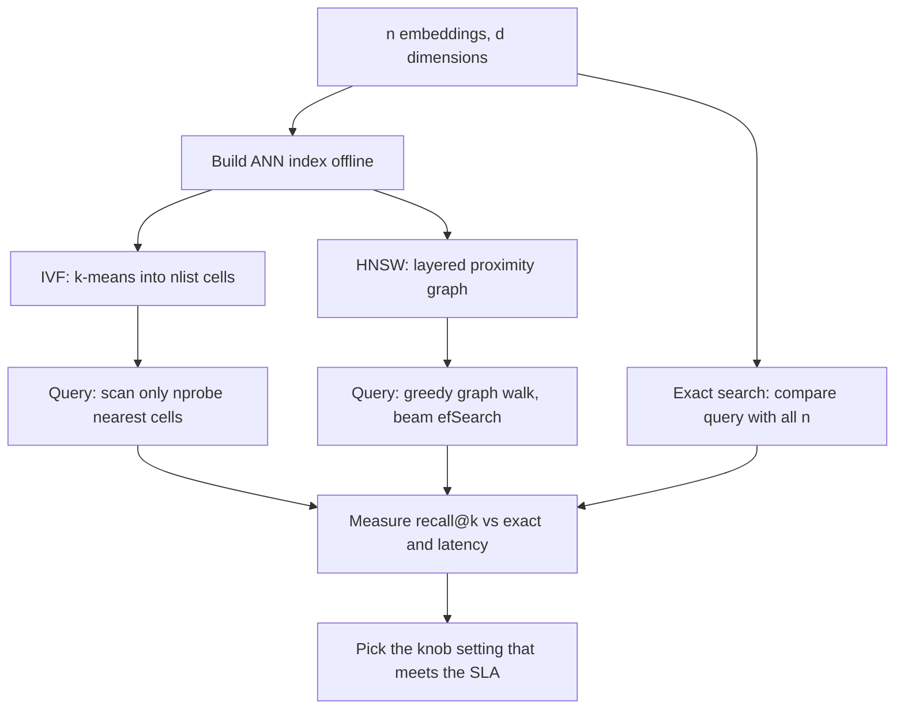

# Vector Search (Approximate Nearest Neighbors)

$$
\text{recall@}k = \frac{\lvert \text{ANN}_k(q) \cap \text{NN}_k(q) \rvert}{k}
$$

, where $\text{NN}_k(q)$ is the exact set of $k$ nearest vectors to query $q$ and $\text{ANN}_k(q)$ is the set returned by the approximate index

## Deep Breakdown

What it tells me *(Situation Awareness)*:
Vector search finds the stored vectors closest to a query vector. Exact (brute-force) search compares the query with every one of $n$ vectors in $d$ dimensions, costing $O(n d)$ per query: fine for 100k vectors, too slow and too expensive for 100 million at thousands of queries per second. Approximate nearest neighbour (ANN) indexes trade a small, *measurable* loss of accuracy for speed-ups of 10x to 1000x by only examining a promising subset of the data. The two dominant families are IVF (inverted file: cluster the vectors with k-means, then search only the few clusters nearest to the query) and HNSW (hierarchical navigable small-world graphs: greedily walk a multi-layer proximity graph towards the query). Every index has a knob (IVF `nprobe`, HNSW `efSearch`) that moves along the speed vs recall curve, and recall@k against exact search is how you choose the setting. In DA/DS: semantic search and RAG retrieval over document embeddings, product and content recommendations ("similar items"), deduplication of near-identical records or images, lookalike audiences at scale, and the candidate-generation stage of two-stage ranking systems. Vector databases (FAISS, pgvector, Qdrant, Pinecone, Milvus, Elasticsearch kNN) are mostly wrappers around these index types.

## Flowchart



## Real-world use

### Where it is used

RAG pipelines (retrieve the top-$k$ chunks for an LLM prompt); semantic search over help-centre articles, tickets or contracts; e-commerce "similar products" and visual search; music/video recommendation candidate generation; near-duplicate detection; face and image matching; anomaly detection by neighbour distance on large datasets.

### Problem it solves

Brute force is linear in $n$. With 10 million 768-dimensional embeddings, one exact query needs about $7.7 \times 10^9$ multiply-adds, and a product page or chat assistant needs answers in tens of milliseconds for many concurrent users. Tree indexes (KD-trees) do not help in hundreds of dimensions. We need sub-linear search whose accuracy loss can be quantified and controlled.

### How it solves the problem

Partition or connect the space in advance so most vectors can be skipped. IVF assigns every vector to its nearest of `nlist` k-means centroids; at query time it compares the query to the centroids, then scans only the vectors in the `nprobe` closest cells, so roughly a fraction $\text{nprobe}/\text{nlist}$ of the data is examined. A true neighbour is missed only if it lives in a cell that was not probed, which is exactly what recall@k measures. HNSW instead links each vector to a few near neighbours on several layers (sparse top layers for long jumps, dense bottom layer for precision) and walks greedily towards the query, keeping a candidate list of size `efSearch`. Compression (product quantization) can be added to fit billions of vectors in memory.

### Example in a business

A marketplace with 1,000,000 product embeddings serves "similar items". Exact search scans 1,000,000 vectors per request. An IVF index with `nlist = 1000` and `nprobe = 10` scans the 1,000 centroids plus about 10,000 vectors (10 cells of ~1,000), i.e. about 11,000 comparisons, roughly 91x fewer. Offline evaluation on 1,000 sample queries shows recall@10 of 0.95; the team accepts it because the missed neighbours are near-ties that users would not notice, and latency drops below the 20 ms budget.

## The formula, piece by piece

- $q$: the query vector (e.g. the embedding of a user question or a product)
- $\text{NN}_k(q)$: the true top-$k$ nearest vectors, found by exact brute-force search (the ground truth)
- $\text{ANN}_k(q)$: the top-$k$ list returned by the approximate index
- $\lvert \cdot \cap \cdot \rvert$: how many true neighbours the index actually found
- $/k$: normalizes to $[0, 1]$; 1 means the ANN result is identical to exact search (as a set)
- Average over a sample of queries: report mean recall@k together with latency or the fraction of vectors scanned
- IVF knobs: `nlist` (number of k-means cells), `nprobe` (cells scanned per query); work per query $\approx \text{nlist} + n \cdot \text{nprobe}/\text{nlist}$ distance computations
- HNSW knobs: `M` (links per node, memory), `efConstruction` (build quality), `efSearch` (query beam width, recall vs speed)

## The formula in words

"Recall@k is the share of the true $k$ nearest neighbours that the fast index managed to return." Tiny example: exact search says the 10 most similar products are items 1 to 10; the ANN index returns items 1 to 9 plus item 14. Overlap is 9, so recall@10 $= 9/10 = 0.9$.

## Critical Concepts

- **Exact first, then approximate:** below roughly a few hundred thousand vectors, a brute-force matrix product (often on a GPU or with BLAS) is fast enough and has recall 1. Add an ANN index when latency or cost demands it.
- **Speed vs recall is a curve, not a point:** raising `nprobe` or `efSearch` increases recall and latency together. Always plot recall@k vs queries per second (or fraction scanned) and pick the knee that meets the service-level target.
- **Distance must match the embedding:** for normalized embeddings, cosine similarity, dot product and Euclidean distance give the same ranking ($\lVert u - v \rVert^2 = 2 - 2\,u \cdot v$ for unit vectors). Normalize before indexing if the model was trained with cosine similarity (see [[embedding_similarity]]).
- **IVF cell boundaries:** a query near the edge of its cell has neighbours in adjacent cells; that is why `nprobe = 1` can have poor recall and small increases help a lot.
- **HNSW trade-offs:** excellent recall/latency and supports incremental inserts, but uses more memory (the graph links) and deletions are awkward. IVF is cheaper to build, easy to shard, and combines well with product quantization.
- **Filters break assumptions:** metadata filters ("only in-stock items in Brazil") applied after ANN retrieval can leave fewer than $k$ results; use pre-filtering support in the database or over-fetch.
- **Recall is not relevance:** recall@k measures agreement with exact search in embedding space. Whether those neighbours are *useful* is a separate question for the embedding model and for offline relevance labels.

## Step-by-step calculation (tiny example)

*Catalog of $n = 1{,}000{,}000$ vectors, IVF with nlist $= 1000$ cells (about 1,000 vectors each), nprobe $= 10$.*

*Step 1: Exact cost*
$1{,}000{,}000$ distance computations per query.

*Step 2: IVF coarse step*
Compare the query with all centroids: $1{,}000$ computations.

*Step 3: IVF fine step*
Scan 10 cells of about 1,000 vectors: $10{,}000$ computations.

*Step 4: Speed-up*
Total $11{,}000$ vs $1{,}000{,}000$: about $1{,}000{,}000 / 11{,}000 = 91$ times less work; fraction of the data scanned $= 10/1000 = 1\%$.

*Step 5: Quality*
For one query the exact top-10 is $\{1,\dots,10\}$ and IVF returns $\{1,\dots,9, 14\}$: recall@10 $= 9/10 = 0.9$. Averaging over many queries gives the number to report.

## Code examples

### Beginner example (Python)

```python
import numpy as np

exact_top10 = set(range(1, 11))           # items 1..10
ann_top10 = set(range(1, 10)) | {14}      # items 1..9 and 14
recall = len(exact_top10 & ann_top10) / 10
print(f"recall@10 = {recall:.1f}")        # 0.9

n, nlist, nprobe = 1_000_000, 1_000, 10
ivf_work = nlist + nprobe * (n // nlist)
print(f"IVF comparisons: {ivf_work:,} vs exact {n:,} -> {n / ivf_work:.0f}x less work")  # 11,000 ; 91x
```

### Beginner example (R)

```r
exact_top10 <- 1:10
ann_top10 <- c(1:9, 14)
cat(sprintf("recall@10 = %.1f\n", length(intersect(exact_top10, ann_top10)) / 10))  # 0.9
n <- 1e6; nlist <- 1000; nprobe <- 10
ivf_work <- nlist + nprobe * (n / nlist)
cat(sprintf("IVF work = %d, speed-up = %.0fx\n", ivf_work, n / ivf_work))          # 11000, 91x
```

### Professional example (Python)

```python
import time
import numpy as np
from sklearn.cluster import KMeans

rng = np.random.default_rng(42)

# Synthetic "embedding" catalogue: 20,000 unit vectors in 32-d drawn around 50 topics
n, d, n_topics = 20_000, 32, 50
topics = rng.normal(size=(n_topics, d))
X = topics[rng.integers(0, n_topics, n)] + 0.6 * rng.normal(size=(n, d))
X /= np.linalg.norm(X, axis=1, keepdims=True)
queries = X[rng.choice(n, 200, replace=False)] + 0.05 * rng.normal(size=(200, d))
queries /= np.linalg.norm(queries, axis=1, keepdims=True)
k = 10


def exact_search(Q: np.ndarray, k: int) -> np.ndarray:
    scores = Q @ X.T                                   # cosine similarity (unit vectors)
    return np.argsort(-scores, axis=1)[:, :k]


class TinyIVF:
    """Inverted-file index: k-means cells + scan only the nprobe closest cells."""

    def __init__(self, nlist: int, seed: int = 42):
        self.km = KMeans(n_clusters=nlist, n_init=1, max_iter=50, random_state=seed)

    def fit(self, X: np.ndarray) -> "TinyIVF":
        labels = self.km.fit_predict(X)
        self.centroids = self.km.cluster_centers_
        self.lists = [np.where(labels == c)[0] for c in range(len(self.centroids))]
        return self

    def search(self, q: np.ndarray, k: int, nprobe: int) -> tuple[np.ndarray, int]:
        cells = np.argsort(-(self.centroids @ q))[:nprobe]       # coarse step
        cand = np.concatenate([self.lists[c] for c in cells])    # candidate ids
        scores = X[cand] @ q                                     # fine step
        top = cand[np.argsort(-scores)[:k]]
        return top, len(cand) + len(self.centroids)


t0 = time.perf_counter()
truth = exact_search(queries, k)
t_exact = time.perf_counter() - t0
index = TinyIVF(nlist=100).fit(X)
print(f"Exact search for {len(queries)} queries: {t_exact * 1000:.1f} ms (scans 100% of vectors)\n")
print(f"{'nprobe':>6} {'recall@10':>10} {'work vs exact':>14}")
for nprobe in [1, 2, 5, 10, 20]:
    recalls, work = [], []
    for q, true_ids in zip(queries, truth):
        ids, cost = index.search(q, k, nprobe)
        recalls.append(len(set(ids) & set(true_ids)) / k)
        work.append(cost / n)
    print(f"{nprobe:>6} {np.mean(recalls):>10.3f} {np.mean(work):>13.1%}")
```

---

*Source: domain knowledge*
