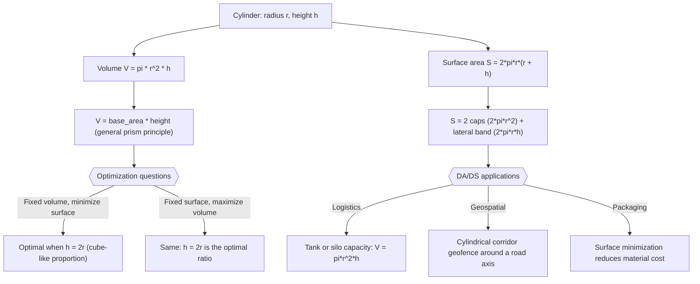

# Cylinder

$$
V = \pi r^2 h
$$

, $S = 2\pi r(r + h)$

## Deep Breakdown

What it tells me *(Situation Awareness)*:
A cylinder with base radius $r$ and height $h$ has volume $V = \pi r^2 h$ and total surface area $S = 2\pi r(r + h)$, where $2\pi r^2$ covers the two circular caps and $2\pi r h$ is the lateral surface. The volume formula is simply the base area ($\pi r^2$) multiplied by the height — a principle that generalizes to any prism. In DA/DS, the cylinder appears in logistics/operations analytics (tank capacity, container optimization), in 3D spatial queries (cylindrical geofences around road corridors), and as a conceptual shape for understanding how volume scales in models with one "width" parameter and one "depth" parameter (analogous to feature width vs number of layers in a neural network height analogy).

## Flowchart



## Real-world use

### Where it is used

Used in supply chain and logistics (capacity of cylindrical tanks, silos, drums), in geospatial analytics (cylindrical buffer zones around linear features like roads or pipelines), in packaging optimization (minimize material surface for a given volume), and as a concrete example of how volume scales with $r^2 h$ when teaching quadratic vs linear relationships in feature interactions.

### Problem it solves

Given a target storage volume, what radius and height minimize material cost (surface area)? This is the "optimal cylinder" problem: for fixed $V = \pi r^2 h$, the surface $S = 2\pi r^2 + 2\pi r h$ is minimized when $h = 2r$ (cube-like proportion, height equals diameter). This is a classic constrained optimization problem that appears in both engineering and operations analytics.

### How it solves the problem

$V = \pi r^2 h$: the base is a circle of area $\pi r^2$, and the cylinder is formed by stacking $h$ units of that base. $S = 2\pi r^2 + 2\pi r h$: two caps of area $\pi r^2$ each, plus a rectangular lateral band that when unrolled has dimensions $2\pi r$ (circumference) by $h$ (height). The optimization uses calculus: substitute $h = V/(\pi r^2)$ into $S$, differentiate with respect to $r$, set equal to zero, and solve to get $r^* = (V/(2\pi))^{1/3}$ and $h^* = 2r^*$.

### Example in a business

A supply chain analyst needs to specify a cylindrical storage tank for 10,000 litres ($= 10\ \text{m}^3$) of liquid fertiliser. The cost is proportional to the steel surface area ($\approx \text{EUR}\ 80/\text{m}^2$). By solving the optimal cylinder problem, the analyst finds $r^* \approx 1.08\ \text{m}$, $h^* \approx 2.17\ \text{m}$, with surface area $\approx 22.1\ \text{m}^2$ and cost $\approx \text{EUR}\ 1770$ — compared to a tall thin cylinder ($r=0.5, h=12.7$) with surface $\approx 42\ \text{m}^2$ and cost $\approx \text{EUR}\ 3360$.

## The formula, piece by piece

- $V = \pi r^2 h$: volume; $\pi r^2$ is the base circle area, $h$ is the height; same structure as base × height for any prism
- $r$: radius of the circular base
- $h$: height of the cylinder (distance between the two caps)
- $S = 2\pi r(r + h)$: total surface area, factored form; $r + h$ encodes both caps (contributes $r$) and lateral surface (contributes $h$)
- $2\pi r^2$: area of two circular caps
- $2\pi r h$: lateral surface area (unrolled rectangle of width $2\pi r$ and height $h$) Full formulas: $V = \pi r^2 h$, $S = 2\pi r(r + h)$

## The formula in words

"The cylinder's volume is how many circular slices fit in the height: area of one circle times how tall you stack it. The surface is the two circular lids plus the curved band that wraps around the side (unroll it and it becomes a rectangle)." Tiny numeric example:
$r = 2$, $h = 5$.
$V = \pi(4)(5) = 20\pi \approx 62.83$.
$S = 2\pi(2)(2 + 5) = 4\pi(7) = 28\pi \approx 87.96$.

## Critical Concepts

- **Optimal proportion:** for a fixed volume, surface area is minimized when $h = 2r$ (height equals diameter). This minimizes packaging/material cost. Solve by substituting $h = V/(\pi r^2)$ and minimizing $S(r)$.
- **Lateral vs total:** $S_{\text{lateral}} = 2\pi r h$ is the curved side only; $S_{\text{total}} = 2\pi r h + 2\pi r^2 = 2\pi r(r + h)$ includes the caps. Know which you need: a pipe is open-ended (lateral only), a sealed tank needs total.
- **Units:** $V$ has units of length$^3$; $S$ has units of length$^2$. If $r$ is in metres, $V$ is in m$^3$ and $S$ is in m$^2$.
- **Relation to sphere:** at the optimal $h = 2r$, $V_{\text{cyl}} = 2\pi r^3$ vs $V_{\text{sphere}} = \frac{4}{3}\pi r^3$; the cylinder (same height as diameter) holds about 1.5 times the volume of the inscribed sphere.
- **Truncated cylinder (oblique):** if the top is cut at an angle, volume is still $\pi r^2 h_{\text{avg}}$ where $h_{\text{avg}}$ is the average height.

## Step-by-step calculation (tiny example)

*Step 1: Compute volume and surface area for given r and h*
$r = 3$, $h = 8$.
$V = \pi(9)(8) = 72\pi \approx 226.19$.
$S = 2\pi(3)(3 + 8) = 6\pi(11) = 66\pi \approx 207.35$.

*Step 2: Find the optimal radius for the same volume*
Target: $V = 72\pi$. Optimal: $r^* = (V/(2\pi))^{1/3} = (36)^{1/3} \approx 3.302$. $h^* = 2r^* \approx 6.604$.

*Step 3: Compute optimal surface and compare*
$S^* = 2\pi(3.302)(3.302 + 6.604) = 2\pi(3.302)(9.906) \approx 205.9$.
The optimal is only slightly smaller here because $r=3$ was already close to the optimum.

## Code examples

### Beginner example (Python)

```python
import numpy as np   # -- Cylinder: volume, surface area, and optimal proportion ----------

def cylinder_volume(r: float, h: float) -> float:
    """Volume of a right circular cylinder."""
    return np.pi * r**2 * h

def cylinder_surface(r: float, h: float) -> float:
    """Total surface area of a closed cylinder."""
    return 2 * np.pi * r * (r + h)
print("Cylinder V and S for various (r, h):")
for r, h in [(2, 5), (3, 8), (5, 1), (3, 6)]:
    v = cylinder_volume(r, h)
s = cylinder_surface(r, h)
print(f" r={r}, h={h}: V={v:.2f}, S={s:.2f}, h/r={h/r:.2f}")   # Optimal cylinder: minimize S for fixed V

def optimal_cylinder(target_volume: float):
    """Find optimal r and h minimizing surface area for a given volume."""
    r_opt = (target_volume / (2 * np.pi)) ** (1/3)
    h_opt = 2 * r_opt
    return r_opt, h_opt, cylinder_surface(r_opt, h_opt)
target_v = 100.0
r_opt, h_opt, s_opt = optimal_cylinder(target_v)
print(f"\nOptimal cylinder for V={target_v:.0f}:")
print(f" r_opt={r_opt:.4f}, h_opt={h_opt:.4f} (h=2r), S_min={s_opt:.4f}")
print(f" Verify V: {cylinder_volume(r_opt, h_opt):.4f} (should be {target_v:.0f})")
```

### Beginner example (R)

```r
# -- Cylinder: volume, surface area, and optimal proportion ----------
cylinder_volume <- function(r, h) pi * r^2 * h
cylinder_surface <- function(r, h) 2 * pi * r * (r + h)
cat("Cylinder V and S for various (r, h):\n")
params <- list(c(2,5), c(3,8), c(5,1), c(3,6))
for (p in params) { r <- p[1]; h <- p[2]
  cat(sprintf(" r=%g, h=%g: V=%.2f, S=%.2f, h/r=%.2f\n", r, h, cylinder_volume(r,h), cylinder_surface(r,h), h/r))
}  # Optimal cylinder
target_v <- 100.0
r_opt <- (target_v / (2 * pi))^(1/3)
h_opt <- 2 * r_opt
s_opt <- cylinder_surface(r_opt, h_opt)
cat(sprintf("\nOptimal cylinder for V=%.0f: r=%.4f, h=%.4f, S_min=%.4f\n", target_v, r_opt, h_opt, s_opt))
cat(sprintf("Verify V: %.4f\n", cylinder_volume(r_opt, h_opt)))
```

### Professional example (Python)

```python
import numpy as np
import pandas as pd   # -- Business scenario: minimize tank material cost for a set of storage volumes
# A logistics firm needs cylindrical tanks for 5 products with different volume targets.
# Steel costs EUR 80 / m^2. Find optimal dimensions and compare to a "tall thin" design. STEEL_COST_PER_M2 = 80.0
# EUR per m^2 VOLUME_TARGETS_M3 = [2.0, 5.0, 10.0, 20.0, 50.0]
# m^3
PRODUCT_NAMES = ["Lubricant A", "Solvent B", "Fertiliser C", "Acid D", "Water E"]

def optimal_cylinder(v: float):
    r = (v / (2 * np.pi)) ** (1/3)
    h = 2 * r
    return r, h

def tall_thin_cylinder(v: float):
    r = 0.3   # fixed narrow radius (0.3 m)
    h = v / (np.pi * r**2)
    return r, h
rows = []
for name, v in zip(PRODUCT_NAMES, VOLUME_TARGETS_M3):
    r_opt, h_opt = optimal_cylinder(v)
r_thin, h_thin = tall_thin_cylinder(v)
s_opt = 2 * np.pi * r_opt * (r_opt + h_opt)
s_thin = 2 * np.pi * r_thin * (r_thin + h_thin)
rows.append({ "product": name, "volume_m3": v, "opt_r_m": round(r_opt, 3), "opt_h_m": round(h_opt, 3), "opt_surface_m2": round(s_opt, 2), "opt_cost_eur": round(s_opt * STEEL_COST_PER_M2, 0), "thin_surface_m2": round(s_thin, 2), "thin_cost_eur": round(s_thin * STEEL_COST_PER_M2, 0), "savings_eur": round((s_thin - s_opt) * STEEL_COST_PER_M2, 0), })
df = pd.DataFrame(rows)
print("Optimal vs tall-thin cylinder: material cost comparison")
print(df.to_string(index=False))
total_savings = float(df["savings_eur"].sum())
print(f"\nTotal savings from optimal proportioning: EUR {total_savings:,.0f}")
print("Interpretation: V = pi*r^2*h; optimal cylinder uses h=2r (height=diameter). Tall thin designs waste material on excess lateral surface.")
```

---

*Source: domain knowledge*
