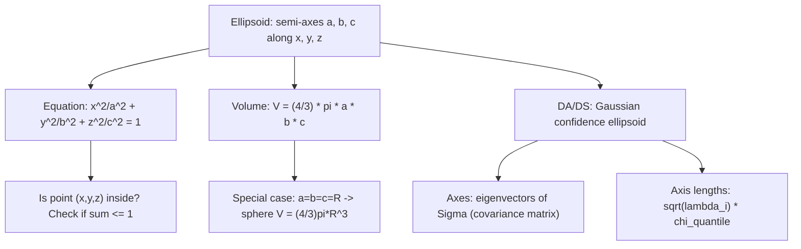

# Ellipsoid

$$
V = \frac{4}{3} \pi abc
$$

## Deep Breakdown

What it tells me *(Situation Awareness)*:
An ellipsoid is a 3D surface defined by $\frac{x^2}{a^2} + \frac{y^2}{b^2} + \frac{z^2}{c^2} = 1$, where $a$, $b$, $c$ are the semi-axes along the $x$, $y$, $z$ axes respectively. It is the 3D generalization of an ellipse. The volume formula $V = \frac{4}{3}\pi abc$ generalizes the sphere volume $V = \frac{4}{3}\pi R^3$ (setting $a = b = c = R$). In DA/DS: the ellipsoid is the confidence region of a multivariate Gaussian distribution. The set $\{x : (x-\mu)^T \Sigma^{-1}(x-\mu) \leq c^2\}$ is an ellipsoid with axes aligned to the eigenvectors of $\Sigma$ and axis lengths proportional to $\sqrt{\lambda_i} \cdot c$. This is central to Mahalanobis distance, PCA, Gaussian mixture models, and covariance visualization.

## Flowchart



## Real-world use

### Where it is used

Visualizing covariance structure of multivariate Gaussian distributions (PCA confidence ellipsoid), Mahalanobis distance thresholds (the boundary $D_M = c$ is an ellipsoid), Gaussian mixture model cluster shapes, 3D bounding volumes in computer graphics and robotics (minimum volume enclosing ellipsoid), and quality control (tolerance ellipsoid for multivariate measurements).

### Problem it solves

In 3D, spheres are too restrictive for representing data spread: data may be stretched along certain directions. An ellipsoid captures directional variance. Given a covariance matrix $\Sigma$, the 1-sigma ellipsoid shows exactly which 3D region contains 68% of the distribution's probability mass.

### How it solves the problem

The equation $\frac{x^2}{a^2} + \frac{y^2}{b^2} + \frac{z^2}{c^2} = 1$ is the boundary where each axis contribution is normalized by its semi-axis length. Points strictly inside satisfy $< 1$. Volume $V = \frac{4}{3}\pi abc$ comes from integrating the sphere formula with each axis rescaled: if you stretch a unit sphere by $a$, $b$, $c$ along each axis, the volume scales by $a \cdot b \cdot c$.

### Example in a business

A DS fits a 3-feature Gaussian anomaly detector on normal sensor readings. The alert boundary is an ellipsoid in 3D feature space with axes aligned to the principal components of $\Sigma$ and lengths proportional to $\sqrt{\lambda_i \cdot \chi^2_{0.99}}$. The DS visualizes this ellipsoid to validate that the detector is capturing the right region of normal behavior.

## The formula, piece by piece

- $a, b, c$: semi-axes of the ellipsoid along $x$, $y$, $z$ (all $> 0$)
- $\frac{4}{3}\pi$: the same constant as in the sphere volume formula
- $abc$: product of the three semi-axes; replaces $R^3$ in the sphere formula
- Surface equation: $\frac{x^2}{a^2} + \frac{y^2}{b^2} + \frac{z^2}{c^2} = 1$
- Interior: $\frac{x^2}{a^2} + \frac{y^2}{b^2} + \frac{z^2}{c^2} \leq 1$
- Special case $a=b=c=R$: $V = \frac{4}{3}\pi R^3$ (sphere)
- Special case $a=b \neq c$: oblate ($c < a$) or prolate ($c > a$) spheroid
- Surface area: no closed form in general; requires elliptic integrals

## The formula in words

"Scale a unit sphere by $a$ along $x$, by $b$ along $y$, and by $c$ along $z$. The volume of this stretched sphere is the sphere volume $\frac{4}{3}\pi$ times the product of the scaling factors $abc$. The boundary is the set of points where the sum of normalized squared coordinates equals 1." Tiny example: $a=3$, $b=2$, $c=1$.
$V = \frac{4}{3}\pi(3)(2)(1) = 8\pi \approx 25.13$.
Compare sphere $R=3$: $V = \frac{4}{3}\pi(27) = 36\pi \approx 113.1$. The ellipsoid has much less volume because it is flattened.

## Critical Concepts

- **Mahalanobis ellipsoid:** the boundary $D_M = c$ is an ellipsoid with axes = eigenvectors of $\Sigma$ and lengths $= c\sqrt{\lambda_i}$.
- **PCA confidence ellipsoid:** for a $d$-dimensional Gaussian, the 95% region is the ellipsoid with $D_M^2 \leq \chi^2_{0.95, d}$.
- **No closed-form surface area:** unlike volume, ellipsoid surface area requires elliptic integrals. Use `scipy.integrate` or approximations in practice.
- **Minimum volume enclosing ellipsoid (MVEE):** the smallest ellipsoid containing all points. Used in robust statistics and optimal experiment design.
- **Degeneracy:** if any semi-axis is 0, the ellipsoid degenerates to a lower-dimensional shape.
- **Parametric form:** $(x,y,z) = (a\sin\phi\cos\theta, b\sin\phi\sin\theta, c\cos\phi)$ for $\phi \in [0,\pi]$, $\theta \in [0,2\pi)$.

## Step-by-step calculation (tiny example)

*Step 1: Set up the ellipsoid*
Semi-axes: $a=4$, $b=3$, $c=2$.
Equation: $\frac{x^2}{16} + \frac{y^2}{9} + \frac{z^2}{4} = 1$.

*Step 2: Compute volume*
$V = \frac{4}{3}\pi(4)(3)(2) = \frac{4}{3}\pi(24) = 32\pi \approx 100.53$.

*Step 3: Check if a point is inside*
$p = (2, 1, 1)$: $\frac{4}{16} + \frac{1}{9} + \frac{1}{4} = 0.25 + 0.11 + 0.25 = 0.61 < 1$. Inside. $\checkmark$

## Code examples

### Beginner example (Python)

```python
import numpy as np

def ellipsoid_volume(a: float, b: float, c: float) -> float:
    """Volume of ellipsoid with semi-axes a, b, c."""
    return (4.0 / 3.0) * np.pi * a * b * c

def is_inside_ellipsoid(point: np.ndarray, a: float, b: float, c: float) -> bool:
    """Check if a 3D point is inside/on the ellipsoid."""
    x, y, z = point
    return float(x**2/a**2 + y**2/b**2 + z**2/c**2) <= 1.0


a, b, c = 4.0, 3.0, 2.0
print(f"Semi-axes: a={a}, b={b}, c={c}")
print(f"Volume = (4/3)*pi*a*b*c = {ellipsoid_volume(a, b, c):.4f}")
test_points = [
    np.array([2.0, 1.0, 1.0]),
    np.array([4.0, 0.0, 0.0]),  # on boundary (x-axis endpoint)
    np.array([3.0, 2.0, 1.5]),
]
for pt in test_points:
    val = pt[0]**2/a**2 + pt[1]**2/b**2 + pt[2]**2/c**2
    inside = is_inside_ellipsoid(pt, a, b, c)
    print(f" {pt}: normalized_sum = {val:.4f} -> {'inside' if inside else 'outside/boundary'}")
```

### Beginner example (R)

```r
# -- Ellipsoid volume and point classification ---
ellipsoid_volume <- function(a, b, c) (4 / 3) * pi * a * b * c
is_inside_ellipsoid <- function(point, a, b, c) {
  (point[1]^2 / a^2 + point[2]^2 / b^2 + point[3]^2 / c^2) <= 1
}
a <- 4; b <- 3; c <- 2
cat(sprintf("Volume = %.4f\n", ellipsoid_volume(a, b, c)))
test_pts <- list(c(2, 1, 1), c(4, 0, 0), c(3, 2, 1.5))
for (pt in test_pts) {
  val <- pt[1]^2/a^2 + pt[2]^2/b^2 + pt[3]^2/c^2
  status <- ifelse(is_inside_ellipsoid(pt, a, b, c), "inside", "outside")
  cat(sprintf(" (%.1f, %.1f, %.1f): normalized_sum=%.4f -> %s\n", pt[1], pt[2], pt[3], val, status))
}
```

### Professional example (Python)

```python
import numpy as np
import pandas as pd
from scipy.stats import chi2
np.random.seed(42)

# -- Business scenario: 3D Gaussian confidence ellipsoid for sensor anomaly detection ---
N_TRAIN = 300
D = 3

# Simulate correlated 3D normal data
Sigma_true = np.array([[4.0, 1.5, 0.5], [1.5, 2.0, 0.3], [0.5, 0.3, 1.0]])
mu_true = np.array([2.0, 1.0, 0.5])
L = np.linalg.cholesky(Sigma_true)
X_train = np.random.randn(N_TRAIN, D) @ L.T + mu_true

# Estimate mean and covariance
mu_hat = X_train.mean(axis=0)
Sigma_hat = np.cov(X_train.T)

# Eigendecomposition: ellipsoid axes aligned to eigenvectors
eigenvalues, eigenvectors = np.linalg.eigh(Sigma_hat)  # sorted ascending

# Chi-squared threshold for 99% at D=3
chi2_threshold = chi2.ppf(0.99, df=D)
semi_axes = np.sqrt(eigenvalues * chi2_threshold)

# Volume of the 99% confidence ellipsoid
volume_99pct = (4.0 / 3.0) * np.pi * np.prod(semi_axes)
results = pd.DataFrame({
    "component": [f"PC{i+1}" for i in range(D)],
    "eigenvalue": eigenvalues.round(4),
    "semi_axis": semi_axes.round(4),
})
print(f"3D Gaussian confidence ellipsoid (99%, chi2_threshold={chi2_threshold:.2f}):")
print(results.to_string(index=False))
print(f"\nEllipsoid volume (99% confidence region): {volume_99pct:.4f}")
print(f"Sphere volume with same max semi-axis: {(4/3)*np.pi*semi_axes.max()**3:.4f}")
print(f"(Ellipsoid is smaller: it accounts for covariance shape)")
```

---

*Source: domain knowledge*
