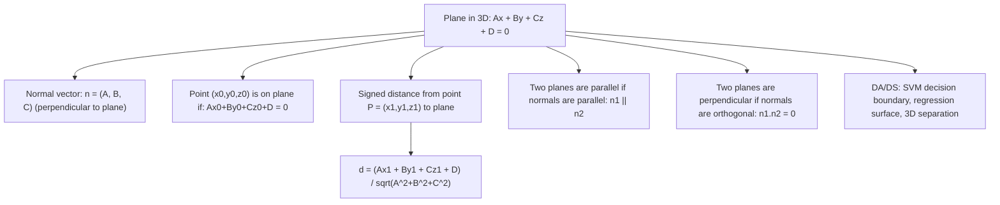

# Plane Equation

$$
Ax + By + Cz + D = 0
$$

## Deep Breakdown

What it tells me *(Situation Awareness)*:
The general equation of a plane in 3D space is $Ax + By + Cz + D = 0$, where the vector $\mathbf{n} = (A, B, C)$ is the normal vector (perpendicular to the plane). Any point $(x,y,z)$ satisfying the equation lies on the plane. In DA/DS: the plane is the 3D version of a linear decision boundary. In SVMs with 3 features, the decision boundary is a plane. In 3D linear regression, the fitted surface $\hat{y} = \beta_0 + \beta_1 x_1 + \beta_2 x_2$ defines a plane. The signed distance from a point to a plane is the foundation of SVM margin theory, support vector computation, and any 3D geometric reasoning.

## Flowchart



## Real-world use

### Where it is used

SVM decision boundary (the hyperplane $\mathbf{w}^T\mathbf{x} + b = 0$ with signed distance $= (\mathbf{w}^T\mathbf{x}+b)/\|\mathbf{w}\|$), 3D linear regression fitted surface, point-to-surface distance in 3D sensor data (LiDAR ground plane detection), computer vision (plane fitting for AR/VR), and normal vector computation in 3D mesh processing.

### Problem it solves

Given a 3D plane, you need to: (1) determine which side a point is on (classification), (2) compute the signed distance from any point to the plane (SVM margin, RANSAC fitting error), (3) find the intersection of the plane with lines or other planes. The single equation $Ax + By + Cz + D = 0$ encodes all of this.

### How it solves the problem

The normal vector $\mathbf{n} = (A,B,C)$ is perpendicular to every vector lying in the plane. The plane equation says: the dot product of any point on the plane with the normal, plus $D$, equals zero. For any point $P = (x_1,y_1,z_1)$: the signed distance to the plane is $d = (Ax_1+By_1+Cz_1+D)/\|\mathbf{n}\|$. Positive $d$ = on the normal side; negative = opposite side.

### Example in a business

A DS fits an SVM classifier on 3D sensor data (roll, pitch, yaw of a vehicle sensor). The decision boundary is a plane $Ax+By+Cz+D=0$ separating "normal operation" from "fault". For a new observation, they compute the signed distance to the boundary: large positive = confidently normal, large negative = confidently fault, near zero = uncertain (near the margin). This signed distance is also used as a calibrated anomaly score.

## The formula, piece by piece

- $A, B, C$: coefficients of $x, y, z$; together form the normal vector $\mathbf{n} = (A, B, C)$
- $D$: constant offset; determines the plane's position along the normal direction
- $Ax + By + Cz + D = 0$: the implicit equation; all points satisfying this are on the plane
- Normal vector $\mathbf{n} = (A,B,C)$ is perpendicular to the plane
- Signed distance from point $P=(x_1,y_1,z_1)$: $d = \frac{Ax_1+By_1+Cz_1+D}{\sqrt{A^2+B^2+C^2}}$
- Distance (unsigned): $|d|$
- Alternative form using a point $P_0=(x_0,y_0,z_0)$ on the plane: $A(x-x_0)+B(y-y_0)+C(z-z_0)=0$
- In DA/DS: SVM hyperplane $\mathbf{w}^T\mathbf{x} + b = 0$ with $A=w_1$, $B=w_2$, $C=w_3$, $D=b$

## The formula in words

"A plane is defined by a direction (normal vector $(A,B,C)$) and an offset $D$. Every point on the plane has the same dot product with the normal. To check which side of the plane a point is on, compute $Ax+By+Cz+D$: positive = same side as the normal direction, negative = opposite side, zero = on the plane." Tiny example: Plane $x + 2y - z - 4 = 0$.
Normal: $(1, 2, -1)$.
Check $(2, 1, 1)$: $2 + 2 - 1 - 4 = -1 \neq 0$: not on plane.
Signed distance: $-1/\sqrt{1+4+1} = -1/\sqrt{6} \approx -0.408$.
Negative: this point is on the opposite side of the normal. $\checkmark$

## Critical Concepts

- **Normal vector uniquely defines orientation:** any scalar multiple of $(A,B,C,D)$ gives the same plane. Normalize by dividing by $\sqrt{A^2+B^2+C^2}$ to get unit normal.
- **SVM margin:** for SVM, the margin is $2/\|\mathbf{w}\|$ — the distance between the two support hyperplanes $\mathbf{w}^T\mathbf{x}+b = \pm 1$. Maximizing margin $\Leftrightarrow$ minimizing $\|\mathbf{w}\|$.
- **Plane from three points:** given $P_1$, $P_2$, $P_3$: normal = $(P_2-P_1) \times (P_3-P_1)$ (cross product). Then $D = -\mathbf{n} \cdot P_1$.
- **Parallel planes:** $A_1x+B_1y+C_1z+D_1=0$ and $A_2x+B_2y+C_2z+D_2=0$ are parallel iff $(A_1,B_1,C_1) = \lambda(A_2,B_2,C_2)$ for some scalar $\lambda$.
- **Angle between planes:** $\cos\theta = |\mathbf{n}_1 \cdot \mathbf{n}_2| / (\|\mathbf{n}_1\|\|\mathbf{n}_2\|)$.
- **RANSAC plane fitting:** in 3D point clouds (LiDAR), RANSAC randomly samples 3 points, fits a plane, counts inliers (points within distance $\epsilon$), and iterates to find the best-fitting plane.

## Step-by-step calculation (tiny example)

*Step 1: Write the plane equation from normal and point*
Normal $\mathbf{n} = (2, -1, 3)$, point on plane $P_0 = (1, 0, 2)$.
$A=2$, $B=-1$, $C=3$, $D = -(2\cdot1 - 1\cdot0 + 3\cdot2) = -(2+6) = -8$.
Plane: $2x - y + 3z - 8 = 0$.

*Step 2: Verify the point is on the plane*
$2(1) - (0) + 3(2) - 8 = 2 + 6 - 8 = 0$. $\checkmark$

*Step 3: Compute signed distance from another point*
$Q = (3, 2, 1)$.
$d = \frac{2(3)-1(2)+3(1)-8}{\sqrt{4+1+9}} = \frac{6-2+3-8}{\sqrt{14}} = \frac{-1}{\sqrt{14}} \approx -0.267$.
$Q$ is slightly on the negative-normal side. $\checkmark$

## Code examples

### Beginner example (Python)

```python
import numpy as np

def plane_from_normal_point(normal: np.ndarray, point: np.ndarray) -> np.ndarray:
    """Return [A, B, C, D] for plane with given normal through given point."""
    A, B, C = normal
    D = -float(normal @ point)
    return np.array([A, B, C, D])

def signed_distance_to_plane(pt: np.ndarray, plane: np.ndarray) -> float:
    """Signed distance from point to plane [A, B, C, D]."""
    A, B, C, D = plane
    return float(A*pt[0] + B*pt[1] + C*pt[2] + D) / float(np.linalg.norm([A, B, C]))   # Define plane
normal = np.array([2.0, -1.0, 3.0])
p0 = np.array([1.0, 0.0, 2.0])
plane = plane_from_normal_point(normal, p0)
print(f"Plane: {plane[0]:.1f}x + {plane[1]:.1f}y + {plane[2]:.1f}z + {plane[3]:.1f} = 0")
print(f"Normal vector: {normal}")   # Test points
test_pts = [ np.array([1.0, 0.0, 2.0]),   # on plane np.array([3.0,
    2.0, 1.0]), np.array([0.0, 0.0, 0.0]), np.array([4.0, 1.0, 3.0]),
]
for pt in test_pts: d = signed_distance_to_plane(pt, plane) side = "ON plane" if np.isclose(d, 0) else ("positive side" if d > 0 else "negative side[[") print(f"]] {pt}: d = {d:.4f} -> {side}")
```

### Beginner example (R)

```r
# -- Plane equation in 3D ---
normal <- c(2, -1, 3)
p0 <- c(1, 0, 2)
D <- -sum(normal * p0)
cat(sprintf("Plane: %.0fx + %.0fy + %.0fz + %.0f = 0\n", normal[1], normal[2], normal[3], D))
signed_dist <- function(pt, normal, D) { (sum(normal * pt) + D) / sqrt(sum(normal^2))
}
test_pts <- list(c(1, 0, 2), c(3, 2, 1), c(0, 0, 0))
for (pt in test_pts) { d <- signed_dist(pt, normal, D)
  side <- ifelse(abs(d) < 1e-10, "ON plane", ifelse(d > 0, "positive side", "negative side"))
  cat(sprintf(" (%g,%g,%g): d=%.4f -> %s\n", pt[1], pt[2], pt[3], d, side))
}
```

### Professional example (Python)

```python
import numpy as np
import pandas as pd
from sklearn.svm import SVC
from sklearn.preprocessing import StandardScaler
np.random.seed(42)   # -- Business scenario: SVM decision boundary as plane in 3D feature space ---
# 3 features: transaction amount, velocity, account age (all scaled).
# Train SVM, extract the decision plane equation.
N_NORMAL = 200
N_FRAUD = 50
D = 3   # Normal transactions
X_normal = np.random.randn(N_NORMAL, D) * np.array([1, 1, 1])   # Fraud: shifted distribution
X_fraud = np.random.randn(N_FRAUD, D) * np.array([0.5, 0.5, 0.5]) + np.array([2, 2, -2])
X_all = np.vstack([X_normal, X_fraud])
y_all = np.array([0] * N_NORMAL + [1] * N_FRAUD)
scaler = StandardScaler()
X_std = scaler.fit_transform(X_all)   # Linear SVM: decision boundary is a plane w^T x +
b = 0
svm = SVC(kernel='linear', C=1.0, random_state=42)
svm.fit(X_std, y_all)
w = svm.coef_[0]   # normal vector (A, B, C)
b = svm.intercept_[0]
print(f"SVM decision plane: {w[0]:.4f}*x1 + {w[1]:.4f}*x2 + {w[2]:.4f}*x3 + {b:.4f} = 0")
print(f"Normal vector ||w|| = {np.linalg.norm(w):.4f}")
print(f"SVM margin = 2 / ||w|| = {2.0 / np.linalg.norm(w):.4f}")   # Compute signed distances for test samples
X_test = np.random.randn(20, D)
X_test[:10] += np.array([2, 2, -2])   # fraud-like
X_test_std = scaler.transform(X_test)
signed_dists = X_test_std @ w + b
results = pd.DataFrame({ "sample": range(20), "true_class": ["fraud" if i < 10 else "normal" for i in range(20)], "signed_dist": signed_dists.round(4), "predicted": ["fraud" if d > 0 else "normal" for d in signed_dists],
})
print(f"\nSigned distances to SVM decision plane:")
print(results.to_string(index=False))
```

---

*Source: 1300 p. 173*
