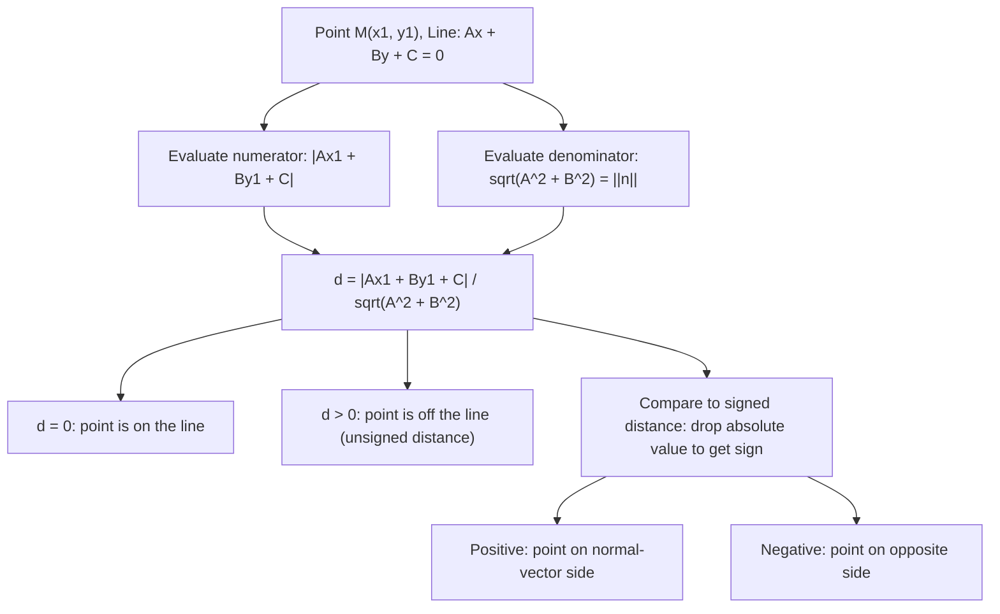

# Straight Line (Distance from point $M(x 1, y 1)$)

$$
d = \frac{|Ax_1 + By_1 + C|}{\sqrt{A^2 + B^2}}
$$

## Deep Breakdown

What it tells me *(Situation Awareness)*:
This formula gives the shortest (perpendicular) distance from a point $M(x_1, y_1)$ to the line $Ax + By + C = 0$. It is the unsigned version of the signed distance formula: the absolute value removes the sign, so $d \geq 0$ regardless of which side of the line the point is on. This is one of the most operationally useful formulas in 2D geometry and is directly related to the SVM margin, residuals in OLS regression, tolerance bands in quality control, and the confidence threshold in 2D logistic regression. In DA/DS: any time you need to know "how far is this data point from the decision boundary, the regression line, or a reference threshold?", this formula answers it.

## Flowchart



## Real-world use

### Where it is used

OLS regression residual distance from the fitted line, SVM margin calculation ($d = 1/\|\mathbf{w}\|$ from boundary to support hyperplane), quality control tolerance bands (acceptable region between two parallel lines), anomaly detection (flag points farther than threshold $t$ from a reference line), and 2D logistic regression confidence scoring.

### Problem it solves

Given a fitted line $Ax + By + C = 0$ (decision boundary, regression line, or reference boundary), you need to know how far each new data point is from that line to make decisions: is it inside the acceptable zone? How confident is the classifier? Is it an outlier? The signed distance tells you side; the unsigned distance tells you magnitude.

### How it solves the problem

The formula follows directly from the signed distance by taking the absolute value: $d = |Ax_1 + By_1 + C| / \sqrt{A^2 + B^2}$. The numerator $|Ax_1 + By_1 + C|$ measures how much the point "violates" the line equation (zero means on the line). Dividing by $\sqrt{A^2 + B^2} = \|\mathbf{n}\|$ normalizes by the length of the normal vector, converting the raw violation into actual geometric distance in the same units as $x$ and $y$.

### Example in a business

A DS builds a 2D quality control system for a manufacturing process: two features are part dimensions. Acceptable parts lie within a tolerance band between two parallel lines $Ax + By + C_1 = 0$ and $Ax + By + C_2 = 0$. For each new part, they compute $d = |Ax_1 + By_1 + C|/\sqrt{A^2+B^2}$ from the center line and flag parts with $d > \text{tolerance}$ for rejection. The formula provides an interpretable, unit-consistent distance metric directly tied to manufacturing tolerances.

## The formula, piece by piece

- $d$: perpendicular (shortest) distance from point $M(x_1, y_1)$ to line $Ax + By + C = 0$; always $\geq 0$
- $|Ax_1 + By_1 + C|$: absolute value of the line equation evaluated at the point; zero means on the line
- $\sqrt{A^2 + B^2}$: the length of the normal vector $(A, B)$; normalizes the expression to actual distance units
- $Ax_1 + By_1 + C$ (without absolute value): the signed distance — sign tells which side of the line
- Special case $B = 0$ (vertical line $Ax + C = 0$, i.e., $x = -C/A$): $d = |Ax_1 + C|/|A| = |x_1 + C/A|$
- Special case $A = 0$ (horizontal line $By + C = 0$, i.e., $y = -C/B$): $d = |By_1 + C|/|B| = |y_1 + C/B|$
- Distance between two parallel lines $Ax + By + C_1 = 0$ and $Ax + By + C_2 = 0$: $|C_1 - C_2|/\sqrt{A^2+B^2}$

## The formula in words

"Plug the point into the line equation. Take the absolute value of what you get. Divide by the length of the normal vector. The result is the shortest distance from the point to the line — it's zero if the point is on the line, and grows as the point moves away perpendicularly." Tiny example: Line $3x - 4y + 5 = 0$. $\|\mathbf{n}\| = \sqrt{9+16} = 5$.
Point $(1, 2)$: $|3(1) - 4(2) + 5| / 5 = |3 - 8 + 5| / 5 = |0| / 5 = 0$. On the line. $\checkmark$
Point $(4, 0)$: $|3(4) - 4(0) + 5| / 5 = |17| / 5 = 3.4$.
Point $(-1, 2)$: $|3(-1) - 4(2) + 5| / 5 = |-6| / 5 = 1.2$.

## Critical Concepts

- **Perpendicular distance:** $d$ is the length of the segment from $M$ to the foot of the perpendicular dropped from $M$ to the line. It is the shortest possible distance from the point to any point on the line.
- **Unsigned vs. signed:** the signed version $(Ax_1 + By_1 + C)/\sqrt{A^2+B^2}$ is used for classification (sign = side). The unsigned version is used when only magnitude matters (anomaly score, residual, tolerance check).
- **SVM margin:** the distance from the decision boundary $\mathbf{w}^T\mathbf{x} + b = 0$ to a support vector is $1/\|\mathbf{w}\|$. This comes directly from this formula with $|Ax_1 + By_1 + C| = 1$.
- **OLS residual:** in simple linear regression $y = \beta_0 + \beta_1 x$, the vertical residual $|y_i - \hat{y}_i|$ is NOT the perpendicular distance to the regression line (unless the line is horizontal). The perpendicular distance is $|\beta_1 x_i - y_i + \beta_0|/\sqrt{\beta_1^2 + 1}$.
- **Normalization trick (Hesse normal form):** if $(A, B, C)$ is divided by $\sqrt{A^2+B^2}$ upfront, the distance formula simplifies to $|Ax_1 + By_1 + C|$ with no denominator needed.
- **Parallel line separation:** two parallel lines $Ax + By + C_1 = 0$ and $Ax + By + C_2 = 0$ are separated by $|C_1 - C_2|/\sqrt{A^2+B^2}$ — derived by computing the distance from any point on one line to the other.

## Step-by-step calculation (tiny example)

*Step 1: Write the line in general form*
Line $y = 2x - 3$ rearranges to $2x - y - 3 = 0$. So $A=2$, $B=-1$, $C=-3$.
$\sqrt{A^2+B^2} = \sqrt{4+1} = \sqrt{5} \approx 2.236$.

*Step 2: Compute distance from $P = (4, 1)$*
$|2(4) + (-1)(1) + (-3)| / \sqrt{5} = |8 - 1 - 3| / \sqrt{5} = |4| / \sqrt{5} \approx 1.789$.

*Step 3: Compute distance from origin $P = (0, 0)$*
$|2(0) + (-1)(0) + (-3)| / \sqrt{5} = 3/\sqrt{5} \approx 1.342$.

*Step 4: Verify a point on the line*
At $x = 2$: $y = 2(2)-3 = 1$. So $(2, 1)$ is on the line.
$|2(2) + (-1)(1) + (-3)| / \sqrt{5} = |4 - 1 - 3| / \sqrt{5} = 0$. $\checkmark$

## Code examples

### Beginner example (Python)

```python
import numpy as np

def point_to_line_distance(x1: float, y1: float, A: float, B: float, C: float) -> float:
    """Perpendicular distance from point (x1, y1) to line Ax + By + C = 0."""
    return abs(A * x1 + B * y1 + C) / np.sqrt(A**2 + B**2)

def parallel_line_separation(A: float, B: float, C1: float, C2: float) -> float:
    """Distance between parallel lines Ax + By + C1 = 0 and Ax + By + C2 = 0."""
    return abs(C1 - C2) / np.sqrt(A**2 + B**2)   # Line: y = 2x - 3 => 2x - y - 3 = 0
A, B, C = 2.0, -1.0, -3.0
test_points = [(4, 1), (0, 0), (2, 1), (-1, -5)]
print(f"Line: {A}x + {B}y + {C} = 0 (slope {-A/B:.2f})")
print(f"||normal|| = {np.sqrt(A**2+B**2):.4f}\n")
for x, y in test_points:
    d = point_to_line_distance(x, y, A, B, C)
on = "ON LINE" if np.isclose(d, 0.0) else f"distance = {d:.4f}"
print(f" ({x:>4}, {y:>4}): {on}")   # Tolerance band: parallel lines at +-1 unit from the center line
C_plus = C + np.sqrt(A**2 + B**2)   # shift C by ||n||
C_minus = C - np.sqrt(A**2 + B**2)
print(f"\nParallel line separation (center to each band): " f"{parallel_line_separation(A, B, C, C_plus):.4f}")
```

### Beginner example (R)

```r
# -- Distance from point to line:
d = |Ax1 + By1 + C| / sqrt(A^2 + B^2) ---
point_line_dist <- function(x1, y1, A, B, C) { abs(A * x1 + B * y1 + C) / sqrt(A^2 + B^2)
}  # Line:
y = 2x - 3 => 2x - y - 3 = 0
A <- 2; B <- -1; C <- -3
points_list <- list(c(4, 1), c(0, 0), c(2, 1), c(-1, -5))
cat(sprintf("Line: %.0fx + %.0fy + %.0f = 0\n", A, B, C))
for (pt in points_list) { d <- point_line_dist(pt[1], pt[2], A, B, C)
  status <- if (abs(d) < 1e-10) "ON LINE"
  else sprintf("d = %.4f", d)
  cat(sprintf(" (%g, %g): %s\n", pt[1], pt[2], status))
}  # Distance between two parallel lines
parallel_sep <- function(A, B, C1, C2) abs(C1 - C2) / sqrt(A^2 + B^2)
cat(sprintf("\nParallel lines: C=-3 vs C=-7, separation = %.4f\n", parallel_sep(A, B, -3, -7)))
```

### Professional example (Python)

```python
import numpy as np
import pandas as pd
from sklearn.linear_model import LinearRegression
np.random.seed(42)   # -- Business scenario: OLS regression line with perpendicular distance bands ---
# Fit a regression line, compute perpendicular (geometric) distances from each
# observation to the line, and flag outliers beyond a distance threshold.
N = 120
x_vals = np.linspace(0, 10, N) + np.random.randn(N) * 0.2
y_vals = 1.5 * x_vals - 2.0 + np.random.randn(N) * 1.2   # Add 10 deliberate outliers
x_vals[-10:] += np.random.uniform(-3, 3, 10)
y_vals[-10:] += np.random.uniform(5, 10, 10)   # Fit OLS line: y = beta1*x + beta0 => beta1*x - y +
beta0 = 0
lr = LinearRegression()
lr.fit(x_vals.reshape(-1, 1), y_vals)
beta1 = lr.coef_[0]
beta0 = lr.intercept_   # General form: beta1*x - y +
beta0 = 0
A_line = beta1
B_line = -1.0
C_line = beta0
norm_n = np.sqrt(A_line**2 + B_line**2)
print(f"Fitted line: y = {beta1:.4f}x + {beta0:.4f}")
print(f"General form: {A_line:.4f}x + {B_line:.4f}y + {C_line:.4f} = 0")
print(f"||normal|| = {norm_n:.4f}\n")   # Compute perpendicular distances for all points
perp_distances = np.abs(A_line * x_vals + B_line * y_vals + C_line) / norm_n   # Vertical residuals (standard OLS residuals) for comparison
vert_residuals = np.abs(y_vals - lr.predict(x_vals.reshape(-1, 1)))   # Outlier threshold: 2.5 standard deviations of perpendicular distance
THRESHOLD = 2.5 * perp_distances[:-10].std()
is_outlier = perp_distances > THRESHOLD
results = pd.DataFrame({ "point_idx": range(N), "x": x_vals.round(3), "y": y_vals.round(3), "perp_dist": perp_distances.round(4), "vert_resid": vert_residuals.round(4), "is_outlier": is_outlier,
})
print(f"Outlier threshold (perp dist): {THRESHOLD:.4f}")
print(f"Flagged outliers: {is_outlier.sum()} / {N}")
print(f"\nTop 5 largest perpendicular distances:")
print(results.nlargest(5, "perp_dist")[ ["point_idx", "x", "y", "perp_dist", "vert_resid", "is_outlier"] ].to_string(index=False))
print(f"\nNote: perpendicular distance < vertical residual (always).")
print(f"Mean perp/vert ratio: {(perp_distances / vert_residuals).mean():.4f}")
print(f"(Ratio = 1/sqrt(1 + slope^2) = {1/norm_n:.4f})")
```

---

*Source: 1300 p. 154*
