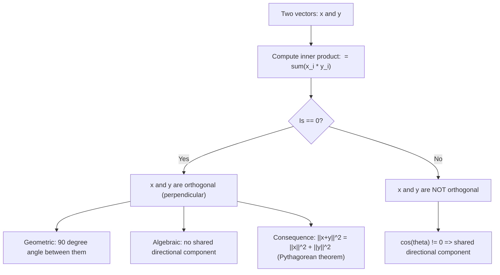

# Orthogonality condition

$$
\langle x, y \rangle = 0 \iff x \perp y
$$

## Deep Breakdown

What it tells me *(Situation Awareness)*:
The orthogonality condition $\langle x, y\rangle = 0 \Leftrightarrow x \perp y$ states that two vectors are perpendicular (orthogonal) if and only if their inner product is zero. This is one of the most used conditions in linear algebra and ML. It means: no component of $x$ lies along the direction of $y$, and vice versa. Orthogonality appears everywhere in DA/DS: PCA produces orthogonal principal components (each captures variance not explained by the others), OLS residuals are orthogonal to the column space of $X$ (the projection theorem), and orthonormal bases simplify matrix algebra enormously. The $\Leftrightarrow$ is critical: zero inner product is both necessary and sufficient for orthogonality.

## Flowchart



## Real-world use

### Where it is used

Verifying that PCA components are orthogonal (uncorrelated directions), checking that residuals in OLS are orthogonal to the design matrix columns, constructing orthonormal feature bases (Gram-Schmidt), testing independence assumptions in statistical models (uncorrelated Gaussian variables have zero inner product in expectation), and validating that weight updates in different gradient directions do not interfere.

### Problem it solves

Orthogonality enables decomposition: if features are orthogonal, the effect of each can be estimated independently without the estimate changing when others are added or removed. Multicollinear (non-orthogonal) features cause instability in regression. Orthogonal principal components in PCA allow dimensionality reduction without redundancy.

### How it solves the problem

For $\langle x, y\rangle = \sum_i x_i y_i = 0$: the projection of $x$ onto $y$ is $\frac{\langle x,y\rangle}{\|y\|^2}y = 0$. There is no component of $x$ in the direction of $y$. Consequently, knowing $y$ tells you nothing about the component of $x$ in its direction. This is why orthogonal features in regression have independently estimable coefficients.

### Example in a business

A DS checks that two derived features are truly orthogonal before adding both to a regression: $\text{feature}_1 = $ (revenue - mean), $\text{feature}_2 = $ (days active - mean). They compute $\langle f_1, f_2\rangle = \sum_i f_{1,i} f_{2,i}$. If this is near zero, the features are orthogonal (uncorrelated when mean-centered) and both can be included without multicollinearity. If it is not zero, they may need to apply Gram-Schmidt orthogonalization.

## The formula, piece by piece

- $\langle x, y\rangle$: the inner product of $x$ and $y$; in $\mathbb{R}^n$: $\sum_{i=1}^n x_i y_i$
- $= 0$: the inner product equals exactly zero
- $\iff$: if and only if (biconditional); zero inner product is both necessary and sufficient
- $x \perp y$: $x$ is orthogonal (perpendicular) to $y$; angle between them is $90°$
- Geometric interpretation: $\cos\theta = \frac{\langle x,y\rangle}{\|x\|\|y\|} = 0 \Rightarrow \theta = 90°$

## The formula in words

"Two vectors are perpendicular if and only if their dot product is zero. There is no directional overlap between them: one has no component in the direction of the other." Tiny examples:
- $x = (1, 0)$, $y = (0, 1)$: $\langle x,y\rangle = 0$. These are the standard basis vectors, clearly perpendicular. $\checkmark$
- $x = (3, 4)$, $y = (4, -3)$: $\langle x,y\rangle = 12 - 12 = 0$. Orthogonal. $\checkmark$
- $x = (1, 1)$, $y = (1, 2)$: $\langle x,y\rangle = 1+2 = 3 \neq 0$. Not orthogonal.

## Critical Concepts

- **Pythagorean theorem:** if $x \perp y$, then $\|x+y\|^2 = \|x\|^2 + \|y\|^2$. Proof: $\|x+y\|^2 = \langle x+y, x+y\rangle = \|x\|^2 + 2\langle x,y\rangle + \|y\|^2 = \|x\|^2 + \|y\|^2$ when $\langle x,y\rangle = 0$.
- **Orthonormal:** a set of vectors that are mutually orthogonal AND each has unit norm: $\langle x_i, x_j\rangle = \delta_{ij}$ (Kronecker delta: 1 if $i=j$, 0 otherwise).
- **OLS projection:** the residual $\hat{e} = y - \hat{y} = y - X\hat{\beta}$ satisfies $\langle x_j, \hat{e}\rangle = 0$ for every column $x_j$ of $X$. This is the normal equation $X^T(y - X\hat{\beta}) = 0$.
- **PCA components:** eigenvectors of a symmetric matrix corresponding to distinct eigenvalues are orthogonal. PCA exploits this to find uncorrelated directions of variance.
- **Near-zero threshold:** in floating point, use a tolerance (e.g., `abs(np.dot(x, y)) < 1e-10`) rather than exact equality.
- **Gram-Schmidt:** the algorithm that takes any set of linearly independent vectors and produces an orthonormal basis by successively removing projections.

## Step-by-step calculation (tiny example)

*Step 1: Pick two vectors and compute the inner product*
$x = (2, -1, 0)$, $y = (1, 2, 5)$.
$\langle x, y\rangle = 2\cdot1 + (-1)\cdot2 + 0\cdot5 = 2 - 2 + 0 = 0$.

*Step 2: Conclude orthogonality*
$\langle x, y\rangle = 0 \Rightarrow x \perp y$.

*Step 3: Verify via Pythagorean theorem*
$\|x\|^2 = 4+1+0 = 5$. $\|y\|^2 = 1+4+25 = 30$.
$\|x+y\|^2 = \|(3,1,5)\|^2 = 9+1+25 = 35 = 5+30$. $\checkmark$ (Pythagorean theorem holds.)

## Code examples

### Beginner example (Python)

```python
import numpy as np   # -- Orthogonality check: inner product == 0 --- # Standard basis vectors
e1 = np.array([1.0, 0.0, 0.0])
e2 = np.array([0.0, 1.0, 0.0])
e3 = np.array([0.0, 0.0, 1.0])
print("Standard basis orthogonality:")
for i, u in enumerate([e1, e2, e3]):
    for j, v in enumerate([e1, e2, e3]):
        if i < j:
            ip = np.dot(u, v)
        print(f" <e{i+1}, e{j+1}> = {ip:.4f} orthogonal: {np.isclose(ip, 0)}")   # Custom vectors
x = np.array([2.0, -1.0, 0.0])
y = np.array([1.0, 2.0, 5.0])
ip = np.dot(x, y)
print(f"\n<x, y> = {ip:.4f} orthogonal: {np.isclose(ip, 0)}")   # Pythagorean theorem verification
print(f"Pythagorean check: ||x||^2 + ||y||^2 = {np.dot(x,x) + np.dot(y,y):.4f}")
print(f" ||x+y||^2 = {np.dot(x+y, x+y):.4f}")
```

### Beginner example (R)

```r
# -- Orthogonality check ---
x <- c(2, -1, 0)
y <- c(1, 2, 5)
inner_product <- sum(x * y)
cat(sprintf("<x, y> = %.4f\n", inner_product))
cat(sprintf("Orthogonal: %s\n", isTRUE(all.equal(inner_product, 0))))  # Pythagorean theorem
cat(sprintf("||x||^2 + ||y||^2 = %.4f\n", sum(x^2) + sum(y^2)))
cat(sprintf("||x+y||^2 = %.4f\n", sum((x+y)^2)))
```

### Professional example (Python)

```python
import numpy as np
import pandas as pd
from sklearn.preprocessing import StandardScaler
from sklearn.decomposition import PCA
np.random.seed(42)   # -- Business scenario: verify PCA components are orthogonal ---
# PCA components must be mutually orthogonal by construction.
# This validates the orthogonality condition in a real DS workflow.
N_SAMPLES = 500
N_FEATURES = 5   # Correlated feature data (simulated customer metrics)
raw_data = np.random.randn(N_SAMPLES, N_FEATURES)
raw_data[:, 1] += 0.8 * raw_data[:, 0]   # feature1 correlated with feature0
raw_data[:, 2] += 0.5 * raw_data[:, 0]   # feature2 partially correlated
scaler = StandardScaler()
data_scaled = scaler.fit_transform(raw_data)
pca = PCA(n_components=N_FEATURES)
pca.fit(data_scaled)
components = pca.components_   # shape: (n_components, n_features) # Verify orthogonality: <component_i, component_j> should be 0 for i != j
print("PCA component orthogonality check:")
violations = 0
for i in range(N_FEATURES):
    for j in range(i + 1, N_FEATURES):
        ip = np.dot(components[i], components[j])
    is_ortho = np.isclose(ip, 0, atol=1e-10)
if not is_ortho:
    violations += 1
print(f" <PC{i+1}, PC{j+1}> = {ip:.2e} orthogonal: {is_ortho}")
print(f"\nTotal violations: {violations} (expected: 0)")
print(f"Variance explained per component: {np.round(pca.explained_variance_ratio_, 4)}")
print("\nConclusion: PCA components are mutually orthogonal by construction.")
print("This means each component captures variance not explained by any other.")
```

---

*Source: MML1 p. 82*
