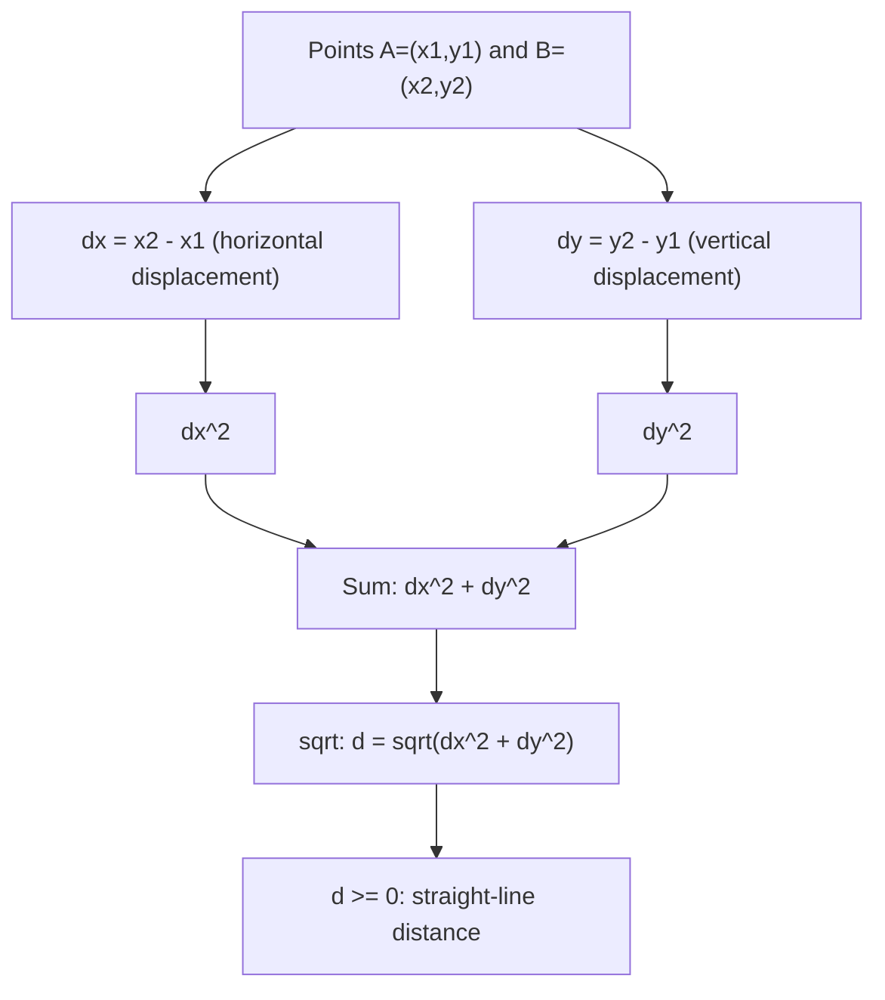

# 2D Distance

$$
d = \sqrt{(x_2 - x_1)^2 + (y_2 - y_1)^2}
$$

## Deep Breakdown

What it tells me *(Situation Awareness)*:
The 2D Euclidean distance formula gives the straight-line distance between two points $A = (x_1, y_1)$ and $B = (x_2, y_2)$ in the plane: $d = \sqrt{(x_2-x_1)^2 + (y_2-y_1)^2}$. This is a direct application of the Pythagorean theorem: horizontal displacement $\Delta x$ and vertical displacement $\Delta y$ form the legs of a right triangle; $d$ is the hypotenuse. In DA/DS: measuring distance between 2D data points, geographic proximity on small scales, 2D scatter plot analysis, and as the conceptual foundation for $n$-dimensional Euclidean distance.

## Flowchart



## Real-world use

### Where it is used

Measuring distance between observations in a 2D feature space (e.g., height vs weight scatter), 2D clustering (k-means with 2 features), geographic store-to-customer distance on small scales, evaluating distance-based anomaly detection in 2D, and as the base case for understanding $n$-dimensional distance.

### Problem it solves

Given two points in 2D, compute the shortest path connecting them (straight line). Used whenever you need a numeric measure of "how far apart" two data points are when described by two numeric dimensions.

### How it solves the problem

Apply the Pythagorean theorem: the straight-line path between $(x_1,y_1)$ and $(x_2,y_2)$ forms the hypotenuse of a right triangle with legs $|\Delta x|$ and $|\Delta y|$. Squaring removes sign (negative and positive displacements contribute equally), and the square root gives the actual length.

### Example in a business

A retail analyst maps store and customer locations on a 2D coordinate system. They compute $d = \sqrt{(\text{store}_x - \text{cust}_x)^2 + (\text{store}_y - \text{cust}_y)^2}$ for each store-customer pair and assign each customer to the nearest store. This is 2D Euclidean distance applied to spatial assignment.

## The formula, piece by piece

- $x_2 - x_1$: horizontal difference between the two points (can be negative)
- $y_2 - y_1$: vertical difference between the two points (can be negative)
- $(x_2-x_1)^2$: squared horizontal displacement — always $\geq 0$
- $(y_2-y_1)^2$: squared vertical displacement — always $\geq 0$
- $\sqrt{(x_2-x_1)^2 + (y_2-y_1)^2}$: square root of sum of squares = hypotenuse length

## The formula in words

"Find the horizontal gap between the two points, square it. Find the vertical gap, square it. Add the two squares. Take the square root. You get the straight-line distance." Tiny example: $A = (1, 2)$, $B = (4, 6)$.
$d = \sqrt{(4-1)^2 + (6-2)^2} = \sqrt{9+16} = \sqrt{25} = 5$.

## Critical Concepts

- **Symmetric:** $d(A,B) = d(B,A)$ since squaring removes sign.
- **Always non-negative:** $d \geq 0$; equals 0 only when $A = B$.
- **Triangle inequality:** $d(A,C) \leq d(A,B) + d(B,C)$.
- **Scale sensitivity:** Euclidean distance is not scale-invariant. If $x$ is in thousands and $y$ in units, $x$ dominates. Standardize features before using Euclidean distance in ML.
- **Pythagorean special cases:** if $\Delta x = 0$: $d = |\Delta y|$; if $\Delta y = 0$: $d = |\Delta x|$.
- **Geographic note:** accurate only for short distances (flat Earth). Use Haversine for global distances.
- **In NumPy:** `np.sqrt((x2-x1)**2 + (y2-y1)**2)` or `np.linalg.norm(np.array([x2-x1, y2-y1]))`.

## Step-by-step calculation (tiny example)

*Step 1: Compute displacements*
$A = (2,3)$, $B = (5,7)$. $\Delta x = 5-2 = 3$, $\Delta y = 7-3 = 4$.

*Step 2: Square and sum*
$\Delta x^2 + \Delta y^2 = 9 + 16 = 25$.

*Step 3: Take the square root*
$d = \sqrt{25} = 5$.

## Code examples

### Beginner example (Python)

```python
import numpy as np   # -- 2D Euclidean distance ---
A = np.array([2.0, 3.0])
B = np.array([5.0, 7.0])
dx = B[0] - A[0]
dy = B[1] - A[1]
d_manual = np.sqrt(dx**2 + dy**2)
d_numpy = np.linalg.norm(B - A)
print(f"A = {A}, B = {B}")
print(f"dx = {dx}, dy = {dy}")
print(f"d (manual) = {d_manual:.4f}")
print(f"d (numpy) = {d_numpy:.4f}")
print(f"Match : {np.isclose(d_manual, d_numpy)}")   # Multiple distances from a query point
query = np.array([0.0, 0.0])
candidates = np.array([[3.0, 4.0], [1.0, 1.0], [6.0, 8.0], [0.0, 5.0]])
distances = np.linalg.norm(candidates - query, axis=1)
print(f"\nDistances from origin: {distances.round(4)}")
print(f"Nearest point: {candidates[np.argmin(distances)]} at d={distances.min():.4f}")
```

### Beginner example (R)

```r
# -- 2D Euclidean distance ---
A <- c(2, 3)
B <- c(5, 7)
dx <- B[1] - A[1]
dy <- B[2] - A[2]
d <- sqrt(dx^2 + dy^2)
cat(sprintf("A = (%g,%g), B = (%g,%g)\n", A[1], A[2], B[1], B[2]))
cat(sprintf("dx = %g, dy = %g, d = %.4f\n", dx, dy, d))  # Multiple distances from origin
query <- c(0, 0)
candidates <- matrix(c(3,4, 1,1, 6,8, 0,5), ncol=2, byrow=TRUE)
dists <- apply(candidates, 1, function(p) sqrt(sum((p - query)^2)))
cat("Distances from origin:", round(dists, 4), "\n")
cat("Nearest:", candidates[which.min(dists), ], "\n")
```

### Professional example (Python)

```python
import numpy as np
import pandas as pd
np.random.seed(42)   # -- Business scenario: nearest store assignment for customers ---
N_STORES = 10
N_CUSTOMERS = 100
store_xy = np.random.uniform(-20, 20, (N_STORES, 2))
cust_xy = np.random.uniform(-25, 25, (N_CUSTOMERS, 2))
store_names = [f"Store_{i:02d}" for i in range(N_STORES)]   # Pairwise 2D distances using broadcasting: (N_CUST, 1, 2) - (1, N_STORES, 2)
diff = cust_xy[:, np.newaxis, :] - store_xy[np.newaxis, :, :]   # (100, 10, 2)
all_dists = np.linalg.norm(diff, axis=2)   # (100, 10)
nearest_idx = np.argmin(all_dists, axis=1)
nearest_dist = all_dists[np.arange(N_CUSTOMERS), nearest_idx]
assignment = pd.DataFrame({ "customer": range(N_CUSTOMERS), "nearest_store": [store_names[i] for i in nearest_idx], "distance": nearest_dist.round(3),
})
summary = assignment.groupby("nearest_store").agg( n_customers=("customer", "count"), avg_distance=("distance", "mean"),
).round(3).sort_values("n_customers", ascending=False)
print(summary.to_string())
print(f"\nMean distance to nearest store: {nearest_dist.mean():.3f} units")
```

### Professional example (R)

```r
# Nearest store assignment: 2D Euclidean distance
set.seed(42)
N_STORES <- 10
N_CUSTOMERS <- 100
store_xy <- matrix(runif(N_STORES * 2, -20, 20), ncol = 2)
cust_xy <- matrix(runif(N_CUSTOMERS * 2, -25, 25), ncol = 2)
store_names <- sprintf("Store_%02d", 0:(N_STORES-1))
dists <- matrix(0, N_CUSTOMERS, N_STORES)
for (j in 1:N_STORES)
dists[, j] <- sqrt((cust_xy[,1] - store_xy[j,1])^2 + (cust_xy[,2] - store_xy[j,2])^2)
nearest_idx <- max.col(-dists)
nearest_dist <- dists[cbind(1:N_CUSTOMERS, nearest_idx)]
assignment <- data.frame(customer = 1:N_CUSTOMERS, nearest_store = store_names[nearest_idx], distance = round(nearest_dist, 3))
summary <- aggregate(customer ~ nearest_store, data = assignment, FUN = length)
summary$avg_distance <- round(aggregate(distance ~ nearest_store, data = assignment, FUN = mean)$distance, 3)
cat("Nearest store assignment (2D distance)\n")
print(summary)
cat(sprintf("\nMean distance to nearest store: %.3f\n", mean(nearest_dist)))
```

---

*Source: 1300 p. 139*
