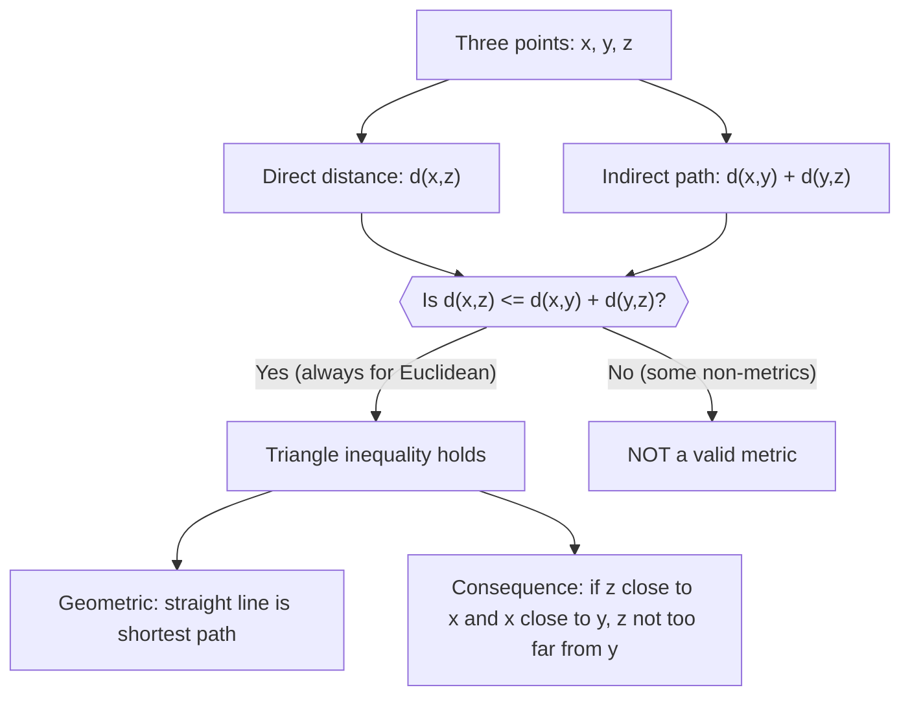

# Metric Triangle Inequality

$$
d(x,z) \le d(x,y) + d(y,z)
$$

## Deep Breakdown

What it tells me *(Situation Awareness)*:
The triangle inequality for metrics states $d(x,z) \leq d(x,y) + d(y,z)$: the direct path from $x$ to $z$ is never longer than the path that detours through $y$. This is the third required axiom for a valid metric and the geometric intuition is immediate: the straight-line path is always the shortest. This property ensures consistency in distance-based algorithms: a point $z$ that is close to both $x$ and $y$ must also be close to itself relative to the roundabout path. KL divergence fails this — it is NOT a metric.

## Flowchart



## Real-world use

### Where it is used

Validating that a proposed distance function is a valid metric, theoretical analysis of clustering convergence, proving that if a test point is far from a centroid it cannot be close to points near that centroid (used in BallTree/KD-Tree pruning), and explaining why some loss functions (like KL divergence) cannot be used as distances in standard distance-based algorithms.

### Problem it solves

The triangle inequality enables efficient search algorithms. In k-NN with a ball tree, if the distance from the query point to a ball's center exceeds the ball's radius plus the current best distance, no point inside the ball can be a neighbor — this pruning is only valid because the metric triangle inequality guarantees it. Without this property, distance-based search cannot be pruned safely.

### How it solves the problem

For Euclidean distance, the proof: $\|x - z\|_2 = \|(x-y) + (y-z)\|_2 \leq \|x-y\|_2 + \|y-z\|_2$ by the norm triangle inequality (Cauchy-Schwarz or direct verification). The metric triangle inequality follows directly from the norm triangle inequality when the distance is induced by a norm ($d(x,y) = \|x-y\|$).

### Example in a business

A DS uses `sklearn`'s BallTree for fast k-NN queries in a customer database with Euclidean distance. The BallTree partitions space into nested balls and uses the triangle inequality to prune branches: "if the query is further than $R + r$ from this ball's center, skip the entire ball." This pruning works correctly because Euclidean distance satisfies the triangle inequality. If you tried to use KL divergence in a BallTree, the pruning would be incorrect.

## The formula, piece by piece

- $d(x,z)$: direct distance from $x$ to $z$
- $d(x,y)$: distance from $x$ to intermediate point $y$
- $d(y,z)$: distance from $y$ to $z$
- $d(x,z) \leq d(x,y) + d(y,z)$: direct is always $\leq$ detour
- Equality holds when $y$ lies on the straight line between $x$ and $z$

## The formula in words

"The distance from x directly to z is at most as long as going from x to y and then from y to z. A detour is never shorter than a direct route." Tiny example in 1D ($d(a,b) = |a-b|$): $x=1$, $y=5$, $z=3$.
$d(x,z) = |1-3| = 2$. $d(x,y) + d(y,z) = |1-5| + |5-3| = 4+2 = 6$. $2 \leq 6$. $\checkmark$

## Critical Concepts

- **Equality case:** $d(x,z) = d(x,y) + d(y,z)$ when $y$ is on the geodesic (shortest path) from $x$ to $z$.
- **KL divergence fails this:** $KL(P\|R)$ can be greater than $KL(P\|Q) + KL(Q\|R)$. It is not a metric.
- **Cosine distance satisfies it:** $1 - \cos\theta$ is a metric on the unit sphere (but not on all of $\mathbb{R}^n$).
- **Connection to norm triangle inequality:** if the distance is norm-induced ($d(x,y) = \|x-y\|$), then the norm triangle inequality $\|u+v\| \leq \|u\|+\|v\|$ implies the metric triangle inequality.
- **Algorithm consequence:** BallTree and KD-Tree use the triangle inequality to prune search, giving $O(\log N)$ expected query time instead of $O(N)$.

## Step-by-step calculation (tiny example)

*Step 1: Pick three points and compute all three pairwise distances*
$x = (0,0)$, $y = (3,4)$, $z = (6,0)$ with Euclidean distance.
$d(x,z) = \sqrt{36+0} = 6$.
$d(x,y) = \sqrt{9+16} = 5$.
$d(y,z) = \sqrt{9+16} = 5$.

*Step 2: Check the inequality*
$d(x,z) = 6 \leq d(x,y) + d(y,z) = 5+5 = 10$. $\checkmark$

*Step 3: Observe the geometry*
The triangle inequality is strict here because the three points form a triangle; going via $y$ is a longer detour than going directly from $x$ to $z$.

## Code examples

### Beginner example (Python)

```python
import numpy as np
from itertools import permutations   # -- Verify triangle inequality for Euclidean and check KL violation ---

def euclidean(a, b):
    return np.linalg.norm(np.array(a, dtype=float) - np.array(b, dtype=float))   # Test with random 2D points
np.random.seed(42)
pts = np.random.randn(10, 2)
violations = 0
for i, j, k in permutations(range(len(pts)), 3):
    dik = euclidean(pts[i], pts[k])
dij = euclidean(pts[i], pts[j])
djk = euclidean(pts[j], pts[k])
if dik > dij + djk + 1e-10:
    violations += 1
print(f"Euclidean triangle inequality violations: {violations} (expected: 0)")   # KL divergence is NOT a metric (triangle inequality can fail)

def kl_div(p, q):
    """KL(P||Q)."""
    p = np.array(p, dtype=float)
    q = np.array(q, dtype=float)
    return float(np.sum(p * np.log(p / q)))
P = np.array([0.8, 0.2])
Q = np.array([0.5, 0.5])
R = np.array([0.1, 0.9])
kl_pr = kl_div(P, R)
kl_pq = kl_div(P, Q)
kl_qr = kl_div(Q, R)
print(f"\nKL(P||R) = {kl_pr:.4f}")
print(f"KL(P||Q) + KL(Q||R) = {kl_pq:.4f} + {kl_qr:.4f} = {kl_pq+kl_qr:.4f}")
print(f"Triangle inequality satisfied for KL: {kl_pr <= kl_pq + kl_qr + 1e-10}")
```

### Beginner example (R)

```r
# -- Triangle inequality check for Euclidean ---
set.seed(42)
pts <- matrix(rnorm(20), ncol=2)
n <- nrow(pts)
violations <- 0
for (i in 1:n)
for (j in 1:n)
for (k in 1:n) { if (i == j | j == k | i == k) next
  dik <- sqrt(sum((pts[i,]-pts[k,])^2))
  dij <- sqrt(sum((pts[i,]-pts[j,])^2))
  djk <- sqrt(sum((pts[j,]-pts[k,])^2))
  if (dik > dij + djk + 1e-10)
  violations <- violations + 1
}
cat(sprintf("Euclidean triangle inequality violations: %d\n", violations))
```

### Professional example (Python)

```python
import numpy as np
from sklearn.neighbors import BallTree
import time
np.random.seed(42)   # -- Business scenario: BallTree pruning relies on triangle inequality ---
# Compare brute-force k-NN vs BallTree k-NN speed.
# BallTree is faster because it prunes branches using the triangle inequality.
N_CUSTOMERS = 10000
N_FEATURES = 6
K_NEIGHBORS = 5
X = np.random.randn(N_CUSTOMERS, N_FEATURES)
query = np.random.randn(1, N_FEATURES)   # Brute force: compute all distances
t0 = time.perf_counter()
all_dists = np.linalg.norm(X - query, axis=1)
brute_idx = np.argsort(all_dists)[:K_NEIGHBORS]
brute_time = time.perf_counter() - t0   # BallTree: uses triangle inequality pruning
t0 = time.perf_counter()
tree = BallTree(X, metric="euclidean")
tree_dists, tree_idx = tree.query(query, k=K_NEIGHBORS)
tree_time = time.perf_counter() - t0
print(f"Brute force: {brute_time*1000:.2f} ms | top-{K_NEIGHBORS}: {brute_idx}")
print(f"BallTree: {tree_time*1000:.2f} ms | top-{K_NEIGHBORS}: {tree_idx[0]}")
print(f"Results match: {set(brute_idx) == set(tree_idx[0].tolist())}")
print(f"\nBallTree is faster because it uses the triangle inequality to skip branches.")
print(f"This pruning is only valid because Euclidean distance is a proper metric.")
```

---

*Source: 1300 p. 22*
