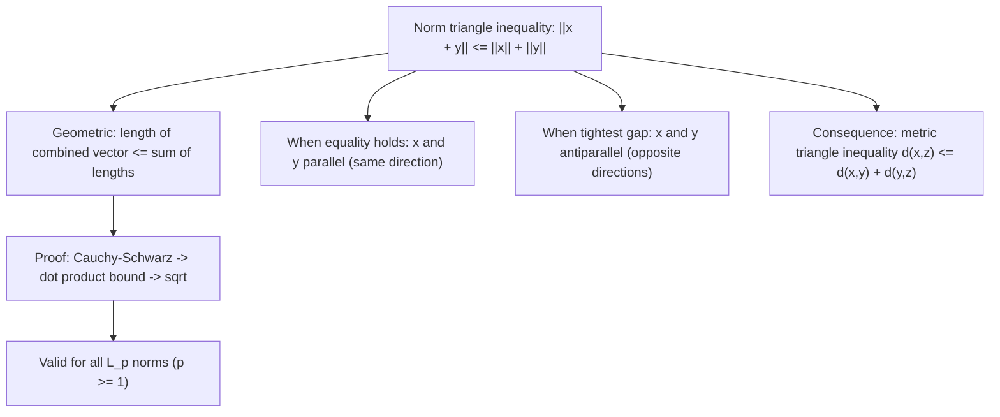

# Norm Triangle Inequality

$$
\|x + y\| \le \|x\| + \|y\|
$$

## Deep Breakdown

What it tells me *(Situation Awareness)*:
The norm triangle inequality $\|x + y\| \leq \|x\| + \|y\|$ is the third required axiom of a norm. It states that the length of the sum of two vectors is at most the sum of their individual lengths. Equality holds only when $x$ and $y$ point in exactly the same direction ($y = \lambda x$ with $\lambda \geq 0$). This is the vector generalization of the triangle inequality in geometry: "the sum of two sides of a triangle is at least as long as the third side." It is also called the **subadditivity** property of norms. Combined with positive definiteness and absolute homogeneity, it defines a valid norm.

## Flowchart



## Real-world use

### Where it is used

This is a theoretical property used to verify that a function is a valid norm, to prove error bounds in numerical analysis (accumulated rounding errors satisfy $\|\sum_i e_i\| \leq \sum_i \|e_i\|$), in regularization analysis (the $L_1$ and $L_2$ penalties are valid norms), and in understanding why adding gradient contributions does not arbitrarily increase their combined norm.

### Problem it solves

Without subadditivity, the norm of a sum could exceed the sum of norms, which would mean combining two small vectors could produce an unexpectedly large result. This would break most guarantees in numerical linear algebra and optimization. The triangle inequality ensures that norms behave "as expected" under vector addition.

### How it solves the problem

For $L_2$: use Cauchy-Schwarz: $\|x+y\|_2^2 = \|x\|_2^2 + 2\langle x,y\rangle + \|y\|_2^2 \leq \|x\|_2^2 + 2\|x\|_2\|y\|_2 + \|y\|_2^2 = (\|x\|_2 + \|y\|_2)^2$. Taking square roots: $\|x+y\|_2 \leq \|x\|_2 + \|y\|_2$. Equality when $\langle x,y\rangle = \|x\|_2\|y\|_2$, which requires $y = \lambda x$ with $\lambda \geq 0$.

### Example in a business

A DS adds multiple regularization terms to a loss: $L = \text{fit} + \lambda_1\|w\|_1 + \lambda_2\|w\|_2$. They want to bound the combined penalty: $\lambda_1\|w\|_1 + \lambda_2\|w\|_2 \leq C$ implies $\|w\|$ is controlled. The triangle inequality on norms guarantees that the sum of two valid penalties ($\|w\|_1$ and $\|w\|_2$) bounds the combined penalty, which is used in elastic net convergence proofs.

## The formula, piece by piece

- $\|x + y\|$: the norm of the sum of two vectors
- $\|x\|$: the norm of $x$ alone
- $\|y\|$: the norm of $y$ alone
- $\leq$: the key inequality — combined cannot exceed the sum of parts
- Also called: subadditivity of the norm
- Equivalent statement: $\|x - z\| \leq \|x - y\| + \|y - z\|$ (metric triangle inequality for distance induced by norm)

## The formula in words

"The length of the vector you get by adding $x$ and $y$ together is at most the length of $x$ plus the length of $y$. The combined vector is never longer than the total length traveled." Tiny example: $x = (3,0)$, $y = (0,4)$.
$\|x+y\|_2 = \|(3,4)\|_2 = 5$.
$\|x\|_2 + \|y\|_2 = 3 + 4 = 7$.
$5 \leq 7$. $\checkmark$ (The diagonal is shorter than going along two sides.) Equality example: $x = (1,0)$, $y = (2,0)$ (same direction).
$\|x+y\|_2 = 3 = \|x\|_2 + \|y\|_2 = 1+2$. Equality holds.

## Critical Concepts

- **Equality iff same direction:** $\|x+y\| = \|x\|+\|y\|$ iff $y = \lambda x$ with $\lambda \geq 0$.
- **Valid for all $L_p$ norms ($p \geq 1$):** Minkowski's inequality. Fails for $p < 1$ (those are not valid norms).
- **Connection to metric:** if $d(x,y) = \|x-y\|$, then the metric triangle inequality $d(x,z) \leq d(x,y) + d(y,z)$ follows directly.
- **Cauchy-Schwarz:** $|\langle x,y\rangle| \leq \|x\|_2\|y\|_2$ is the key tool in proving this for $L_2$.
- **Subadditivity:** this property is why regularization with multiple norms still produces bounded solutions.

## Step-by-step calculation (tiny example)

*Step 1: Choose two vectors*
$x = (3,4)$, $y = (-1, 1)$.

*Step 2: Compute both sides*
$x+y = (2, 5)$. $\|x+y\|_2 = \sqrt{4+25} = \sqrt{29} \approx 5.385$.
$\|x\|_2 = 5$. $\|y\|_2 = \sqrt{2} \approx 1.414$.
$\|x\|_2 + \|y\|_2 \approx 6.414$.

*Step 3: Verify the inequality*
$5.385 \leq 6.414$. $\checkmark$

## Code examples

### Beginner example (Python)

```python
import numpy as np   # -- Norm triangle inequality: verify for L1, L2, Linf ---
np.random.seed(42)
n_tests = 1000
dim = 5
for p, name in [(1, "L1"), (2, "L2"), (np.inf, "Linf")]:
    violations = 0
for _ in range(n_tests):
    x = np.random.randn(dim)
y = np.random.randn(dim)
lhs = np.linalg.norm(x + y, ord=p)
rhs = np.linalg.norm(x, ord=p) + np.linalg.norm(y, ord=p)
if lhs > rhs + 1e-10:
    violations += 1
print(f"{name}: violations in {n_tests} tests = {violations}")   # Demonstrate equality case
x = np.array([1.0, 2.0, 3.0])
y = 2.5 * x   # same direction
lhs = np.linalg.norm(x + y)
rhs = np.linalg.norm(x) + np.linalg.norm(y)
print(f"\nEquality case (y = 2.5*x): ||x+y|| = {lhs:.4f}, ||x||+||y|| = {rhs:.4f}")
print(f"Equal: {np.isclose(lhs, rhs)}")
```

### Beginner example (R)

```r
# -- Norm triangle inequality: verify for L2 ---
set.seed(42)
violations <- 0
for (i in 1:1000) { x <- rnorm(5); y <- rnorm(5)
  lhs <- sqrt(sum((x+y)^2))
  rhs <- sqrt(sum(x^2)) + sqrt(sum(y^2))
  if (lhs > rhs + 1e-10)
  violations <- violations + 1
}
cat(sprintf("L2 violations in 1000 tests: %d\n", violations))  # Equality case
x <- c(1, 2, 3)
y <- 2.5 * x
lhs <- sqrt(sum((x+y)^2))
rhs <- sqrt(sum(x^2)) + sqrt(sum(y^2))
cat(sprintf("Equality (y=2.5x): ||x+y||=%.4f, ||x||+||y||=%.4f, equal=%s\n", lhs, rhs, isTRUE(all.equal(lhs, rhs))))
```

### Professional example (Python)

```python
import numpy as np
import pandas as pd
np.random.seed(42)   # -- Business scenario: error accumulation bound via triangle inequality ---
# A data pipeline applies N sequential transformations.
# Each transformation introduces a small error vector e_i.
# Triangle inequality bounds the total accumulated error.
N_STEPS = 10
DIM = 20
MAX_ERR = 0.05   # max per-step error norm # Simulate per-step error vectors
errors = [np.random.randn(DIM) * MAX_ERR / np.linalg.norm(np.random.randn(DIM)) for _ in range(N_STEPS)]   # Each error is bounded by MAX_ERR
per_step_norms = [np.linalg.norm(e) for e in errors]   # Total accumulated error (actual)
total_error = sum(errors)
actual_norm = np.linalg.norm(total_error)   # Upper bound via triangle inequality: ||sum(e_i)|| <= sum(||e_i||)
upper_bound = sum(per_step_norms)
print("Error accumulation analysis:")
print(f" Number of pipeline steps : {N_STEPS}")
print(f" Per-step error bound : {MAX_ERR}")
print(f" Actual total error norm : {actual_norm:.4f}")
print(f" Triangle ineq upper bound : {upper_bound:.4f}")
print(f" Bound satisfied? : {actual_norm <= upper_bound + 1e-10}")
print(f" Slack (how conservative) : {upper_bound - actual_norm:.4f}")
print(f"\nThe triangle inequality gives a safe but conservative bound.")
print(f"Actual error is smaller because individual errors partly cancel out.")
```

---

*Source: MML1 p. 76*
