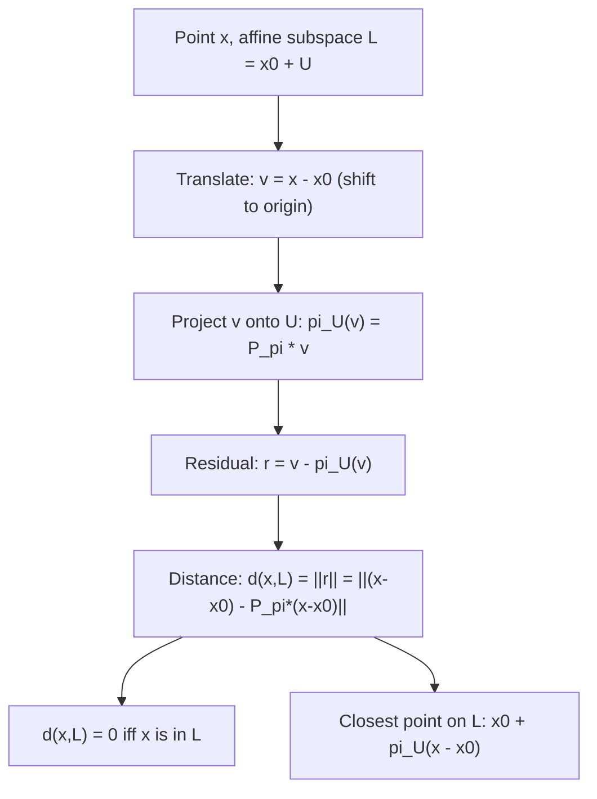

# Distance to affine subspace

$$
d(x, L) = \|(x - x_0) - \pi_U(x - x_0)\|
$$

## Deep Breakdown

What it tells me *(Situation Awareness)*:
An **affine subspace** $L = x_0 + U$ is a linear subspace $U$ shifted by a point $x_0$ — it does not necessarily pass through the origin. The distance from a point $x$ to $L$ is computed by: (1) translating the problem to the origin (subtract $x_0$ from $x$), (2) projecting the translated point onto $U$, and (3) measuring the residual. The formula $d(x, L) = \|(x-x_0) - \pi_U(x-x_0)\|$ reduces the affine problem to the linear projection problem. In DA/DS: distance from a data point to a hyperplane (a 2D affine subspace in $\mathbb{R}^3$, or $(n-1)$D in $\mathbb{R}^n$) is used in SVM, linear regression diagnostics, and decision boundary analysis.

## Flowchart



## Real-world use

### Where it is used

Distance from a point to a hyperplane (SVM margin), computing the residual of a data point from a fitted regression line/plane (OLS residual in geometric terms), finding the nearest point on a fitted linear manifold to a query point, and clustering (distance from a centroid-defined affine cluster to a new data point).

### Problem it solves

Linear subspaces pass through the origin. Real data is rarely centered at the origin. An affine subspace (like a fitted regression plane or an SVM hyperplane) is a linear subspace translated by a specific offset $x_0$. Computing the distance requires removing this offset first before applying the standard linear projection formula.

### How it solves the problem

The key idea: translate $x$ by $-x_0$ to get $v = x - x_0$. Now $v$ is measured relative to the origin of $U$, and $U$ IS a linear subspace containing $\mathbf{0}$. The distance from $v$ to $U$ is the standard subspace distance: $\|v - \pi_U(v)\|$. Since translation preserves distances: $d(x, L) = d(x - x_0, U) = \|(x-x_0) - \pi_U(x-x_0)\|$.

### Example in a business

In SVM: the decision hyperplane is $w^T x + b = 0$, which is an affine subspace. The geometric margin (distance from a support vector $x_{\text{sv}}$ to the hyperplane) is $d = \frac{|w^T x_{\text{sv}} + b|}{\|w\|}$. This is the distance formula for an affine subspace (the hyperplane). SVM maximizes this margin, i.e., pushes support vectors as far from the decision boundary as possible.

## The formula, piece by piece

- $L = x_0 + U$: the affine subspace; $x_0 \in \mathbb{R}^n$ is any anchor point on $L$; $U$ is the associated linear subspace (direction space)
- $x$: the point whose distance to $L$ we want
- $x - x_0$: translate $x$ to be relative to the anchor point $x_0$; this converts an affine problem to a linear one
- $\pi_U(x - x_0) = P_\pi(x-x_0)$: project the translated vector onto the linear subspace $U$
- $(x-x_0) - \pi_U(x-x_0)$: the residual; the component of $x-x_0$ not captured by $U$
- $\|(x-x_0) - \pi_U(x-x_0)\|$: the distance; always $\geq 0$, equals 0 iff $x \in L$

## The formula in words

"Shift the origin to a point on the affine subspace $L$. Now $L$ looks like a linear subspace passing through the origin. Compute the standard linear projection distance. Shift back." Tiny example: $L$ = the line through $(1, 1)$ in the direction $(1, 0)$ (horizontal line at height 1).
$x_0 = (1, 1)$, $U = \text{span}(1, 0)$. Query: $x = (3, 4)$.
$v = x - x_0 = (2, 3)$.
$\pi_U(v) = (2, 0)$ (project onto x-axis).
Residual: $(2,3)-(2,0) = (0,3)$.
$d(x, L) = \|(0,3)\| = 3$. (Distance from $(3,4)$ to the horizontal line $y=1$ is $|4-1|=3$.) $\checkmark$

## Critical Concepts

- **SVM hyperplane distance:** for hyperplane $w^T x + b = 0$: $d(x, H) = \frac{|w^Tx+b|}{\|w\|}$. This is the affine subspace distance formula applied to a codimension-1 subspace.
- **OLS residuals:** the residual $y_i - \hat{y}_i$ is the distance from observation $i$ to the fitted hyperplane $x_0 + \text{col}(X)$ measured in the response direction.
- **Affine vs. linear:** a linear subspace contains $\mathbf{0}$; an affine subspace does not (unless $x_0 = 0$). The formulas differ by a translation.
- **Closest point on L:** $\pi_L(x) = x_0 + \pi_U(x-x_0)$ is the closest point on $L$ to $x$ (covered in its own file).
- **Invariance:** $d(x, L) = d(x + c, L + c)$ for any shift $c$.

Distance is translation-invariant.

## Step-by-step calculation (tiny example)

*Step 1: Define the affine subspace*
Line through $x_0 = (1, 2, 0)$ in direction $b = (1, 0, 0)$ (the x-axis shifted to height 2 in y, z=0).
Query: $x = (5, 4, 3)$.

*Step 2: Translate and project*
$v = x - x_0 = (4, 2, 3)$.
$b_{\text{unit}} = (1,0,0)$.
$\pi_U(v) = (b^Tv)b = (4)(1,0,0) = (4,0,0)$.
Residual: $(4,2,3)-(4,0,0) = (0,2,3)$.

*Step 3: Compute distance*
$d(x, L) = \|(0,2,3)\| = \sqrt{0+4+9} = \sqrt{13} \approx 3.606$.
Interpretation: the point $(5,4,3)$ is $\sqrt{13}$ units from the line.

## Code examples

### Beginner example (Python)

```python
import numpy as np   # -- Distance from a point to an affine subspace ---
# L = x0 + span(b): a line through x0 in direction b
x0 = np.array([1.0, 2.0, 0.0])   # anchor point on L
b = np.array([1.0, 0.0, 0.0])   # direction of the line (unit vector)
x = np.array([5.0, 4.0, 3.0])   # query point # Step 1: translate
v = x - x0   # Step 2: project onto
U = span(b)
proj_v = np.dot(b, v) * b   #
pi_U(v)   # Step 3: residual and distance
residual = v - proj_v
dist = np.linalg.norm(residual)
print(f"v = x - x0 = {v}")
print(f"pi_U(v) = {proj_v}")
print(f"Residual = {residual}")
print(f"d(x, L) = {dist:.4f}")   # Closest point on L
closest_on_L = x0 + proj_v
print(f"\nClosest point on L: {closest_on_L}")
print(f"Distance verification: {np.linalg.norm(x - closest_on_L):.4f}")
```

### Beginner example (R)

```r
# -- Distance from point to affine subspace ---
x0 <- c(1, 2, 0)
b <- c(1, 0, 0)
x <- c(5, 4, 3)
v <- x - x0
proj_v <- sum(b * v) * b
resid <- v - proj_v
dist <- sqrt(sum(resid^2))
cat(sprintf("d(x, L) = %.4f\n", dist))
closest <- x0 + proj_v
cat(sprintf("Closest point on L: (%g, %g, %g)\n", closest[1], closest[2], closest[3]))
```

### Professional example (Python)

```python
import numpy as np
import pandas as pd
from sklearn.svm import SVC
from sklearn.preprocessing import StandardScaler
np.random.seed(42)   # -- Business scenario: SVM margin = distance to hyperplane (affine subspace) ---
# The SVM hyperplane w^T x + b = 0 is an affine subspace.
# Margin = distance from support vectors to this affine subspace.
# Generate two-class customer data (2 features for visualization clarity)
N = 200
X_class0 = np.random.randn(N/2, 2) - 1.5
X_class1 = np.random.randn(N/2, 2) + 1.5
X = np.vstack([X_class0, X_class1])
y = np.array([0]*(N/2) + [1]*(N/2))
scaler = StandardScaler()
X_s = scaler.fit_transform(X)
svm = SVC(kernel='linear', C=1.0)
svm.fit(X_s, y)
w = svm.coef_[0]
b_val = svm.intercept_[0]   # Distance from each training point to the hyperplane
# Affine subspace formula: d = |w^T x + b| / ||w||
distances = np.abs(X_s @ w + b_val) / np.linalg.norm(w)
margin = 2 / np.linalg.norm(w)   # total margin width
results = pd.DataFrame({ "obs": range(N), "class": y, "distance": distances.round(4),
})
print(f"SVM hyperplane: w = {w.round(4)}, b = {b_val:.4f}")
print(f"||w|| = {np.linalg.norm(w):.4f}")
print(f"\nMargin width = 2/||w|| = {margin:.4f}")
print(f"\nSupport vectors (distance to hyperplane <= 1/||w|| + tolerance):")
sv_mask = distances < (1.0 / np.linalg.norm(w) + 0.05)
print(results[sv_mask].head(10).to_string(index=False))
```

---

*Source: MML1*
