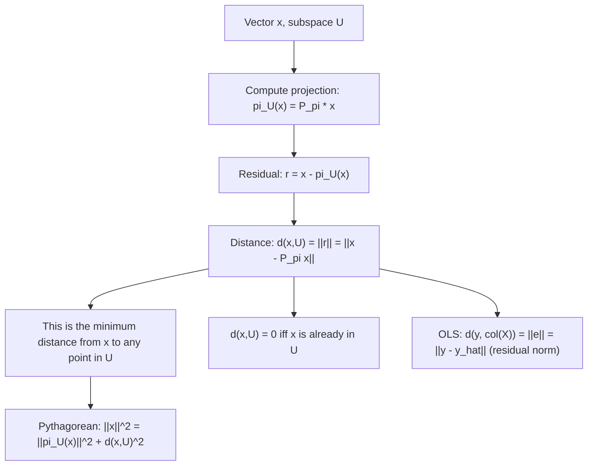

# Projection error (distance to subspace)

$$
d(x, U) = \|x - \pi_U(x)\| = \|x - P_\pi x\|
$$

## Deep Breakdown

What it tells me *(Situation Awareness)*:
$d(x, U) = \|x - \pi_U(x)\|$ is the distance from a vector $x$ to a subspace $U$: the length of the residual after projecting $x$ onto $U$. It is the minimum possible distance from $x$ to any point in $U$, achieved at the projection point $\pi_U(x)$. In DA/DS: this is the reconstruction error in PCA (how much of $x$ is lost when projecting onto the top-$k$ components), the OLS residual norm (distance from the response vector $y$ to the column space of $X$), and the anomaly score in many anomaly detection methods (how far a new observation is from the "normal" subspace).

## Flowchart



## Real-world use

### Where it is used

OLS residual norm: $\|y - \hat{y}\| = \|y - Hy\| = d(y, \text{col}(X))$. PCA reconstruction error: $\|x - VV^Tx\|$ measures how much information is lost. Anomaly detection: project a new observation onto the "normal" subspace and flag it if the residual norm exceeds a threshold. SVM: the margin is related to the distance from support vectors to the decision hyperplane.

### Problem it solves

Given a point $x$ and a subspace $U$, find the shortest distance from $x$ to the subspace. This is needed for: assessing how well a model fits data (OLS), measuring information loss in dimensionality reduction (PCA), and scoring how anomalous an observation is.

### How it solves the problem

The projection $\pi_U(x)$ is the unique point in $U$ closest to $x$ (proven by the projection theorem). The distance is $\|x - \pi_U(x)\|$. This equals $\|(I - P_\pi)x\|$, the norm of the component of $x$ that lies outside $U$. By the Pythagorean theorem: $\|x\|^2 = \|\pi_U(x)\|^2 + d(x,U)^2$.

### Example in a business

A DS builds a PCA model on "normal" customer behavior using the top 3 components. For a new customer $x_{\text{new}}$, they compute the reconstruction error $d(x_{\text{new}}, U_3) = \|x_{\text{new}} - V_3 V_3^T x_{\text{new}}\|$. If this exceeds the 99th percentile of training reconstruction errors, the customer is flagged as anomalous.

## The formula, piece by piece

- $d(x, U)$: distance from point $x$ to subspace $U$; always $\geq 0$
- $\pi_U(x) = P_\pi x$: the orthogonal projection of $x$ onto $U$; the closest point in $U$ to $x$
- $x - \pi_U(x)$: the residual vector; lies in $U^\perp$ (orthogonal complement of $U$)
- $\|\cdot\|$: typically the Euclidean norm ($L_2$)
- $\|x - P_\pi x\| = \|(I - P_\pi)x\|$: equivalent formulations
- Pythagorean theorem: $\|x\|^2 = \|\pi_U(x)\|^2 + d(x,U)^2$
- $d(x,U) = 0 \Leftrightarrow x \in U$ (by positive definiteness of the norm)

## The formula in words

"Project $x$ onto the subspace $U$. The distance from $x$ to $U$ is the length of the part of $x$ that could NOT be represented in $U$. The shorter this residual, the closer $x$ is to living entirely in $U$." Tiny example: $U = \text{span}(1, 0, 0)$, $x = (3, 4, 0)$.
$\pi_U(x) = (3, 0, 0)$ (project onto x-axis).
Residual: $(0, 4, 0)$.
$d(x, U) = \|(0,4,0)\| = 4$.
Pythagorean: $\|x\|^2 = 25 = 9 + 16 = \|\pi_U(x)\|^2 + d^2$. $\checkmark$

## Critical Concepts

- **Minimum distance:** no point in $U$ is closer to $x$ than $\pi_U(x)$. The projection is the closest point.
- **Residual is in $U^\perp$:** $P_\pi(x - P_\pi x) = P_\pi x - P_\pi^2 x = P_\pi x - P_\pi x = 0$. The residual is orthogonal to all of $U$.
- **Energy decomposition:** $\|x\|^2 = \|P_\pi x\|^2 + \|(I-P_\pi)x\|^2$. The squared norm splits into "in-subspace" and "out-of-subspace" parts.
- **OLS R²:** $R^2 = 1 - d(y, \text{col}(X))^2/\|y-\bar{y}\mathbf{1}\|^2 = 1 - \text{SS}_\text{res}/\text{SS}_\text{tot}$.
- **PCA reconstruction error:** $d(x, U_k)^2 = \|x\|^2 - \sum_{i=1}^k (b_i^T x)^2$; equals the sum of variances not captured by the top $k$ components.

## Step-by-step calculation (tiny example)

*Step 1: Project onto the subspace*
$b = (1, 1, 0)/\sqrt{2}$ (unit vector along diagonal), $x = (3, 1, 2)$.
$\pi_U(x) = (b^T x)b = \frac{3+1}{\sqrt{2}} \cdot \frac{(1,1,0)}{\sqrt{2}} = 2\cdot(1,1,0) = (2,2,0)$.

*Step 2: Compute residual and distance*
$r = (3,1,2) - (2,2,0) = (1,-1,2)$.
$d(x, U) = \|(1,-1,2)\| = \sqrt{1+1+4} = \sqrt{6} \approx 2.449$.

*Step 3: Verify Pythagorean theorem*
$\|x\|^2 = 9+1+4 = 14$. $\|\pi_U(x)\|^2 = 4+4 = 8$. $d^2 = 6$.
$14 = 8 + 6$. $\checkmark$

## Code examples

### Beginner example (Python)

```python
import numpy as np   # -- Distance from a vector to a subspace ---
# Subspace: span of b (1D)
b = np.array([1.0, 1.0, 0.0]) / np.sqrt(2)   # unit vector
x = np.array([3.0, 1.0, 2.0])
proj = np.dot(b, x) * b   #
pi_U(x)
residual = x - proj
dist = np.linalg.norm(residual)
print(f"Projection pi_U(x): {proj.round(4)}")
print(f"Residual: {residual.round(4)}")
print(f"Distance d(x, U): {dist:.4f}")   # Pythagorean verification
norm_x_sq = np.dot(x, x)
norm_proj_sq = np.dot(proj, proj)
print(f"\nPythagorean check: ||x||^2 = {norm_x_sq:.4f} = ||proj||^2 + d^2 = {norm_proj_sq:.4f} + {dist**2:.4f} = {norm_proj_sq + dist**2:.4f}")   # 2D subspace: span of two orthonormal vectors
b2 = np.array([0.0, 0.0, 1.0])
B = np.column_stack([b, b2])
P = B @ B.T
proj2 = P @ x
dist2 = np.linalg.norm(x - proj2)
print(f"\n2D subspace: d(x, U) = {dist2:.4f}")
```

### Beginner example (R)

```r
# -- Distance from x to subspace ---
b <- c(1, 1, 0) / sqrt(2)
x <- c(3, 1, 2)
proj <- sum(b * x) * b
residual <- x - proj
dist <- sqrt(sum(residual^2))
cat(sprintf("Projection: (%g, %g, %g)\n", proj[1], proj[2], proj[3]))
cat(sprintf("Distance d(x,U): %.4f\n", dist))
cat(sprintf("Pythagorean: ||x||^2 = %.4f = %.4f + %.4f\n", sum(x^2), sum(proj^2), dist^2))
```

### Professional example (Python)

```python
import numpy as np
import pandas as pd
from sklearn.preprocessing import StandardScaler
np.random.seed(42)   # -- Business scenario: PCA-based anomaly detection ---
# Flag customers whose behavior cannot be explained by the normal subspace.
N_TRAIN = 500
N_TEST = 50
D = 6   # Training data: normal customers
X_train = np.random.randn(N_TRAIN, D)
X_train[:, 1] += 0.8 * X_train[:, 0]   # correlation in normal data
scaler = StandardScaler()
X_scaled = scaler.fit_transform(X_train)   # PCA: top 3 components define the "normal" subspace
_, _, Vt = np.linalg.svd(X_scaled, full_matrices=False)
V3 = Vt[:3].T   # orthonormal basis (D x 3)
P_normal = V3 @ V3.T   # projection matrix (D x D) # Reconstruction error threshold: 99th percentile of training errors
train_errors = np.linalg.norm(X_scaled - X_scaled @ P_normal, axis=1)
threshold = np.percentile(train_errors, 99)   # Test data: mostly normal, a few anomalies
X_test = np.random.randn(N_TEST, D)
X_test[:5] *= 5.0   # inject 5 anomalies
X_test_scaled = scaler.transform(X_test)
test_errors = np.linalg.norm(X_test_scaled - X_test_scaled @ P_normal, axis=1)
is_anomaly = test_errors > threshold
results = pd.DataFrame({ "test_obs": range(N_TEST), "recon_error": test_errors.round(4), "is_anomaly": is_anomaly,
})
print(f"Normal subspace: top-3 PCA components")
print(f"Anomaly threshold (99th pct of train): {threshold:.4f}")
print(f"\nAnomalies detected: {is_anomaly.sum()} / {N_TEST}")
print(results[results["is_anomaly"]].to_string(index=False))
```

---

*Source: MML1*
