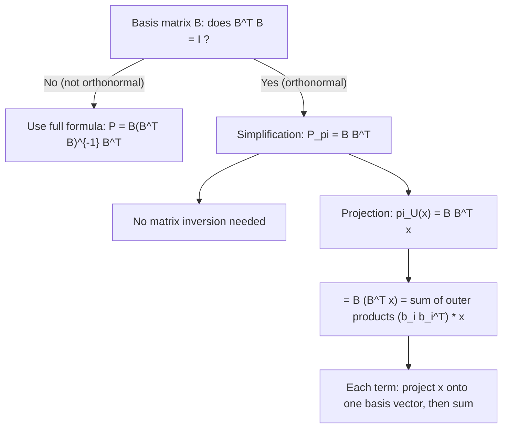

# Projection matrix onto orthonormal basis $B$

$$
P_\pi = B B^T
$$

## Deep Breakdown

What it tells me *(Situation Awareness)*:
When the columns of $B$ form an **orthonormal** basis for the subspace $U$ (i.e., $B^TB = I_k$), the projection matrix simplifies from $B(B^TB)^{-1}B^T$ to $BB^T$. This is a massive computational shortcut: no matrix inversion needed. The condition $B^TB = I$ means every column has unit length and columns are mutually orthogonal. In DA/DS: PCA components are orthonormal by construction, so projecting onto the top-$k$ components uses $P_\pi = VV^T$ where $V$ is the matrix of $k$ eigenvectors. Orthonormal bases enable fast, numerically stable projections.

## Flowchart



## Real-world use

### Where it is used

Projecting data onto PCA components (orthonormal by construction), computing projections onto eigenvectors or singular vectors (which are orthonormal from SVD), fast reconstruction in autoencoders (encoder maps $x \to B^Tx$, decoder maps back via $Bz$), and QR decomposition: after `np.linalg.qr(X)`, the $Q$ matrix has orthonormal columns and $P = QQ^T$.

### Problem it solves

The general projection formula $B(B^TB)^{-1}B^T$ requires computing and inverting the $k \times k$ Gram matrix, which can be numerically unstable when columns are near-parallel. When $B$ is orthonormal, $B^TB = I$ exactly, so the inversion is trivial and the formula collapses to $BB^T$.

### How it solves the problem

Substituting $B^TB = I_k$ into $P = B(B^TB)^{-1}B^T$: $P = B \cdot I_k^{-1} \cdot B^T = B \cdot I_k \cdot B^T = BB^T$. Also: $BB^T = \sum_{i=1}^k b_i b_i^T$ (sum of $k$ rank-1 outer products, one per basis vector). The projection decomposes as: project $x$ onto each basis vector independently and sum.

### Example in a business

A DS computes PCA on a customer dataset and keeps the top 3 components $V_3$ (matrix with 3 orthonormal columns). To reconstruct the approximate data in the original space: $\hat{X} = X V_3 V_3^T = X P_\pi$. Since $V_3^T V_3 = I_3$, the projection matrix is $V_3 V_3^T$ — no inversion required.

## The formula, piece by piece

- $B$: $n \times k$ matrix with orthonormal columns: $B^TB = I_k$; each column is a unit vector, all pairs orthogonal
- $B^T$: $k \times n$ transpose; $B^T x$ computes the coordinate of $x$ in the basis $B$
- $BB^T$: $n \times n$ projection matrix; symmetric, idempotent, rank $k$
- Special case of the general formula: $B(B^TB)^{-1}B^T$ with $B^TB = I_k$
- $BB^T x = B(B^Tx)$: first project $x$ onto each basis vector (via $B^Tx$), then map back to $\mathbb{R}^n$ (via $B$)
- Outer product decomposition: $BB^T = \sum_{i=1}^k b_i b_i^T$

## The formula in words

"With an orthonormal basis, projection is just: find the coordinates (how much of $x$ lies along each basis direction), then reconstruct using those coordinates and the basis vectors. No need to invert anything." Tiny example: $B = \frac{1}{\sqrt{2}}\begin{pmatrix}1\\1\end{pmatrix}$, $x = (3,1)^T$.
$B^TB = \frac{1}{2}(1+1) = 1$. $\checkmark$ (orthonormal)
$BB^T = \frac{1}{2}\begin{pmatrix}1&1\\1&1\end{pmatrix}$.
$\pi_U(x) = \frac{1}{2}\begin{pmatrix}1&1\\1&1\end{pmatrix}\begin{pmatrix}3\\1\end{pmatrix} = \frac{1}{2}\begin{pmatrix}4\\4\end{pmatrix} = \begin{pmatrix}2\\2\end{pmatrix}$.

## Critical Concepts

- **Requirement:** $B^TB = I_k$ must hold exactly. If it does not, use the general formula $B(B^TB)^{-1}B^T$.
- **Idempotent:** $(BB^T)^2 = BB^TBB^T = B(B^TB)B^T = BI_kB^T = BB^T$. $\checkmark$
- **Symmetric:** $(BB^T)^T = (B^T)^T B^T = BB^T$. $\checkmark$
- **PCA reconstruction:** $\hat{X} = XV_kV_k^T$. The approximation error is $\|X - \hat{X}\|_F^2 = \sum_{i>k}\sigma_i^2$ (sum of discarded singular values squared).
- **QR decomposition:** `Q, R = np.linalg.qr(X, mode='reduced')`. $Q$ has orthonormal columns, $P = QQ^T$.
- **Complement:** $I - BB^T$ projects onto $U^\perp$; also symmetric and idempotent.
- **Gram-Schmidt:** converts any linearly independent set to an orthonormal basis, enabling the simplified formula.

## Step-by-step calculation (tiny example)

*Step 1: Verify orthonormality of columns*
$B = \begin{pmatrix}1/\sqrt{2} & 1/\sqrt{2}\\ 1/\sqrt{2} & -1/\sqrt{2}\end{pmatrix}$ (2D rotation by 45°).
$B^T B = \begin{pmatrix}1 & 0\\ 0 & 1\end{pmatrix} = I_2$. $\checkmark$ Orthonormal.

*Step 2: Compute the projection matrix*
Since $B^TB = I$, $P_\pi = BB^T = \begin{pmatrix}1/\sqrt{2}\\1/\sqrt{2}\end{pmatrix}(1/\sqrt{2}, 1/\sqrt{2}) + \begin{pmatrix}1/\sqrt{2}\\-1/\sqrt{2}\end{pmatrix}(1/\sqrt{2},-1/\sqrt{2})$.
$= \frac{1}{2}\begin{pmatrix}1&1\\1&1\end{pmatrix} + \frac{1}{2}\begin{pmatrix}1&-1\\-1&1\end{pmatrix} = \begin{pmatrix}1&0\\0&1\end{pmatrix} = I$.
This makes sense: $B$ spans all of $\mathbb{R}^2$, so projection onto the full space is the identity.

*Step 3: Projection onto first column only*
Use only first column: $b_1 = (1/\sqrt{2}, 1/\sqrt{2})^T$. $P = b_1 b_1^T = \frac{1}{2}\begin{pmatrix}1&1\\1&1\end{pmatrix}$.
$x = (3, 1)^T$: $\pi_U(x) = (2, 2)^T$. Residual $(1,-1)^T$; $b_1^T(1,-1) = 0$. $\checkmark$

## Code examples

### Beginner example (Python)

```python
import numpy as np   # -- Orthonormal projection matrix P = B B^T ---
# Use two orthonormal vectors as basis
b1 = np.array([1.0, 0.0, 0.0])   # e1
b2 = np.array([0.0, 1.0, 0.0])   # e2
B = np.column_stack([b1, b2])   # span the xy-plane # Verify orthonormality
print(f"B^T B = \n{B.T @ B}")   # should be I_2 # Projection matrix
P = B @ B.T
print(f"\nP = B B^T =\n{P}")
print(f"Idempotent: {np.allclose(P @ P, P)}")
print(f"Symmetric: {np.allclose(P, P.T)}")   # Project a 3D vector onto xy-plane
x = np.array([3.0, 2.0, 5.0])
proj = P @ x
resid = x - proj
print(f"\nx = {x}")
print(f"pi_U = {proj} (xy-plane shadow)")
print(f"resid = {resid} (z component only)")
print(f"B^T resid = {B.T @ resid}")
```

### Beginner example (R)

```r
# -- Orthonormal projection
P = B B^T ---
B <- cbind(c(1,0,0), c(0,1,0))  # xy-plane basis
cat("B^T B:\n"); print(t(B) %*% B)
P <- B %*% t(B)
x <- c(3, 2, 5)
proj <- P %*% x
cat(sprintf("pi_U(x) = (%g, %g, %g)\n", proj[1], proj[2], proj[3]))
cat(sprintf("Idempotent: %s\n", isTRUE(all.equal(P %*% P, P))))
```

### Professional example (Python)

```python
import numpy as np
import pandas as pd
from sklearn.preprocessing import StandardScaler
np.random.seed(42)   # -- Business scenario: PCA reconstruction using P = V_k V_k^T ---
# Project data onto top-k PCA directions and measure reconstruction quality.
N, D = 300, 8
raw_data = np.random.randn(N, D)
raw_data[:, 1] += 0.9 * raw_data[:, 0]
raw_data[:, 2] += 0.7 * raw_data[:, 0]
scaler = StandardScaler()
X = scaler.fit_transform(raw_data)   # SVD to get orthonormal principal components
U, S, Vt = np.linalg.svd(X, full_matrices=False)
results = []
for k in [1, 2, 3, 4]:
    V_k = Vt[:k].T   # shape (D, k): orthonormal columns # Projection matrix: P = V_k V_k^T (since V_k^T V_k = I_k)
P = V_k @ V_k.T
X_hat = X @ P   # reconstruction in original space
error = np.linalg.norm(X - X_hat, 'fro')**2
total_ss = np.linalg.norm(X, 'fro')**2
results.append({ "k_components": k, "reconstruction_error": round(error, 3), "pct_variance_kept": round(1 - error / total_ss, 4), "P_idempotent": np.allclose(P @ P, P), })
df = pd.DataFrame(results)
print("PCA reconstruction via P = V_k V_k^T (orthonormal basis):")
print(df.to_string(index=False))
print("\nNote: P = V_k V_k^T works only because V_k^T V_k = I (orthonormal).")
```

---

*Source: MML1*
