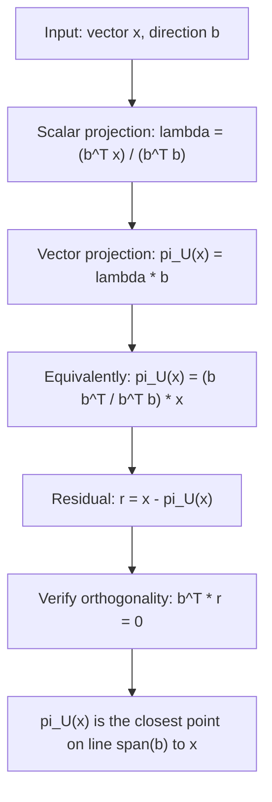

# Projection of x onto 1D subspace (line) U spanned by b

$$
\pi_U(x) = \frac{b b^T}{b^T b} x
$$

## Deep Breakdown

What it tells me *(Situation Awareness)*:
$\pi_U(x) = \frac{bb^T}{b^Tb}x$ projects a vector $x$ onto the 1D subspace (line through the origin) spanned by $b$. The result is the closest point on that line to $x$. Geometrically: drop a perpendicular from $x$ to the line; the foot of the perpendicular is $\pi_U(x)$. This is the scalar projection formula scaled back into a vector. The scalar projection of $x$ onto $b$ is $\frac{b^T x}{b^T b}$ (a number); multiplying by $b$ gives the vector projection $\pi_U(x) = \frac{b^T x}{b^T b}b = \frac{bb^T}{b^Tb}x$. In DA/DS: projecting data onto a 1D direction is the core of PCA (project onto the first principal component), Linear Discriminant Analysis, and any dimensionality reduction to a single direction.

## Flowchart



## Real-world use

### Where it is used

PCA: projecting data onto the first principal component direction $b = v_1$. Regression with a single predictor: projecting the response vector onto the predictor direction. Gradient projection: projecting a gradient onto a constraint direction. Computing explained variance: $\|\pi_U(x)\|^2 / \|x\|^2$ = fraction of $x$'s energy in the direction of $b$.

### Problem it solves

Given a direction $b$ and a point $x$ NOT on the line through $b$, find the point on the line that is closest to $x$. The closest point minimizes $\|x - \lambda b\|^2$ over all scalars $\lambda$. The solution is the orthogonal projection.

### How it solves the problem

Minimize $\|x - \lambda b\|^2$: take derivative with respect to $\lambda$ and set to zero. $\frac{d}{d\lambda}\|x - \lambda b\|^2 = -2b^T(x - \lambda b) = 0 \Rightarrow \lambda = \frac{b^T x}{b^T b}$. The projected vector is $\pi_U(x) = \lambda b = \frac{b^T x}{b^T b}b$. Written as a matrix: $\pi_U(x) = \frac{bb^T}{b^Tb}x$ where $\frac{bb^T}{b^Tb}$ is the rank-1 projection matrix.

### Example in a business

A DS computes the first PCA component $b = v_1$ of a customer feature matrix. To project each customer's feature vector $x_i$ onto this direction: $\text{score}_i = \frac{b^T x_i}{\|b\|^2}$ (scalar, used for ranking) and $\pi_U(x_i) = \frac{bb^T}{\|b\|^2} x_i$ (vector, for reconstruction). The scalar score is the first principal component score for customer $i$.

## The formula, piece by piece

- $b$: the direction vector (basis of the 1D subspace); does NOT need to be unit length
- $b^T$: row vector transpose of $b$
- $b^T b = \|b\|^2$: the squared norm of $b$ (a scalar); the denominator normalizes the projection
- $b b^T$: outer product of $b$ with itself; an $n \times n$ rank-1 matrix
- $\frac{bb^T}{b^Tb}$: the projection matrix $P_b$ onto $\text{span}(b)$; rank-1, symmetric, idempotent ($P_b^2 = P_b$)
- $\pi_U(x) = \frac{bb^T}{b^Tb}x$: the projection of $x$ onto the line spanned by $b$
- Scalar form: $\pi_U(x) = \frac{b^T x}{b^T b} \cdot b$ (scalar coefficient times the direction)

## The formula in words

"Find how much of $x$ lies in the direction of $b$ (the scalar projection), then multiply by $b$ to get the vector that sits on the line at that 'shadow' point. Dividing by $b^Tb$ corrects for the length of $b$." Tiny example: $b = (2, 0)$, $x = (3, 4)$.
$b^T x = 6$. $b^T b = 4$. $\lambda = 6/4 = 1.5$.
$\pi_U(x) = 1.5 \cdot (2, 0) = (3, 0)$.
Residual: $r = (3,4) - (3,0) = (0,4)$. Check: $b^T r = (2)(0)+(0)(4) = 0$. $\checkmark$

## Critical Concepts

- **Idempotent:** $P_b^2 = P_b$. Projecting twice gives the same result as projecting once.
- **Symmetric:** $P_b^T = P_b$.
- **Rank 1:** the projection matrix has rank 1 (projects onto a line).
- **Unit vector shortcut:** if $\|b\| = 1$, then $P_b = bb^T$ and $\pi_U(x) = (b^T x)b$.
- **Residual orthogonality:** $b^T(x - \pi_U(x)) = 0$ always. The residual is perpendicular to $b$.
- **Energy decomposition:** $\|x\|^2 = \|\pi_U(x)\|^2 + \|x - \pi_U(x)\|^2$ (Pythagorean theorem).
- **Connection to PCA:** PCA finds $b$ that maximizes $\|\pi_U(x)\|^2$ over all data points, i.e., the direction of maximum projected variance.

## Step-by-step calculation (tiny example)

*Step 1: Define direction vector and input*
$b = (1, 2)$, $x = (3, 1)$.

*Step 2: Compute scalar projection*
$b^T x = 1\cdot3 + 2\cdot1 = 5$. $b^T b = 1+4 = 5$. $\lambda = 5/5 = 1$.

*Step 3: Compute vector projection and verify orthogonality*
$\pi_U(x) = 1 \cdot (1,2) = (1,2)$.
Residual: $r = (3,1) - (1,2) = (2,-1)$.
$b^T r = 1\cdot2 + 2\cdot(-1) = 0$. $\checkmark$ The residual is orthogonal to $b$.

## Code examples

### Beginner example (Python)

```python
import numpy as np   # -- 1D projection: pi_U(x) = (b b^T / b^T b) x ---
b = np.array([1.0, 2.0])
x = np.array([3.0, 1.0])
scalar_proj = np.dot(b, x) / np.dot(b, b)
proj_vector = scalar_proj * b
residual = x - proj_vector
print(f"b = {b}")
print(f"x = {x}")
print(f"lambda = {scalar_proj:.4f}")
print(f"pi_U(x) = {proj_vector}")
print(f"residual = {residual}")
print(f"b^T residual = {np.dot(b, residual):.10f} (should be 0)")   # Projection matrix P_b = b b^T / b^T b
P_b = np.outer(b, b) / np.dot(b, b)
print(f"\nProjection matrix P_b:\n{P_b}")
print(f"P_b @ x = {P_b @ x} (matches pi_U(x): {np.allclose(P_b @ x, proj_vector)})")
print(f"P_b^2 = P_b (idempotent): {np.allclose(P_b @ P_b, P_b)}")
```

### Beginner example (R)

```r
# -- 1D projection ---
b <- c(1, 2)
x <- c(3, 1)
scalar_proj <- sum(b * x) / sum(b * b)
proj_vector <- scalar_proj * b
residual <- x - proj_vector
cat(sprintf("lambda = %.4f\n", scalar_proj))
cat(sprintf("pi_U(x) = (%g, %g)\n", proj_vector[1], proj_vector[2]))
cat(sprintf("b^T residual = %.10f\n", sum(b * residual)))

# Projection matrix
P_b <- outer(b, b) / sum(b * b)
cat("Projection matrix P_b:\n")
print(round(P_b, 4))
```

### Professional example (Python)

```python
import numpy as np
import pandas as pd
from sklearn.preprocessing import StandardScaler
np.random.seed(42)

# -- Business scenario: project customer data onto first PCA direction ---
# Each customer has 3 RFM features. Project each onto the first PCA direction.
N_CUSTOMERS = 200
rfm_raw = np.column_stack([
    np.random.exponential(30, N_CUSTOMERS),   # recency (days since last purchase)
    np.random.poisson(10, N_CUSTOMERS),       # frequency (purchases/month)
    np.random.lognormal(4, 1, N_CUSTOMERS),   # monetary (spend in euros)
])
scaler = StandardScaler()
rfm_scaled = scaler.fit_transform(rfm_raw)

# First PCA direction: eigenvector of largest eigenvalue of covariance matrix
cov_matrix = np.cov(rfm_scaled.T)
eigenvalues, eigenvectors = np.linalg.eigh(cov_matrix)
b_first_pc = eigenvectors[:, -1]   # largest eigenvalue direction

# Project each customer onto this 1D subspace
scalar_scores = rfm_scaled @ b_first_pc / np.dot(b_first_pc, b_first_pc)
proj_vectors = np.outer(scalar_scores, b_first_pc)

# Explained variance: ||pi_U(x)||^2 / ||x||^2
proj_norms_sq = np.sum(proj_vectors**2, axis=1)
orig_norms_sq = np.sum(rfm_scaled**2, axis=1)
explained_ratio = proj_norms_sq / orig_norms_sq
results = pd.DataFrame({
    "customer": range(N_CUSTOMERS),
    "pc1_score": scalar_scores.round(3),
    "explained_ratio": explained_ratio.round(3),
})
print(f"First PCA direction b: {b_first_pc.round(4)}")
print(f"\nMean explained variance (1D projection): {explained_ratio.mean():.3f}")
print(f"\nTop 5 customers by PC1 score:")
print(results.nlargest(5, "pc1_score").to_string(index=False))
```

---

*Source: MML1*
