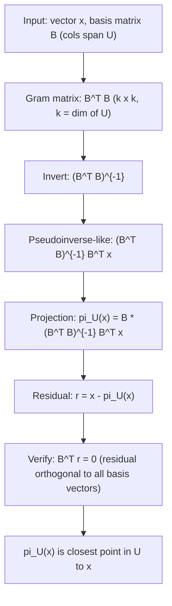

# Projection of x onto general subspace U

$$
\pi_U(x) = B(B^T B)^{-1} B^T x
$$

## Deep Breakdown

What it tells me *(Situation Awareness)*:
$\pi_U(x) = B(B^TB)^{-1}B^Tx$ projects a vector $x$ onto an arbitrary subspace $U$ spanned by the columns of $B$ (a basis matrix). The result is the closest point in $U$ to $x$. This generalizes the 1D formula: when $B$ is a single column $b$, it reduces to $\frac{bb^T}{b^Tb}x$. When $B$ is an orthonormal matrix ($B^TB = I$), it simplifies to $BB^Tx$. This is the core of orthogonal projection theory and appears directly in ordinary least squares regression (OLS), which is projection of the response vector $y$ onto the column space of $X$.

## Flowchart



## Real-world use

### Where it is used

OLS regression: $\hat{y} = X(X^TX)^{-1}X^Ty$ is projection of $y$ onto $\text{col}(X)$. PCA: project data matrix onto the subspace of top $k$ principal components. Any dimensionality reduction that fits a low-dimensional subspace. Signal processing: project a signal vector onto a subspace spanned by basis functions.

### Problem it solves

Given a subspace $U = \text{span}(b_1, \ldots, b_k)$ and a point $x \notin U$, find the point in $U$ closest to $x$. Equivalently: find coefficients $\lambda_1, \ldots, \lambda_k$ such that $\|\lambda_1 b_1 + \cdots + \lambda_k b_k - x\|^2$ is minimized. This is the least squares problem.

### How it solves the problem

The projection $\pi_U(x) = B\hat{\lambda}$ where $\hat{\lambda}$ minimizes $\|B\hat{\lambda} - x\|^2$. Setting the gradient to zero: $B^T(x - B\hat{\lambda}) = 0 \Rightarrow B^TB\hat{\lambda} = B^Tx$. This is the normal equation. Solving: $\hat{\lambda} = (B^TB)^{-1}B^Tx$ (assuming $B$ has full column rank, so $B^TB$ is invertible). The projection is $\pi_U(x) = B\hat{\lambda} = B(B^TB)^{-1}B^Tx$.

### Example in a business

In OLS regression: $B = X$ (design matrix), $x = y$ (response vector). $\hat{y} = X(X^TX)^{-1}X^Ty$ is exactly $\pi_U(y)$, the projection of $y$ onto $\text{col}(X)$. The fitted values $\hat{y}$ are the closest values to $y$ achievable by any linear combination of the predictors.

## The formula, piece by piece

- $B$: $n \times k$ basis matrix; its columns are the basis vectors of $U$; must have full column rank ($k \leq n$)
- $B^T$: $k \times n$ transpose of $B$
- $B^T B$: $k \times k$ Gram matrix; measures inner products between all pairs of basis vectors; invertible iff $B$ has full column rank
- $(B^T B)^{-1}$: inverse of the Gram matrix; exists when columns of $B$ are linearly independent
- $(B^T B)^{-1} B^T$: the left pseudo-inverse of $B$; maps $\mathbb{R}^n$ to $\mathbb{R}^k$ (coordinate vector)
- $B(B^T B)^{-1} B^T$: the projection matrix $P_\pi = P_U$; symmetric, idempotent, rank $k$
- $\pi_U(x) = P_U x$: the projection of $x$ onto $U$

## The formula in words

"Solve the normal equations: find the coefficients $\hat{\lambda}$ such that $B\hat{\lambda}$ is closest to $x$. The projection is $B$ times those coefficients. The matrix $B(B^TB)^{-1}B^T$ does this automatically for any $x$." Tiny example: $B = \begin{pmatrix}1\\1\\0\end{pmatrix}$, $x = \begin{pmatrix}2\\0\\3\end{pmatrix}$.
$B^TB = 2$. $(B^TB)^{-1} = 0.5$.
$\hat{\lambda} = 0.5 \cdot B^T x = 0.5\cdot2 = 1$.
$\pi_U(x) = 1 \cdot B = (1,1,0)^T$.
$r = (2,0,3)-(1,1,0) = (1,-1,3)$. $B^Tr = 1-1+0 = 0$. $\checkmark$

## Critical Concepts

- **Requires full column rank:** $B^TB$ must be invertible. If columns of $B$ are linearly dependent, use the pseudoinverse instead.
- **Idempotent:** $P_U^2 = P_U$. Projecting twice = projecting once.
- **Symmetric:** $P_U^T = P_U$.
- **Rank:** $\text{rank}(P_U) = k = \dim(U)$.
- **Orthonormal shortcut:** if $B^TB = I$ (columns are orthonormal), then $P_U = BB^T$ (no inversion needed).
- **OLS:** $\hat{\beta} = (X^TX)^{-1}X^Ty$, $\hat{y} = X\hat{\beta} = X(X^TX)^{-1}X^Ty = P_U y$.
- **Residual:** $r = x - \pi_U(x)$ is always orthogonal to every column of $B$: $B^Tr = 0$.

## Step-by-step calculation (tiny example)

*Step 1: Set up B and x*
$B = \begin{pmatrix}1 & 0\\0 & 1\\1 & 1\end{pmatrix}$ (two basis vectors in $\mathbb{R}^3$), $x = (2, 3, 4)^T$.

*Step 2: Compute Gram matrix and its inverse*
$B^T B = \begin{pmatrix}2 & 1\\1 & 2\end{pmatrix}$. $(B^TB)^{-1} = \frac{1}{3}\begin{pmatrix}2 & -1\\-1 & 2\end{pmatrix}$.

*Step 3: Compute coordinates and projection*
$B^T x = (2+4, 3+4)^T = (6,7)^T$.
$\hat{\lambda} = \frac{1}{3}\begin{pmatrix}2&-1\\-1&2\end{pmatrix}\begin{pmatrix}6\\7\end{pmatrix} = \frac{1}{3}\begin{pmatrix}5\\8\end{pmatrix} = (5/3, 8/3)^T$.
$\pi_U(x) = B\hat{\lambda} = \frac{5}{3}(1,0,1)^T + \frac{8}{3}(0,1,1)^T = (5/3, 8/3, 13/3)^T \approx (1.667, 2.667, 4.333)^T$.
Residual: $r = (2,3,4) - (1.667, 2.667, 4.333) = (0.333, 0.333, -0.333)$. $B^Tr = (0.333+(-0.333), 0.333+(-0.333)) = (0,0)$. $\checkmark$

## Code examples

### Beginner example (Python)

```python
import numpy as np

# -- Projection onto general subspace: pi_U(x) = B(B^T B)^{-1} B^T x ---
B = np.array([[1.0, 0.0], [0.0, 1.0], [1.0, 1.0]])
x = np.array([2.0, 3.0, 4.0])
gram_matrix = B.T @ B   # B^T B
gram_inv = np.linalg.inv(gram_matrix)   # (B^T B)^{-1}
coords = gram_inv @ B.T @ x   # hat_lambda
projection = B @ coords   # pi_U(x)
residual = x - projection
print(f"Gram matrix B^T B:\n{gram_matrix}")
print(f"\nCoordinates lambda_hat: {coords.round(4)}")
print(f"Projection pi_U(x): {projection.round(4)}")
print(f"Residual r: {residual.round(4)}")
print(f"B^T r (should be 0): {(B.T @ residual).round(10)}")

# Projection matrix
P_U = B @ gram_inv @ B.T
print(f"\nProjection matrix P_U (symmetric: {np.allclose(P_U, P_U.T)}, idempotent: {np.allclose(P_U @ P_U, P_U)})")
```

### Beginner example (R)

```r
# -- Projection onto general subspace ---
B <- matrix(c(1,0,1, 0,1,1), nrow=3, ncol=2)
x <- c(2, 3, 4)
gram_matrix <- t(B) %*% B
gram_inv <- solve(gram_matrix)
coords <- gram_inv %*% t(B) %*% x
projection <- B %*% coords
residual <- x - projection
cat("Coordinates (lambda_hat):", round(coords, 4), "\n")
cat("Projection pi_U(x):", round(projection, 4), "\n")
cat("B^T r (should be 0):", round(t(B) %*% residual, 10), "\n")
```

### Professional example (Python)

```python
import numpy as np
import pandas as pd
np.random.seed(42)

# -- Business scenario: OLS regression as projection ---
# Fitted values = projection of y onto col(X).
# Show that this minimizes ||y - y_hat||^2 (closest point in col(X) to y).
N = 100
# Design matrix X (intercept + 2 predictors)
X = np.column_stack([
    np.ones(N),
    np.random.uniform(1, 10, N),
    np.random.uniform(0, 5, N),
])
true_beta = np.array([2.0, 1.5, -0.8])
y = X @ true_beta + np.random.randn(N) * 0.5

# OLS = projection: y_hat = X(X^T X)^{-1} X^T y
gram_matrix = X.T @ X
beta_hat = np.linalg.solve(gram_matrix, X.T @ y)   # solve normal equations
y_hat = X @ beta_hat   # fitted values = pi_U(y)
residuals = y - y_hat

# Verify properties
ortho_check = X.T @ residuals   # should be ~0 (normal equations)
ss_res = np.sum(residuals**2)
ss_tot = np.sum((y - y.mean())**2)
r_squared = 1 - ss_res / ss_tot
print("OLS = projection of y onto col(X):")
print(f" beta_hat (estimated): {beta_hat.round(4)}")
print(f" true_beta: {true_beta}")
print(f" R^2: {r_squared:.4f}")
print(f" X^T * residuals (normal equations, should be ~0):")
print(f" {ortho_check.round(8)}")
print(f"\n||y - y_hat||^2 is minimized by OLS (projection theorem).")
```

---

*Source: MML1*
