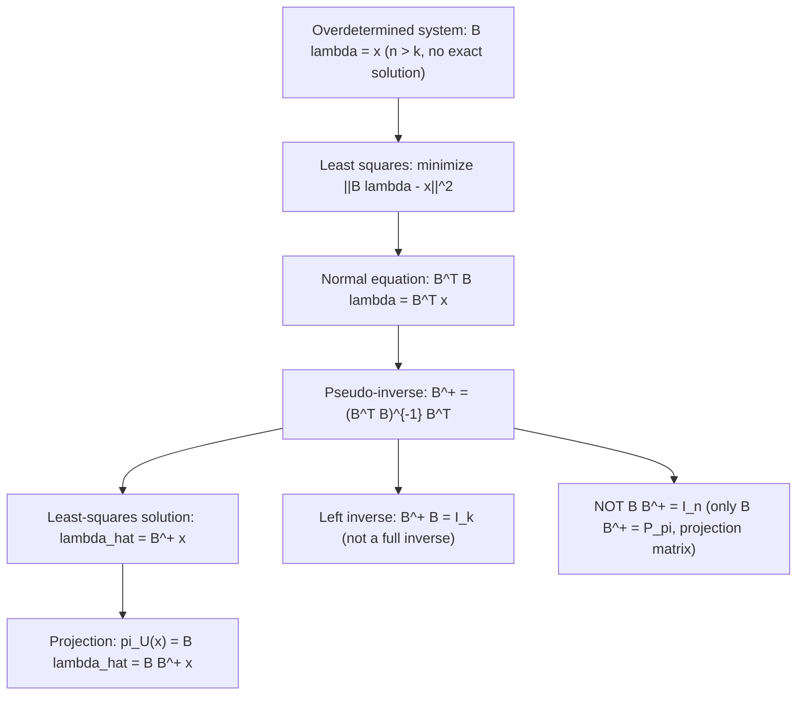

# Pseudo-inverse of B

$$
(B^T B)^{-1} B^T
$$

## Deep Breakdown

What it tells me *(Situation Awareness)*:
$(B^TB)^{-1}B^T$ is the **left pseudo-inverse** (or Moore-Penrose pseudoinverse when $B$ has full column rank) of the matrix $B$. It is a $k \times n$ matrix that maps any vector $x \in \mathbb{R}^n$ to the least-squares solution $\hat{\lambda} = (B^TB)^{-1}B^Tx \in \mathbb{R}^k$. When $B$ is a tall matrix ($n > k$) with full column rank, the system $B\lambda = x$ is overdetermined (more equations than unknowns) and generally has no exact solution. The pseudo-inverse gives the best approximate solution: $\hat{\lambda}$ minimizes $\|B\lambda - x\|^2$. In OLS: $\hat{\beta} = (X^TX)^{-1}X^Ty$ is the pseudo-inverse of $X$ applied to $y$.

## Flowchart



## Real-world use

### Where it is used

OLS regression (most common use): $\hat{\beta} = (X^TX)^{-1}X^Ty$. Any overdetermined linear system (more observations than parameters). Computing the coordinates of a vector's projection onto a subspace. Implementing least-squares fitting in signal processing, control systems, and statistics.

### Problem it solves

A regular inverse $B^{-1}$ only exists for square, invertible matrices. For a tall matrix $B$ ($n > k$), there is no inverse. The pseudo-inverse $(B^TB)^{-1}B^T$ is the "best possible substitute": it gives the unique minimum-norm least-squares solution to $B\lambda = x$.

### How it solves the problem

$(B^TB)^{-1}B^T$ is called the left pseudo-inverse because $(B^TB)^{-1}B^T \cdot B = (B^TB)^{-1}(B^TB) = I_k$. It satisfies "left inverse": $B^+B = I_k$. But $BB^+ = B(B^TB)^{-1}B^T = P_\pi \neq I_n$ (it's the projection matrix, not the identity). So it is a one-sided inverse.

### Example in a business

In OLS with $n=1000$ observations and $k=5$ predictors: $X$ is 1000×5 (tall, full column rank). $X^+= (X^TX)^{-1}X^T$ is 5×1000. Applying it to $y$ gives $\hat{\beta} = X^+y \in \mathbb{R}^5$: the 5 regression coefficients. The fitted values $\hat{y} = X\hat{\beta} = XX^+y = P_\pi y$ are the projection of $y$ onto $\text{col}(X)$.

## The formula, piece by piece

- $B^T$: $k \times n$ transpose; maps $\mathbb{R}^n \to \mathbb{R}^k$
- $B^T B$: $k \times k$ Gram matrix; invertible iff $B$ has full column rank (no redundant basis vectors)
- $(B^T B)^{-1}$: $k \times k$ inverse of the Gram matrix
- $(B^T B)^{-1} B^T$: $k \times n$ pseudo-inverse; maps $\mathbb{R}^n \to \mathbb{R}^k$
- Notation: $B^+ = (B^TB)^{-1}B^T$ (full column rank case); more generally, $B^+ = V\Sigma^+U^T$ (SVD-based)
- Left inverse: $B^+B = I_k$
- $BB^+ = P_\pi$ (projection matrix, NOT the identity)
- Applied to a vector: $B^+x = \hat{\lambda}$, the coordinates of $\pi_U(x)$ in basis $B$

## The formula in words

"The pseudo-inverse solves the unsolvable: it finds the best-fit coefficients for an overdetermined system. When you cannot find $\lambda$ such that $B\lambda = x$ exactly (because there is no such $\lambda$), the pseudo-inverse gives the $\lambda$ that makes $B\lambda$ as close to $x$ as possible." Tiny example: $B = (1, 2, 3)^T$, $x = (1, 1, 1)^T$.
$B^+= (B^TB)^{-1}B^T = \frac{1}{14}(1,2,3)$.
$\hat{\lambda} = B^+x = \frac{1+2+3}{14} = \frac{6}{14} = 3/7$.
$\pi_U(x) = B\hat{\lambda} = \frac{3}{7}(1,2,3)^T = (3/7, 6/7, 9/7)^T$.

## Critical Concepts

- **Requires full column rank:** $(B^TB)^{-1}$ exists iff columns of $B$ are linearly independent. If not, use SVD-based pseudoinverse via `np.linalg.pinv`.
- **Left inverse:** $B^+B = I_k$. Not a right inverse: $BB^+ = P_\pi \neq I_n$.
- **SVD form:** for general $B$, $B^+ = V\Sigma^+U^T$ where $\Sigma^+$ replaces each nonzero singular value $\sigma_i$ with $1/\sigma_i$.
- **Minimum norm:** among all least-squares solutions, $B^+x$ has the smallest $\|\hat{\lambda}\|$.
- **OLS:** $\hat{\beta} = (X^TX)^{-1}X^Ty = X^+y$. Numerically, never compute $(X^TX)^{-1}$ explicitly; use `np.linalg.lstsq` or `scipy.linalg.solve`.
- **Numerical stability:** explicit inversion is ill-conditioned for near-singular $B^TB$. SVD-based `np.linalg.pinv` is always preferred.

## Step-by-step calculation (tiny example)

*Step 1: Identify B and x*
$B = \begin{pmatrix}1\\2\\2\end{pmatrix}$, $x = \begin{pmatrix}3\\1\\2\end{pmatrix}$. Overdetermined: 3 equations, 1 unknown.

*Step 2: Compute the pseudo-inverse*
$B^TB = 1+4+4 = 9$. $(B^TB)^{-1} = 1/9$.
$B^+ = \frac{1}{9}(1, 2, 2)$.

*Step 3: Apply to get the least-squares solution*
$\hat{\lambda} = B^+x = \frac{1}{9}(3+2+4) = \frac{9}{9} = 1$.
$\pi_U(x) = B\hat{\lambda} = (1,2,2)^T$.
$r = (3,1,2)-(1,2,2) = (2,-1,0)$. $B^Tr = 2-2+0 = 0$. $\checkmark$

## Code examples

### Beginner example (Python)

```python
import numpy as np

# -- Pseudo-inverse: (B^T B)^{-1} B^T ---
B = np.array([[1.0], [2.0], [2.0]])   # tall matrix (3x1), overdetermined
x = np.array([3.0, 1.0, 2.0])

# Manual pseudo-inverse
gram = B.T @ B                       # 1x1
gram_inv = np.linalg.inv(gram)       # 1x1
B_plus = gram_inv @ B.T              # pseudo-inverse: 1x3
lambda_hat = (B_plus @ x).item()     # least-squares scalar
proj = B * lambda_hat                # projection vector
residual = x - proj.flatten()
print(f"B^T B = {gram[0,0]:.2f}")
print(f"Pseudo-inverse B^+: {B_plus.round(4)}")
print(f"lambda_hat = {lambda_hat:.4f}")
print(f"Projection pi_U(x) = {proj.flatten().round(4)}")
print(f"Residual = {residual.round(4)}")
print(f"B^T residual = {(B.T @ residual).round(10)}")

# Compare to NumPy pinv
B_plus_np = np.linalg.pinv(B)
print(f"\nnp.linalg.pinv(B): {B_plus_np.round(4)}")
print(f"Match: {np.allclose(B_plus, B_plus_np)}")
```

### Beginner example (R)

```r
# -- Pseudo-inverse ---
B <- matrix(c(1, 2, 2), ncol=1)
x <- c(3, 1, 2)
gram <- t(B) %*% B
B_plus <- solve(gram) %*% t(B)
lambda <- B_plus %*% x
proj <- B %*% lambda
resid <- x - proj
cat(sprintf("lambda_hat: %.4f\n", lambda))
cat(sprintf("projection: %s\n", paste(round(proj, 4), collapse=", ")))
cat(sprintf("B^T resid: %.10f\n", t(B) %*% resid))
```

### Professional example (Python)

```python
import numpy as np
import pandas as pd
np.random.seed(42)

# -- Business scenario: OLS coefficients via pseudo-inverse ---
# Compare pseudo-inverse methods for numerical stability.
N, K = 300, 5
X = np.column_stack([
    np.ones(N),
    np.random.uniform(1, 100, N),
    np.random.uniform(0, 50, N),
    np.random.uniform(0, 20, N),
    np.random.uniform(0, 10, N),
])
true_beta = np.array([10.0, 2.5, -1.8, 0.5, 3.0])
y = X @ true_beta + np.random.randn(N) * 2.0

# Method 1: explicit pseudo-inverse (unstable if X^T X ill-conditioned)
gram = X.T @ X
B_plus_exp = np.linalg.inv(gram) @ X.T
beta_exp = B_plus_exp @ y

# Method 2: NumPy pinv (SVD-based, always stable)
B_plus_svd = np.linalg.pinv(X)
beta_svd = B_plus_svd @ y

# Method 3: lstsq (best practice)
beta_lstsq, residuals, rank, sv = np.linalg.lstsq(X, y, rcond=None)
comparison = pd.DataFrame({
    "param": [f"beta_{i}" for i in range(K)],
    "true": true_beta,
    "explicit_inv": beta_exp.round(4),
    "pinv_svd": beta_svd.round(4),
    "lstsq": beta_lstsq.round(4),
})
print("Pseudo-inverse comparison for OLS:")
print(comparison.to_string(index=False))
print(f"\nCondition number of X^T X: {np.linalg.cond(gram):.2f}")
print(f"Matrix rank: {rank}")
print("\nPrefer lstsq or pinv over explicit inversion for numerical stability.")
```

---

*Source: MML1*
