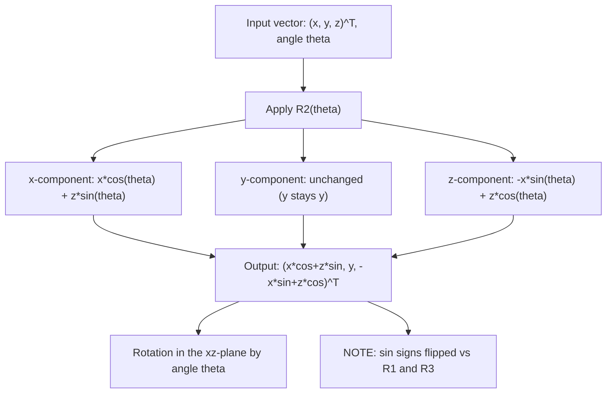

# Rotation about e₂-axis

$$
R_2(\theta) = \begin{bmatrix} \cos\theta & 0 & \sin\theta \\ 0 & 1 & 0 \\ -\sin\theta & 0 & \cos\theta \end{bmatrix}
$$

## Deep Breakdown

What it tells me *(Situation Awareness)*:
$R_2(\theta)$ is the 3D rotation matrix that rotates vectors by angle $\theta$ around the $y$-axis ($e_2$-axis). The $y$-coordinate is unchanged; the $x$-$z$ plane rotates. This is the "pitch" rotation in aerospace/robotics. Note the sign pattern: the $\sin\theta$ entries have opposite signs compared to $R_1$ and $R_3$ — the off-diagonal signs are flipped. This is because rotating the xz-plane by $\theta$ around $y$ follows the right-hand rule differently than the yz or xy plane. In DA/DS: pitch rotation is used in 3D data augmentation, robotics, sensor orientation modeling, and composing Euler angle rotations.

## Flowchart



## Real-world use

### Where it is used

Modeling pitch of drones/cameras in aerial imaging datasets (rotating scene around the horizontal $y$-axis), composing full 3D orientation with Euler angles ($R = R_3 R_2 R_1$), 3D data augmentation for models that should be robust to up-tilt variations, and geodetic coordinate transforms (pitch component of IMU data).

### Problem it solves

Applying a rigid pitch rotation to 3D vectors or point clouds. The $y$-axis acts as the pivot; the $x$ and $z$ coordinates are transformed while $y$ is fixed. This is needed any time 3D data needs to be rotated around the vertical horizontal axis.

### How it solves the problem

The $x$ and $z$ coordinates form the plane perpendicular to the $y$-axis. Rotating this plane by $\theta$ gives: $x' = x\cos\theta + z\sin\theta$, $z' = -x\sin\theta + z\cos\theta$. The sign pattern differs from the standard 2D rotation because of the right-hand rule: the positive rotation from $z$ to $x$ (not $x$ to $z$) defines the positive direction around the $y$-axis.

### Example in a business

A DS augments a drone image dataset by applying pitch rotations: `X_augmented = X @ R2(theta).T` for random $\theta \in [-10°, 10°]$. This prevents an object detection model from failing when the camera is slightly tilted up or down.

## The formula, piece by piece

- $R_2(\theta)$: $3\times3$ rotation matrix around the $e_2 = (0,1,0)$ axis (y-axis)
- Row 1 = $(\cos\theta, 0, \sin\theta)$: new x is $x\cos\theta + z\sin\theta$
- Row 2 = $(0, 1, 0)$: y-coordinate is unchanged
- Row 3 = $(-\sin\theta, 0, \cos\theta)$: new z is $-x\sin\theta + z\cos\theta$
- **Sign flip:** $R_2$ has $+\sin\theta$ in position (1,3) and $-\sin\theta$ in position (3,1) — opposite to $R_1$ and $R_3$
- $R_2(0) = I_3$. $R_2(-\theta) = R_2(\theta)^T = R_2(\theta)^{-1}$
- $\det(R_2) = 1$ (proper rotation)

## The formula in words

"Lock the y-axis. In the xz-plane, apply a rotation: x and z exchange contributions with sine and cosine. But the sign of sine is swapped compared to $R_1$ and $R_3$ due to the right-hand rule around the y-axis." Tiny example: $\theta = 90°$, $v = (1, 0, 0)$ (x-axis unit vector).
$R_2(90°)v = (\cos90°, 0, -\sin90°) = (0, 0, -1)$.
After rotating 90° around y, the positive x-axis maps to the negative z-axis. $\checkmark$ (right-hand rule)

## Critical Concepts

- **Sign anomaly:** in $R_2$, the $+\sin\theta$ is in the top-right and $-\sin\theta$ is in the bottom-left. In $R_1$ and $R_3$, it is reversed ($-\sin\theta$ top-right, $+\sin\theta$ bottom-left). This is not a typo — it follows the right-hand rule.
- **Mnemonic:** $R_1$ rotates yz, $R_2$ rotates xz (with flipped signs), $R_3$ rotates xy.
- **Orthogonal:** $R_2^T R_2 = I$, $\det(R_2) = 1$.
- **Composition:** Euler angles: $R(\psi, \phi, \theta) = R_3(\psi) R_2(\phi) R_1(\theta)$ (yaw, pitch, roll).
- **Gimbal lock:** when $\phi = \pm90°$, the yaw and roll axes align and one degree of freedom is lost.

Use quaternions for robust 3D orientation representation.

## Step-by-step calculation (tiny example)

*Step 1: Build the rotation matrix for $\theta = 30°$*
$\cos30° = \sqrt{3}/2 \approx 0.866$, $\sin30° = 0.5$.
$R_2(30°) = \begin{pmatrix}0.866 & 0 & 0.5\\ 0 & 1 & 0\\ -0.5 & 0 & 0.866\end{pmatrix}$.

*Step 2: Apply to $v = (1, 2, 3)^T$*
$x' = 0.866\cdot1 + 0.5\cdot3 = 0.866+1.5 = 2.366$.
$y' = 2$ (unchanged).
$z' = -0.5\cdot1 + 0.866\cdot3 = -0.5+2.598 = 2.098$.

*Step 3: Verify length preservation*
$\|v\| = \sqrt{1+4+9} = \sqrt{14}$. $\|R_2 v\| = \sqrt{2.366^2+4+2.098^2} = \sqrt{5.598+4+4.402} = \sqrt{14}$. $\checkmark$

## Code examples

### Beginner example (Python)

```python
import numpy as np

# -- Rotation matrix R2(theta) around the y-axis ---


def rotation_y(theta_deg: float) -> np.ndarray:
    """Return 3x3 rotation matrix for rotation around y-axis by theta_deg degrees."""
    theta = np.radians(theta_deg)
    c, s = np.cos(theta), np.sin(theta)
    return np.array([
        [ c, 0.0, s],
        [0.0, 1.0, 0.0],
        [-s, 0.0, c],
    ])


v = np.array([1.0, 0.0, 0.0])  # unit x vector
for angle in [0, 30, 90, 180]:
    R2 = rotation_y(angle)
    v_rot = R2 @ v
    print(f"theta={angle:3d}°: {v} -> {v_rot.round(4)}")


# Verify sign pattern vs R1
def rotation_x(theta_deg):
    t = np.radians(theta_deg)
    return np.array([[1, 0, 0], [0, np.cos(t), -np.sin(t)], [0, np.sin(t), np.cos(t)]])


print(f"\nR2(45) sin pattern (note flipped signs vs R1):")
print(rotation_y(45).round(3))
print(f"\nR1(45) for comparison:")
print(rotation_x(45).round(3))

# Verify orthogonality
R2 = rotation_y(37)
print(f"\nR2^T R2 = I: {np.allclose(R2.T @ R2, np.eye(3))}")
print(f"det(R2) = 1: {np.isclose(np.linalg.det(R2), 1.0)}")
```

### Beginner example (R)

```r
# -- Rotation around y-axis ---
rotation_y <- function(theta_deg) {
  t <- theta_deg * pi / 180
  matrix(c(cos(t), 0, -sin(t), 0, 1, 0, sin(t), 0, cos(t)), nrow=3, ncol=3, byrow=TRUE)
}
v <- c(1, 2, 3)
for (angle in c(0, 30, 90, 180)) {
  R2 <- rotation_y(angle)
  v_rot <- R2 %*% v
  cat(sprintf("theta=%d: (%.4f, %.4f, %.4f) norm=%.4f\n", angle, v_rot[1], v_rot[2], v_rot[3], sqrt(sum(v_rot^2))))
}
```

### Professional example (Python)

```python
import numpy as np
import pandas as pd
np.random.seed(42)

# -- Business scenario: Euler angle composition ---
# Compose yaw (R3), pitch (R2), roll (R1) for full 3D orientation.
# Simulate sensor orientation for an autonomous vehicle dataset.


def rotation_x(theta_deg):
    t = np.radians(theta_deg)
    c, s = np.cos(t), np.sin(t)
    return np.array([[1, 0, 0], [0, c, -s], [0, s, c]])


def rotation_y(theta_deg):
    t = np.radians(theta_deg)
    c, s = np.cos(t), np.sin(t)
    return np.array([[c, 0, s], [0, 1, 0], [-s, 0, c]])


def rotation_z(theta_deg):
    t = np.radians(theta_deg)
    c, s = np.cos(t), np.sin(t)
    return np.array([[c, -s, 0], [s, c, 0], [0, 0, 1]])


N_SENSORS = 20
sensors = []
for i in range(N_SENSORS):
    yaw = np.random.uniform(-180, 180)  # rotation around z (heading)
    pitch = np.random.uniform(-15, 15)  # rotation around y (tilt)
    roll = np.random.uniform(-10, 10)   # rotation around x (lean)

    # Full rotation: R = R3(yaw) R2(pitch) R1(roll)
    R = rotation_z(yaw) @ rotation_y(pitch) @ rotation_x(roll)

    # Verify it is a valid rotation matrix
    is_ortho = np.allclose(R.T @ R, np.eye(3))
    det_ok = np.isclose(np.linalg.det(R), 1.0)
    sensors.append({
        "sensor_id": i + 1,
        "yaw_deg": round(yaw, 1),
        "pitch_deg": round(pitch, 1),
        "roll_deg": round(roll, 1),
        "is_valid_rotation": is_ortho and det_ok,
    })
df = pd.DataFrame(sensors)
print("Euler angle composition (R = R3(yaw) @ R2(pitch) @ R1(roll)):")
print(df.to_string(index=False))
print(f"\nAll valid rotations: {df['is_valid_rotation'].all()}")
```

---

*Source: MML1*
