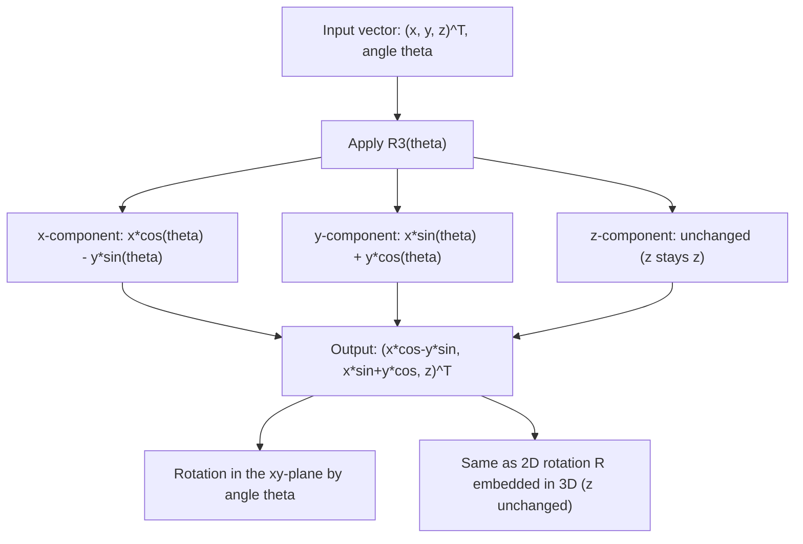

# Rotation about e₃-axis

$$
R_3(\theta) = \begin{bmatrix} \cos\theta & -\sin\theta & 0 \\ \sin\theta & \cos\theta & 0 \\ 0 & 0 & 1 \end{bmatrix}
$$

## Deep Breakdown

What it tells me *(Situation Awareness)*:
$R_3(\theta)$ is the 3D rotation matrix that rotates vectors by angle $\theta$ around the $z$-axis ($e_3$-axis). The $z$-coordinate is unchanged; the $x$-$y$ plane rotates. This is the "yaw" rotation in aerospace/robotics and corresponds exactly to the 2D rotation matrix embedded in 3D. In DA/DS: $R_3$ is the most natural 3D rotation because many 2D patterns extend to 3D by rotating around the vertical $z$-axis. Applications include heading/direction rotation in geographic data, 2D-to-3D data augmentation, and composing Euler angles.

## Flowchart



## Real-world use

### Where it is used

Rotating 2D data in 3D space (when $z=0$ for all points), heading/yaw augmentation in autonomous driving datasets, composing Euler angles as the "yaw" component ($R = R_3(\psi) R_2(\phi) R_1(\theta)$), and transforming geographic coordinates when rotating a map or compass heading.

### Problem it solves

Applying a yaw rotation to 3D data: spinning the data around the vertical axis. This is equivalent to the 2D rotation matrix in the horizontal plane, extended to 3D by keeping the vertical coordinate fixed.

### How it solves the problem

The $x$ and $y$ coordinates form the horizontal plane perpendicular to the $z$-axis. Rotating this plane by $\theta$: $x' = x\cos\theta - y\sin\theta$, $y' = x\sin\theta + y\cos\theta$. The $z$-coordinate is unchanged. This is precisely the 2D rotation formula, embedded in the top-left $2\times2$ block of the $3\times3$ matrix.

### Example in a business

A DS augments a top-down LiDAR point cloud dataset by applying random yaw rotations: `X_aug = X @ R3(theta).T` for $\theta \in [0°, 360°]$. Since the LiDAR is mounted vertically, rotating around $z$ keeps all height values correct while changing the apparent orientation of objects — increasing rotational invariance of the trained detector.

## The formula, piece by piece

- $R_3(\theta)$: $3\times3$ rotation matrix around the $e_3 = (0,0,1)$ axis (z-axis)
- Top-left $2\times2$ block: $\begin{pmatrix}\cos\theta & -\sin\theta\\sin\theta & \cos\theta\end{pmatrix}$ — the standard 2D rotation matrix
- Bottom-right entry: $1$ — z-coordinate is unchanged
- $\theta > 0$: counterclockwise rotation in the xy-plane when viewed from above (positive z direction)
- $R_3(0) = I_3$. $R_3(-\theta) = R_3(\theta)^T = R_3(\theta)^{-1}$
- $\det(R_3) = 1$ (proper rotation)
- Composition: $R_3(\alpha) R_3(\beta) = R_3(\alpha+\beta)$ (rotations around the same axis add)

## The formula in words

"Fix the z-axis. In the xy-plane (horizontal), apply the standard 2D rotation: x and y rotate by angle $\theta$. The z-coordinate stays put. This is just the 2D rotation embedded in 3D." Tiny example: $\theta = 90°$, $v = (1, 0, 5)^T$.
$R_3(90°)v = (\cos90° - 0, \sin90° + 0, 5) = (0, 1, 5)$.
After rotating 90° around z, the positive x-axis maps to the positive y-axis. $\checkmark$

## Critical Concepts

- **2D rotation embedding:** the top-left $2\times2$ block of $R_3$ is the 2D rotation matrix. $R_3$ extends it to 3D.
- **Orthogonal and proper:** $R_3^T R_3 = I$, $\det(R_3) = 1$.
- **Euler angle (yaw):** in aerospace: $\psi$ = yaw = rotation around $z$. Full orientation: $R = R_3(\psi) R_2(\phi) R_1(\theta)$.
- **Commutativity for same axis:** $R_3(\alpha)R_3(\beta) = R_3(\alpha+\beta)$. Not commutative with $R_1$ or $R_2$.
- **Geographic use:** rotating a direction vector $(x, y, 0)$ around $z$ by the compass heading.
- **All three matrices together:** $R_1$ rotates yz, $R_2$ rotates xz (flipped signs), $R_3$ rotates xy.

The 2D rotation block appears in a different position for each.

## Step-by-step calculation (tiny example)

*Step 1: Build the rotation matrix*
$\theta = 60°$. $\cos60° = 0.5$, $\sin60° = \sqrt{3}/2 \approx 0.866$.
$R_3(60°) = \begin{pmatrix}0.5 & -0.866 & 0\\ 0.866 & 0.5 & 0\\ 0 & 0 & 1\end{pmatrix}$.

*Step 2: Apply to $v = (2, 0, 3)^T$*
$x' = 0.5\cdot2 - 0.866\cdot0 = 1$.
$y' = 0.866\cdot2 + 0.5\cdot0 = 1.732$.
$z' = 3$ (unchanged).
$R_3(60°)v = (1, 1.732, 3)^T$.

*Step 3: Verify length preservation*
$\|v\|^2 = 4+0+9 = 13$. $\|R_3 v\|^2 = 1+3+9 = 13$. $\checkmark$

## Code examples

### Beginner example (Python)

```python
import numpy as np

# -- Rotation matrix R3(theta) around the z-axis (yaw) ---


def rotation_z(theta_deg: float) -> np.ndarray:
    """Return 3x3 rotation matrix for rotation around z-axis by theta_deg degrees."""
    theta = np.radians(theta_deg)
    c, s = np.cos(theta), np.sin(theta)
    return np.array([
        [ c, -s, 0.0],
        [ s,  c, 0.0],
        [0.0, 0.0, 1.0],
    ])


# Apply rotation to several test vectors
test_vectors = [
    np.array([1.0, 0.0, 0.0]),
    np.array([0.0, 1.0, 0.0]),
    np.array([1.0, 1.0, 3.0]),
]
for theta in [45, 90, 180]:
    R3 = rotation_z(theta)
    print(f"\ntheta = {theta}°:")
    for v in test_vectors:
        v_rot = R3 @ v
        print(f" {v} -> {v_rot.round(4)}")

# Show embedding of 2D rotation
print(f"\n2D rotation block (top-left 2x2 of R3(30)):")
print(rotation_z(30)[:2, :2].round(4))

# Verify orthogonality and determinant
R3 = rotation_z(37)
print(f"\nOrthogonal: {np.allclose(R3.T @ R3, np.eye(3))}")
print(f"det = 1: {np.isclose(np.linalg.det(R3), 1.0)}")
```

### Beginner example (R)

```r
# -- Rotation around z-axis ---
rotation_z <- function(theta_deg) {
  t <- theta_deg * pi / 180
  matrix(c(cos(t), sin(t), 0, -sin(t), cos(t), 0, 0, 0, 1), nrow=3, ncol=3, byrow=TRUE)
}
v <- c(1, 0, 0)
for (angle in c(0, 45, 90, 180)) {
  R3 <- rotation_z(angle)
  v_rot <- R3 %*% v
  cat(sprintf("theta=%d: (%.4f, %.4f, %.4f)\n", angle, v_rot[1], v_rot[2], v_rot[3]))
}
```

### Professional example (Python)

```python
import numpy as np
import pandas as pd
np.random.seed(42)

# -- Business scenario: yaw augmentation for LiDAR point clouds ---
# Rotate top-down LiDAR points around z-axis to create orientation-augmented data.


def rotation_z(theta_deg: float) -> np.ndarray:
    """3x3 rotation matrix around z-axis."""
    t = np.radians(theta_deg)
    c, s = np.cos(t), np.sin(t)
    return np.array([[c, -s, 0], [s, c, 0], [0, 0, 1]])


N_POINTS = 300
YAW_ANGLES = [0, 45, 90, 135, 180, 225, 270, 315]  # 8 augmented orientations

# Simulated top-down LiDAR: mostly horizontal plane
point_cloud = np.column_stack([
    np.random.uniform(-5, 5, N_POINTS),
    np.random.uniform(-5, 5, N_POINTS),
    np.random.exponential(0.2, N_POINTS),  # small z (mostly flat)
])
results = []
for yaw in YAW_ANGLES:
    R3 = rotation_z(yaw)
    pts_rot = point_cloud @ R3.T

    # Verify z-coordinate unchanged (within float precision)
    z_preserved = np.allclose(point_cloud[:, 2], pts_rot[:, 2])

    # Verify distances from origin preserved
    orig_dists = np.linalg.norm(point_cloud, axis=1)
    rot_dists = np.linalg.norm(pts_rot, axis=1)
    dist_ok = np.allclose(orig_dists, rot_dists)
    results.append({
        "yaw_deg": yaw,
        "z_unchanged": z_preserved,
        "dist_preserved": dist_ok,
        "mean_x_rot": round(pts_rot[:, 0].mean(), 4),
        "mean_y_rot": round(pts_rot[:, 1].mean(), 4),
    })
df = pd.DataFrame(results)
print("Yaw augmentation (rotation around z-axis):")
print(df.to_string(index=False))
print("\nAll augmentations preserve z-heights and pairwise distances.")
```

---

*Source: MML1*
