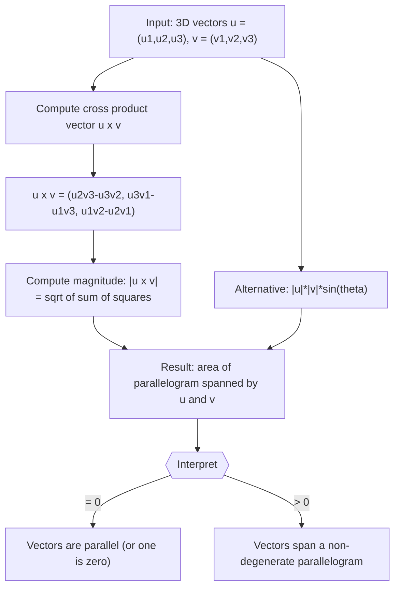

# Cross Product Magnitude

$$
|\vec{u} \times \vec{v}| = |\vec{u}||\vec{v}|\sin\theta
$$

## Deep Breakdown

What it tells me *(Situation Awareness)*:
The cross product is defined only in 3D. While the dot product gives a scalar (alignment), the cross product $\vec{u} \times \vec{v}$ gives a new vector perpendicular to both $\vec{u}$ and $\vec{v}$. Its magnitude $|\vec{u} \times \vec{v}| = |\vec{u}||\vec{v}|\sin\theta$ equals the area of the parallelogram spanned by $\vec{u}$ and $\vec{v}$. When $\sin\theta = 0$ (vectors are parallel), the magnitude is zero — the cross product is the zero vector. In DA/DS this is less common than the dot product, but it appears in 3D geometry computations, normal vector computation for surfaces, and area-based features.

## Flowchart



## Real-world use

### Where it is used

Computing surface normals in 3D graphics and geometry processing, determining the area of triangles in mesh analysis (half the cross product magnitude), checking if two 3D vectors are parallel ($|\vec{u} \times \vec{v}| = 0$), and in physics simulations (torque, angular momentum). In ML: 3D point cloud processing, computer vision geometry, and orientation estimation.

### Problem it solves

Given two 3D vectors, you need either the perpendicular direction (for surface normals) or the area measure (for triangle area, orientation). The dot product only measures alignment; the cross product measures the orthogonal component. Together they fully characterize the geometric relationship between two 3D vectors.

### How it solves the problem

$|\vec{u} \times \vec{v}| = |\vec{u}||\vec{v}|\sin\theta$: when the vectors are perpendicular ($\theta = 90°$), $\sin\theta = 1$ and the magnitude is maximized at $|\vec{u}||\vec{v}|$ (largest possible parallelogram). When parallel ($\theta = 0°$ or $180°$), $\sin\theta = 0$ and the magnitude is zero (degenerate parallelogram). The actual cross product vector $\vec{u} \times \vec{v}$ is computed via the determinant formula and points perpendicular to both vectors (right-hand rule).

### Example in a business

A data scientist working on LiDAR point cloud analysis for autonomous vehicles needs to compute surface normals for each small patch of points. For a triangular face with vertices $A$, $B$, $C$: edge vectors $\vec{AB} = B-A$, $\vec{AC} = C-A$. Normal $= \vec{AB} \times \vec{AC}$ (cross product gives a vector perpendicular to the surface). The magnitude gives the area of the triangle ($\frac{1}{2}|\vec{AB} \times \vec{AC}|$), used for weighting the normal.

## The formula, piece by piece

- $|\vec{u} \times \vec{v}|$: the magnitude (scalar) of the cross product vector; this formula gives you the area
- $|\vec{u}|$: magnitude of $\vec{u}$ — the length
- $|\vec{v}|$: magnitude of $\vec{v}$ — the length
- $\sin\theta$: sine of the angle between the vectors; ranges 0 to 1 for $\theta \in [0°, 180°]$
- The full cross product vector: $\vec{u} \times \vec{v} = (u_2v_3 - u_3v_2,\; u_3v_1 - u_1v_3,\; u_1v_2 - u_2v_1)$

## The formula in words

"The magnitude of the cross product equals the product of the two vector lengths times the sine of the angle between them. This equals the area of the parallelogram formed by placing the two vectors tail-to-tail." Tiny example: $\vec{u} = (1, 0, 0)$ (unit $x$-axis), $\vec{v} = (0, 1, 0)$ (unit $y$-axis).
$\theta = 90°$, $\sin\theta = 1$.
$|\vec{u} \times \vec{v}| = 1 \cdot 1 \cdot 1 = 1$.
Direct: $\vec{u} \times \vec{v} = (0\cdot0 - 0\cdot1,\; 0\cdot0 - 1\cdot0,\; 1\cdot1 - 0\cdot0) = (0, 0, 1)$. Magnitude = 1. $\checkmark$

## Critical Concepts

- **Only defined in 3D:** the cross product is a 3D operation. In 2D, the "cross product" gives only a scalar (the $z$-component).
- **Anti-commutativity:** $\vec{u} \times \vec{v} = -(\vec{v} \times \vec{u})$; swapping order reverses the direction.
- **Parallel test:** $\vec{u} \times \vec{v} = \vec{0}$ if and only if $\vec{u}$ and $\vec{v}$ are parallel (including one being zero).
- **Area interpretation:** $|\vec{u} \times \vec{v}|$ = area of parallelogram. Triangle area = $\frac{1}{2}|\vec{u} \times \vec{v}|$.
- **Perpendicular result:** the cross product vector is always perpendicular to both inputs: $(\vec{u} \times \vec{v}) \cdot \vec{u} = 0$ and $(\vec{u} \times \vec{v}) \cdot \vec{v} = 0$.
- **Right-hand rule:** curl the fingers from $\vec{u}$ to $\vec{v}$; the thumb points in the direction of $\vec{u} \times \vec{v}$.

## Step-by-step calculation (tiny example)

*Step 1: Write out the vectors and use the determinant formula*
$\vec{u} = (2, 1, 0)$, $\vec{v} = (0, 3, 1)$.
$\vec{u} \times \vec{v} = (u_2v_3 - u_3v_2,\; u_3v_1 - u_1v_3,\; u_1v_2 - u_2v_1)$
$= (1\cdot1 - 0\cdot3,\; 0\cdot0 - 2\cdot1,\; 2\cdot3 - 1\cdot0)$

*Step 2: Evaluate each component*
First: $1 - 0 = 1$. Second: $0 - 2 = -2$. Third: $6 - 0 = 6$.
$\vec{u} \times \vec{v} = (1, -2, 6)$.

*Step 3: Compute the magnitude*
$|\vec{u} \times \vec{v}| = \sqrt{1^2 + (-2)^2 + 6^2} = \sqrt{1+4+36} = \sqrt{41} \approx 6.403$.
This is the area of the parallelogram spanned by $\vec{u}$ and $\vec{v}$.

## Code examples

### Beginner example (Python)

```python
import numpy as np   # -- Cross product magnitude: perpendicular vector and area ---
u = np.array([2.0, 1.0, 0.0])
v = np.array([0.0, 3.0, 1.0])
cross_vec = np.cross(u, v)   # full cross product vector
cross_mag = np.linalg.norm(cross_vec)   # magnitude = parallelogram area # Verify perpendicularity
perp_u = np.dot(cross_vec, u)
perp_v = np.dot(cross_vec, v)
print(f"u = {u}")
print(f"v = {v}")
print(f"u x v = {cross_vec}")
print(f"|u x v| = {cross_mag:.4f}")
print(f"Area parallelogram = {cross_mag:.4f}")
print(f"Area triangle = {cross_mag/2:.4f}")
print(f"\n(u x v) . u = {perp_u:.6f} (should be 0)")
print(f"(u x v) . v = {perp_v:.6f} (should be 0)")
print(f"Perpendicular to both: {np.isclose(perp_u, 0) and np.isclose(perp_v, 0)}")
```

### Beginner example (R)

```r
# Cross product in R (no built-in, compute manually)
cross_product_3d <- function(u, v) { c( u[2]*v[3] - u[3]*v[2], u[3]*v[1] - u[1]*v[3], u[1]*v[2] - u[2]*v[1] )
}
u <- c(2, 1, 0)
v <- c(0, 3, 1)
cross_vec <- cross_product_3d(u, v)
cross_mag <- sqrt(sum(cross_vec^2))
cat("u x v :", cross_vec, "\n")
cat(sprintf("|u x v| : %.4f\n", cross_mag))
cat(sprintf("Area parallelogram: %.4f\n", cross_mag))
cat(sprintf("Perpendicular to u: %.6f (should be 0)\n", sum(cross_vec * u)))
cat(sprintf("Perpendicular to v: %.6f (should be 0)\n", sum(cross_vec * v)))
```

### Professional example (Python)

```python
import numpy as np
import pandas as pd
np.random.seed(42)   # -- Business scenario: triangle area computation in 3D mesh analysis ---
# Point cloud of a building facade, triangulated into faces.
# Compute area of each triangle face using cross product magnitude.
N_TRIANGLES = 100   # Random 3D vertices for N triangles (simulating mesh faces)
vertices_A = np.random.uniform(0, 10, (N_TRIANGLES, 3))
vertices_B = np.random.uniform(0, 10, (N_TRIANGLES, 3))
vertices_C = np.random.uniform(0, 10, (N_TRIANGLES, 3))   # Edge vectors from A
AB = vertices_B - vertices_A
AC = vertices_C - vertices_A   # Cross products (vectorized)
cross_products = np.cross(AB, AC)   # shape (N_TRIANGLES, 3)
cross_magnitudes = np.linalg.norm(cross_products, axis=1)   # shape (N_TRIANGLES,)
triangle_areas = cross_magnitudes / 2.0
total_area = triangle_areas.sum()
print(f"Number of triangles : {N_TRIANGLES}")
print(f"Total surface area : {total_area:.2f} sq units")
print(f"Mean triangle area : {triangle_areas.mean():.4f}")
print(f"Max triangle area : {triangle_areas.max():.4f}")
print(f"Min triangle area : {triangle_areas.min():.6f}")   # Find the largest triangles (high priority for refinement)
top5_idx = np.argsort(triangle_areas)[::-1][:5]
top5_df = pd.DataFrame({ "triangle_id": top5_idx, "area": triangle_areas[top5_idx].round(4), "cross_mag": cross_magnitudes[top5_idx].round(4),
})
print("\nTop 5 largest triangles:")
print(top5_df.to_string(index=False))
```

---

*Source: 1300 p. 133*
