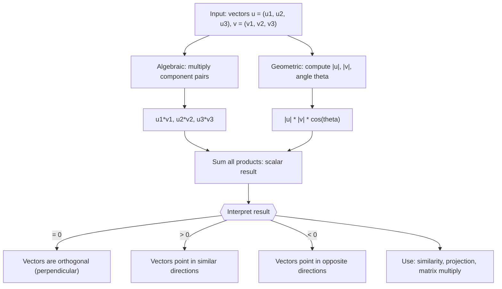

# Dot Product

$$
\vec{u} \cdot \vec{v} = \langle u, v \rangle = u_1 v_1 + u_2 v_2 + u_3 v_3 = |\vec{u}||\vec{v}|\cos\theta
$$

## Deep Breakdown

What it tells me *(Situation Awareness)*:
The dot product (also called inner product or scalar product) takes two vectors and returns a single number. The formula $\vec{u} \cdot \vec{v} = u_1 v_1 + u_2 v_2 + u_3 v_3$ is the algebraic definition; $|\vec{u}||\vec{v}|\cos\theta$ is the geometric interpretation. When $\cos\theta = 0$ (vectors are perpendicular), the dot product is zero. When $\cos\theta = 1$ (vectors point the same direction), the dot product equals the product of their magnitudes. This is the workhorse of linear algebra: it computes projections, measures similarity, and underlies matrix multiplication, neural network activations, attention scores, and OLS regression.

## Flowchart



## Real-world use

### Where it is used

Matrix-vector multiplication (every row of a matrix dotted with the input vector), cosine similarity for text/embedding search, neural network weighted sum before activation ($z = \vec{w} \cdot \vec{x} + b$), OLS regression prediction ($\hat{y} = \vec{x}^T \vec{\beta}$), computing projections onto axes or subspaces, and attention scores in transformers.

### Problem it solves

Collapses two vectors into a single scalar that measures how much they "align." This single number encodes both magnitude and directional relationship, enabling you to rank items by similarity, compute how much of one vector lies along another (projection), and build matrix algebra on top of repeated dot products.

### How it solves the problem

$\vec{u} \cdot \vec{v} = \sum_i u_i v_i = |\vec{u}||\vec{v}|\cos\theta$. The algebraic form sums the products of corresponding components, which is a numerically efficient $O(n)$ computation. The geometric form shows why: each $u_i v_i$ contributes proportionally to how aligned the $i$-th components are. When all components are equally scaled (unit vectors), the result is exactly $\cos\theta$, which is why cosine similarity divides by the norms.

### Example in a business

A recommendation engine embeds each product as a 128-dimensional vector. To find products similar to item $\vec{p}$, it computes $\vec{p} \cdot \vec{q}_j$ for every candidate $\vec{q}_j$ in the catalog. Items with large positive dot products point in similar directions in embedding space (shared attributes, user taste signals). The top-$k$ dot products identify the most relevant recommendations.

## The formula, piece by piece

- $\vec{u} \cdot \vec{v}$: the dot product notation; also written $\langle u, v \rangle$ (inner product notation) or $u^T v$ (matrix notation for column vectors)
- $u_1 v_1 + u_2 v_2 + u_3 v_3$: multiply matching components, then sum; extends to $n$ dimensions as $\sum_{i=1}^n u_i v_i$
- $|\vec{u}|$: magnitude (length) of $\vec{u}$; equals $\sqrt{\vec{u} \cdot \vec{u}}$
- $|\vec{v}|$: magnitude of $\vec{v}$
- $\cos\theta$: cosine of the angle between the two vectors; ranges from $-1$ (opposite) to $+1$ (same direction), with $0$ meaning perpendicular
- The two forms are equivalent; use algebraic for computation, geometric for interpretation

## The formula in words

"Multiply each pair of matching components, then add all the products together. Alternatively, multiply the lengths of both vectors by the cosine of the angle between them." Tiny example: $\vec{u} = (1, 2, 3)$, $\vec{v} = (4, -5, 6)$.
$\vec{u} \cdot \vec{v} = 1\cdot4 + 2\cdot(-5) + 3\cdot6 = 4 - 10 + 18 = 12$.
Angle check: $|\vec{u}| = \sqrt{14}$, $|\vec{v}| = \sqrt{77}$.
$\cos\theta = 12 / (\sqrt{14}\cdot\sqrt{77}) = 12/32.83 \approx 0.366$, so $\theta \approx 68.6°$.

## Critical Concepts

- **Scalar result:** the dot product of two $n$-dimensional vectors is a single number, not a vector.
- **Commutativity:** $\vec{u} \cdot \vec{v} = \vec{v} \cdot \vec{u}$ always.
- **Orthogonality test:** $\vec{u} \cdot \vec{v} = 0 \Leftrightarrow \vec{u} \perp \vec{v}$ (they are perpendicular). Critical for checking orthogonal bases.
- **Self-dot-product = squared norm:** $\vec{v} \cdot \vec{v} = |\vec{v}|^2 = \sum v_i^2$.
- **Cosine similarity vs dot product:** cosine similarity normalizes by magnitudes first: $\cos\theta = (\vec{u} \cdot \vec{v}) / (|\vec{u}||\vec{v}|)$. Pure dot product is not scale-invariant; longer vectors yield larger values regardless of direction.
- **Connection to matrix multiply:** the $(i,j)$ entry of $AB$ is the dot product of row $i$ of $A$ with column $j$ of $B$. All matrix operations reduce to repeated dot products.
- **In NumPy:** `np.dot(u, v)` or `u @ v` for vectors; both are equivalent.

## Step-by-step calculation (tiny example)

*Step 1: Identify matching components*
$\vec{u} = (3, 0, -1)$, $\vec{v} = (2, 5, 4)$.
Pairs: $(3,2)$, $(0,5)$, $(-1,4)$.

*Step 2: Multiply each pair*
$3 \cdot 2 = 6$, $\quad 0 \cdot 5 = 0$, $\quad (-1) \cdot 4 = -4$.

*Step 3: Sum the products*
$\vec{u} \cdot \vec{v} = 6 + 0 + (-4) = 2$.
Interpretation: small positive value means the vectors are mostly perpendicular with a slight alignment.

## Code examples

### Beginner example (Python)

```python
import numpy as np   # -- Dot product: algebraic and geometric forms ---
u = np.array([1.0, 2.0, 3.0])
v = np.array([4.0, -5.0, 6.0])
dot_algebraic = np.dot(u, v)   # or u @ v
dot_loop = sum(ui * vi for ui, vi in zip(u, v))
mag_u = np.linalg.norm(u)
mag_v = np.linalg.norm(v)
cos_theta = dot_algebraic / (mag_u * mag_v)
theta_deg = np.degrees(np.arccos(np.clip(cos_theta, -1, 1)))
print(f"u = {u}")
print(f"v = {v}")
print(f"\nDot product (np.dot): {dot_algebraic}")
print(f"Dot product (loop): {dot_loop}")
print(f"\n|u| = {mag_u:.4f}, |v| = {mag_v:.4f}")
print(f"cos(theta) = {cos_theta:.4f}")
print(f"Angle theta = {theta_deg:.2f} degrees")
print(f"\nOrthogonal? {np.isclose(dot_algebraic, 0)}")
```

### Beginner example (R)

```r
# -- Dot product: algebraic and geometric forms ---
u <- c(1, 2, 3)
v <- c(4, -5, 6)
dot_product <- sum(u * v)  # component multiply then sum
mag_u <- sqrt(sum(u^2))
mag_v <- sqrt(sum(v^2))
cos_theta <- dot_product / (mag_u * mag_v)
theta_deg <- acos(cos_theta) * 180 / pi
cat(sprintf("Dot product : %.4f\n", dot_product))
cat(sprintf("|u| = %.4f, |v| = %.4f\n", mag_u, mag_v))
cat(sprintf("cos(theta) : %.4f\n", cos_theta))
cat(sprintf("Angle (degrees) : %.2f\n", theta_deg))
cat(sprintf("Orthogonal? : %s\n", isTRUE(all.equal(dot_product, 0))))
```

### Professional example (Python)

```python
import numpy as np
import pandas as pd
np.random.seed(42)   # -- Business scenario: embedding similarity search ---
# A recommendation engine stores product embeddings.
# Find the top-5 most similar products to a query product using dot product
# (and compare to cosine similarity to show the difference).
N_PRODUCTS = 200
EMBED_DIM = 16
embeddings = np.random.randn(N_PRODUCTS, EMBED_DIM)   # simulated embeddings
product_ids = [f"prod_{i:03d}" for i in range(N_PRODUCTS)]   # Query product: product 0
query_idx = 0
query_vec = embeddings[query_idx]   # Dot product scores (raw)
dot_scores = embeddings @ query_vec   # shape (N_PRODUCTS,) # Cosine similarity scores (normalized)
norms = np.linalg.norm(embeddings, axis=1, keepdims=True)
embeddings_normed = embeddings / np.clip(norms, 1e-10, None)
cosine_scores = embeddings_normed @ (query_vec / np.linalg.norm(query_vec))   # Top-5 by each metric (excluding the query itself)
k = 5
mask = np.arange(N_PRODUCTS) != query_idx
top_dot = np.argsort(dot_scores[mask])[::-1][:k]
top_cosine = np.argsort(cosine_scores[mask])[::-1][:k]
all_product_ids_masked = [pid for i, pid in enumerate(product_ids) if i != query_idx]
results = pd.DataFrame({ "rank": range(1, k + 1), "top_dot_prod": [all_product_ids_masked[i] for i in top_dot], "dot_score": dot_scores[mask][top_dot].round(4), "top_cosine": [all_product_ids_masked[i] for i in top_cosine], "cosine_score": cosine_scores[mask][top_cosine].round(4),
})
print(f"Query: {product_ids[query_idx]} (dim={EMBED_DIM})\n")
print(results.to_string(index=False))
print("\nNote: top-k results differ between raw dot product and cosine similarity")
print("because dot product favors high-magnitude vectors regardless of direction.")
```

### Professional example (R)

```r
# Top-5 similar products via dot product vs cosine similarity
set.seed(42)
N_PRODUCTS <- 200
EMBED_DIM <- 16
embeddings <- matrix(rnorm(N_PRODUCTS * EMBED_DIM), nrow = N_PRODUCTS)
query_vec <- embeddings[1, ]
dot_scores <- embeddings %*% query_vec
norms <- sqrt(rowSums(embeddings^2))
norms[norms < 1e-10] <- 1e-10
embeddings_normed <- embeddings / norms
cosine_scores <- embeddings_normed %*% (query_vec / sqrt(sum(query_vec^2)))
mask <- (1:N_PRODUCTS) != 1
top_dot <- order(dot_scores[mask], decreasing = TRUE)[1:5]
top_cosine <- order(cosine_scores[mask], decreasing = TRUE)[1:5]
cat("Query: prod_001 Top-5 by dot product and by cosine (differ when magnitudes vary)\n")
print(data.frame(rank = 1:5, dot_score = round(dot_scores[mask][top_dot], 4), cosine_score = round(cosine_scores[mask][top_cosine], 4)))
```

---

*Source: 1300 p. 131*
