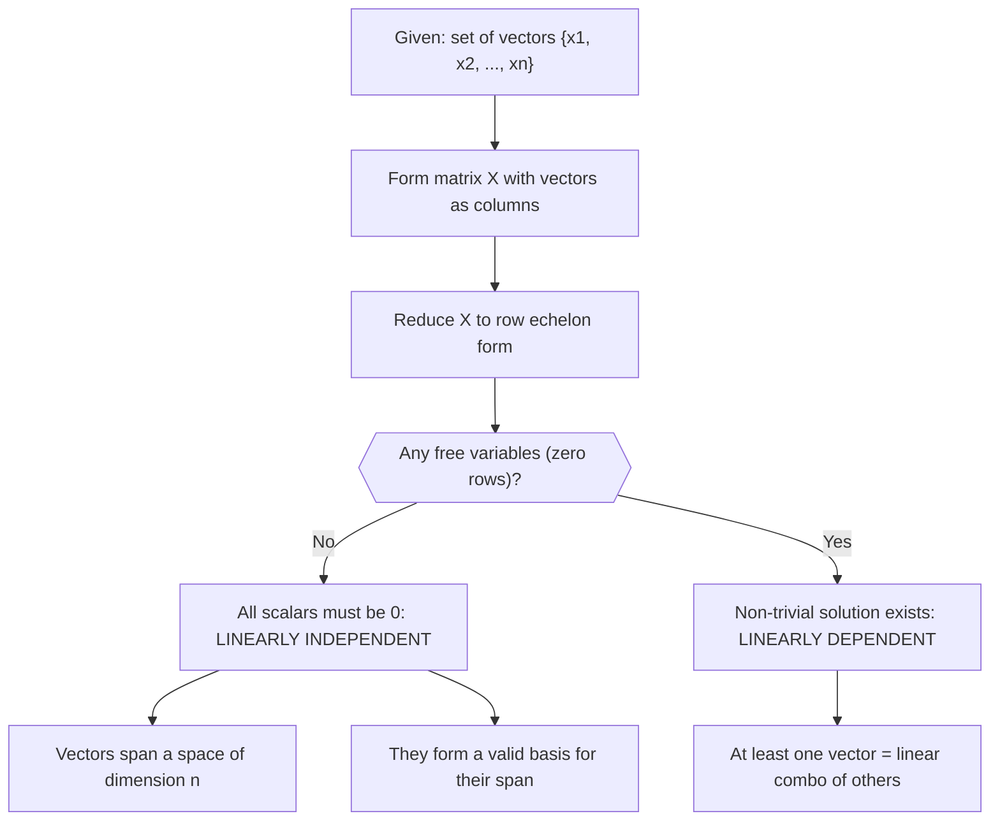

# Linear independence

$$
\sum_{i=1}^n \lambda_i x_i = 0 \implies \lambda_1 = \lambda_2 = \dots = \lambda_n = 0
$$

## Deep Breakdown

What it tells me *(Situation Awareness)*:
A set of vectors $\{x_1, x_2, \ldots, x_n\}$ is **linearly independent** if the only way to get the zero vector by taking a linear combination $\sum_{i=1}^n \lambda_i x_i = \vec{0}$ is to set all scalars $\lambda_i = 0$. If you can get $\vec{0}$ with at least one $\lambda_i \neq 0$, the vectors are **linearly dependent** — meaning at least one vector is redundant (it can be expressed as a combination of the others). This is the foundation of rank, basis, feature multicollinearity, matrix invertibility, and dimensionality.

## Flowchart



## Real-world use

### Where it is used

Detecting multicollinearity in regression features (dependent columns inflate variance), checking if a set of features spans the full feature space (rank of design matrix), PCA (eigenvectors are linearly independent by construction), verifying that a basis is valid, and determining whether a system of equations has a unique solution.

### Problem it solves

If your feature matrix $X$ has linearly dependent columns, $X^T X$ is singular (non-invertible), and OLS has no unique solution. More generally, redundant features carry no new information — they waste parameters, create numerical instability, and make model interpretation unreliable. Linear independence is the minimum requirement for a useful, non-redundant feature set.

### How it solves the problem

Testing linear independence: form the matrix $X$ with the vectors as columns, compute its rank. If $\text{rank}(X) = n$ (number of vectors), they are independent. If $\text{rank}(X) < n$, at least one vector is a linear combination of the others. Equivalently: $\det(X^T X) \neq 0$ iff columns of $X$ are linearly independent (for square $X$).

### Example in a business

A DS builds a regression model with features: `total_spend`, `avg_basket_size`, `n_transactions`, and `revenue` (which equals `total_spend`). The last feature is an exact linear combination of the first: $\text{revenue} = 1 \cdot \text{total\_spend}$. The four columns are linearly dependent. The design matrix is rank-deficient, `np.linalg.lstsq` will warn about rank deficiency, and coefficients will be unreliable. Solution: remove the redundant feature.

## The formula, piece by piece

- $\sum_{i=1}^n \lambda_i x_i$: a linear combination of the vectors $x_1, \ldots, x_n$ with scalar coefficients $\lambda_i$
- $= \vec{0}$: the result equals the zero vector
- $\implies \lambda_1 = \lambda_2 = \ldots = \lambda_n = 0$: the implication says: IF the linear combination is zero, THEN all coefficients must be zero
- **Contrapositive:** if at least one $\lambda_i \neq 0$ can make the sum zero, the vectors are **linearly dependent**

## The formula in words

"Take any weighted combination of these vectors. If the only way to make that combination equal zero is to make every weight zero, the vectors are linearly independent. If you can find a non-zero set of weights that still combines to zero, they are dependent — meaning one vector is a redundant copy of some combination of others." Tiny example: $x_1 = (1, 0)$, $x_2 = (0, 1)$, $x_3 = (2, 3)$.
$\lambda_1(1,0) + \lambda_2(0,1) + \lambda_3(2,3) = (0,0)$.
$\lambda_1 + 2\lambda_3 = 0$ and $\lambda_2 + 3\lambda_3 = 0$.
Choose $\lambda_3 = 1$: $\lambda_1 = -2$, $\lambda_2 = -3$.
Non-trivial solution exists: the set is **linearly dependent** ($x_3 = 2x_1 + 3x_2$).

## Critical Concepts

- **Rank = number of independent vectors:** $\text{rank}(X)$ is the maximum number of linearly independent columns.
- **Dependent $\Leftrightarrow$ singular matrix:** for a square matrix, linear dependence of columns $\Leftrightarrow$ $\det = 0$ $\Leftrightarrow$ non-invertible.
- **Multicollinearity:** in regression, near-linear-dependence (high VIF, correlation $\approx 1$) causes coefficient instability even if not exactly zero.
- **Basis requirement:** a basis for a vector space requires exactly $n$ linearly independent vectors where $n$ is the dimension.
- **Practical test:** `np.linalg.matrix_rank(X)` gives the numerical rank. Condition number `np.linalg.cond(X)` measures near-dependence.
- **Not about orthogonality:** independent vectors do not need to be perpendicular.

Orthogonal vectors are always independent, but independent vectors are not always orthogonal.

## Step-by-step calculation (tiny example)

*Step 1: Set up the linear combination equation*
Test $x_1 = (1, 2)$, $x_2 = (3, 4)$.
$\lambda_1(1, 2) + \lambda_2(3, 4) = (0, 0)$.
$\lambda_1 + 3\lambda_2 = 0$ and $2\lambda_1 + 4\lambda_2 = 0$.

*Step 2: Solve the system*
From the first equation: $\lambda_1 = -3\lambda_2$.
Substitute: $2(-3\lambda_2) + 4\lambda_2 = -6\lambda_2 + 4\lambda_2 = -2\lambda_2 = 0 \Rightarrow \lambda_2 = 0$.
Then $\lambda_1 = 0$.

*Step 3: Conclude*
Only solution is $\lambda_1 = \lambda_2 = 0$: **linearly independent**. $\checkmark$ Also: $\det\begin{bmatrix}1&3\\2&4\end{bmatrix} = 4-6 = -2 \neq 0$ confirms it.

## Code examples

### Beginner example (Python)

```python
import numpy as np   # -- Linear independence: rank test and dependency detection ---
# Case 1: independent vectors
X_indep = np.array([[1, 3], [2, 4]], dtype=float)   # Case 2: dependent (x3 = 2*x1 + 3*x2)
x1 = np.array([1.0, 0.0])
x2 = np.array([0.0, 1.0])
x3 = 2 * x1 + 3 * x2   # explicitly dependent
X_dep = np.column_stack([x1, x2, x3])
rank_indep = np.linalg.matrix_rank(X_indep)
rank_dep = np.linalg.matrix_rank(X_dep)
print("=== Case 1: Independent ===")
print(f"Matrix:\n{X_indep}")
print(f"Rank = {rank_indep} (== n_cols {X_indep.shape[1]}? {rank_indep == X_indep.shape[1]})")
print(f"det = {np.linalg.det(X_indep):.4f}")
print("\n=== Case 2: Dependent ===")
print(f"x3 = 2*x1 + 3*x2 = {x3}")
print(f"Rank = {rank_dep} (< n_cols {X_dep.shape[1]}? {rank_dep < X_dep.shape[1]})")
```

### Beginner example (R)

```r
# -- Linear independence: rank test ---
# Independent
X_indep <- matrix(c(1, 3, 2, 4), nrow = 2, byrow = TRUE)
# Dependent
x1 <- c(1, 0)
x2 <- c(0, 1)
x3 <- 2 * x1 + 3 * x2
X_dep <- cbind(x1, x2, x3)
rank_indep <- qr(X_indep)$rank
rank_dep <- qr(X_dep)$rank
cat("=== Case 1: Independent ===\n")
cat("Matrix:\n"); print(X_indep)
cat(sprintf("Rank = %d (n_cols = %d, independent? %s)\n", rank_indep, ncol(X_indep), rank_indep == ncol(X_indep)))
cat("\n=== Case 2: Dependent ===\n")
cat("x3 =", x3, "\n")
cat(sprintf("Rank = %d (n_cols = %d, dependent? %s)\n", rank_dep, ncol(X_dep), rank_dep < ncol(X_dep)))
```

### Professional example (Python)

```python
import numpy as np
import pandas as pd
from itertools import combinations
np.random.seed(42)   # -- Business scenario: multicollinearity detection in regression features ---
# Build a feature set, inject a dependent feature, detect via rank and VIF.
N = 300
feature_names = ["ad_spend", "n_impressions", "click_rate", "total_revenue", "session_duration"]   # Generate base features
ad_spend = np.random.uniform(1000, 10000, N)
n_impressions = ad_spend * np.random.uniform(8, 12, N)   # correlated
click_rate = np.random.uniform(0.01, 0.08, N)
session_duration = np.random.uniform(60, 360, N)
# Inject EXACT dependency: total_revenue = 5 * ad_spend (bad!)
total_revenue = 5.0 * ad_spend + np.random.normal(0, 50, N)   # nearly dependent
X = np.column_stack([ad_spend, n_impressions, click_rate, total_revenue, session_duration])
rank = np.linalg.matrix_rank(X)
cond = np.linalg.cond(X)
print(f"Feature matrix shape : {X.shape}")
print(f"Rank : {rank} (max possible: {X.shape[1]})")
print(f"Condition number : {cond:.2e} (> 1e4 = near-singular)")
print(f"Near-multicollinear : {cond > 1e4}")   # Pairwise correlations
corr_matrix = np.corrcoef(X.T)
print("\nPairwise correlations (|r| > 0.9 flags near-dependency):")
for i, j in combinations(range(len(feature_names)), 2):
    r = corr_matrix[i, j]
    if abs(r) > 0.9:
        print(f" {feature_names[i]} <-> {feature_names[j]} : r = {r:.4f} ** HIGH **")
    else:
        print(f" {feature_names[i]} <-> {feature_names[j]} : r = {r:.4f}")
print("\nRecommendation: remove or consolidate near-dependent features before regression.")
```

---

*Source: MML1 p. 46*
