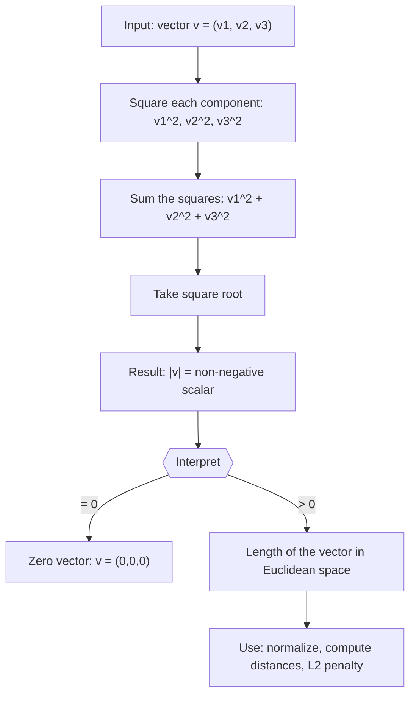

# Magnitude

$$
|\vec{v}| = \sqrt{v_1^2 + v_2^2 + v_3^2}
$$

## Deep Breakdown

What it tells me *(Situation Awareness)*:
The magnitude (also called the Euclidean norm or $L_2$ norm) of a 3D vector $\vec{v} = (v_1, v_2, v_3)$ is $|\vec{v}| = \sqrt{v_1^2 + v_2^2 + v_3^2}$. It is the geometric length of the vector — the straight-line distance from the origin to the tip of the vector. This is just the 3D generalization of the Pythagorean theorem: $\sqrt{a^2+b^2}$ in 2D, extended to three (or $n$) dimensions. In DA/DS: computing $L_2$ regularization penalty $\|\vec{w}\|_2^2$, normalizing vectors to unit length, measuring distance between data points, checking gradient magnitude for clipping, and interpreting feature vector norms.

## Flowchart



## Real-world use

### Where it is used

$L_2$ norm of the weight vector in ridge regression ($\lambda\|\vec{w}\|_2^2$), computing the Euclidean distance between two points ($|\vec{x} - \vec{y}|$), normalizing vectors before computing cosine similarity, measuring gradient magnitude for gradient clipping, and checking convergence (run until $|\vec{x}_{t+1} - \vec{x}_t| < \epsilon$).

### Problem it solves

You need a single number that captures "how large" or "how long" a vector is. Without magnitude, you cannot normalize (direction-only), you cannot measure distances, and you cannot compare whether two vectors are similarly scaled. The magnitude is the bridge from directional vectors to scalable quantities.

### How it solves the problem

By squaring each component, you make all contributions positive. The square root reverses the squaring and gives the geometric length. Squaring before summing ensures that negative components (pointing in the negative direction of an axis) contribute equally to the length as positive ones. This is the unique norm that is rotation-invariant: $|\vec{v}|$ does not change if you rotate the coordinate system.

### Example in a business

A DS applies L2 regularization (Ridge regression): the penalty added to the loss is $\lambda \sum_{j=1}^p w_j^2 = \lambda \|\vec{w}\|_2^2$ where $\|\vec{w}\|_2 = \sqrt{w_1^2 + w_2^2 + \ldots + w_p^2}$. This penalizes models with large weight magnitudes, preventing overfitting. The optimizer minimizes both the fit quality and the squared magnitude of the weight vector simultaneously.

## The formula, piece by piece

- $|\vec{v}|$: the magnitude (norm) of $\vec{v}$; also written $\|\vec{v}\|$ or $\|\vec{v}\|_2$
- $v_1^2 + v_2^2 + v_3^2$: sum of squares of all components; always $\geq 0$
- $\sqrt{\cdot}$: square root; converts the sum of squares back to a length
- $\vec{v} \cdot \vec{v}$: the self-dot-product equals $v_1^2 + v_2^2 + v_3^2 = |\vec{v}|^2$, so $|\vec{v}| = \sqrt{\vec{v} \cdot \vec{v}}$
- Extension to $n$ dimensions: $\|\vec{v}\|_2 = \sqrt{\sum_{i=1}^n v_i^2}$

## The formula in words

"Square every component of the vector, add all the squares together, then take the square root. This gives you the straight-line length of the vector — the distance from the origin to the vector's tip." Tiny example: $\vec{v} = (3, 4, 0)$.
$|\vec{v}| = \sqrt{3^2 + 4^2 + 0^2} = \sqrt{9 + 16 + 0} = \sqrt{25} = 5$.
(Classic 3-4-5 right triangle in the $xy$-plane.)

## Critical Concepts

- **Always non-negative:** $|\vec{v}| \geq 0$; equals 0 if and only if $\vec{v} = \vec{0}$.
- **Relation to dot product:** $|\vec{v}|^2 = \vec{v} \cdot \vec{v}$; this is frequently useful for avoiding the square root when comparing magnitudes ($|\vec{u}| < |\vec{v}| \Leftrightarrow |\vec{u}|^2 < |\vec{v}|^2$).
- **Triangle inequality:** $|\vec{u} + \vec{v}| \leq |\vec{u}| + |\vec{v}|$; the direct path is never longer than the detour.
- **Scaling:** $|k\vec{v}| = |k| \cdot |\vec{v}|$; scaling the vector scales the magnitude by $|k|$.
- **In NumPy:** `np.linalg.norm(v)` computes the $L_2$ norm. `np.linalg.norm(v, ord=2)` is explicit. For the squared norm: `np.dot(v, v)` or `(v**2).sum()`.
- **$L_2$ vs $L_1$ vs $L_\infty$:** $L_2$ is the standard Euclidean norm (squared and rooted). $L_1 = \sum |v_i|$ (Manhattan). $L_\infty = \max|v_i|$ (Chebyshev).

They measure "size" differently.

## Step-by-step calculation (tiny example)

*Step 1: Write out the components and square each*
$\vec{v} = (2, -3, 6)$.
$2^2 = 4$, $(-3)^2 = 9$, $6^2 = 36$.

*Step 2: Sum the squares*
$4 + 9 + 36 = 49$.

*Step 3: Take the square root*
$|\vec{v}| = \sqrt{49} = 7$.
Interpretation: the vector has length 7 units in 3D Euclidean space.

## Code examples

### Beginner example (Python)

```python
import numpy as np   # -- Vector magnitude: multiple methods ---
v = np.array([2.0, -3.0, 6.0])
mag_norm = np.linalg.norm(v)   # numpy built-in
mag_manual = np.sqrt(np.sum(v**2))   # manual formula
mag_dot = np.sqrt(np.dot(v, v))   # via self dot product
print(f"v = {v}")
print(f"|v| (norm) = {mag_norm:.6f}")
print(f"|v| (manual) = {mag_manual:.6f}")
print(f"|v| (dot) = {mag_dot:.6f}")
print(f"All equal : {np.allclose([mag_norm, mag_manual, mag_dot], mag_norm)}")   # Common uses
unit_v = v / mag_norm   # normalization
sq_mag = np.dot(v, v)   # squared magnitude (for L2 penalty)
print(f"\nUnit vector : {unit_v.round(4)}")
print(f"|unit_v| : {np.linalg.norm(unit_v):.6f} (should be 1.0)")
print(f"Squared mag : {sq_mag} (for L2 regularization)")
```

### Beginner example (R)

```r
# -- Vector magnitude ---
v <- c(2, -3, 6)
mag <- sqrt(sum(v^2))  # manual formula
mag_builtin <- norm(v, "2")  # R built-in
cat(sprintf("|v| (manual) : %.6f\n", mag))
cat(sprintf("|v| (norm()) : %.6f\n", mag_builtin))  # Normalization
unit_v <- v / mag
cat("Unit vector:", round(unit_v, 4), "\n")
cat(sprintf("|unit_v| : %.6f (should be 1.0)\n", sqrt(sum(unit_v^2))))  # Squared magnitude
sq_mag <- sum(v^2)
cat(sprintf("Squared mag : %.0f (use for L2 penalty)\n", sq_mag))
```

### Professional example (Python)

```python
import numpy as np
import pandas as pd
np.random.seed(42)   # -- Business scenario: gradient monitoring and L2 regularization penalty ---
# Track gradient norms during training epochs to detect exploding/vanishing.
# Also compute L2 penalty contribution for different regularization strengths.
N_PARAMS = 20
N_EPOCHS = 10
LAMBDA = 0.01   # regularization strength # Simulate weight and gradient histories
weights_history = np.random.randn(N_EPOCHS, N_PARAMS) * np.linspace(2, 0.5, N_EPOCHS)[:, None]
gradient_history = np.random.randn(N_EPOCHS, N_PARAMS) * np.linspace(3, 0.1, N_EPOCHS)[:, None]
weight_norms = np.linalg.norm(weights_history, axis=1)
gradient_norms = np.linalg.norm(gradient_history, axis=1)
l2_penalties = LAMBDA * weight_norms**2   # L2 reg penalty each epoch
report = pd.DataFrame({ "epoch": range(1, N_EPOCHS + 1), "weight_norm": weight_norms.round(4), "gradient_norm": gradient_norms.round(4), "l2_penalty": l2_penalties.round(6), "grad_explode?": gradient_norms > 5.0, "grad_vanish?": gradient_norms < 0.01,
})
print(report.to_string(index=False))
print(f"\nFinal weight norm : {weight_norms[-1]:.4f}")
print(f"Final gradient norm : {gradient_norms[-1]:.4f}")
print(f"Final L2 penalty : {l2_penalties[-1]:.6f}")
```

### Professional example (R)

```r
# Gradient and weight norms; L2
penalty = lambda * ||w||^2
set.seed(42)
N_PARAMS <- 20
N_EPOCHS <- 10
LAMBDA <- 0.01
weights_history <- matrix(rnorm(N_EPOCHS * N_PARAMS), nrow = N_EPOCHS) * seq(2, 0.5, length.out = N_EPOCHS)
gradient_history <- matrix(rnorm(N_EPOCHS * N_PARAMS), nrow = N_EPOCHS) * seq(3, 0.1, length.out = N_EPOCHS)
weight_norms <- sqrt(rowSums(weights_history^2))
gradient_norms <- sqrt(rowSums(gradient_history^2))
l2_penalties <- LAMBDA * weight_norms^2
report <- data.frame(epoch = 1:N_EPOCHS, weight_norm = round(weight_norms, 4), gradient_norm = round(gradient_norms, 4), l2_penalty = round(l2_penalties, 6))
print(report)
cat(sprintf("\nFinal weight norm: %.4f gradient norm: %.4f L2 penalty: %.6f\n", weight_norms[N_EPOCHS], gradient_norms[N_EPOCHS], l2_penalties[N_EPOCHS]))
```

---

*Source: 1300 p. 126*
