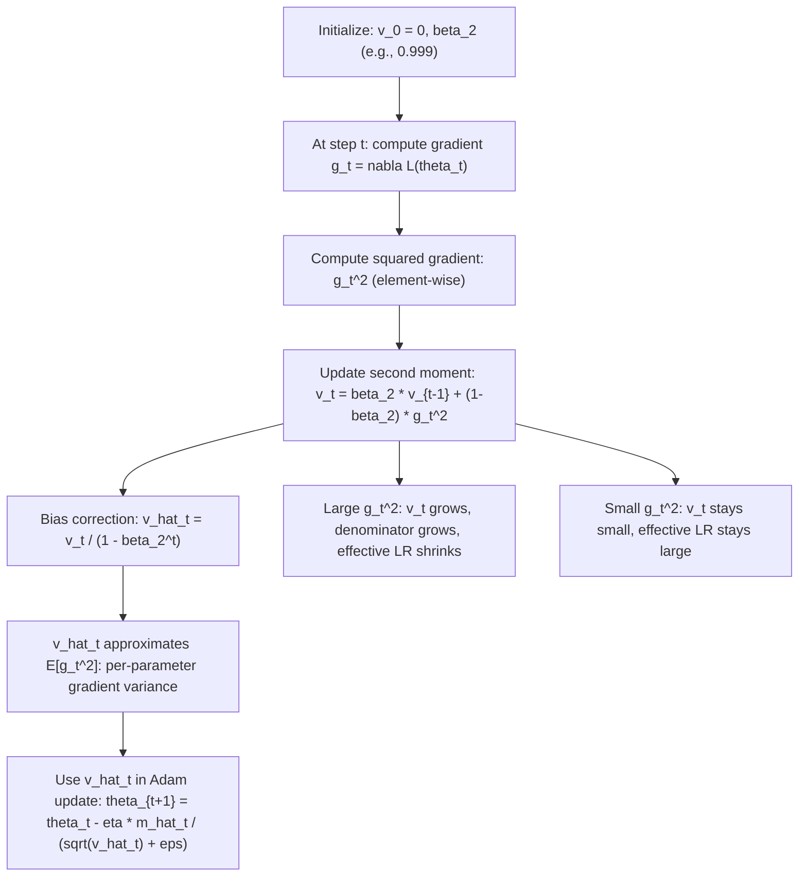

# Adam Optimizer (second moment)

$$
v_t = \beta_2 v_{t-1} + (1-\beta_2)g_t^2
$$

## Deep Breakdown

What it tells me *(Situation Awareness)*:
This is the second moment update in Adam (Adaptive Moment Estimation). $v_t$ is an exponentially weighted moving average (EWMA) of the squared gradients: it tracks the per-parameter magnitude of recent gradients, approximating the uncentered variance (second raw moment). Where the first moment $m_t$ gives direction, $v_t$ gives scale: it measures how noisy/large the gradient has been recently for each parameter independently. Parameters with large, consistent gradients get large $v_t$ and therefore a smaller effective learning rate; parameters with rare, small gradients get small $v_t$ and a larger effective learning rate. This is the mechanism behind Adam's "adaptive" name. In DA/DS: sparse features (embeddings, rare NLP tokens) get amplified updates via small $v_t$; frequent features get moderated updates. Together with $m_t$, $v_t$ forms the denominator of the Adam parameter update.

## Flowchart



## Real-world use

### Where it is used

Adam optimizer in all modern deep learning frameworks (PyTorch `torch.optim.Adam`, TensorFlow `tf.keras.optimizers.Adam`). Key for: transformer fine-tuning (BERT, GPT), sparse feature models where embedding gradients are sparse, training CNNs, NLP language models. RMSProp is the special case using $v_t$ alone without $m_t$.

### Problem it solves

Raw gradient magnitude varies enormously across parameters: embedding parameters for rare words receive sparse, variable-magnitude gradients; final-layer parameters receive dense, large gradients. A single global learning rate cannot handle this heterogeneity well. $v_t$ tracks per-parameter gradient scale, enabling Adam to normalize each parameter's update by its own historical gradient magnitude.

### How it solves the problem

The EWMA $v_t = \beta_2 v_{t-1} + (1-\beta_2)g_t^2$ tracks the running average of squared gradients element-wise. At $\beta_2 = 0.999$, the effective window is $1/(1-\beta_2) = 1000$ steps. The bias correction $\hat{v}_t = v_t/(1-\beta_2^t)$ corrects for zero initialization (at $t=1$: $v_1 = (1-\beta_2)g_1^2 \ll g_1^2$ without correction). The Adam update $\eta / (\sqrt{\hat{v}_t} + \epsilon)$ is then a per-parameter adaptive learning rate: large historical gradients reduce the effective step; small historical gradients amplify it.

### Example in a business

A DS trains a text embedding model on a 50k-word vocabulary. Frequent words (e.g., "the") receive dense gradient updates: $v_t$ grows large, effective LR shrinks to ~$0.0001$. Rare words (e.g., "ephemeral") receive sparse gradients: $v_t$ stays small, effective LR remains ~$0.001$. Without $v_t$, rare-word embeddings would be undertrained. With Adam, all vocabulary items adapt at their own effective learning rate.

## The formula, piece by piece

- $v_t$: second moment estimate at step $t$; a vector of same dimension as $\theta$ and $g_t$; all elements $\ge 0$
- $\beta_2$: exponential decay rate for the second moment; typical value $0.999$; $\beta_2 \in (0, 1)$
- $v_{t-1}$: previous second moment estimate; initialized at $v_0 = \mathbf{0}$
- $g_t$: gradient at step $t$; $g_t = \nabla_\theta L(\theta_{t-1})$
- $g_t^2$: element-wise square of the gradient; always $\ge 0$; captures magnitude regardless of sign
- $(1-\beta_2)$: weight of the current squared gradient; equals $0.001$ when $\beta_2 = 0.999$
- EWMA expansion: $v_t = (1-\beta_2)[g_t^2 + \beta_2 g_{t-1}^2 + \beta_2^2 g_{t-2}^2 + \ldots]$
- Bias correction: $\hat{v}_t = v_t / (1 - \beta_2^t)$; corrects for zero initialization
- Effective window: $\approx 1/(1-\beta_2)$ steps; at $\beta_2 = 0.999$: ~1000 steps; much longer memory than $m_t$
- $\hat{v}_t$ vs $\text{Var}[g_t]$: $\hat{v}_t \approx \mathbb{E}[g_t^2]$ (uncentered variance, not centered); includes mean squared component

## The formula in words

"Keep a running average of squared past gradients. At each step, blend 99.9% of the current average with 0.1% of the new squared gradient. This gives a smoothed estimate of how large the gradient has been recently for each parameter — a per-parameter scale factor." Tiny trace: $g_1 = 2$, $g_2 = -1$, $g_3 = 3$. $\beta_2 = 0.999$.
$v_0 = 0$.
$v_1 = 0.999 \cdot 0 + 0.001 \cdot 4 = 0.004$.
$v_2 = 0.999 \cdot 0.004 + 0.001 \cdot 1 = 0.003996 + 0.001 = 0.004996$.
$v_3 = 0.999 \cdot 0.004996 + 0.001 \cdot 9 = 0.004991 + 0.009 = 0.013991$.

Bias corrected:
$\hat{v}_1 = 0.004 / (1 - 0.999) = 0.004 / 0.001 = 4.0 = g_1^2$ (correct).
$\hat{v}_2 = 0.004996 / (1 - 0.999^2) = 0.004996 / 0.001999 \approx 2.499$.
$\hat{v}_3 = 0.013991 / (1 - 0.999^3) = 0.013991 / 0.002997 \approx 4.668$.

## Critical Concepts

- **$v_t$ vs $m_t$ timescale:** $\beta_2 = 0.999$ gives ~1000-step memory vs $\beta_1 = 0.9$ giving ~10-step memory. $v_t$ is intentionally slow-changing: the adaptive normalization should reflect long-run gradient scale, not react to individual spiky gradients.
- **Uncentered variance:** $\hat{v}_t \approx \mathbb{E}[g_t^2]$, not $\mathbb{E}[(g_t - \mathbb{E}[g_t])^2]$. The uncentered version is cheaper (no subtraction of mean), always $\ge 0$, and sufficient for normalization. The centered variance would be $\hat{v}_t - \hat{m}_t^2$.
- **$\epsilon$ in denominator:** Adam uses $\eta \hat{m}_t / (\sqrt{\hat{v}_t} + \epsilon)$ with $\epsilon \approx 10^{-8}$. When $\hat{v}_t \approx 0$ (parameter has barely received any gradient), $\epsilon$ prevents division by zero and caps the effective learning rate.
- **RMSProp connection:** RMSProp is Adam without the first moment: $\theta_{t+1} = \theta_t - \eta g_t / (\sqrt{v_t} + \epsilon)$. It uses raw $g_t$ in numerator (no momentum smoothing). Adam adds $m_t$ as a smoother numerator.
- **AMSGrad variant:** replaces $\hat{v}_t$ with $\max(\hat{v}_{t-1}, \hat{v}_t)$ to ensure non-increasing effective learning rate, addressing Adam's convergence proof issues (Reddi et al., 2018).

More conservative but provably convergent.

## Step-by-step calculation (tiny example)

*Compute $v_t$ and $\hat{v}_t$ for 5 gradient steps. $\beta_2 = 0.999$, gradients: $g = [0.5, -0.3, 0.8, 0.2, -0.6]$.*

| $t$ | $g_t$ | $g_t^2$ | $v_t = 0.999 v_{t-1} + 0.001 g_t^2$ | $1-\beta_2^t$ | $\hat{v}_t = v_t / (1-\beta_2^t)$ |
|-----|--------|---------|--------------------------------------|----------------|-----------------------------------|
| 1 | 0.500 | 0.2500 | 0.000250 | 0.001000 | 0.2500 |
| 2 | -0.300 | 0.0900 | 0.000340 | 0.001999 | 0.1701 |
| 3 | 0.800 | 0.6400 | 0.001000 | 0.002997 | 0.3337 |
| 4 | 0.200 | 0.0400 | 0.001040 | 0.003994 | 0.2604 |
| 5 | -0.600 | 0.3600 | 0.001399 | 0.004990 | 0.2804 |

## Code examples

### Beginner example (Python)

```python
import numpy as np

def ewma_second_moment( gradients: list, beta2: float = 0.999,
) -> tuple:
    """Compute EWMA second moment v_t and bias-corrected v_hat_t."""
    v = 0.0
    moments, moments_corrected = [], []
    for t, g in enumerate(gradients, start=1):
        v = beta2 * v + (1 - beta2) * g**2
    v_hat = v / (1 - beta2**t)
    moments.append(v)
    moments_corrected.append(v_hat)
    return moments, moments_corrected   # Example: 10 gradient steps
gradients = [0.5, -0.3, 0.8, 0.2, -0.6, 1.0, -0.4, 0.7, 0.1, -0.2]
v_raw, v_corrected = ewma_second_moment(gradients, beta2=0.999)
print(f"{'t':>3} {'g_t':>8} {'g_t^2':>8} {'v_t (raw)':>12} {'v_hat_t (corrected)':>20}")
for t, (g, v, vh) in enumerate(zip(gradients, v_raw, v_corrected), start=1):
    print(f"{t:>3} {g:>8.3f} {g**2:>8.4f} {v:>12.6f} {vh:>20.5f}")
print(f"\nBias correction at t=1: v_1={v_raw[0]:.6f}, v_hat_1={v_corrected[0]:.5f}")
print(f"(v_hat_1 should equal g_1^2 = {gradients[0]**2})")
print(f"\nEffective window (1/(1-beta2)): {1/(1-0.999):.0f} steps")
```

### Beginner example (R)

```r
# Adam second moment: EWMA of squared gradients with bias correction
ewma_second_moment <- function(gradients, beta2 = 0.999) { v <- 0
  v_list <- numeric(length(gradients))
  vhat_list <- numeric(length(gradients))
  for (t in seq_along(gradients)) { g <- gradientst
    v <- beta2 * v + (1 - beta2) * g^2
    v_hat <- v / (1 - beta2^t)
    v_list[t] <- v
    vhat_list[t] <- v_hat
  } list(v = v_list, v_hat = vhat_list)
}
grads <- c(0.5, -0.3, 0.8, 0.2, -0.6, 1.0, -0.4, 0.7, 0.1, -0.2)
result <- ewma_second_moment(grads, beta2 = 0.999)
cat(sprintf("%-3s %-8s %-8s %-12s %-20s\n", "t", "g_t", "g_t^2", "v_t (raw)", "v_hat_t (corrected)"))
for (t in seq_along(grads)) { cat(sprintf("%-3d %-8.3f %-8.4f %-12.6f %-20.5f\n", t, grads[t], grads[t]^2, result$v[t], result$v_hat[t]))
}
cat(sprintf("\nEffective window: %.0f steps\n", 1 / (1 - 0.999)))
```

### Professional example (Python)

```python
import numpy as np
np.random.seed(42)   # -- Visualize how v_t adapts LR differently across sparse vs dense parameters --
# Scenario: parameter A = frequent (large, dense gradients)
# parameter B = sparse (mostly zero, occasional large gradient)
N_STEPS = 300
BETA2 = 0.999
EPSILON = 1e-8
ETA = 0.001   # Simulate gradient streams
rng = np.random.default_rng(42)   # Dense parameter: gradients sampled N(0, 1) every step
grads_dense = rng.normal(0, 1.0, N_STEPS)   # Sparse parameter: gradient is 0 most steps, large occasionally (5% sparsity)
sparsity_mask = rng.binomial(1, 0.05, N_STEPS).astype(float)
grads_sparse = sparsity_mask * rng.normal(0, 2.0, N_STEPS)

def compute_effective_lr( gradients: np.ndarray, beta2: float = 0.999, eta: float = 0.001, epsilon: float = 1e-8,
) -> tuple:
    """Return v_hat and effective_lr = eta / (sqrt(v_hat) + epsilon) at each step."""
    v = 0.0
    v_hats, eff_lrs = [], []
    for t, g in enumerate(gradients, start=1):
        v = beta2 * v + (1 - beta2) * g**2
    v_hat = v / (1 - beta2**t)
    eff_lr = eta / (np.sqrt(v_hat) + epsilon)
    v_hats.append(v_hat)
    eff_lrs.append(eff_lr)
    return np.array(v_hats), np.array(eff_lrs)
v_hat_dense, eff_lr_dense = compute_effective_lr(grads_dense, BETA2, ETA, EPSILON)
v_hat_sparse, eff_lr_sparse = compute_effective_lr(grads_sparse, BETA2, ETA, EPSILON)
print("Adam Second Moment: Effective LR Adaptation (dense vs sparse gradients)")
print(f"\n{'Step':>6} {'v_hat (dense)':>15} {'eff_LR (dense)':>16} {'v_hat (sparse)':>16} {'eff_LR (sparse)':>17}")
for step in [9, 29, 99, 199, 299]:
    print( f"{step+1:>6} {v_hat_dense[step]:>15.6f} {eff_lr_dense[step]:>16.6f} " f"{v_hat_sparse[step]:>16.6f} {eff_lr_sparse[step]:>17.6f}" )
print(f"\nMean effective LR (dense): {eff_lr_dense.mean():.6f}")
print(f"Mean effective LR (sparse): {eff_lr_sparse.mean():.6f}")
print(f"LR ratio sparse/dense: {eff_lr_sparse.mean()/eff_lr_dense.mean():.2f}x")
print(f"\nInterpretation: sparse parameter gets {eff_lr_sparse.mean()/eff_lr_dense.mean():.1f}x higher effective LR")
print(f"because its v_hat is smaller (rare updates keep denominator small).")
```

---

*Source: domain knowledge*
