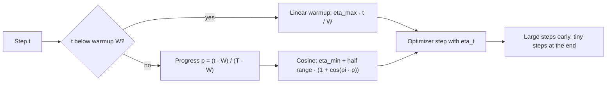

# Learning-Rate Schedules

$$
\eta_t =
\begin{cases}
\eta_{\max} \, \dfrac{t}{W}, & t \lt W \\
\eta_{\min} + \left(\eta_{\max} - \eta_{\min}\right) c_t, & W \le t \le T
\end{cases}
\qquad
c_t = \dfrac{1 + \cos \pi p_t}{2},
\quad
p_t = \dfrac{t - W}{T - W}
$$

, linear warmup for $W$ steps followed by cosine annealing to step $T$; other common schedules are step decay $\eta_t = \eta_0 \gamma^{\lfloor t/s \rfloor}$ and exponential decay $\eta_t = \eta_0 e^{-kt}$

## Deep Breakdown

What it tells me *(Situation Awareness)*:
A learning-rate schedule makes the step size a function of training progress instead of a constant. The logic comes from two competing needs. Early in training I want large steps to cover distance quickly and to escape poor regions (and, with SGD, the gradient noise of a large step acts as useful exploration). Late in training I want small steps, because with stochastic gradients a constant learning rate never settles: the iterate keeps bouncing around the minimum in a "noise ball" whose size is proportional to $\eta$. Decaying $\eta$ shrinks that ball and lets the loss settle. Warmup addresses a third need: at initialisation the gradients and the adaptive statistics of optimizers like Adam are unreliable, so jumping straight to $\eta_{\max}$ can blow up training; ramping linearly over the first few hundred or thousand steps avoids that. Step decay (divide by 10 at fixed epochs) was the classic ResNet recipe; exponential decay is smooth and common in older TensorFlow code; linear warmup + cosine decay is the default for transformers and LLMs; warmup + linear decay is the BERT/Hugging Face default. In DA/DS: training any neural network, fine-tuning LLMs (warmup ratio and decay type are standard `TrainingArguments`), gradient boosting with shrinking learning rates, online models that must keep adapting (where the schedule should *not* decay to zero), and diagnosing loss curves (the sharp drops in step-decay curves line up with the decay points).

## Flowchart



## Real-world use

### Where it is used

Transformer and LLM pretraining/fine-tuning (warmup + cosine or linear decay); ResNet/CNN training (step decay at epochs 30/60/90 or cosine); one-cycle policy for fast training; SGDR (cosine with warm restarts) for snapshot ensembles; recommender and click-through models trained with SGD; scikit-learn's `SGDClassifier(learning_rate='invscaling')` and `'optimal'` schedules.

### Problem it solves

A single constant learning rate is a compromise: large enough to make progress early means too large to converge precisely late; small enough to converge precisely means wasting most of the budget early. With adaptive optimizers there is also early instability before second-moment estimates are meaningful.

### How it solves the problem

The schedule spends the large-step budget when the model is far from a good region and the small-step budget when it is close. For SGD with noise variance $\sigma^2$, the stationary error scales roughly like $\eta\sigma^2$, so driving $\eta \to 0$ removes it; classic theory (Robbins–Monro) asks for $\sum_t \eta_t = \infty$ (can still travel anywhere) and $\sum_t \eta_t^2 \lt \infty$ (noise eventually averages out). Cosine decay stays near $\eta_{\max}$ for a long time, then drops smoothly, without extra hyperparameters such as decay epochs. Warmup gives the optimizer statistics and normalisation layers time to stabilise.

### Example in a business

A team trains a basket-value regression model with mini-batch SGD (batch 16, 3,000 steps; see the professional example). With a constant $\eta = 0.05$ the training MSE stays $0.0211$ above the least-squares optimum because the iterate keeps jittering. Step decay, exponential decay, and warmup + cosine all start at (or ramp to) the same $\eta_{\max}$ and end near zero; their excess MSE is between $0.0004$ and $0.0008$, roughly 25–50 times smaller, for the same compute.

## The formula, piece by piece

- $t$: current optimizer step (or epoch, depending on the library)
- $T$: total number of steps in the run — cosine schedules need it in advance
- $W$: warmup steps, often 1–10% of $T$ (Hugging Face `warmup_ratio`)
- $\eta_{\max}$: peak learning rate, reached at the end of warmup
- $\eta_{\min}$: floor at the end (often 0 or $0.1\,\eta_{\max}$)
- $\eta_{\max}\, t/W$: linear ramp from 0 to $\eta_{\max}$
- $\frac{t - W}{T - W}$: decay progress from 0 to 1 after warmup
- $\frac{1}{2}(1 + \cos(\pi \cdot \text{progress}))$: smooth factor going $1 \to 0.5 \to 0$; flat at both ends, steepest in the middle
- Step decay: $\gamma$ (e.g. $0.1$) applied every $s$ steps — a staircase
- Exponential: $e^{-kt}$ — constant relative decay per step; choose $k = \ln(\eta_0/\eta_{\text{end}})/T$ to land on $\eta_{\text{end}}$

## The formula in words

"Ramp the learning rate up linearly for the first few steps, then follow half a cosine wave from the peak down to the floor by the end of training." Tiny example: $\eta_{\max} = 10^{-3}$, $\eta_{\min} = 0$, $W = 100$, $T = 1000$. At $t = 50$ (mid-warmup) $\eta = 5 \times 10^{-4}$; at $t = 100$ the peak $10^{-3}$; at $t = 550$ (half-way through decay) $\eta = 5 \times 10^{-4}$; at $t = 1000$, $\eta = 0$.

## Critical Concepts

- **Warmup is essential for Adam + transformers:** early Adam second-moment estimates are based on few samples and the post-LN transformer's gradients are large at init; skipping warmup often causes divergence in the first hundred steps.
- **Peak learning rate still matters most:** a schedule shapes the trajectory, but a peak $10\times$ too high or low will not be rescued by any shape.
- **Cosine needs $T$:** if training is extended after the fact, the schedule must be recomputed; warmup-stable-decay (WSD, constant then short decay) and inverse-square-root schedules avoid committing to $T$.
- **Step decay artefacts:** the loss curve shows sharp drops at each decay; the timing is a hyperparameter (often at 50% and 75% of training).
- **Restarts:** SGDR resets the cosine to $\eta_{\max}$ periodically; each cycle's end is a good snapshot for ensembling.
- **Epoch vs step:** PyTorch schedulers can be stepped per batch or per epoch; mixing them up compresses or stretches the schedule by a factor of the number of batches per epoch.
- **Online systems:** for continual-learning models (fraud, ads) decaying to 0 freezes the model; use a floor $\eta_{\min} \gt 0$ or a constant rate.

## Step-by-step calculation (tiny example)

*Warmup + cosine with $\eta_{\max} = 10^{-3}$, $\eta_{\min} = 0$, $W = 100$, $T = 1000$.*

*Step 1: During warmup, $t = 50$*
$\eta_{50} = 10^{-3} \times 50/100 = 5.0 \times 10^{-4}$.

*Step 2: End of warmup, $t = 100$*
Progress $= 0$; $\cos 0 = 1$; $\eta = \tfrac{1}{2} \times 10^{-3} \times 2 = 1.0 \times 10^{-3}$.

*Step 3: Quarter of the decay, $t = 325$*
Progress $= 225/900 = 0.25$; $\cos(\pi/4) = 0.7071$; $\eta = 0.5 \times 10^{-3} \times 1.7071 = 8.536 \times 10^{-4}$.

*Step 4: Half-way, $t = 550$*
Progress $= 0.5$; $\cos(\pi/2) = 0$; $\eta = 5.0 \times 10^{-4}$.

*Step 5: Three quarters, $t = 775$*
Progress $= 0.75$; $\cos(3\pi/4) = -0.7071$; $\eta = 0.5 \times 10^{-3} \times 0.2929 = 1.464 \times 10^{-4}$.

*Step 6: End, $t = 1000$*
Progress $= 1$; $\cos\pi = -1$; $\eta = 0$. Note the shape: still 85% of the peak a quarter of the way in, only 15% three quarters in.

## Code examples

### Beginner example (Python)

```python
import math


def warmup_cosine(t, lr_max=1e-3, lr_min=0.0, warmup=100, total=1000):
    if t < warmup:
        return lr_max * t / warmup
    progress = (t - warmup) / (total - warmup)
    return lr_min + 0.5 * (lr_max - lr_min) * (1 + math.cos(math.pi * progress))


def step_decay(t, lr0=1e-3, gamma=0.1, every=400):
    return lr0 * gamma ** (t // every)


def exponential(t, lr0=1e-3, k=0.003):
    return lr0 * math.exp(-k * t)


print(f"{'t':>5s} {'warmup+cos':>11s} {'step':>9s} {'exp':>9s}")
for t in (0, 50, 100, 325, 550, 775, 1000):
    print(f"{t:5d} {warmup_cosine(t):11.3e} {step_decay(t):9.1e} {exponential(t):9.2e}")
# warmup+cos: 0, 5.000e-04, 1.000e-03, 8.536e-04, 5.000e-04, 1.464e-04, 0
```

### Beginner example (R)

```r
warmup_cosine <- function(t, lr_max = 1e-3, lr_min = 0, warmup = 100, total = 1000) {
  if (t < warmup) return(lr_max * t / warmup)
  progress <- (t - warmup) / (total - warmup)
  lr_min + 0.5 * (lr_max - lr_min) * (1 + cos(pi * progress))
}
step_decay <- function(t, lr0 = 1e-3, gamma = 0.1, every = 400) lr0 * gamma^(t %/% every)

for (t in c(0, 50, 100, 325, 550, 775, 1000)) {
  cat(sprintf("t = %4d  warmup+cos = %.3e  step = %.1e\n", t, warmup_cosine(t), step_decay(t)))
}
```

### Professional example (Python)

```python
import math

import numpy as np


def constant(t, T, lr_max=0.05):
    return lr_max


def step_decay(t, T, lr_max=0.05, gamma=0.1, every=None):
    every = every or T // 3
    return lr_max * gamma ** (t // every)


def exponential(t, T, lr_max=0.05, lr_end=5e-4):
    k = math.log(lr_max / lr_end) / T          # decay rate so lr(T) = lr_end
    return lr_max * math.exp(-k * t)


def warmup_cosine(t, T, lr_max=0.05, lr_min=0.0, warmup=None):
    warmup = warmup if warmup is not None else T // 20
    if t < warmup:
        return lr_max * (t + 1) / warmup     # linear warmup (t + 1 so step 0 is not zero)
    progress = (t - warmup) / max(1, T - warmup)
    return lr_min + 0.5 * (lr_max - lr_min) * (1 + math.cos(math.pi * progress))


# Noisy linear regression trained with mini-batch SGD (e.g. predicting basket value)
rng = np.random.default_rng(3)
n, p = 20000, 8
X = rng.normal(size=(n, p))
w_true = rng.normal(size=p)
y = X @ w_true + rng.normal(scale=1.0, size=n)
w_ols = np.linalg.lstsq(X, y, rcond=None)[0]


def mse(w):
    r = X @ w - y
    return float(r @ r / n)


def train(schedule, steps=3000, batch=16, seed=0):
    r = np.random.default_rng(seed)
    w = np.zeros(p)
    for t in range(steps):
        b = r.integers(0, n, size=batch)
        g = 2 * X[b].T @ (X[b] @ w - y[b]) / batch
        w = w - schedule(t, steps) * g
    return mse(w)


print(f"optimal MSE (least squares): {mse(w_ols):.5f}")
for name, sched in [("constant", constant), ("step decay", step_decay),
                    ("exponential", exponential), ("warmup + cosine", warmup_cosine)]:
    excess = np.mean([train(sched, seed=s) for s in range(5)]) - mse(w_ols)
    print(f"{name:16s} lr at start/middle/end = "
          f"{sched(0, 3000):.4f}/{sched(1500, 3000):.4f}/{sched(2999, 3000):.5f}  "
          f"excess MSE = {excess:.5f}")
```

---

*Source: domain knowledge*
