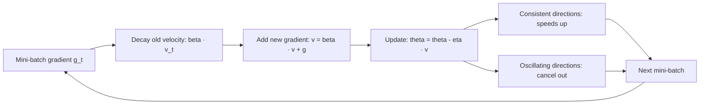

# Momentum (SGD with momentum)

$$
\mathbf{v}_{t+1} = \beta \, \mathbf{v}_t + \nabla f(\boldsymbol{\theta}_t), \qquad \boldsymbol{\theta}_{t+1} = \boldsymbol{\theta}_t - \eta \, \mathbf{v}_{t+1}
$$

, where $\mathbf{v}_0 = \mathbf{0}$, $\eta$ is the learning rate and $\beta \in [0, 1)$ is the momentum coefficient (typically $0.9$)

## Deep Breakdown

What it tells me *(Situation Awareness)*:
Momentum replaces "step along the current gradient" with "step along a running sum of recent gradients". The velocity $\mathbf{v}$ is an exponentially weighted accumulation: unrolled, $\mathbf{v}_{t+1} = \sum_{k=0}^{t} \beta^k \nabla f(\boldsymbol{\theta}_{t-k})$. Gradient components that point the same way step after step add up (up to a factor $1/(1-\beta)$, i.e. $10\times$ for $\beta = 0.9$), while components that flip sign — the zig-zag across a narrow valley — cancel out. The result is faster travel along gentle, consistent directions and damped oscillation along steep ones, which is exactly the failure mode of plain gradient descent on ill-conditioned problems. In stochastic training the averaging also smooths mini-batch noise, and the accumulated velocity helps roll through plateaus and away from saddle points. The physical picture is a heavy ball rolling downhill with friction $1-\beta$. In DA/DS: the default optimizer for training CNNs (SGD + momentum 0.9 + a learning-rate schedule), a building block of Adam (its first moment is a momentum term), training linear/logistic models with SGD on large data, matrix factorisation for recommenders, and fine-tuning when Adam generalises worse.

## Flowchart



## Real-world use

### Where it is used

Image models (ResNets trained with SGD, momentum 0.9, weight decay, cosine or step schedule); Adam/AdamW (first-moment estimate $m_t$ is momentum with $1-\beta_1$ scaling); LARS/LAMB large-batch optimizers; online learning for ad click models; any SGD-based pipeline in scikit-learn (`SGDClassifier` uses plain SGD, while `MLPClassifier(solver='sgd', momentum=0.9, nesterovs_momentum=True)` exposes momentum directly).

### Problem it solves

Plain gradient descent on an ill-conditioned loss zig-zags: the learning rate must be small enough for the steepest direction ($\eta \lt 2/L$), so progress along the flattest direction is painfully slow — the number of steps grows like the condition number $\kappa = L/\mu$. Stochastic gradients add noise that makes the path even more erratic.

### How it solves the problem

The velocity is a low-pass filter on the gradient sequence. Along a consistent direction the effective step grows towards $\eta/(1-\beta)$; across an oscillating direction successive gradients have opposite signs and largely cancel. On quadratics, heavy-ball momentum with tuned $\beta$ and $\eta$ cuts the iteration count from order $\kappa$ to order $\sqrt{\kappa}$.

### Example in a business

A marketing team fits a conversion model (logistic regression, 10 unevenly scaled features, 5,000 sessions) with mini-batch SGD. With the same learning rate $0.02$ and 5 epochs, plain SGD reaches log-loss $0.3294$, momentum $0.5$ reaches $0.3121$, and momentum $0.9$ reaches $0.3061$ (see the professional example). On a toy quadratic with condition number 25, plain GD needs 259 iterations, momentum 0.9 needs 145, Nesterov momentum 45, and tuned heavy-ball momentum only 29.

## The formula, piece by piece

- $\boldsymbol{\theta}_t$: parameters at step $t$
- $\nabla f(\boldsymbol{\theta}_t)$: gradient (in practice a mini-batch estimate $\mathbf{g}_t$)
- $\mathbf{v}_t$: velocity, the accumulated gradient history; starts at $\mathbf{0}$
- $\beta$: momentum coefficient — the fraction of the old velocity kept each step; $\beta = 0$ recovers plain SGD
- $\beta \mathbf{v}_t$: decayed memory; a gradient from $k$ steps ago carries weight $\beta^k$ ($0.9^{10} \approx 0.35$, $0.9^{50} \approx 0.005$)
- $1/(1-\beta)$: the effective memory length and maximum amplification (10 for $\beta = 0.9$, 100 for $0.99$)
- $\eta$: learning rate applied to the velocity, not to the raw gradient
- Alternative (dampened) form used by some libraries and by Adam: $\mathbf{v}_{t+1} = \beta \mathbf{v}_t + (1-\beta)\mathbf{g}_t$, which is the same update with $\eta$ rescaled by $1/(1-\beta)$

## The formula in words

"Keep a running velocity that remembers most of its previous value and adds the new gradient, then move the parameters along that velocity; directions the gradient keeps agreeing on build up speed, and directions it keeps flipping on cancel out." Tiny example: on $f(x) = x^2$ with $\eta = 0.1$, $\beta = 0.9$ from $x_0 = 1$, momentum gives $x = 0.8, 0.46, 0.062$ after three steps while plain GD gives $0.8, 0.64, 0.512$.

## Critical Concepts

- **Nesterov accelerated gradient (NAG):** evaluate the gradient at the look-ahead point: $\mathbf{v}_{t+1} = \beta \mathbf{v}_t + \nabla f(\boldsymbol{\theta}_t - \eta\beta\mathbf{v}_t)$, $\boldsymbol{\theta}_{t+1} = \boldsymbol{\theta}_t - \eta\mathbf{v}_{t+1}$. It "corrects before overshooting", damps oscillations better, and has optimal $O(\sqrt{\kappa}\log(1/\varepsilon))$ guarantees for smooth convex functions. On the condition-25 quadratic below it needs 45 iterations versus 145 for heavy ball at the same $\beta$ and $\eta$.
- **Overshoot:** momentum carries the iterate past the minimum ($x_4 = -0.3086$ in the tiny example) and the path spirals in. Too high a $\beta$ with too large an $\eta$ oscillates or diverges; the stability region on a quadratic is $0 \lt \eta\lambda \lt 2(1+\beta)$.
- **Tuned heavy ball on quadratics:** $\beta^* = \left(\frac{\sqrt{L}-\sqrt{\mu}}{\sqrt{L}+\sqrt{\mu}}\right)^2$, $\eta^* = \frac{4}{(\sqrt{L}+\sqrt{\mu})^2}$; convergence rate $\frac{\sqrt{\kappa}-1}{\sqrt{\kappa}+1}$ per step versus $\frac{\kappa-1}{\kappa+1}$ for GD.
- **Coupling with learning rate:** effective step $\approx \eta/(1-\beta)$; when raising $\beta$ from 0.9 to 0.99, lower $\eta$ roughly tenfold to keep the same scale.
- **Noise averaging:** with mini-batches, the velocity averages about $1/(1-\beta)$ gradients, reducing variance — similar in spirit to a larger batch.
- **Saddles and plateaus:** accumulated velocity keeps moving through flat regions where the instantaneous gradient is tiny.
- **Momentum inside Adam:** Adam's $m_t$ is a dampened momentum; Adam then divides by $\sqrt{v_t}$ (per-parameter scaling) — momentum handles direction smoothing, the second moment handles scale.

## Step-by-step calculation (tiny example)

*Minimise $f(x) = x^2$ (gradient $2x$) from $x_0 = 1$ with $\eta = 0.1$, $\beta = 0.9$, $v_0 = 0$.*

*Step 1*
$v_1 = 0.9 \times 0 + 2(1) = 2$; $x_1 = 1 - 0.1 \times 2 = 0.8$. (Plain GD: $x_1 = 0.8$.)

*Step 2*
$v_2 = 0.9 \times 2 + 2(0.8) = 1.8 + 1.6 = 3.4$; $x_2 = 0.8 - 0.34 = 0.46$. (Plain GD: $0.64$.)

*Step 3*
$v_3 = 0.9 \times 3.4 + 2(0.46) = 3.06 + 0.92 = 3.98$; $x_3 = 0.46 - 0.398 = 0.062$. (Plain GD: $0.512$.)

*Step 4: overshoot*
$v_4 = 0.9 \times 3.98 + 2(0.062) = 3.582 + 0.124 = 3.706$; $x_4 = 0.062 - 0.3706 = -0.3086$. The ball rolls past the minimum and will spiral back; the accumulated speed is both the strength and the risk.

## Code examples

### Beginner example (Python)

```python
# f(x) = x^2, gradient 2x; compare plain GD with momentum
eta, beta = 0.1, 0.9
x_gd, x_m, v = 1.0, 1.0, 0.0
for t in range(1, 5):
    x_gd = x_gd - eta * 2 * x_gd
    v = beta * v + 2 * x_m
    x_m = x_m - eta * v
    print(f"step {t}: plain GD x = {x_gd:.4f} | momentum v = {v:.4f}, x = {x_m:.4f}")
# step 1: 0.8000 | v = 2.0000, x = 0.8000
# step 2: 0.6400 | v = 3.4000, x = 0.4600
# step 3: 0.5120 | v = 3.9800, x = 0.0620
# step 4: 0.4096 | v = 3.7060, x = -0.3086 (overshoot)
```

### Beginner example (R)

```r
eta <- 0.1; beta <- 0.9
x_gd <- 1; x_m <- 1; v <- 0
for (t in 1:4) {
  x_gd <- x_gd - eta * 2 * x_gd
  v <- beta * v + 2 * x_m
  x_m <- x_m - eta * v
  cat(sprintf("step %d: GD x = %.4f | momentum v = %.4f, x = %.4f\n", t, x_gd, v, x_m))
}
```

### Professional example (Python)

```python
import numpy as np

# Part 1: ill-conditioned quadratic f = 0.5 * (x^2 + 25 y^2), curvatures mu = 1, L = 25
A = np.diag([1.0, 25.0])


def iterations_to_converge(beta, eta, nesterov=False, tol=1e-3, max_iter=5000):
    theta = np.array([10.0, 1.0])
    v = np.zeros(2)
    for k in range(1, max_iter + 1):
        look = theta - eta * beta * v if nesterov else theta   # Nesterov: gradient at look-ahead
        g = A @ look
        v = beta * v + g
        theta = theta - eta * v
        if np.linalg.norm(theta) < tol:
            return k
    return max_iter


L, mu = 25.0, 1.0
beta_opt = ((np.sqrt(L) - np.sqrt(mu)) / (np.sqrt(L) + np.sqrt(mu))) ** 2
eta_opt = 4 / (np.sqrt(L) + np.sqrt(mu)) ** 2
print("iterations until ||theta|| < 1e-3 (condition number 25):")
print(f"  plain GD, eta = 0.035          : {iterations_to_converge(0.0, 0.035)}")
print(f"  momentum beta = 0.9, eta = 0.035: {iterations_to_converge(0.9, 0.035)}")
print(f"  Nesterov beta = 0.9, eta = 0.035: {iterations_to_converge(0.9, 0.035, nesterov=True)}")
print(f"  best plain GD, eta = 2/(L+mu)   : {iterations_to_converge(0.0, 2 / (L + mu))}")
print(f"  tuned heavy ball (beta = {beta_opt:.3f}, eta = {eta_opt:.3f}): "
      f"{iterations_to_converge(beta_opt, eta_opt)}")

# Part 2: mini-batch SGD with momentum on a logistic-regression conversion model
rng = np.random.default_rng(1)
n, p = 5000, 10
X = rng.normal(size=(n, p)) * np.linspace(0.5, 3.0, p)    # unevenly scaled features
w_true = rng.normal(size=p)
y = (rng.random(n) < 1 / (1 + np.exp(-X @ w_true))).astype(float)


def loss(w):
    z = X @ w
    return float(np.mean(np.logaddexp(0.0, z) - y * z))


def train(beta, eta=0.02, epochs=5, batch=64, seed=0):
    r = np.random.default_rng(seed)
    w, v = np.zeros(p), np.zeros(p)
    for _ in range(epochs):
        idx = r.permutation(n)
        for start in range(0, n, batch):
            b = idx[start:start + batch]
            prob = 1 / (1 + np.exp(-(X[b] @ w)))
            g = X[b].T @ (prob - y[b]) / len(b)
            v = beta * v + g
            w = w - eta * v
    return loss(w)


print("\nlogistic regression, 5 epochs of mini-batch SGD (eta = 0.02):")
for beta in (0.0, 0.5, 0.9):
    print(f"  beta = {beta}: final log-loss = {train(beta):.4f}")
```

---

*Source: domain knowledge*
