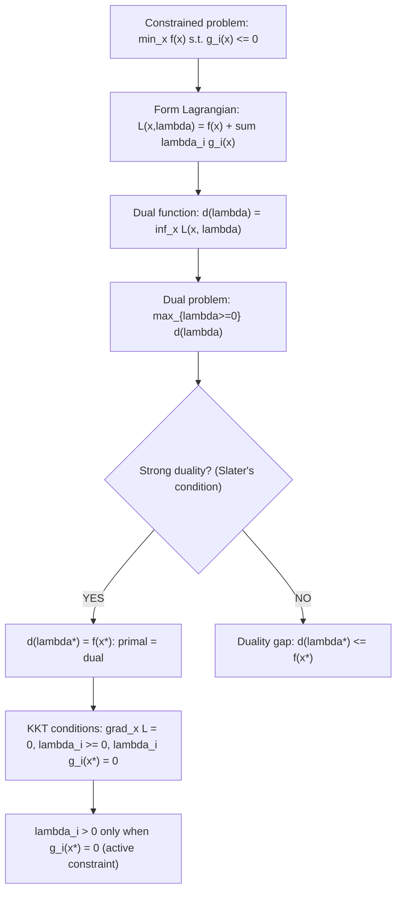

# Lagrangian Formulation

$$
\mathcal{L}(x, \lambda) = f(x) + \sum_i \lambda_i g_i(x)
$$

## Deep Breakdown

What it tells me *(Situation Awareness)*:
The Lagrangian $\mathcal{L}(x, \lambda)$ converts a constrained optimization problem $\min_x f(x)$ subject to $g_i(x) \le 0$ (or $= 0$) into an unconstrained saddle-point problem by penalizing constraint violations with dual variables $\lambda_i$ (Lagrange multipliers). This is the foundational tool of constrained optimization and forms the basis of the KKT conditions, Lagrangian duality, and the SVM dual derivation. In DA/DS: SVM duality ($\lambda_i$ are support vector weights), regularized regression as constrained optimization (L1/L2 constraints), portfolio optimization with budget constraints, and neural network training with output constraints all use the Lagrangian framework.

## Flowchart



## Real-world use

### Where it is used

SVM: constrained QP solved via Lagrangian dual; regularized regression: L1/L2 constraints equivalent to Lagrangian penalties; portfolio optimization: maximize return subject to risk budget; neural network architecture search: minimize parameters subject to accuracy constraint.

### Problem it solves

Many real optimization problems have hard constraints: budget limits, probability simplex constraints, physical feasibility. Directly solving constrained problems requires specialized methods (interior point, active set). The Lagrangian transforms the constrained problem into an unconstrained saddle-point problem that is often more tractable, especially when duality gives a dual with fewer variables or a simpler structure.

### How it solves the problem

Attach dual variable $\lambda_i \ge 0$ to each inequality constraint $g_i(x) \le 0$. The Lagrangian $\mathcal{L}(x, \lambda) = f(x) + \sum_i \lambda_i g_i(x)$ penalizes constraint violations: if $g_i(x) > 0$ (violation) and $\lambda_i > 0$, the Lagrangian increases, pushing $x$ back toward feasibility. The minimax theorem (strong duality under Slater's condition) states that $\min_x \max_{\lambda \ge 0} \mathcal{L}(x,\lambda) = \max_{\lambda \ge 0} \min_x \mathcal{L}(x,\lambda)$, so solving the dual $\max_\lambda d(\lambda)$ gives the primal solution.

### Example in a business

SVM derivation: $\min_{w,b} \frac{1}{2}\|w\|^2$ s.t. $y_i(w^T x_i + b) \ge 1$. Rewritten as $g_i(w) = 1 - y_i(w^T x_i + b) \le 0$. Lagrangian: $\mathcal{L}(w, b, \alpha) = \frac{1}{2}\|w\|^2 + \sum_i \alpha_i(1 - y_i(w^T x_i + b))$. Setting $\nabla_w \mathcal{L} = 0$ gives $w = \sum_i \alpha_i y_i x_i$. Substituting back yields the SVM dual: $\max_\alpha \sum \alpha_i - \frac{1}{2}\sum_{i,j} \alpha_i\alpha_j y_iy_j x_i^Tx_j$ subject to $\alpha_i \ge 0$.

## The formula, piece by piece

- $\mathcal{L}$: the Lagrangian function; a function of both primal variable $x$ and dual variables $\lambda$
- $x$: the primal optimization variable (model weights, portfolio allocations, etc.)
- $\lambda$: the vector of Lagrange multipliers (dual variables); $\lambda_i \ge 0$ for inequality constraints; unrestricted for equality constraints
- $f(x)$: the primal objective (loss, negative return, cost to minimize)
- $\sum_i \lambda_i g_i(x)$: sum of constraint functions scaled by multipliers; penalizes violations
- $g_i(x) \le 0$: inequality constraint (convention: constraint is $\le 0$ in standard form)
- KKT complementary slackness: $\lambda_i g_i(x^*) = 0$ — either constraint is active ($g_i = 0$) or multiplier is zero ($\lambda_i = 0$)
- Equality constraints $h_j(x) = 0$: add $\mu_j h_j(x)$ with unrestricted $\mu_j$

## The formula in words

"Attach a price (Lagrange multiplier) $\lambda_i$ to each constraint. The Lagrangian is the original objective plus all constraints weighted by their prices. If you violate a constraint ($g_i > 0$) and the price is positive, the Lagrangian increases — so minimizing the Lagrangian over $x$ while maximizing over $\lambda$ forces the solution to satisfy the constraints." Tiny example: $\min_x x^2$ s.t. $x \ge 2$ (written as $-x + 2 \le 0$, i.e., $g(x) = 2-x \le 0$).
$\mathcal{L}(x, \lambda) = x^2 + \lambda(2-x)$.
$\partial_x \mathcal{L} = 2x - \lambda = 0 \Rightarrow x^* = \lambda/2$.
Dual: $d(\lambda) = (\lambda/2)^2 + \lambda(2 - \lambda/2) = \lambda^2/4 + 2\lambda - \lambda^2/2 = -\lambda^2/4 + 2\lambda$.
$d'(\lambda) = -\lambda/2 + 2 = 0 \Rightarrow \lambda^* = 4$.
$x^* = 2$, $f(x^*) = 4$, $d(\lambda^*) = -4 + 8 = 4$. Zero duality gap. $\checkmark$

## Critical Concepts

- **Lagrange multiplier interpretation:** $\lambda_i^*$ is the shadow price of constraint $i$ — how much the optimal objective value would change if the constraint $g_i(x) \le 0$ is relaxed to $g_i(x) \le \epsilon$. High $\lambda_i^*$ means the constraint is very binding.
- **KKT conditions (necessary + sufficient for convex programs):** 1. Stationarity: $\nabla_x \mathcal{L}(x^*, \lambda^*) = 0$ 2. Primal feasibility: $g_i(x^*) \le 0$ 3. Dual feasibility: $\lambda_i^* \ge 0$ 4. Complementary slackness: $\lambda_i^* g_i(x^*) = 0$
- **Slater's condition (strong duality):** if there exists a strictly feasible $\hat{x}$ with $g_i(\hat{x}) < 0$ for all $i$, and $f$ and $g_i$ are convex, then strong duality holds (zero duality gap).
- **Difference from penalty method:** the Lagrangian penalizes constraint violation exactly via $\lambda_i$; the penalty method penalizes by $\rho g_i(x)^2$ (soft, inexact). Augmented Lagrangian combines both.
- **Connection to regularization:** Lasso ($\min_w \|y-Xw\|^2$ s.t. $\|w\|_1 \le t$) via Lagrangian: $\|y-Xw\|^2 + \lambda\|w\|_1$.

The Lagrange multiplier $\lambda$ corresponds to the regularization strength.

## Step-by-step calculation (tiny example)

*Minimize $f(x_1, x_2) = x_1^2 + x_2^2$ subject to $x_1 + x_2 = 4$ (equality constraint).*

*Step 1: Lagrangian (equality constraint, multiplier unrestricted)*
$\mathcal{L}(x_1, x_2, \mu) = x_1^2 + x_2^2 + \mu(x_1 + x_2 - 4)$.

*Step 2: Stationarity conditions*
$\partial_{x_1} \mathcal{L} = 2x_1 + \mu = 0 \Rightarrow x_1 = -\mu/2$.
$\partial_{x_2} \mathcal{L} = 2x_2 + \mu = 0 \Rightarrow x_2 = -\mu/2$.

*Step 3: Use constraint*
$x_1 + x_2 = 4 \Rightarrow -\mu/2 - \mu/2 = 4 \Rightarrow \mu = -4$.
$x_1^* = x_2^* = 2$.

*Step 4: Verify*
$f(2,2) = 4 + 4 = 8$. Gradient check: $\nabla f = (4, 4) = -\mu(1, 1) = 4(1,1)$. $\checkmark$

## Code examples

### Beginner example (Python)

```python
import numpy as np
from scipy.optimize import minimize

def lagrangian( x: np.ndarray, mu: float, objective_fn, constraint_fn ) -> float:
    """Lagrangian L(x, mu) = f(x) + mu * h(x) for equality constraint h(x)=0."""
    return objective_fn(x) + mu * constraint_fn(x)   # Minimize x1^2 + x2^2 subject to x1 +
x2 = 4

def f(x: np.ndarray) -> float:
    return x[0]**2 + x[1]**2

def h(x: np.ndarray) -> float:
    return x[0] + x[1] - 4   # Using scipy constrained optimizer
result = minimize( f, x0=[0.0, 0.0], constraints={"type": "eq", "fun": h}, method="SLSQP",
)
print(f"x* = {result.x.round(6)}")
print(f"f(x*) = {f(result.x):.6f}")
print(f"Constraint satisfied: h(x*) = {h(result.x):.2e}")   # Compute shadow price (Lagrange multiplier) numerically
DELTA = 0.001

def f_relaxed(x, eps=0.0):
    return minimize(f, [0,0], constraints={"type":"eq","fun":lambda z:z[0]+z[1]-(4+eps)}, method="SLSQP").fun
shadow_price = (f_relaxed(None, DELTA) - f_relaxed(None, 0)) / DELTA
print(f"\nShadow price (lambda*) ~ {shadow_price:.4f}")
print("(Relaxing constraint by 1 unit decreases optimal f by ~|lambda*|)")
```

### Beginner example (R)

```r
# Lagrangian for equality-constrained optimization
library(nloptr)  # or use base R optim with constraints # Minimize x1^2 + x2^2 subject to x1 +
x2 = 4
f_obj <- function(x) x[1]^2 + x[2]^2
h_eq <- function(x) x[1] + x[2] - 4  # equality
constraint = 0  # Use augmented Lagrangian (slsqp from nloptr)
opts <- list(algorithm = "NLOPT_LD_SLSQP", xtol_rel = 1e-8, maxeval = 1000)
result <- nloptr::slsqp( x0 = c(0, 0), fn = f_obj, heq = h_eq, control = list(xtol_rel = 1e-8, maxeval = 1000)
) cat(sprintf("x* = (%.6f, %.6f)\n", result$par[1], result$par[2]))
cat(sprintf("f(x*) = %.6f\n", f_obj(result$par)))
cat(sprintf("Constraint: x1 + x2 = %.6f (should be 4)\n", sum(result$par)))  # Manual verification of Lagrange multiplier
cat(sprintf("\nExpected: x1* = x2* = 2, lambda* = -4\n"))
cat(sprintf("grad f at x*: (%.1f, %.1f), should equal -lambda*(1,1)\n", 2*result$par[1], 2*result$par[2]))
```

### Professional example (Python)

```python
import numpy as np
from scipy.optimize import minimize
np.random.seed(42)   # -- SVM via Lagrangian dual: derive support vectors --------------------------
N_PER_CLASS = 25
X_pos = np.random.randn(N_PER_CLASS, 2) + np.array([2.5, 0])
X_neg = np.random.randn(N_PER_CLASS, 2) + np.array([-2.5, 0])
X = np.vstack([X_pos, X_neg])
y = np.hstack([np.ones(N_PER_CLASS), -np.ones(N_PER_CLASS)])
N = len(y)
C_PARAM = 1.0   # SVM dual Lagrangian: max
sum(alpha) - 0.5 * alpha @ K @ alpha
# where K_ij = y_i y_j x_i^T x_j
K = np.outer(y, y) * (X @ X.T)

def dual_negative(alpha: np.ndarray) -> float:
    return 0.5 * alpha @ K @ alpha - alpha.sum()

def dual_gradient(alpha: np.ndarray) -> np.ndarray:
    return K @ alpha - np.ones(N)
result = minimize( dual_negative, np.zeros(N), jac=dual_gradient, method="SLSQP", bounds=[(0, C_PARAM)] * N, constraints={"type": "eq", "fun": lambda a: a @ y, "jac": lambda a: y}, options={"ftol": 1e-10, "maxiter": 1000},
)
alpha = result.x
support_mask = alpha > 1e-4   # Recover primal from dual via stationarity: w = sum alpha_i y_i x_i
w = (alpha * y) @ X
b = np.mean(y[support_mask] - X[support_mask] @ w)
print("SVM via Lagrangian Dual")
print(f"Support vectors (active constraints, lambda > 0): {support_mask.sum()} / {N}")
print(f"\nKKT complementary slackness check:")
for idx in np.where(support_mask)[0][:5]:
    margin = y[idx] * (X[idx] @ w + b) - 1
print(f" Sample {idx}: alpha={alpha[idx]:.4f}, margin-1={margin:.4f} (should be ~0)")
print(f"\nDecision boundary: {w[0]:.4f}*x1 + {w[1]:.4f}*x2 + {b:.4f} = 0")
print(f"Margin = 2/||w|| = {2/np.linalg.norm(w):.4f}")   # Lagrange multiplier shadow price interpretation
print(f"\nLambda (alpha) interpretation:")
print(f" alpha_i > 0: sample i lies on the margin boundary (active constraint)")
print(f" alpha_i = 0: sample i is not a support vector (inactive constraint)")
print(f" alpha_i = C: sample i is a margin violation (active upper bound)")
```

---

*Source: MML1 p. 198*
