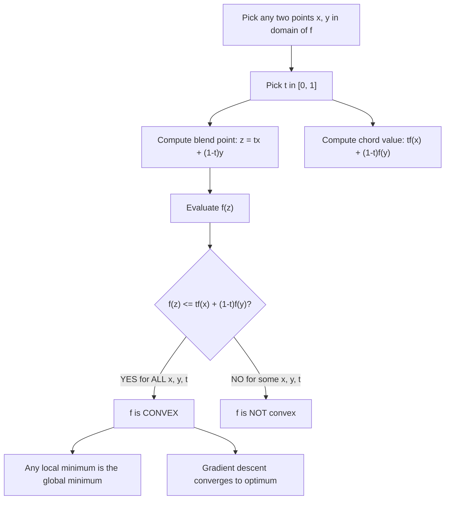

# Convex Function (Definition)

$$
f(tx + (1-t)y) \le t f(x) + (1-t)f(y)
$$

## Deep Breakdown

What it tells me *(Situation Awareness)*:
A function $f$ is convex if, for any two points $x$ and $y$ in its domain and any $t \in [0,1]$, the value of $f$ at the blend $tx + (1-t)y$ (a point on the line segment between $x$ and $y$) is at most the blended function value $tf(x) + (1-t)f(y)$ (the corresponding point on the chord). Geometrically: the chord between any two points on the graph lies above (or on) the graph. In DA/DS: almost every loss function used in ML (MSE, log-loss, hinge loss, KL divergence) is convex. Convexity guarantees that any local minimum is a global minimum, making gradient descent-based optimization reliable. Understanding this definition is foundational for reading ML papers, constructing custom loss functions, and verifying why gradient descent converges.

## Flowchart



## Real-world use

### Where it is used

Verifying whether a proposed loss function or regularization penalty is convex, justifying why gradient descent will find the global optimum, constructing composite loss functions (e.g., L2 penalty added to log-loss), and diagnosing non-convergence of gradient-based optimizers.

### Problem it solves

Before training a model, you need to know whether the optimization problem has a unique, reachable optimum. Non-convex losses (like those in neural networks) can have many local minima, making convergence tricky. For convex losses, gradient descent provably reaches the global minimum given sufficient iterations and a suitable learning rate. Knowing convexity also lets you apply duality results (Lagrange, Fenchel) to derive analytical solutions or efficient algorithms.

### How it solves the problem

The definition $f(tx+(1-t)y) \le tf(x)+(1-t)f(y)$ is the "chord test." Equivalently: the Hessian $\nabla^2 f(x) \succeq 0$ (positive semi-definite) at all $x$. Equivalently: $f(y) \ge f(x) + \nabla f(x)^T(y-x)$ for all $x, y$ (first-order condition: tangent hyperplanes underestimate $f$). These equivalent conditions give multiple ways to prove or disprove convexity.

### Example in a business

A DS is designing a custom loss function for a pricing model: $L(\hat{p}, p) = w_1 (p - \hat{p})^2 + w_2 \max(0, \hat{p} - p)$. They check convexity: the first term (MSE) is convex (Hessian = $2w_1 > 0$); the second term (hinge) is convex (piecewise linear and max of linear functions). Since convexity is preserved under non-negative sums, the composite $L$ is convex. Gradient descent will find the global optimum.

## The formula, piece by piece

- $f$: the function being tested (loss function, penalty, objective)
- $x, y$: any two points in the domain of $f$ (e.g., two weight vectors, two parameter values)
- $t \in [0, 1]$: a mixing coefficient; the blend $tx + (1-t)y$ is a point on the line segment from $x$ to $y$
- $tx + (1-t)y$: the convex combination of $x$ and $y$; geometrically the blend point on the segment
- $tf(x) + (1-t)f(y)$: the corresponding blend of function values (the chord value at $t$)
- $\le$: the chord value must be at least as large as the function value at the blend point (chord lies above graph)
- $\forall x, y \in \text{dom}(f), \forall t \in [0,1]$: must hold for ALL pairs, not just some
- Strictly convex: $<$ (strict inequality) for $t \in (0,1)$ and $x \ne y$ — unique minimum
- Strongly convex: $f(tx+(1-t)y) \le tf(x)+(1-t)f(y) - \frac{m}{2}t(1-t)\|x-y\|^2$ for $m > 0$ — exponential convergence

## The formula in words

"For any two points in the domain and any mixing weight $t$, the function value at the mix is at most the mix of the function values. In other words, the chord connecting any two points on the function's graph never dips below the graph itself." Tiny example: $f(x) = x^2$, $x = 0$, $y = 4$, $t = 0.5$.
LHS: $f(0.5 \cdot 0 + 0.5 \cdot 4) = f(2) = 4$.
RHS: $0.5 \cdot f(0) + 0.5 \cdot f(4) = 0 + 0.5 \cdot 16 = 8$.
$4 \le 8$. $\checkmark$ Convex. Non-convex example: $f(x) = \cos(x)$, $x = 0$, $y = \pi$, $t = 0.5$.
LHS: $f(\pi/2) = 0$.
RHS: $0.5 \cdot 1 + 0.5 \cdot (-1) = 0$.
$0 \le 0$. $\checkmark$ Equality here, but try $t = 0.3$: LHS $= \cos(0.3\pi) \approx 0.588$, RHS $= 0.3 + 0.5 \cdot (-1) = -0.2$. $0.588 \le -0.2$? NO. Not convex.

## Critical Concepts

- **Equivalent conditions for convexity:** 1. Chord test (definition above): $f(tx+(1-t)y) \le tf(x)+(1-t)f(y)$ 2. First-order: $f(y) \ge f(x) + \nabla f(x)^T(y-x)$ (tangent underestimates) 3. Second-order: $\nabla^2 f(x) \succeq 0$ for all $x$ (Hessian PSD)
- **Strict vs. strong convexity:** Strict convexity ($<$) implies unique minimum but not exponential convergence. Strong convexity ($m > 0$) implies both unique minimum and linear (exponential) convergence of gradient descent.
- **Common convex functions in ML:** $x^2$ (MSE), $\log(1+e^{-x})$ (log-loss), $\|x\|_1$ (LASSO), $\|x\|_2^2$ (ridge), $\max(0, 1-x)$ (hinge loss), $x \log x$ (entropy term in KL divergence).
- **Common non-convex functions in ML:** $\sin(x)$, $\cos(x)$, $-\log(x)$ on $\mathbb{R}$ (but convex on $x>0$), neural network losses with multiple layers.
- **Convexity-preserving operations:** non-negative weighted sum, composition with affine map, pointwise max, infimal convolution. These let you build complex convex objectives from simple convex pieces.
- **Why it matters for gradient descent:** for convex $f$ with Lipschitz gradient, vanilla gradient descent converges at rate $O(1/k)$; for strongly convex, at rate $O(\rho^k)$ (linear/exponential rate, where $\rho < 1$).

## Step-by-step calculation (tiny example)

*Test: Is $f(x) = x^2 + 3x + 2$ convex?* *Method 1: Second-order condition*
$f'(x) = 2x + 3$.
$f''(x) = 2 > 0$ for all $x$.
Since $f''(x) \ge 0$ everywhere, $f$ is convex. $\checkmark$ *Method 2: Chord test — spot check with $x=0, y=2, t=0.5$*
Blend: $t=0.5 \Rightarrow z = 0.5 \cdot 0 + 0.5 \cdot 2 = 1$.
LHS: $f(1) = 1 + 3 + 2 = 6$.
RHS: $0.5 \cdot f(0) + 0.5 \cdot f(2) = 0.5 \cdot 2 + 0.5 \cdot (4+6+2) = 1 + 6 = 7$.
$6 \le 7$. $\checkmark$ *Method 3: First-order condition — check at $x=1$, evaluate at $y=3$*
$\nabla f(x) = f'(1) = 2(1)+3 = 5$.
$f(3) = 9 + 9 + 2 = 20$.
$f(1) + f'(1)(3-1) = 6 + 5 \cdot 2 = 16$.
$20 \ge 16$. $\checkmark$

## Code examples

### Beginner example (Python)

```python
import numpy as np

def is_convex_chord_test(
    func,
    x_val: float,
    y_val: float,
    t_val: float,
    tol: float = 1e-9,
) -> bool:
    """Check the convexity chord inequality at specific points."""
    blend_point = t_val * x_val + (1 - t_val) * y_val
    lhs = func(blend_point)
    rhs = t_val * func(x_val) + (1 - t_val) * func(y_val)
    return lhs <= rhs + tol


# Test f(x) = x^2 (convex)
def quadratic(x: float) -> float:
    return x**2


# Test f(x) = -x^2 (concave, NOT convex)
def neg_quadratic(x: float) -> float:
    return -(x**2)


test_pairs = [(0, 4, 0.5), (1, 5, 0.3), (-2, 3, 0.7)]
print("Convexity chord test:")
for x, y, t in test_pairs:
    result_quad = is_convex_chord_test(quadratic, x, y, t)
    result_neg = is_convex_chord_test(neg_quadratic, x, y, t)
    print(f" x={x}, y={y}, t={t}")
    print(f" x^2 passes chord test: {result_quad}")
    print(f" -x^2 passes chord test: {result_neg}")
```

### Beginner example (R)

```r
# Convex function chord test: f(tx + (1-t)y) <= tf(x) + (1-t)f(y)
is_convex_chord_test <- function(f, x_val, y_val, t_val, tol = 1e-9) {
  blend_point <- t_val * x_val + (1 - t_val) * y_val
  lhs <- f(blend_point)
  rhs <- t_val * f(x_val) + (1 - t_val) * f(y_val)
  lhs <= rhs + tol
}
quadratic <- function(x) x^2
neg_quadratic <- function(x) -(x^2)
log_loss_f <- function(x) log(1 + exp(-x))  # log-loss (convex)
test_cases <- list(c(0, 4, 0.5), c(1, 5, 0.3), c(-2, 3, 0.7))
cat("Chord test results:\n")
for (tc in test_cases) {
  x <- tc[1]; y <- tc[2]; t <- tc[3]
  cat(sprintf(" x=%g, y=%g, t=%g:\n", x, y, t))
  cat(sprintf(" x^2 convex: %s\n", is_convex_chord_test(quadratic, x, y, t)))
  cat(sprintf(" -x^2 convex: %s\n", is_convex_chord_test(neg_quadratic, x, y, t)))
  cat(sprintf(" log-loss convex: %s\n", is_convex_chord_test(log_loss_f, x, y, t)))
}
```

### Professional example (Python)

```python
import numpy as np
from scipy.optimize import minimize
np.random.seed(42)

# -- Verify convexity of a custom loss and optimize it --------------------------
# Business case: fit a robust pricing model using a convex composite loss
# L(y_hat, y) = w1 * (y - y_hat)^2 + w2 * max(0, y_hat - y)
# (MSE penalizes all errors; hinge term adds extra cost for over-predictions)
W1 = 1.0   # weight for squared error
W2 = 2.0   # weight for over-prediction penalty (asymmetric cost)


def composite_loss(y_hat: float, y: float) -> float:
    """Custom convex composite loss: MSE + over-prediction hinge."""
    squared_term = W1 * (y - y_hat) ** 2
    hinge_term = W2 * max(0.0, y_hat - y)
    return squared_term + hinge_term


def verify_convexity_in_y_hat(y_true: float, n_checks: int = 200) -> bool:
    """Numerically verify chord inequality over a grid of (x, y_hat, t) triples."""
    y_hat_grid = np.linspace(y_true - 5, y_true + 5, 50)
    t_grid = np.linspace(0.01, 0.99, n_checks // 50)
    for x_h in y_hat_grid:
        for t in t_grid:
            for y_h in y_hat_grid:
                blend = t * x_h + (1 - t) * y_h
                lhs = composite_loss(blend, y_true)
                rhs = t * composite_loss(x_h, y_true) + (1 - t) * composite_loss(y_h, y_true)
                if lhs > rhs + 1e-8:
                    return False
    return True


y_observed = 10.0
print(f"Composite loss convex in y_hat? {verify_convexity_in_y_hat(y_observed)}")

# Optimize: find y_hat* that minimizes expected composite loss over training data
np.random.seed(42)
y_true_samples = 10.0 + np.random.randn(100) * 2.0


def mean_composite_loss(y_hat_arr: np.ndarray) -> float:
    y_hat = y_hat_arr[0]
    return float(np.mean([composite_loss(y_hat, y) for y in y_true_samples]))


result = minimize(mean_composite_loss, x0=[8.0], method="Nelder-Mead")
y_hat_optimal = result.x[0]

# Analytical comparison: MSE-only optimum is the mean
mean_y = y_true_samples.mean()
print(f"\nTrue mean of y: {mean_y:.4f}")
print(f"MSE-only optimum (mean): {mean_y:.4f}")
print(f"Composite loss optimum: {y_hat_optimal:.4f}")
print("(Composite optimum < mean: extra hinge cost pulls estimate down,"
      " avoiding over-predictions)")
```

---

*Source: MML2 p. 193*
