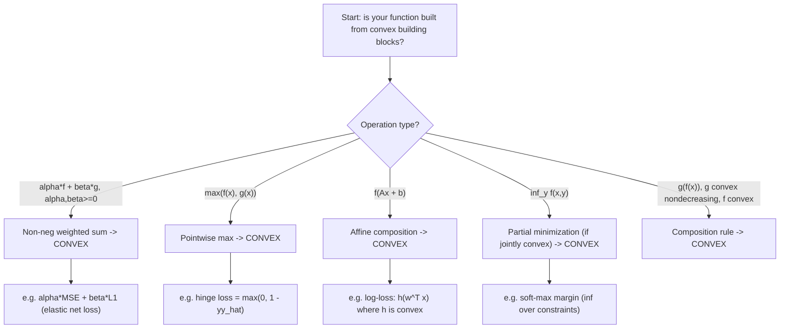

# Operations preserving convexity

$$
\max\{f(x), g(x)\}
$$

, $f(Ax + b)$

## Deep Breakdown

What it tells me *(Situation Awareness)*:
Convexity is preserved under a specific set of operations. If $f$ and $g$ are convex, then many natural combinations of them are also convex: non-negative weighted sums, pointwise maximum, composition with affine maps, and several others. This is a toolkit for verifying convexity of complex loss functions without computing Hessians. The two prototypical examples on the formula line are: $\max\{f(x), g(x)\}$ (pointwise max of convex functions is convex) and $f(Ax+b)$ (composition of convex function with affine map is convex). In DA/DS: the log-loss is convex because $\log(1+e^{-x})$ is convex (standard result) and compositions with linear predictors preserve convexity. Hinge loss $\max(0, 1-y\hat{y})$ is the pointwise max of two convex functions (0 and $1 - y\hat{y}$).

## Flowchart



## Real-world use

### Where it is used

Building and verifying composite loss functions, proving gradient descent will converge to global optimum, designing regularized objectives (Elastic Net = L1 + L2), justifying that a multi-task loss (sum of per-task losses) is convex, and constructing the SVM hinge loss.

### Problem it solves

Real-world loss functions are rarely "just $x^2$." They are combinations: MSE plus L1 penalty, or hinge loss, or log-loss with L2 regularization. Rather than computing the Hessian of the full composite function (which can be tedious), these preservation rules let you verify convexity by identifying which operations were used to compose the function from known convex pieces.

### How it solves the problem

The five main operations that preserve convexity are: (1) non-negative linear combination $\alpha f + \beta g$, $\alpha,\beta \ge 0$; (2) pointwise max $\max(f,g)$; (3) affine composition $f(Ax+b)$; (4) partial minimization $\inf_y h(x,y)$ (if $h$ is jointly convex); (5) monotone nondecreasing convex composition $g(f(x))$ when $g$ is nondecreasing convex and $f$ is convex. Each rule is proved via the definition of convexity.

### Example in a business

An ML engineer builds an Elastic Net loss: $L(w) = \|y - Xw\|_2^2 + \lambda_1 \|w\|_1 + \lambda_2 \|w\|_2^2$. Verification: $\|y - Xw\|_2^2$ is convex in $w$ (composition of convex $\|\cdot\|^2$ with affine $Xw$); $\|w\|_1$ and $\|w\|_2^2$ are convex; non-negative linear combination of convex functions is convex. Therefore $L(w)$ is convex — gradient descent converges to the global minimum.

## The formula, piece by piece

- $\max\{f(x), g(x)\}$: pointwise maximum; takes the larger value of $f$ and $g$ at each $x$; convex if both $f$ and $g$ are convex. Geometric interpretation: the epigraph of $\max(f,g)$ is the intersection of epigraphs of $f$ and $g$.
- $f(Ax + b)$: composition of convex $f$ with affine map $Ax + b$; convex in $x$. Connects to all linear model losses: $L(w) = \ell(Xw)$ is convex if $\ell$ is convex.
- $\alpha f(x) + \beta g(x)$: non-negative weighted sum; $\alpha, \beta \ge 0$; convex. Used for regularization.
- $\inf_y h(x, y)$: infimal convolution / partial minimization; convex in $x$ if $h(x,y)$ is jointly convex.
- $g(f(x))$: composition; convex if $g$ is nondecreasing convex AND $f$ is convex (e.g., $e^{f(x)}$, $f(x)^2$ for $f \ge 0$).
- Indicator of convex set: $\mathbb{I}_\mathcal{C}(x) = 0$ if $x \in \mathcal{C}$, $+\infty$ otherwise; convex iff $\mathcal{C}$ is convex.

## The formula in words

"If you build a function by taking pointwise maximums of convex functions, or by plugging an affine transformation into a convex function, the result is still convex. More generally, several standard ways to combine convex pieces preserve convexity — so you can verify convexity by inspection of the recipe." Tiny example: Is $h(x) = \max(2x, x^2 - 1)$ convex?
- $f_1(x) = 2x$: linear, hence convex.
- $f_2(x) = x^2 - 1$: sum of convex $x^2$ and constant $-1$; convex.
- $\max(f_1, f_2)$: pointwise max of two convex functions. Convex. $\checkmark$

## Critical Concepts

- **Summary table of convexity-preserving operations:**

| Operation | Condition | Example |
|---|---|---|
| $\alpha f + \beta g$ | $\alpha,\beta \ge 0$ | Elastic Net |
| $\max(f, g)$ | $f,g$ convex | Hinge loss |
| $f(Ax + b)$ | $f$ convex | Log-loss |
| $\inf_y h(x,y)$ | $h$ jointly convex | Soft margin |
| $g(f(x))$ | $g$ nondecreasing convex, $f$ convex | $e^{f(x)}$ |

- **Pointwise max of infinitely many convex functions:** $\sup_\alpha f_\alpha(x)$ is convex even when $\alpha$ ranges over an infinite index set. This is how the SVM objective can be written as $\sup_\alpha$. Also why $\|x\|_1 = \max_s \{s^T x : \|s\|_\infty \le 1\}$ (support function of $L_\infty$ ball) is convex.
- **Affine composition without restriction on sign:** for affine maps, no non-decreasing restriction is needed. For general nonlinear compositions, the signs matter: $g(f(x))$ is convex if $g$ is nondecreasing convex and $f$ is convex; or if $g$ is nonincreasing convex and $f$ is concave.
- **What does NOT preserve convexity:** product of two positive convex functions (e.g., $x^2 \cdot x^2 = x^4$ — actually convex here, but not in general); composition of two convex functions without monotonicity ($\cos(x^2)$ — not convex).
- **Practical workflow:** start with known convex atoms (norms, squares, log, exponentials) and combine them using only convexity-preserving operations.

If every step in the composition uses a valid rule, the composite is convex.

## Step-by-step calculation (tiny example)

*Verify: Elastic Net penalty $P(w) = \lambda_1 \|w\|_1 + \lambda_2 \|w\|_2^2$ is convex for $\lambda_1, \lambda_2 > 0$.*

*Step 1: Identify atoms*
- $\|w\|_1 = \sum_i |w_i|$: sum of absolute values; each $|w_i|$ is convex; sum preserves convexity. $\checkmark$
- $\|w\|_2^2 = \sum_i w_i^2$: sum of squares; each $w_i^2$ is convex; sum preserves convexity. $\checkmark$

*Step 2: Combine*
$P(w) = \lambda_1 \|w\|_1 + \lambda_2 \|w\|_2^2$.
Non-negative combination ($\lambda_1, \lambda_2 > 0$) of two convex functions. Convex. $\checkmark$

*Step 3: Add the data term*
Full Elastic Net: $L(w) = \|y - Xw\|_2^2 + P(w)$.
- $\|y - Xw\|_2^2$: affine $Xw$ composed with convex $\|\cdot\|_2^2$. Convex in $w$. $\checkmark$
- $P(w)$: convex. $\checkmark$
- $L(w) = $ sum. Convex. $\checkmark$

## Code examples

### Beginner example (Python)

```python
import numpy as np

def hinge_loss(y_pred: float, y_true: float) -> float:
    """Hinge loss = max(0, 1 - y_true * y_pred). Convex (pointwise max)."""
    return max(0.0, 1.0 - y_true * y_pred)

def elastic_net_penalty(w: np.ndarray, lam1: float, lam2: float) -> float:
    """Elastic Net penalty: lam1 * ||w||_1 + lam2 * ||w||_2^2."""
    return lam1 * np.sum(np.abs(w)) + lam2 * np.sum(w**2)

def log_loss_linear(w: np.ndarray, x: np.ndarray, y: float) -> float:
    """Logistic loss: log(1 + exp(-y * w^T x)). Convex (affine then convex)."""
    margin = y * (w @ x)
    return float(np.log1p(np.exp(-margin)))   # Demonstrate pointwise max (hinge) is convex via chord test

def chord_test(func, x_val, y_val, t, **kwargs):
    blend = t * x_val + (1 - t) * y_val
    lhs = func(blend, **kwargs)
    rhs = t * func(x_val, **kwargs) + (1 - t) * func(y_val, **kwargs)
    return lhs <= rhs + 1e-9
y_true = 1.0
print("Hinge loss convexity chord test (y_true=1):")
test_pairs = [(0.5, -1.5, 0.5), (2.0, -0.5, 0.3), (-1.0, 1.5, 0.7)]
for x, y, t in test_pairs:
    result = chord_test(hinge_loss, x, y, t, y_true=y_true)
print(f" y_pred x={x}, y={y}, t={t}: {result}")   # Elastic net on a weight vector
w_vec = np.array([0.5, -1.2, 0.0, 0.3])
print(f"\nElastic Net penalty (lam1=0.1, lam2=0.01): {elastic_net_penalty(w_vec, 0.1, 0.01):.4f}")
```

### Beginner example (R)

```r
# Operations preserving convexity: examples
hinge_loss <- function(y_pred, y_true) max(0, 1 - y_true * y_pred)
elastic_net <- function(w, lam1, lam2) lam1 * sum(abs(w)) + lam2 * sum(w^2)  # Chord test for convexity
chord_test <- function(f, x_val, y_val, t, ...) { blend <- t * x_val + (1 - t) * y_val f(blend, ...) <= t * f(x_val, ...) + (1 - t) * f(y_val, ...) + 1e-9
}
y_t <- 1
cat("Hinge loss convexity chord tests:\n")
pairs <- list(c(0.5, -1.5, 0.5), c(2, -0.5, 0.3), c(-1, 1.5, 0.7))
for (p in pairs) { result <- chord_test(hinge_loss, p[1], p[2], p[3], y_true = y_t)
  cat(sprintf(" x=%.1f, y=%.1f, t=%.1f: %s\n", p[1], p[2], p[3], result))
}  # Affine composition: log-loss h(w^T x) is convex in w
log_loss <- function(margin) log(1 + exp(-margin))
w_vec <- c(0.5, -1.2)
x_vec <- c(1.0, 2.0)
margin <- sum(w_vec * x_vec)
cat(sprintf("\nLog-loss at margin %.2f: %.4f\n", margin, log_loss(margin)))
cat("(Convex: h(w^Tx) = log_loss composed with affine w^Tx)\n")
```

### Professional example (Python)

```python
import numpy as np
from sklearn.linear_model import SGDClassifier, LogisticRegression
from sklearn.preprocessing import StandardScaler
from sklearn.model_selection import train_test_split
from sklearn.metrics import log_loss as sklearn_log_loss
np.random.seed(42)   # -- Compare convex loss functions for binary classification -------------------
# All losses below are convex; compare convergence and decision quality
N = 500
X = np.random.randn(N, 4)
true_w = np.array([1.5, -1.0, 0.5, 0.0])
log_odds = X @ true_w
probs = 1 / (1 + np.exp(-log_odds))
y = (np.random.rand(N) < probs).astype(float) * 2 - 1   # {-1, +1}
X_train, X_test, y_train, y_test = train_test_split(X, y, test_size=0.25)
scaler = StandardScaler()
X_train_std = scaler.fit_transform(X_train)
X_test_std = scaler.transform(X_test)
y_binary = (y_train == 1).astype(int)   # {0, 1} for log-loss
y_binary_test = (y_test == 1).astype(int)   # 1. Log-loss (convex by affine composition + log(1 + e^{-x}))
lr = LogisticRegression(C=1.0, random_state=42, max_iter=1000)
lr.fit(X_train_std, y_binary)   # 2. Hinge loss (convex = max(0, 1 - y * yhat))
svm_sgd = SGDClassifier(loss="hinge", alpha=0.01, random_state=42, max_iter=1000, tol=1e-4)
svm_sgd.fit(X_train_std, y_train)   # 3. Modified Huber loss (convex composite: smooth approximation to hinge)
huber_sgd = SGDClassifier(loss="modified_huber", alpha=0.01, random_state=42, max_iter=1000, tol=1e-4)
huber_sgd.fit(X_train_std, y_train)   # Evaluate
lr_proba = lr.predict_proba(X_test_std)
lr_acc = (lr.predict(X_test_std) == y_binary_test).mean()
svm_acc = (svm_sgd.predict(X_test_std) == y_test).mean()
huber_acc = (huber_sgd.predict(X_test_std) == y_test).mean()
print("Convex loss function comparison")
print(f"{'Loss':<20} {'Test Accuracy':>15} {'Convexity Basis'}")
print(f"{'Log-loss':<20} {lr_acc:>14.4f} affine composition + log(1+e^-x)")
print(f"{'Hinge':<20} {svm_acc:>14.4f} pointwise max(0, 1-y*yhat)")
print(f"{'Modified Huber':<20} {huber_acc:>14.4f} smooth composite (piecewise convex)")
print("\nAll three losses are convex -> gradient descent converges to global opt.")
print("Elastic Net = ||y-Xw||^2 + lam1*||w||_1 + lam2*||w||^2")
print(" = non-neg sum of convex terms -> convex.")
```

---

*Source: domain knowledge*
