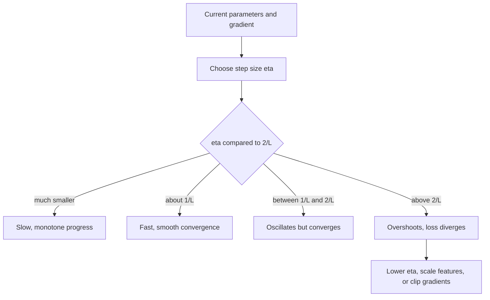

# Learning Rate (step size)

$$
\boldsymbol{\theta}_{t+1} = \boldsymbol{\theta}_t - \eta \, \nabla f(\boldsymbol{\theta}_t), \qquad \text{stable on a quadratic iff } 0 \lt \eta \lt \frac{2}{L}
$$

, where $L$ is the largest eigenvalue of the Hessian (the sharpest curvature), i.e. $f$ is $L$-smooth

## Deep Breakdown

What it tells me *(Situation Awareness)*:
The learning rate $\eta$ is the single number that converts a gradient (a direction and a slope) into an actual move in parameter space. The gradient only tells me which way is downhill locally; $\eta$ decides how far I trust that local picture. Too small and training crawls (each step barely changes the loss, wasting compute and possibly stalling on plateaus); too large and the step overshoots the valley floor, bouncing from wall to wall with growing amplitude until the loss explodes. On a quadratic the boundary is exact: along a direction of curvature $\lambda$, one step multiplies the error by $(1 - \eta\lambda)$, so convergence needs $|1 - \eta\lambda| \lt 1$, i.e. $\eta \lt 2/\lambda$. The sharpest direction ($\lambda = L$) sets the limit $2/L$, while the flattest direction ($\lambda = \mu$) sets the speed — this mismatch (the condition number $L/\mu$) is why feature scaling, momentum and adaptive methods matter. In DA/DS: the learning rate is the first hyperparameter to tune for any neural network, gradient-boosting model (where it is the "shrinkage" per tree), logistic regression trained with SGD, matrix factorisation for recommenders, or LLM fine-tuning; an LR range test, warmup and decay schedules are standard practice.

## Flowchart



## Real-world use

### Where it is used

Every gradient-based training loop: SGD, momentum, Adam (where $\eta$ multiplies the adaptive step), gradient boosting (learning rate = shrinkage per tree, typically 0.01–0.3), word embeddings, recommender matrix factorisation, LLM pretraining and fine-tuning (typically $10^{-5}$ to $10^{-3}$ for Adam-family optimizers).

### Problem it solves

The gradient has units of "loss per unit parameter", not "parameter change". Something has to choose the length of the step. A fixed rule that works everywhere does not exist, because the safe step depends on the curvature of the specific loss surface.

### How it solves the problem

Taylor-expand around $\boldsymbol{\theta}$: $f(\boldsymbol{\theta} - \eta \mathbf{g}) \approx f(\boldsymbol{\theta}) - \eta \|\mathbf{g}\|^2 + \tfrac{\eta^2}{2} \mathbf{g}^\top H \mathbf{g}$. The linear term rewards bigger steps, the quadratic (curvature) term punishes them. For an $L$-smooth function any $\eta \le 1/L$ guarantees the loss decreases by at least $\tfrac{\eta}{2}\|\mathbf{g}\|^2$ per step, and $\eta \lt 2/L$ is the boundary of stability on a quadratic. In practice $L$ is unknown, so I tune $\eta$ on a log grid, use an LR range test, or let a schedule/adaptive method handle it.

### Example in a business

A retail DS fits a 4-feature linear model of weekly sales with plain gradient descent (in the simulation below). The Hessian's largest eigenvalue is $L \approx 9.25$, so the divergence threshold is $2/L \approx 0.216$. With $\eta = 0.05/L$ the loss after 200 steps is still $0.381$ (optimal is $0.124$); with $\eta = 1/L$ it reaches the optimum; with $\eta = 2.1/L$ it diverges. Standardising the features shrinks the gap between $L$ and $\mu$ (condition number $36.4$ here) so a single learning rate works well for all coefficients.

## The formula, piece by piece

- $\boldsymbol{\theta}_t$: parameters at step $t$ (weights, coefficients)
- $\nabla f(\boldsymbol{\theta}_t)$: gradient of the loss at the current parameters
- $\eta$: learning rate (step size), a positive scalar; in some texts $\alpha$ or $\gamma$
- $\eta \nabla f$: the actual move; its length is $\eta \|\nabla f\|$
- $L$: smoothness constant, the largest Hessian eigenvalue on a quadratic; measures the sharpest curvature
- $2/L$: stability threshold — above it the error along the sharpest direction grows each step
- $1/L$: the classic safe default that guarantees monotone decrease for $L$-smooth functions
- $\mu$: the smallest curvature; the error along it shrinks by $(1 - \eta\mu)$ per step, which governs total convergence time
- Per-direction contraction on a quadratic: $e_{t+1} = (1 - \eta \lambda)\, e_t$

## The formula in words

"Each step moves against the gradient by a distance proportional to the learning rate; if the step is larger than twice the inverse of the sharpest curvature, every step overshoots by more than it corrects, and training blows up." Tiny example: $f(x) = 2x^2$ has $L = f''(x) = 4$, so the threshold is $2/4 = 0.5$. From $x_0 = 10$: with $\eta = 0.1$ each step multiplies $x$ by $0.6$ ($10 \to 6 \to 3.6 \to 2.16$); with $\eta = 0.6$ it multiplies by $-1.4$ ($10 \to -14 \to 19.6 \to -27.44$), diverging.

## Critical Concepts

- **Too small:** convergence is slow ($\propto 1/\eta$ steps) and the optimizer can stall on plateaus or in flat saddle regions; in SGD a tiny $\eta$ also reduces the beneficial noise that helps generalisation.
- **Too large:** oscillation (for $1/L \lt \eta \lt 2/L$, the iterate flips sign but shrinks), then divergence ($\eta \gt 2/L$), visible as loss going up, then `inf`/`NaN`.
- **Optimal constant step on a quadratic:** $\eta^* = 2/(L + \mu)$ balances the fastest and slowest directions; the contraction factor is $(\kappa - 1)/(\kappa + 1)$ with $\kappa = L/\mu$.
- **Condition number:** large $\kappa$ (badly scaled features, correlated inputs) forces a small $\eta$ for the sharp direction while the flat direction crawls. Remedies: standardise features, momentum, Adam, second-order methods.
- **Batch size coupling:** for SGD, the noise scale is roughly $\eta / B$; the "linear scaling rule" increases $\eta$ proportionally when increasing batch size $B$ (with warmup).
- **Edge of stability:** in deep nets trained with large $\eta$, the sharpness often rises until it hovers near $2/\eta$ — the threshold is a dynamic quantity, not only a property of the initial surface.
- **Tune on a log scale:** try $10^{-4}, 3 \times 10^{-4}, 10^{-3}, \ldots$; differences of 10–30% rarely matter, orders of magnitude always do.

## Step-by-step calculation (tiny example)

*Minimise $f(x) = 2x^2$ from $x_0 = 10$. Gradient $f'(x) = 4x$, so $x_{t+1} = x_t - 4\eta x_t = (1 - 4\eta)\,x_t$.*

*Step 1: Curvature and threshold*
$L = f''(x) = 4$, so stable iff $0 \lt \eta \lt 2/4 = 0.5$.

*Step 2: $\eta = 0.1$ (small)*
Factor $1 - 0.4 = 0.6$: $x_1 = 6$, $x_2 = 3.6$, $x_3 = 2.16$. Smooth, slow.

*Step 3: $\eta = 0.25 = 1/L$ (exactly right)*
Factor $1 - 1 = 0$: $x_1 = 0$. One step to the minimum (only possible on a 1-D quadratic).

*Step 4: $\eta = 0.45$ (large but stable)*
Factor $1 - 1.8 = -0.8$: $x_1 = -8$, $x_2 = 6.4$, $x_3 = -5.12$. Oscillates, shrinking.

*Step 5: $\eta = 0.6$ (above the threshold)*
Factor $1 - 2.4 = -1.4$: $x_1 = -14$, $x_2 = 19.6$, $x_3 = -27.44$. Diverges; $f$ goes $200 \to 392 \to 768.32 \to 1505.91$.

## Code examples

### Beginner example (Python)

```python
# f(x) = 2x^2, gradient 4x, curvature L = 4, threshold 2/L = 0.5
def run(eta, x0=10.0, steps=3):
    xs = [x0]
    for _ in range(steps):
        xs.append(xs[-1] - eta * 4 * xs[-1])
    return xs


for eta in (0.1, 0.25, 0.45, 0.6):
    xs = run(eta)
    print(f"eta = {eta:4.2f}, factor = {1 - 4 * eta:5.2f}: " + ", ".join(f"{x:.2f}" for x in xs))
# eta = 0.10 -> 10, 6, 3.6, 2.16
# eta = 0.25 -> 10, 0, 0, 0
# eta = 0.45 -> 10, -8, 6.4, -5.12
# eta = 0.60 -> 10, -14, 19.6, -27.44 (diverging)
print("loss at eta = 0.6:", [round(2 * x**2, 2) for x in run(0.6)])
```

### Beginner example (R)

```r
# f(x) = 2x^2, gradient 4x, threshold 2/L = 0.5
run <- function(eta, x0 = 10, steps = 3) {
  xs <- numeric(steps + 1)
  xs[1] <- x0
  for (t in 1:steps) xs[t + 1] <- xs[t] - eta * 4 * xs[t]
  xs
}
for (eta in c(0.1, 0.25, 0.45, 0.6)) {
  cat(sprintf("eta = %.2f: %s\n", eta, paste(round(run(eta), 2), collapse = ", ")))
}
```

### Professional example (Python)

```python
import numpy as np

rng = np.random.default_rng(42)

# Linear regression for weekly sales: MSE loss f(w) = ||Xw - y||^2 / (2n)
n, p = 1000, 4
X = rng.normal(size=(n, p)) * np.array([1.0, 2.0, 0.5, 3.0])   # features on different scales
w_true = np.array([2.0, -1.0, 0.5, 1.5])
y = X @ w_true + rng.normal(scale=0.5, size=n)

H = X.T @ X / n                          # Hessian of the MSE loss
eigs = np.linalg.eigvalsh(H)
L, mu = eigs.max(), eigs.min()
print(f"L (largest curvature) = {L:.3f}, mu (smallest) = {mu:.3f}, condition number = {L / mu:.1f}")
print(f"divergence threshold 2/L = {2 / L:.4f}, best constant step 2/(L+mu) = {2 / (L + mu):.4f}")


def loss(w):
    r = X @ w - y
    return float(r @ r / (2 * n))


def run_gd(eta, steps=200):
    w = np.zeros(p)
    for t in range(steps):
        w = w - eta * (X.T @ (X @ w - y) / n)
        if not np.isfinite(loss(w)) or loss(w) > 1e12:
            return t + 1, float("inf")
    return steps, loss(w)


w_ols = np.linalg.lstsq(X, y, rcond=None)[0]
print(f"optimal loss (least squares) = {loss(w_ols):.4f}\n")
for frac in (0.05, 0.5, 1.0, 1.9, 2.1):
    eta = frac / L
    steps, final = run_gd(eta)
    status = f"loss {final:.4f}" if np.isfinite(final) else f"diverged after {steps} steps"
    print(f"eta = {frac:4.2f}/L = {eta:.4f}: {status}")
```

---

*Source: domain knowledge*
