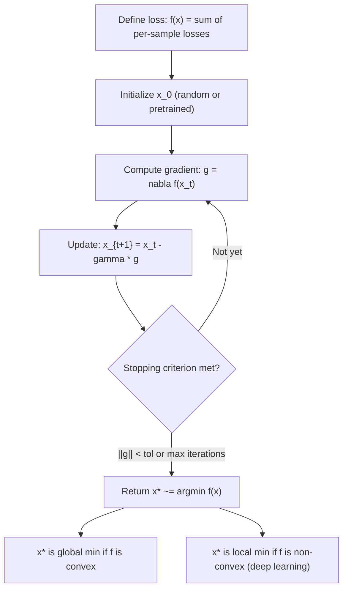

# Objective

Solve $\min_x f(x)$

## Deep Breakdown

What it tells me *(Situation Awareness)*:
The gradient descent objective $\min_x f(x)$ is the canonical statement of unconstrained optimization: find the value of $x$ (a parameter vector, weight matrix, or scalar) that makes $f(x)$ as small as possible. This is the central problem of training every ML model. $f$ is the loss function (MSE, cross-entropy, hinge, etc.); $x$ is the model parameter vector; and "solve" means finding the argmin: $x^* = \arg\min_x f(x)$. Gradient descent is the algorithm that iteratively moves $x$ in the direction of $-\nabla f(x)$ to approach $x^*$. This notation appears in every ML paper and is the frame within which all optimizer variants (SGD, Adam, RMSProp, L-BFGS) operate.

## Flowchart



## Real-world use

### Where it is used

Training any parametric ML model: linear regression (minimize MSE), logistic regression (minimize cross-entropy), SVM (minimize hinge + regularizer), neural networks (minimize task loss + optional regularizer). The objective $\min_x f(x)$ is also used in hyperparameter optimization (Bayesian optimization minimizes acquisition function), clustering (k-means minimizes intra-cluster variance), and dimensionality reduction (PCA minimizes reconstruction error).

### Problem it solves

ML models are parameterized by weights $x$ (e.g., $w \in \mathbb{R}^d$ for linear models, $\theta$ for neural nets). The training data induces a loss surface $f(x)$ over the parameter space. The goal is to find the parameter values that minimize the loss, which corresponds to the best-fitting model. Without solving $\min_x f(x)$, there is no trained model.

### How it solves the problem

By repeatedly evaluating $\nabla f(x)$ (the direction of steepest ascent) and moving in the opposite direction, gradient descent descends the loss surface. The learning rate $\gamma$ (step size) controls how far each step moves. Under suitable conditions (convexity, Lipschitz gradient), convergence to $x^*$ is guaranteed.

### Example in a business

A DA builds a linear regression to predict customer lifetime value from 10 features. $f(w) = \frac{1}{n}\|y - Xw\|_2^2$. They run gradient descent: initialize $w = 0$; compute $\nabla f(w) = -\frac{2}{n}X^T(y - Xw)$; update $w \leftarrow w - \gamma \nabla f(w)$; repeat until convergence. After $T$ iterations, $w^*$ minimizes the MSE over the training set.

## The formula, piece by piece

- $\min$: the minimization operator; asks "find $x$ that makes $f(x)$ as small as possible"
- $x$: the optimization variable; in ML, the parameter vector $w \in \mathbb{R}^d$, or $\theta$
- $f(x)$: the objective function; the quantity being minimized; in ML, this is the training loss (MSE, cross-entropy, etc.)
- $x^* = \arg\min_x f(x)$: the optimal parameters; the model weights after training
- $f(x^*)$: the minimum value of the loss; the best achievable training error
- Unconstrained: $x$ ranges freely over $\mathbb{R}^d$; constrained versions add $x \in \mathcal{C}$
- Necessary condition for a minimum: $\nabla f(x^*) = 0$ (gradient is zero); sufficient condition adds $\nabla^2 f(x^*) \succeq 0$ (PSD Hessian)

## The formula in words

"Find the input $x$ that makes $f(x)$ as small as possible. This is the foundational problem of ML training: which model parameters produce the lowest loss on the training data?" Tiny example: $f(x) = (x - 3)^2 + 2$.
$\nabla f(x) = 2(x-3) = 0 \Rightarrow x^* = 3$.
$f(x^*) = 2$ (minimum value).
Gradient descent: start at $x_0 = 0$, step $\gamma = 0.4$.
$x_1 = 0 - 0.4 \cdot 2(0-3) = 0 + 2.4 = 2.4$.
$x_2 = 2.4 - 0.4 \cdot 2(2.4-3) = 2.4 + 0.48 = 2.88$.
$x_3 = 2.88 - 0.4 \cdot 2(2.88-3) \approx 2.976$. Converging to 3.

## Critical Concepts

- **Gradient descent is not the optimizer — it's a family:** batch GD (full dataset), mini-batch GD (batch size $B$), SGD (batch size 1), momentum, Adam, RMSProp. All solve $\min_x f(x)$ by iteratively using gradient information.
- **Learning rate $\gamma$:** too large → overshooting, divergence; too small → slow convergence. Optimal $\gamma \le 1/L$ where $L$ is the Lipschitz constant of $\nabla f$. Learning rate schedules (cosine, warmup, polynomial decay) are key practical choices.
- **Convex vs non-convex:** for convex $f$, $\nabla f(x^*) = 0$ is sufficient for global minimum. For non-convex $f$ (neural nets), it's only necessary for local minimum. Deep learning accepts local optima and saddle points.
- **Analytical vs numerical:** some $\min_x f(x)$ have closed-form solutions (OLS: $w^* = (X^TX)^{-1}X^Ty$; ridge: $(X^TX + \lambda I)^{-1}X^Ty$). Gradient descent is the numerical fallback when closed forms are unavailable or too expensive.
- **Regularized objectives:** $\min_x f(x) + \lambda R(x)$ adds regularization penalty $R$ (L1, L2, elastic net).

Still the same framework; gradient descent applies to the joint objective.

## Step-by-step calculation (tiny example)

*Minimize $f(w) = (w_1 - 2)^2 + (w_2 + 1)^2$ starting from $w_0 = (0, 0)$, step $\gamma = 0.5$.* $\nabla f(w) = (2(w_1 - 2), 2(w_2 + 1))$. *Iteration 1:*
$g_0 = (2(0-2), 2(0+1)) = (-4, 2)$.
$w_1 = (0, 0) - 0.5 \cdot (-4, 2) = (2, -1)$. *Iteration 2:*
$g_1 = (2(2-2), 2(-1+1)) = (0, 0)$.
$w_2 = (2, -1) - 0.5 \cdot (0, 0) = (2, -1)$. Converged in 1 step to $w^* = (2, -1)$, $f(w^*) = 0$. $\checkmark$

## Code examples

### Beginner example (Python)

```python
import numpy as np

def gradient_descent(
    func,
    grad_func,
    x_init: np.ndarray,
    learning_rate: float = 0.1,
    n_iterations: int = 200,
    tol: float = 1e-6,
) -> tuple:
    """Minimize func(x) using gradient descent."""
    x = x_init.copy().astype(float)
    history = []
    for iteration in range(n_iterations):
        grad = grad_func(x)
        loss = func(x)
        history.append(loss)
        if np.linalg.norm(grad) < tol:
            print(f" Converged at iteration {iteration}")
            break
        x = x - learning_rate * grad
    return x, history


# Example: minimize f(w) = (w1 - 2)^2 + (w2 + 1)^2
def f(w: np.ndarray) -> float:
    return (w[0] - 2)**2 + (w[1] + 1)**2


def grad_f(w: np.ndarray) -> np.ndarray:
    return np.array([2 * (w[0] - 2), 2 * (w[1] + 1)])


w_init = np.array([0.0, 0.0])
w_star, loss_curve = gradient_descent(f, grad_f, w_init, learning_rate=0.5)
print(f"x* = {w_star}")
print(f"f(x*) = {f(w_star):.8f}")
print(f"Final gradient norm: {np.linalg.norm(grad_f(w_star)):.2e}")
print(f"Steps to converge: {len(loss_curve)}")
```

### Beginner example (R)

```r
# Gradient descent: min_x f(x)
gradient_descent <- function(func, grad_func, x_init, learning_rate = 0.1, n_iter = 200, tol = 1e-6) {
  x <- x_init
  history <- numeric(n_iter)
  for (i in seq_len(n_iter)) {
    g <- grad_func(x)
    history[i] <- func(x)
    if (sqrt(sum(g^2)) < tol) {
      cat(sprintf("Converged at iteration %d\n", i))
      return(list(x = x, history = history[1:i]))
    }
    x <- x - learning_rate * g
  }
  list(x = x, history = history)
}
f <- function(w) (w[1] - 2)^2 + (w[2] + 1)^2
grad_f <- function(w) c(2*(w[1]-2), 2*(w[2]+1))
result <- gradient_descent(f, grad_f, c(0, 0), learning_rate = 0.5)
cat(sprintf("x* = (%.6f, %.6f)\n", result$x[1], result$x[2]))
cat(sprintf("f(x*) = %.8f\n", f(result$x)))
```

### Professional example (Python)

```python
import numpy as np
from sklearn.datasets import make_regression
from sklearn.preprocessing import StandardScaler
from sklearn.metrics import mean_squared_error
np.random.seed(42)

# -- Gradient descent for linear regression from scratch ----------------------
X_raw, y = make_regression(n_samples=300, n_features=5, noise=15.0, random_state=42)
scaler = StandardScaler()
X = scaler.fit_transform(X_raw)
n_samples, n_features = X.shape

# OLS loss: f(w) = (1/n)||y - Xw||^2
# Gradient: grad_f(w) = -(2/n) X^T (y - Xw)
def mse_loss(w: np.ndarray) -> float:
    residuals = y - X @ w
    return float(np.mean(residuals**2))


def mse_gradient(w: np.ndarray) -> np.ndarray:
    residuals = y - X @ w
    return -2.0 / n_samples * X.T @ residuals


# Analytical optimum (OLS closed form) for comparison
w_ols = np.linalg.lstsq(X, y, rcond=None)[0]

# Gradient descent
LEARNING_RATE = 0.1
N_ITER = 2000
TOLERANCE = 1e-7
w = np.zeros(n_features)
loss_history = []
for step in range(N_ITER):
    loss = mse_loss(w)
    grad = mse_gradient(w)
    loss_history.append(loss)
    if np.linalg.norm(grad) < TOLERANCE:
        print(f"Converged at step {step}")
        break
    w -= LEARNING_RATE * grad
print(f"min_w f(w) solved via gradient descent")
print(f"Final MSE (GD): {mse_loss(w):.6f}")
print(f"Optimal MSE (OLS): {mse_loss(w_ols):.6f}")
print(f"||w_gd - w_ols||: {np.linalg.norm(w - w_ols):.2e}")
print(f"Loss at iteration 1: {loss_history[0]:.4f}")
print(f"Loss at convergence: {loss_history[-1]:.6f}")
print(f"Steps taken: {len(loss_history)}")
```

---

*Source: MML1 p. 234*
