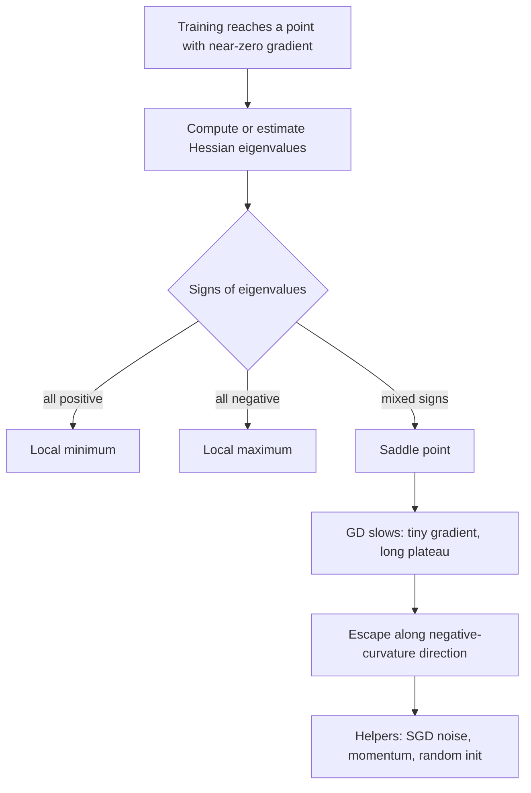

# Saddle Points in Loss Landscapes

$$
\nabla f(\boldsymbol{\theta}^*) = \mathbf{0} \quad \text{and} \quad \lambda_{\min}\big(\nabla^2 f(\boldsymbol{\theta}^*)\big) \lt 0 \lt \lambda_{\max}\big(\nabla^2 f(\boldsymbol{\theta}^*)\big)
$$

, canonical example $f(x, y) = x^2 - y^2$ at the origin, with Hessian $\operatorname{diag}(2, -2)$

## Deep Breakdown

What it tells me *(Situation Awareness)*:
A saddle point is a stationary point (zero gradient) that is neither a minimum nor a maximum: the surface curves up in some directions and down in others, like a horse saddle or a mountain pass. The Hessian's eigenvalues have mixed signs; the eigenvectors with negative eigenvalues are the escape routes. In the non-convex loss surfaces of neural networks, saddles are far more common than bad local minima: for a random critical point in $d$ dimensions, having all $d$ curvatures positive is exponentially unlikely, so most critical points with high loss are saddles. They matter because gradient descent slows to a crawl near them — the gradient is near zero, so steps are tiny, and the iterate first gets pulled *towards* the saddle along the positive-curvature directions before slowly sliding off along the negative-curvature ones. The training curve shows this as a long plateau followed by a sudden drop. Exact GD started exactly on the attracting set never escapes; any noise (SGD mini-batches, random initialisation) almost surely does. This note is about loss-surface geometry in non-convex optimisation; the min-max saddle point of a Lagrangian in constrained optimisation is a related but different idea. In DA/DS: interpreting loss plateaus when training deep nets, matrix factorisation for recommenders (whose symmetric solutions are saddles), PCA via gradient methods, deciding whether to add momentum or noise, and checking the Hessian spectrum when a model "converges" to a suspiciously high loss.

## Flowchart



## Real-world use

### Where it is used

Deep-learning training (plateaus in loss curves, especially early in training and in very deep or poorly initialised networks); low-rank matrix factorisation for recommender systems ($\mathbf{0}$ is a saddle of $\|R - UV^\top\|^2$); neural PCA/autoencoders; GAN training; theory of why SGD works on non-convex problems (escape-from-saddle results for perturbed gradient descent).

### Problem it solves

When the gradient vanishes, the usual stopping criterion "gradient norm below tolerance" cannot distinguish a good minimum from a saddle. Understanding saddles tells me whether a flat loss curve means "done" or "stuck for a while".

### How it solves the problem

Second-order information classifies the stationary point: if the smallest Hessian eigenvalue is negative, there is a direction $\mathbf{v}$ with $\mathbf{v}^\top H \mathbf{v} \lt 0$ along which the loss decreases quadratically. Near a saddle, GD acts on each eigen-direction independently: components with curvature $\lambda \gt 0$ shrink by $(1 - \eta\lambda)$ per step, components with $\lambda \lt 0$ grow by $(1 + \eta|\lambda|)$ per step. Escape time is therefore about $\log(1/\varepsilon_0)/\log(1 + \eta|\lambda|)$, where $\varepsilon_0$ is the initial component along the escape direction — small initial components mean long plateaus. Noise and momentum increase $\varepsilon_0$ or accelerate growth.

### Example in a business

A marketplace trains a two-tower recommendation model. The training loss sits flat at $0.69$ for 3,000 steps and the team considers stopping. A Hessian-vector-product probe (Lanczos on a mini-batch) finds a clearly negative eigenvalue, so this is a saddle, not a minimum. Keeping training (and adding momentum) lets the model leave the plateau; the loss drops to $0.41$ a few hundred steps later. A rule "stop when gradient norm is small" would have shipped a model at a saddle.

## The formula, piece by piece

- $\boldsymbol{\theta}^*$: a candidate point in parameter space
- $\nabla f(\boldsymbol{\theta}^*) = \mathbf{0}$: stationary point — first-order test cannot tell minimum, maximum or saddle apart
- $\nabla^2 f(\boldsymbol{\theta}^*)$: the Hessian, the matrix of second derivatives (local curvature)
- $\lambda_{\min}, \lambda_{\max}$: smallest and largest Hessian eigenvalues
- $\lambda_{\min} \lt 0 \lt \lambda_{\max}$: curves down in at least one direction and up in at least one — the saddle condition
- $f(x, y) = x^2 - y^2$: a minimum along $x$, a maximum along $y$; Hessian $\operatorname{diag}(2, -2)$
- Degenerate case: zero eigenvalues (flat directions) make the second-order test inconclusive; deep-net Hessians have many near-zero eigenvalues
- Strict saddle: $\lambda_{\min} \lt 0$ strictly; perturbed GD provably escapes these in polynomial time

## The formula in words

"A saddle point is a flat spot where the loss goes up in some directions and down in others; gradient descent gets slowed down there because the slope is almost zero, and it only escapes along the directions that curve downwards." Tiny example: on $f = x^2 - y^2$ with $\eta = 0.1$, GD multiplies $x$ by $0.8$ and $y$ by $1.2$ each step. Starting from $(1, 0.001)$, $x$ collapses towards 0 quickly while $y$ needs $\lceil \ln 1000 / \ln 1.2 \rceil = 38$ steps to grow past 1.

## Critical Concepts

- **Saddles dominate in high dimensions:** a random symmetric matrix of size 20 essentially never has all eigenvalues of one sign; for random-like Hessians, the fraction of critical points that are minima vanishes as dimension grows. Bad local minima are rare compared with saddles in large networks.
- **Why GD slows:** step length is $\eta\|\nabla f\|$, and $\|\nabla f\| \to 0$ near the saddle. The iterate first gets attracted along positive-curvature directions, then repelled along negative ones — the plateau-then-drop pattern.
- **Stable manifold:** points that flow exactly into the saddle under GD form a set of measure zero. With random initialisation GD almost surely avoids converging to strict saddles, but it can still spend a very long time near them.
- **Noise helps:** SGD mini-batch noise or explicit perturbations push the iterate off the stable manifold; momentum accumulates velocity along the escape direction.
- **Newton's method is attracted to saddles:** a raw Newton step $-H^{-1}\nabla f$ moves *towards* any stationary point, saddles included. Saddle-free Newton, trust-region and cubic-regularised methods fix this by using $|H|$ or damping.
- **Detecting a saddle:** estimate $\lambda_{\min}$ with Hessian-vector products and Lanczos/power iteration — no need to form the full Hessian.
- **Not the Lagrangian saddle:** in constrained optimisation, the solution is a min-max saddle of the Lagrangian on purpose; here a saddle of the loss is an obstacle.

## Step-by-step calculation (tiny example)

*Gradient descent on $f(x, y) = x^2 - y^2$ with $\eta = 0.1$ from $(1, 0.001)$.*

*Step 1: Classify the origin*
$\nabla f = (2x, -2y) = \mathbf{0}$ at $(0, 0)$. Hessian $\operatorname{diag}(2, -2)$: eigenvalues $2$ and $-2$, mixed signs, so a saddle.

*Step 2: Update rule per coordinate*
$x_{t+1} = x_t - 0.1 \cdot 2x_t = 0.8\,x_t$; $y_{t+1} = y_t + 0.1 \cdot 2y_t = 1.2\,y_t$.

*Step 3: Ten steps in*
$x_{10} = 0.8^{10} \approx 0.107$, $y_{10} = 0.001 \times 1.2^{10} \approx 0.0062$. Gradient norm $\approx 0.215$ (started at $2.0$): GD is slowing down near the saddle.

*Step 4: Twenty steps in*
$x_{20} \approx 0.0115$, $y_{20} \approx 0.0383$, gradient norm $\approx 0.080$. This is the plateau; loss $\approx -0.0013$, barely below 0.

*Step 5: Escape*
$y_t = 0.001 \times 1.2^t \ge 1$ needs $t \ge \ln 1000/\ln 1.2 \approx 37.9$, so 38 steps: $y_{38} \approx 1.02$, loss $\approx -1.04$, gradient norm back up to $\approx 2.04$.

*Step 6: Sensitivity*
Starting with $y_0 = 0$ exactly, $y_t = 0$ forever and GD converges to the saddle.

## Code examples

### Beginner example (Python)

```python
import numpy as np

# f(x, y) = x^2 - y^2, saddle at the origin
H = np.array([[2.0, 0.0], [0.0, -2.0]])
print("Hessian eigenvalues:", np.linalg.eigvalsh(H))   # [-2.  2.] -> saddle

eta = 0.1
p = np.array([1.0, 1e-3])
for t in range(39):
    g = np.array([2 * p[0], -2 * p[1]])
    if t in (0, 10, 20, 38):
        loss = p[0] ** 2 - p[1] ** 2
        print(f"step {t:2d}: x = {p[0]:.4f}, y = {p[1]:.4f}, "
              f"|grad| = {np.linalg.norm(g):.3f}, loss = {loss:.4f}")
    p = p - eta * g
# step 10: |grad| = 0.215; step 20: |grad| = 0.080 (plateau); step 38: y = 1.0207, escaped
print("steps for y to pass 1:", int(np.ceil(np.log(1000) / np.log(1.2))))   # 38
```

### Beginner example (R)

```r
H <- matrix(c(2, 0, 0, -2), nrow = 2)
print(eigen(H)$values)   # 2 -2 -> saddle

eta <- 0.1
p <- c(1, 1e-3)
for (t in 0:38) {
  g <- c(2 * p[1], -2 * p[2])
  if (t %in% c(0, 10, 20, 38)) {
    cat(sprintf("step %d: x = %.4f, y = %.4f, |grad| = %.3f\n", t, p[1], p[2], sqrt(sum(g^2))))
  }
  p <- p - eta * g
}
```

### Professional example (Python)

```python
import numpy as np

rng = np.random.default_rng(7)

# Double-well loss: f(x, y) = x^4 - 2x^2 + y^2
# critical points: (0, 0) saddle, (+1, 0) and (-1, 0) minima
f = lambda p: p[0] ** 4 - 2 * p[0] ** 2 + p[1] ** 2
grad = lambda p: np.array([4 * p[0] ** 3 - 4 * p[0], 2 * p[1]])
hess = lambda p: np.array([[12 * p[0] ** 2 - 4, 0.0], [0.0, 2.0]])

for pt in [(0.0, 0.0), (1.0, 0.0), (-1.0, 0.0)]:
    ev = np.linalg.eigvalsh(hess(np.array(pt)))
    kind = "saddle" if ev.min() < 0 < ev.max() else ("minimum" if ev.min() > 0 else "maximum")
    print(f"critical point {pt}: Hessian eigenvalues {ev}, {kind}")


def descend(p0, eta=0.05, steps=400, noise=0.0):
    p = np.array(p0, dtype=float)
    grad_norms = []
    for _ in range(steps):
        g = grad(p)
        grad_norms.append(np.linalg.norm(g))
        p = p - eta * (g + noise * rng.normal(size=2))
    return p, np.array(grad_norms)


# 1) exact GD started on the saddle's attracting axis (x = 0) never leaves
p, _ = descend([0.0, 1.0])
print(f"\nexact GD from (0, 1): ends at {np.round(p, 4)}, loss {f(p):.4f} (stuck at saddle)")

# 2) tiny perturbation: GD lingers near the saddle, then escapes
p, gn = descend([1e-6, 1.0])
first_escape = int(np.argmax(np.abs(gn[50:]) > 0.5)) + 50
print(f"GD from (1e-6, 1): ends at {np.round(p, 4)}, loss {f(p):.4f}")
print(f"  gradient norm drops to {gn[20:first_escape].min():.1e} near the saddle "
      f"and only recovers above 0.5 at step {first_escape}")

# 3) gradient noise (as in SGD) escapes from the exact stable manifold too
p, _ = descend([0.0, 1.0], noise=0.1)
print(f"noisy GD from (0, 1): ends at {np.round(p, 2)}, loss {f(p):.4f} (escaped)")

# 4) in high dimensions, random symmetric 'Hessians' are almost never definite
dim, trials = 20, 2000
mixed = 0
for _ in range(trials):
    A = rng.normal(size=(dim, dim))
    ev = np.linalg.eigvalsh((A + A.T) / 2)
    mixed += ev.min() < 0 < ev.max()
print(f"\nrandom {dim}x{dim} symmetric matrices with mixed-sign eigenvalues: {mixed / trials:.1%}")
```

---

*Source: domain knowledge*
