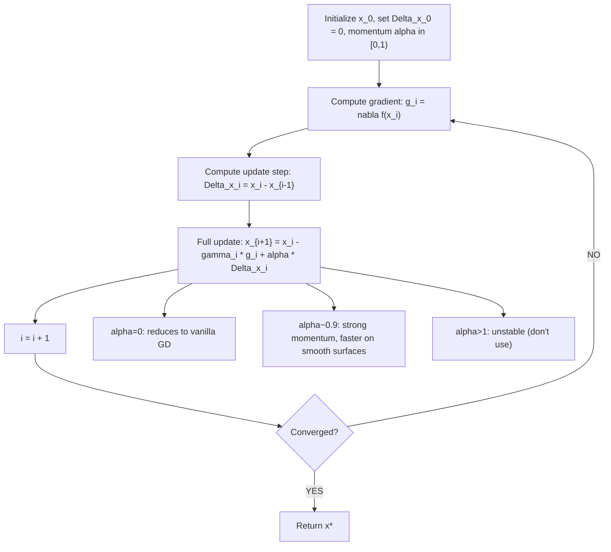

# $x {i+1} = x i - gamma i (nabla f(x i))^T + alpha Delta x i$

$$
x_{i+1} = x_i - \gamma_i (\nabla f(x_i))^T + \alpha \Delta x_i
$$

## Deep Breakdown

What it tells me *(Situation Awareness)*:
This is the momentum gradient descent update rule (classical/Polyak momentum). Compared to vanilla GD ($x_{i+1} = x_i - \gamma_i \nabla f(x_i)$), it adds a momentum term $\alpha \Delta x_i$ where $\Delta x_i = x_i - x_{i-1}$ is the previous step direction and $\alpha \in [0, 1)$ is the momentum coefficient. The momentum term accumulates a velocity vector over time: if gradients consistently point in the same direction, momentum amplifies the step; if gradients oscillate, momentum dampens the oscillation. This is analogous to a ball rolling downhill that gains speed on consistent slopes and decelerates on reversals. In DA/DS: momentum is used in virtually every practical optimizer (SGD+momentum is the default in PyTorch, Adam incorporates an exponential moving average of gradients as its first moment). Understanding momentum explains why Adam and RMSProp work so much better than plain SGD in practice.

## Flowchart



## Real-world use

### Where it is used

Training neural networks (PyTorch SGD with `momentum=0.9` is a common baseline), optimizing deep learning models when plain SGD stalls in flat ravines, and accelerating convergence in quadratic objectives. Momentum is also the conceptual foundation for Nesterov accelerated gradient and Adam's first moment.

### Problem it solves

Vanilla GD suffers on loss surfaces with high curvature in some directions and low curvature in others (ill-conditioned problems). It oscillates across the narrow direction (high curvature, large gradient) while moving slowly along the flat direction (low curvature, small gradient). Momentum smooths oscillations by averaging gradients over time, effectively amplifying movement in consistent directions and dampening back-and-forth noise.

### How it solves the problem

The term $\alpha \Delta x_i = \alpha (x_i - x_{i-1})$ adds a fraction of the previous step. Over multiple iterations, this builds up a "velocity" proportional to $\sum_{k} \alpha^{i-k} (-\gamma_k g_k)$ — an exponentially weighted average of past gradients. The ball analogy: momentum accumulates speed downhill, slides through local flat spots, and requires deliberate deceleration to stop at a minimum.

### Example in a business

A DS trains a deep demand forecasting network. With plain SGD ($\gamma = 0.01$), the model stalls after 50 epochs at high validation RMSE due to an elongated loss valley. Adding momentum ($\alpha = 0.9$) accelerates training: the velocity builds up along the consistent downhill direction, and the model converges to lower RMSE in 30 epochs. This is equivalent to using `optimizer = torch.optim.SGD(model.parameters(), lr=0.01, momentum=0.9)`.

## The formula, piece by piece

- $x_{i+1}$: next iterate (updated parameters)
- $x_i$: current iterate
- $\gamma_i$: learning rate at step $i$; scales the gradient term
- $(\nabla f(x_i))^T$: gradient of loss at current point; row-to-column transpose (same as $\nabla f(x_i)$ in column vector notation)
- $\alpha$: momentum coefficient; $\alpha \in [0, 1)$; typically 0.9 or 0.99 in practice
- $\Delta x_i = x_i - x_{i-1}$: the previous step direction (displacement from step $i-1$ to $i$)
- $\alpha \Delta x_i$: the momentum term; adds $\alpha$ times the previous step
- At $\alpha = 0$: formula reduces to vanilla GD $x_{i+1} = x_i - \gamma_i \nabla f(x_i)$
- Velocity form (equivalent): $v_{i+1} = \alpha v_i - \gamma_i g_i$; $x_{i+1} = x_i + v_{i+1}$; more common in practice

## The formula in words

"The new parameter = current parameter minus a gradient step plus a fraction of the last step. The extra term gives the update 'inertia': it keeps moving in the same direction it was already moving, like a ball that builds speed rolling downhill." Tiny example: $f(x) = x^2$, $x_0 = 5$, $\gamma = 0.3$, $\alpha = 0.9$.
$\Delta x_0 = 0$ (initial).
$g_0 = 2 \cdot 5 = 10$.
$x_1 = 5 - 0.3 \cdot 10 + 0.9 \cdot 0 = 2$.
$\Delta x_1 = x_1 - x_0 = 2 - 5 = -3$.
$g_1 = 2 \cdot 2 = 4$.
$x_2 = 2 - 0.3 \cdot 4 + 0.9 \cdot (-3) = 2 - 1.2 - 2.7 = -1.9$.
(Overshoot: momentum carried too far — illustrates that $\alpha$ must be tuned alongside $\gamma$.)

## Critical Concepts

- **Two equivalent momentum formulations:** 1. Polyak (this formula): $x_{i+1} = x_i - \gamma g_i + \alpha \Delta x_i$ 2. Velocity: $v_{i+1} = \alpha v_i - \gamma g_i$; $x_{i+1} = x_i + v_{i+1}$ Both are identical: $v_{i+1} = x_{i+1} - x_i = -\gamma g_i + \alpha (x_i - x_{i-1}) = -\gamma g_i + \alpha \Delta x_i$.
- **Nesterov momentum:** evaluates gradient at the "lookahead" point $x_i + \alpha \Delta x_i$ instead of $x_i$. This provides a tighter convergence rate for convex problems: $O(1/i^2)$ vs $O(1/i)$ for plain GD.
- **Adam's connection:** Adam's first moment $m_t = \beta_1 m_{t-1} + (1-\beta_1)g_t$ is an exponentially weighted moving average of gradients — equivalent to momentum with $\alpha = \beta_1$ and rescaled by $(1-\beta_1)$.
- **Effective step size:** with strong momentum, the effective learning rate is approximately $\gamma / (1 - \alpha)$. At $\alpha = 0.9$, effective LR is $10\times$ larger than $\gamma$. Reducing $\gamma$ when increasing $\alpha$ is important to prevent divergence.
- **Gradient clipping + momentum:** in RNNs and transformers, gradient clipping is applied before the momentum update to prevent exploding gradient instability.

## Step-by-step calculation (tiny example)

*Compare vanilla GD vs momentum GD on $f(w_1, w_2) = w_1^2 + 100 w_2^2$ (ill-conditioned). $\gamma = 0.02$, $\alpha = 0.9$.*

| Step | $w_1$ (GD) | $w_2$ (GD) | $w_1$ (mom) | $w_2$ (mom) |
|------|------------|------------|-------------|-------------|
| 0 | 1.000 | 1.000 | 1.000 | 1.000 |
| 1 | 0.960 | -2.000 | 0.960 | -2.000 |
| 2 | 0.922 | 0.520 | 0.886 | 1.400 |
| 3 | 0.885 | -0.912 | 0.810 | -0.980 |
| 4 | 0.849 | 0.270 | 0.737 | 0.682 |

Vanilla GD oscillates wildly on $w_2$ (high curvature). Momentum damps oscillation and converges faster.

## Code examples

### Beginner example (Python)

```python
import numpy as np

def momentum_gd( grad_func, x_init: np.ndarray, learning_rate: float = 0.02, momentum: float = 0.9, n_steps: int = 100,
) -> tuple:
    """Gradient descent with classical (Polyak) momentum."""
    x = x_init.copy().astype(float)
    x_prev = x.copy()
    history = []
    for step in range(n_steps):
        g = grad_func(x)
    delta_x = x - x_prev
    x_new = x - learning_rate * g + momentum * delta_x
    x_prev = x
    x = x_new
    history.append(x.copy())
    return x, history   # Ill-conditioned quadratic: f(w) = w1^2 + 100*w2^2

def f(w: np.ndarray) -> float:
    return w[0]**2 + 100 * w[1]**2

def grad_f(w: np.ndarray) -> np.ndarray:
    return np.array([2 * w[0], 200 * w[1]])
w_init = np.array([1.0, 1.0])   # Vanilla GD
_, hist_vanilla = momentum_gd(grad_f, w_init, learning_rate=0.009, momentum=0.0, n_steps=150)
# Momentum GD
w_star_mom, hist_mom = momentum_gd(grad_f, w_init, learning_rate=0.009, momentum=0.9, n_steps=150)

def losses(history):
    return [f(x) for x in history]
vanilla_losses = losses(hist_vanilla)
mom_losses = losses(hist_mom)
print(f"After 50 steps:")
print(f" Vanilla GD loss: {vanilla_losses[49]:.4f}")
print(f" Momentum GD loss: {mom_losses[49]:.4f}")
print(f"After 150 steps:")
print(f" Vanilla GD loss: {vanilla_losses[-1]:.6f}")
print(f" Momentum GD loss: {mom_losses[-1]:.6f}")
```

### Beginner example (R)

```r
# Gradient descent with momentum: x_{i+1} = x_i - gamma * g + alpha * (x_i - x_{i-1})
momentum_gd <- function(grad_func, x_init, lr = 0.02, alpha = 0.9, n_steps = 100) { x <- x_init
  x_prev <- x
  history <- matrix(0, nrow = n_steps, ncol = length(x))
  for (step in seq_len(n_steps)) { g <- grad_func(x)
    delta_x <- x - x_prev
    x_new <- x - lr * g + alpha * delta_x
    x_prev <- x
    x <- x_new
    history[step, ] <- x
  } list(x = x, history = history)
}
f <- function(w) w[1]^2 + 100 * w[2]^2
grad_f <- function(w) c(2 * w[1], 200 * w[2])
w_init <- c(1, 1)
res_van <- momentum_gd(grad_f, w_init, lr = 0.009, alpha = 0.0, n_steps = 150)
res_mom <- momentum_gd(grad_f, w_init, lr = 0.009, alpha = 0.9, n_steps = 150)
cat("After 50 steps:\n")
cat(sprintf(" Vanilla GD loss: %.4f\n", f(res_van$history[50, ])))
cat(sprintf(" Momentum GD loss: %.4f\n", f(res_mom$history[50, ])))
```

### Professional example (Python)

```python
import numpy as np
from sklearn.datasets import load_digits
from sklearn.preprocessing import StandardScaler, LabelBinarizer
from sklearn.model_selection import train_test_split
np.random.seed(42)   # -- Compare vanilla SGD vs SGD+momentum on softmax classification of Digits --
digits = load_digits()
X_raw, y_raw = digits.data, digits.target
scaler = StandardScaler()
X = scaler.fit_transform(X_raw)
lb = LabelBinarizer()
Y = lb.fit_transform(y_raw).astype(float)   # (n, 10) one-hot
X_train, X_test, Y_train, Y_test = train_test_split(X, Y, test_size=0.2, random_state=42)
y_test_labels = np.argmax(Y_test, axis=1)
N, D = X_train.shape
K = Y_train.shape[1]   # 10 classes
BATCH_SIZE = 64
N_EPOCHS = 40
LR = 0.05

def softmax(z: np.ndarray) -> np.ndarray:
    z_shifted = z - z.max(axis=1, keepdims=True)
    exp_z = np.exp(z_shifted)
    return exp_z / exp_z.sum(axis=1, keepdims=True)

def cross_entropy_gradient(W: np.ndarray, X_batch: np.ndarray, Y_batch: np.ndarray) -> np.ndarray:
    probs = softmax(X_batch @ W)
    return X_batch.T @ (probs - Y_batch) / len(X_batch)

def evaluate_accuracy(W: np.ndarray) -> float:
    preds = np.argmax(softmax(X_test @ W), axis=1)
    return (preds == y_test_labels).mean()

def run_sgd(use_momentum: bool, alpha: float = 0.9) -> list:
    W = np.random.randn(D, K) * 0.01
    V = np.zeros_like(W)   # velocity
    acc_history = []
    for epoch in range(N_EPOCHS):
        perm = np.random.permutation(N)
        for start in range(0, N, BATCH_SIZE):
            idx = perm[start:start + BATCH_SIZE]
            g = cross_entropy_gradient(W, X_train[idx], Y_train[idx])
            if use_momentum:
                # Velocity form: v_{t+1} = alpha*v_t - gamma*g; x_{t+1} = x_t + v_{t+1}
                V = alpha * V - LR * g
                W = W + V
            else:
                W = W - LR * g
            acc_history.append(evaluate_accuracy(W))
        return acc_history
    acc_vanilla = run_sgd(use_momentum=False)
acc_momentum = run_sgd(use_momentum=True, alpha=0.9)
print(f"Digits classification: SGD vs SGD+Momentum (alpha=0.9)")
print(f"{'Epoch':<8} {'Vanilla Acc':>12} {'Momentum Acc':>14}")
for ep in [4, 9, 19, 29, 39]:
    print(f"{ep+1:<8} {acc_vanilla[ep]:>12.4f} {acc_momentum[ep]:>14.4f}")
print(f"\nFinal test accuracy:")
print(f" Vanilla SGD: {acc_vanilla[-1]:.4f}")
print(f" SGD+Momentum: {acc_momentum[-1]:.4f}")
```

---

*Source: domain knowledge*
