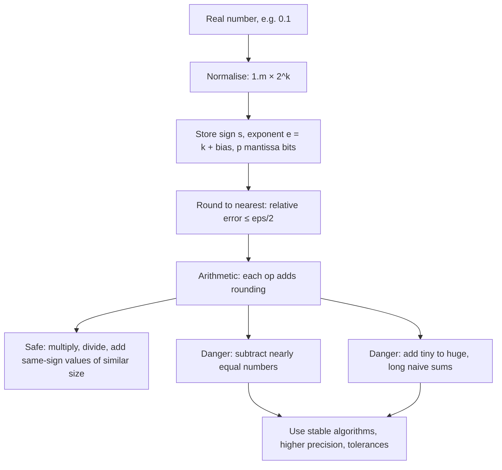

# Floating-Point Precision

$$
x = (-1)^{s} \times (1.m)_2 \times 2^{\,e - \text{bias}}, \qquad \varepsilon_{\text{mach}} = 2^{-p}
$$

, where $s$ is the sign bit, $m$ the $p$ stored fraction (mantissa) bits, $e$ the stored exponent; float16: $p = 10$, bias $15$; float32: $p = 23$, bias $127$; float64: $p = 52$, bias $1023$.

## Deep Breakdown

What it tells me *(Situation Awareness)*:
Computers store real numbers in IEEE 754 binary scientific notation: a sign, a fixed number of significant binary digits, and an exponent. That gives a *relative* precision, not an absolute one: every number is stored to within a relative error of about $\varepsilon_{\text{mach}}/2$, where machine epsilon $\varepsilon_{\text{mach}}$ is the gap between $1$ and the next representable number — $2^{-10} \approx 9.8 \times 10^{-4}$ for float16 (about 3 decimal digits), $2^{-23} \approx 1.19 \times 10^{-7}$ for float32 (about 6–7 digits) and $2^{-52} \approx 2.22 \times 10^{-16}$ for float64 (about 16 digits). Most decimal fractions (like $0.1$) have infinite binary expansions, so they are rounded on input, which is why $0.1 + 0.2 \ne 0.3$. Rounding is harmless in most single operations, but some operations amplify it: subtracting nearly equal numbers (catastrophic cancellation) wipes out the leading digits and leaves mostly rounding noise; adding a tiny number to a huge one (absorption) loses the tiny one entirely; long sums accumulate error. In DA/DS: never compare floats with `==`; use stable formulas (centred variance, Welford, log-sum-exp, `log1p`, `expm1`); be careful with float32 aggregations of large monetary values or IDs; understand why GPUs train in float16/bfloat16 with float32 accumulators; store money as integer cents or decimals in the database; and know that a "tiny" mismatch between pandas and SQL totals is often just summation order.

## Flowchart



## Real-world use

### Where it is used

Everywhere numbers are computed: pandas/NumPy aggregations, SQL `FLOAT`/`DOUBLE` columns, gradient descent, matrix factorisations, probability products (underflow), GPU deep learning in float16/bfloat16, financial reporting reconciliations, and equality checks in tests and data-validation pipelines.

### Problem it solves

Understanding precision explains (and prevents) silent wrong answers: a variance that comes out negative, a running total that stops increasing, a reconciliation that is off by $0.0000001$, a filter `price == 19.99` that misses rows, a training run whose loss turns into `NaN`.

### How it solves the problem

Knowing the representation tells me where error appears and how big it can be: relative error per operation is at most $\varepsilon_{\text{mach}}/2$; spacing between numbers grows with magnitude ($\text{spacing}(x) \approx |x| \cdot \varepsilon_{\text{mach}}$); cancellation turns a small absolute error into a large relative one. From that follow the fixes: compare with a tolerance (`np.isclose`), choose the precision for the magnitude of the data, centre data before squaring, use compensated or pairwise summation (`math.fsum`, NumPy's pairwise sum), and work in log-space for tiny probabilities.

### Example in a business

A finance analyst computes the variance of daily transaction values stored in cents (around $10^8$ per day) using the textbook shortcut $\mathbb{E}[x^2] - (\mathbb{E}[x])^2$. In float64 the two terms are about $10^{16}$, where float64 spacing is $2$, so a true variance of about $1$ is reported as $2.0$; in float32 the result is a large *negative* number. Centring the data first (two-pass algorithm) or using Welford's algorithm in float64 returns the correct $0.996$.

## The formula, piece by piece

- $s \in \{0, 1\}$: sign bit; $(-1)^s$ is $+1$ or $-1$
- $(1.m)_2$: the significand — an implicit leading $1$ followed by $p$ stored binary fraction bits $m$; value in $[1, 2)$
- $e$: the stored (biased) exponent, an unsigned integer (5, 8 or 11 bits)
- $\text{bias}$: $2^{k-1} - 1$ for a $k$-bit exponent ($15$, $127$, $1023$); lets the exponent be negative without a sign bit
- $2^{e - \text{bias}}$: the scale; float16 max is about $65504$, float32 about $3.4 \times 10^{38}$, float64 about $1.8 \times 10^{308}$
- $\varepsilon_{\text{mach}} = 2^{-p}$: distance from $1$ to the next float; float16 $9.77 \times 10^{-4}$, float32 $1.19 \times 10^{-7}$, float64 $2.22 \times 10^{-16}$
- Rounding: $\text{fl}(x) = x(1 + \delta)$ with $|\delta| \le \varepsilon_{\text{mach}}/2$
- Special values: $e$ all zeros gives zero and subnormals (gradual underflow); $e$ all ones gives $\pm\infty$ and NaN
- Spacing grows with size: near $10^8$ float32 numbers are $8$ apart, so adding $1$ does nothing

## The formula in words

"A float stores a number as sign × (1 plus a binary fraction with $p$ bits) × a power of two, so it is accurate to about $p$ binary digits *relative to its own size* — and anything that cancels those leading digits exposes the rounding." Tiny example: $0.1$ in float64 is really $0.1000000000000000055511151\ldots$ and $0.2$ is similarly off, so $0.1 + 0.2 = 0.30000000000000004$ while the float nearest to $0.3$ is a different number; the two differ by $2^{-54} \approx 5.55 \times 10^{-17}$.

## Critical Concepts

- **Relative, not absolute, precision:** float64 is accurate to about 16 significant digits whatever the magnitude; the absolute gap between neighbours is about $|x| \cdot 2.2 \times 10^{-16}$.
- **Catastrophic cancellation:** $a - b$ with $a \approx b$ keeps the absolute rounding errors of $a$ and $b$ but divides by a tiny result, so the relative error explodes. Example: $1.0000001 - 1.0$ in float64 gives $1.0000000005838672 \times 10^{-7}$, a relative error of about $5.8 \times 10^{-10}$ — millions of times larger than $\varepsilon_{\text{mach}}$.
- **Absorption:** if $|b| < \tfrac{1}{2}\,\text{spacing}(a)$, then $a + b = a$. In float32, $2^{24} + 1 = 2^{24}$.
- **Order matters:** floating-point addition is not associative, so sums in different orders (parallel reductions, SQL vs pandas) differ in the last digits.
- **Never use `==` on computed floats:** use a tolerance (`np.isclose`, `math.isclose`) or exact types (integers, `decimal.Decimal`) for money.
- **Pick precision to the job:** float64 for statistics and finance; float32 for most ML; float16/bfloat16 only with safeguards (see mixed precision training). bfloat16 keeps float32's 8-bit exponent (range) but has only 7 fraction bits ($\varepsilon = 2^{-7}$).

## Step-by-step calculation (tiny example)

*Encode $6.5$ as float32 and decode it back.*

*Step 1: Binary form*
$6.5 = 110.1_2$.

*Step 2: Normalise*
$110.1_2 = 1.101_2 \times 2^2$, so $s = 0$, true exponent $k = 2$, fraction bits $m = 101000\ldots$

*Step 3: Bias the exponent*
$e = 2 + 127 = 129 = 10000001_2$.

*Step 4: Decode*
$(1.101)_2 = 1 + 0.5 + 0.125 = 1.625$; value $= (+1) \times 1.625 \times 2^{129 - 127} = 1.625 \times 4 = 6.5$. Exact. $\checkmark$

*Step 5: Contrast with 0.1*
$0.1 = 1.6 \times 2^{-4}$, but $1.6 = 1.1001100110011\ldots_2$ never terminates. Rounded to 23 bits: $1 + 5033165/2^{23} \approx 1.6000000238$, so float32 stores $0.100000001490$. Relative error $\approx 1.5 \times 10^{-8} \le \varepsilon_{32}/2 \approx 6 \times 10^{-8}$. $\checkmark$

## Code examples

### Beginner example (Python)

```python
import struct
import numpy as np

# 1. Machine epsilon: gap between 1.0 and the next representable number
for t in (np.float16, np.float32, np.float64):
    info = np.finfo(t)
    print(f"{t.__name__:>8}: eps = {info.eps:.4e}, ~{info.precision} decimal digits, max = {info.max:.4e}")

# 2. The classic surprise
print("\n0.1 + 0.2 =", repr(0.1 + 0.2))
print("0.1 + 0.2 == 0.3 ?", 0.1 + 0.2 == 0.3)
print("0.1 is really  :", f"{0.1:.25f}")
print("Safe comparison:", abs((0.1 + 0.2) - 0.3) < 1e-9)

# 3. Decode the IEEE 754 bits of a float32
def float32_bits(x: float):
    (u,) = struct.unpack(">I", struct.pack(">f", x))
    s, e, m = u >> 31, (u >> 23) & 0xFF, u & 0x7FFFFF
    return s, e, m

for x in (6.5, 0.1):
    s, e, m = float32_bits(x)
    value = (-1) ** s * (1 + m / 2 ** 23) * 2.0 ** (e - 127)
    print(f"\n{x}: sign={s}, exponent bits={e:08b} ({e}), e-127={e - 127}, "
          f"mantissa=1+{m}/2^23={1 + m / 2**23:.10f}")
    print(f"   reconstructed value = {value:.12f}")
```

### Beginner example (R)

```r
# R uses float64 (double) for all numeric values
cat(sprintf("Machine epsilon (double): %.4e\n", .Machine$double.eps))
cat(sprintf("0.1 + 0.2 = %.17f\n", 0.1 + 0.2))
print(0.1 + 0.2 == 0.3)                 # FALSE
print(isTRUE(all.equal(0.1 + 0.2, 0.3))) # TRUE: compare with a tolerance

# Catastrophic cancellation
a <- 1.0000001; b <- 1.0
cat(sprintf("a - b = %.16e (intended 1e-07)\n", a - b))

# Absorption: 1 is lost next to 2^53
big <- 2^53
print((big + 1) - big)   # 0
```

### Professional example (Python)

```python
import math
import numpy as np

rng = np.random.default_rng(0)

# --- Catastrophic cancellation in the "textbook" variance formula -------------
# Order values in cents around 1e8 (1 million dollars) with tiny spread: true std = 1.0
x64 = 1e8 + rng.normal(0, 1.0, 10_000)
x32 = x64.astype(np.float32)          # float32 spacing at 1e8 is 8: data gets quantised
print(f"float32 spacing at 1e8: {np.spacing(np.float32(1e8))}")


def var_naive(x):
    """E[x^2] - (E[x])^2: subtracts two huge, nearly equal numbers."""
    n = x.size
    return (np.sum(x * x, dtype=x.dtype) / n) - (np.sum(x, dtype=x.dtype) / n) ** 2


def var_two_pass(x):
    """Centre first, then square: no cancellation."""
    m = np.mean(x, dtype=x.dtype)
    return np.mean((x - m) ** 2, dtype=x.dtype)


def var_welford(x):
    """One-pass, streaming-safe (Welford, 1962)."""
    mean, m2 = 0.0, 0.0
    for k, v in enumerate(x, start=1):
        delta = v - mean
        mean += delta / k
        m2 += delta * (v - mean)
    return m2 / len(x)


reference = var_two_pass(x64)
print(f"Reference variance (float64, two-pass): {reference:.6f}")
print(f"Naive formula, float64               : {var_naive(x64):.6f}")
print(f"Naive formula, float32               : {float(var_naive(x32)):.1f}")
print(f"Two-pass, float32                    : {float(var_two_pass(x32)):.6f}")
print(f"Welford, float64                     : {var_welford(x64):.6f}")

# --- Absorption: adding small numbers to a big running total ------------------
total32 = np.float32(16_777_216.0)          # 2^24
for _ in range(1000):
    total32 += np.float32(1.0)               # each +1 is lost: spacing at 2^24 is 2
print(f"\nfloat32: 2^24 + 1000 x 1.0 = {total32:.1f}  (expected 16778216)")

# --- Summation order: naive vs compensated -----------------------------------
vals = np.full(200_000, 0.1, dtype=np.float32)
naive = np.float32(0.0)
for v in vals:
    naive += v
print(f"float32 loop sum of 200,000 x 0.1 = {naive:.2f} (exact 20000)")
print(f"math.fsum (exact rounding), 1e6 x 0.1 = {math.fsum([0.1] * 1_000_000):.6f}")

# --- Rule of thumb: never test floats with == --------------------------------
print("\nnp.isclose(0.1 + 0.2, 0.3):", np.isclose(0.1 + 0.2, 0.3))
```

The naive variance formula subtracts two numbers of about $10^{16}$: in float64 it returns $2.0$ instead of $0.996$, and in float32 a negative variance. Two-pass in float32 returns $64$ — not because the algorithm fails, but because float32 cannot even *store* the inputs (spacing $8$ near $10^8$). Welford and two-pass in float64 agree on $0.996157$. The float32 running total stays stuck at $2^{24}$ because each $+1$ is below half the spacing ($2$), and a simple float32 loop over 200,000 values of $0.1$ drifts to $19959.49$.

---

*Source: domain knowledge*
