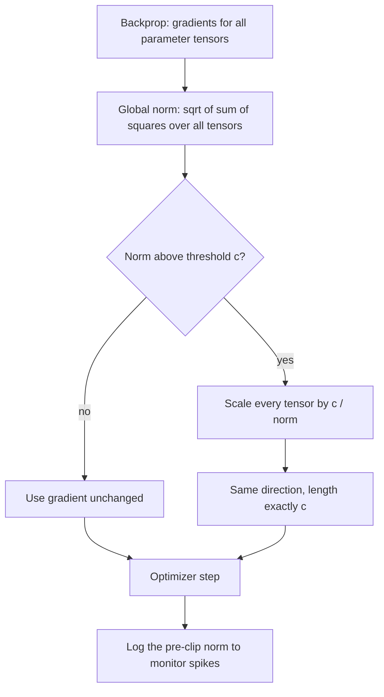

# Gradient Clipping

$$
\mathbf{g} \leftarrow \mathbf{g} \cdot \min\left(1, \frac{c}{\|\mathbf{g}\|_2}\right)
$$

, where $\mathbf{g}$ is the full gradient (all parameter tensors concatenated) and $c \gt 0$ is the maximum allowed norm; the alternative "clip by value" applies $g_i \leftarrow \max(-c, \min(c, g_i))$ to each entry separately

## Deep Breakdown

What it tells me *(Situation Awareness)*:
Gradient clipping is a safety rail on the size of an update. Most steps are untouched; when a gradient is abnormally large — an outlier mini-batch, a steep cliff in the loss surface, an exploding recurrent product — the step is shrunk before it can throw the parameters into a region from which training never recovers. Clipping by global norm rescales the whole gradient vector so its length is at most $c$, which preserves the *direction* exactly and only caps the *magnitude*; it is the standard choice (PyTorch `clip_grad_norm_`, TensorFlow `clip_by_global_norm`, Keras `clipnorm`, Hugging Face `max_grad_norm = 1.0`). Clipping by value caps each coordinate independently, which is simpler but changes the direction (a gradient dominated by one large coordinate gets flattened towards the diagonal). Clipping is not a cure for vanishing gradients and not a substitute for a sensible learning rate; it is cheap insurance against rare, catastrophic steps. In DA/DS: training RNN/LSTM models on long sequences (demand forecasting, clickstreams), fine-tuning and pretraining LLMs (loss spikes), reinforcement learning (PPO uses a clipped global norm), training on heavy-tailed data (whale customers, fraud amounts), and differentially private SGD (per-example clipping bounds each person's influence on the model).

## Flowchart



## Real-world use

### Where it is used

LSTM/GRU training (the original motivation: exploding gradients through time); transformer and LLM training (typical $c = 1.0$); reinforcement learning (PPO, A3C); GAN training; DP-SGD (per-sample clipping, then noise); any SGD on heavy-tailed data where a single mini-batch can produce a gradient orders of magnitude larger than typical.

### Problem it solves

The update $\eta \mathbf{g}$ is proportional to the gradient. One extreme gradient — from a cliff in the loss surface or an outlier batch — produces one extreme step, which can overshoot into a region with even larger gradients, cascading into `inf`/`NaN`. Lowering the learning rate to survive those rare events slows every normal step.

### How it solves the problem

It makes the step length bounded: $\|\eta \mathbf{g}_{\text{clipped}}\| \le \eta c$. Ordinary steps (norm below $c$) are untouched, so the learning rate can stay tuned for typical gradients. Because global-norm clipping multiplies by a single positive scalar, the clipped step is still a descent direction whenever the original was. The model keeps the information about *where* to go, but limits *how far* to trust a single noisy or extreme estimate.

### Example in a business

An e-commerce team fits an order-value model with mini-batch SGD (batch 8, $\eta = 0.05$) on features with heavy tails — a few "whale" customers have feature values far outside the typical range. In the professional example below, unclipped SGD diverges; clipping by value at 5 converges to MSE $0.485$; clipping by global norm at 5 converges to MSE $0.428$ (least-squares optimum $0.245$; the remaining gap is SGD noise from the constant learning rate). Global-norm clipping was active on 355 of 2,000 steps, i.e. about 18% of the time.

## The formula, piece by piece

- $\mathbf{g}$: the gradient of the loss with respect to all parameters, treated as one long vector
- $\|\mathbf{g}\|_2 = \sqrt{\sum_{\text{tensors}} \sum_i g_i^2}$: the global L2 norm across every layer
- $c$: clipping threshold (max norm); common values 0.5–5, with 1.0 the transformer default
- $\min(1, c/\|\mathbf{g}\|)$: scale factor; equals 1 (no change) when $\|\mathbf{g}\| \le c$, otherwise shrinks the norm to exactly $c$
- $\mathbf{g} \cdot \text{scale}$: same direction, bounded length
- Per-tensor norm clipping: the same formula applied to each layer separately — changes the relative scale between layers, so the overall direction changes
- Clip by value: $g_i \leftarrow \operatorname{clip}(g_i, -c, c)$ entrywise — bounds each coordinate, not the vector length, and changes direction
- Effective max step: $\eta c$

## The formula in words

"Measure the length of the entire gradient; if it is longer than the threshold, shrink every component by the same factor so that the length equals the threshold; otherwise leave it alone." Tiny example: two parameter tensors with gradients $(3, 4)$ and $(12)$; global norm $\sqrt{9 + 16 + 144} = 13$. With $c = 6.5$ the scale is $0.5$, giving $(1.5, 2)$ and $(6)$, norm $6.5$.

## Critical Concepts

- **Global norm vs by value:** global-norm clipping preserves direction; by-value clipping does not. In the tiny example, value clipping at $c = 5$ turns $(3, 4, 12)$ into $(3, 4, 5)$, whose cosine similarity with the original is only $0.925$ — the update now points somewhere else.
- **Global vs per-layer:** clipping each tensor separately changes the ratio between layers' updates; global clipping keeps it. Use global unless there is a specific reason.
- **Choosing $c$:** log the pre-clip gradient norm for a few hundred steps and set $c$ near a high percentile (e.g. 90th–99th) so clipping triggers only on outliers. If clipping is active on most steps, it is effectively a learning-rate reduction and normalised-gradient method.
- **Order of operations:** clip after backprop (and after unscaling in mixed-precision training, since the loss scaler multiplies gradients by a large factor), before the optimizer step.
- **Interaction with Adam:** Adam already normalises per parameter, but clipping still protects its moment estimates from a single huge gradient polluting $m_t$ and $v_t$.
- **It does not fix vanishing gradients:** clipping only shrinks; small gradients are untouched. Vanishing needs architecture or initialisation changes.
- **DP-SGD:** clipping *per example* bounds each individual's contribution to the update, which is what makes adding calibrated Gaussian noise give a privacy guarantee.

## Step-by-step calculation (tiny example)

*Gradients for two tensors: $\mathbf{g}_1 = (3, 4)$ and $\mathbf{g}_2 = (12)$; threshold $c = 6.5$.*

*Step 1: Global norm*
$\|\mathbf{g}\| = \sqrt{3^2 + 4^2 + 12^2} = \sqrt{169} = 13$.

*Step 2: Scale factor*
$\min(1, 6.5/13) = 0.5$.

*Step 3: Clip by global norm*
$\mathbf{g}_1 \to (1.5, 2)$, $\mathbf{g}_2 \to (6)$. New norm $= \sqrt{2.25 + 4 + 36} = \sqrt{42.25} = 6.5$. Direction unchanged (cosine similarity 1).

*Step 4: Compare with clipping by value at $c = 5$*
$(3, 4, 12) \to (3, 4, 5)$. Norm $= \sqrt{50} \approx 7.07$ — not even bounded by $c$ as a vector. Cosine similarity with the original: $(9 + 16 + 60)/(13 \times 7.071) = 85/91.92 \approx 0.925$, an angle of about $22^\circ$.

*Step 5: A normal step*
If the gradient were $(0.3, 0.4, 1.2)$ (norm $1.3 \le 6.5$), the factor is $1$: nothing changes.

## Code examples

### Beginner example (Python)

```python
import numpy as np

g1, g2 = np.array([3.0, 4.0]), np.array([12.0])
c = 6.5

total = np.sqrt(np.sum(g1 ** 2) + np.sum(g2 ** 2))
scale = min(1.0, c / total)
print(f"global norm = {total}, scale = {scale}")               # 13.0, 0.5
print("clipped by global norm:", g1 * scale, g2 * scale)       # [1.5 2. ] [6.]

full = np.concatenate([g1, g2])
by_value = np.clip(full, -5.0, 5.0)
cos = full @ by_value / (np.linalg.norm(full) * np.linalg.norm(by_value))
print("clipped by value (c = 5):", by_value)                   # [3. 4. 5.]
print(f"norm after value clip = {np.linalg.norm(by_value):.3f}, cosine with original = {cos:.3f}")
# 7.071, 0.925 -> direction changed
```

### Beginner example (R)

```r
g <- c(3, 4, 12)   # gradients of all tensors concatenated
c_max <- 6.5
total <- sqrt(sum(g^2))
scale <- min(1, c_max / total)
cat(sprintf("global norm = %.1f, scale = %.2f\n", total, scale))
print(g * scale)                       # 1.5 2.0 6.0

by_value <- pmax(-5, pmin(5, g))
cos_sim <- sum(g * by_value) / (sqrt(sum(g^2)) * sqrt(sum(by_value^2)))
cat(sprintf("by value: %s, cosine = %.3f\n", paste(by_value, collapse = ", "), cos_sim))
```

### Professional example (Python)

```python
import numpy as np


def clip_by_global_norm(grads, max_norm):
    """Scale all gradient arrays together so their joint L2 norm is at most max_norm."""
    total = np.sqrt(sum(float(np.sum(g ** 2)) for g in grads))
    scale = min(1.0, max_norm / (total + 1e-12))
    return [g * scale for g in grads], total


def clip_by_value(grads, c):
    return [np.clip(g, -c, c) for g in grads]


# Linear model for order value with heavy-tailed features (rare whale customers)
rng = np.random.default_rng(0)
n, p = 5000, 5
X = rng.standard_t(df=2, size=(n, p))          # heavy tails: occasional huge rows
w_true = np.array([1.0, -0.5, 2.0, 0.0, 0.7])
y = X @ w_true + rng.normal(scale=0.5, size=n)


def mse(w):
    r = X @ w - y
    return float(r @ r / n)


def train(mode, eta=0.05, steps=2000, batch=8, c=5.0, seed=1):
    r = np.random.default_rng(seed)
    w, b = np.zeros(p), 0.0
    big = 0
    for _ in range(steps):
        idx = r.integers(0, n, size=batch)
        err = X[idx] @ w + b - y[idx]
        gw, gb = 2 * X[idx].T @ err / batch, np.array(2 * err.mean())
        if mode == "global norm":
            (gw, gb), total = clip_by_global_norm([gw, gb], c)
            big += total > c
        elif mode == "by value":
            gw, gb = clip_by_value([gw, gb], c)
        w, b = w - eta * gw, b - eta * float(gb)
        if not np.isfinite(w).all() or np.abs(w).max() > 1e6:
            return "diverged", big
    return f"MSE {mse(w):.4f}, |w - w_true| = {np.linalg.norm(w - w_true):.3f}", big


print(f"least-squares MSE for reference: {mse(np.linalg.lstsq(X, y, rcond=None)[0]):.4f}")
for mode in ("none", "by value", "global norm"):
    result, big = train(mode)
    extra = f" ({big} of 2000 steps were clipped)" if mode == "global norm" else ""
    print(f"{mode:12s}: {result}{extra}")
```

---

*Source: domain knowledge*
