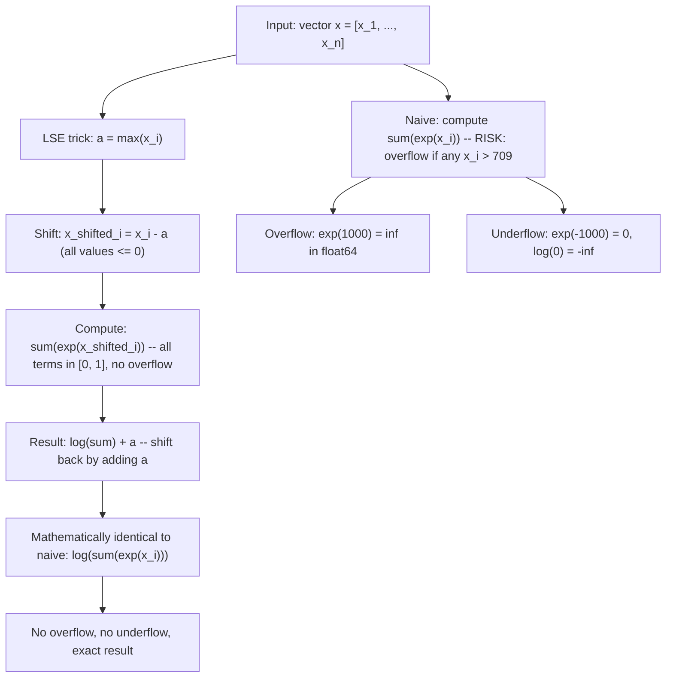

# Log-Sum-Exp Trick (prevents underflowoverflow)

$$
\log \sum_i e^{x_i} = a + \log \sum_i e^{x_i - a}
$$

, where $a = \max_i(x_i)$

## Deep Breakdown

What it tells me *(Situation Awareness)*:
The log-sum-exp (LSE) trick is a numerically stable identity for computing $\log \sum_i e^{x_i}$ when the $x_i$ values are large (causing overflow: $e^{1000} = \infty$ in float64) or very negative (causing underflow: $e^{-1000} = 0$). By subtracting $a = \max_i(x_i)$ before exponentiating, the largest term becomes $e^0 = 1$ and all other terms are $\le 1$, preventing overflow entirely. The mathematical identity is exact: no approximation is made. In DA/DS: LSE appears in softmax cross-entropy loss (numerically stable implementation), log-likelihood computation for mixture models (log-sum over component likelihoods), Hidden Markov Model forward algorithm, attention mechanisms in transformers, and any log-probability computation involving sums of exponentials. NumPy's `scipy.special.logsumexp` and PyTorch's `torch.logsumexp` both implement this trick.

## Flowchart



## Real-world use

### Where it is used

Softmax cross-entropy in every neural network (stable implementation of $-\log p_y$ where $p_y = e^{z_y}/\sum_j e^{z_j}$); Gaussian Mixture Model log-likelihood (sum over $K$ components in log space); HMM forward/backward algorithm; attention score computation in transformers; Bayesian model comparison (log marginal likelihood); any computation of $\log \sum_k e^{\text{score}_k}$.

### Problem it solves

Direct computation of $\log \sum_i e^{x_i}$ fails numerically for extreme inputs. In float64: $e^x$ overflows to `inf` for $x > 709$; underflows to $0$ for $x < -745$. Log-probabilities in language models, log-likelihoods summed over long sequences, and logit vectors from large-vocabulary classifiers routinely exceed these ranges.

### How it solves the problem

Factor out the maximum: $\log \sum_i e^{x_i} = \log \sum_i e^{x_i - a + a} = \log [e^a \sum_i e^{x_i - a}] = a + \log \sum_i e^{x_i - a}$. Since $x_i - a \le 0$ for all $i$ (because $a = \max_i x_i$), every $e^{x_i - a} \in (0, 1]$, so $\sum_i e^{x_i-a} \in (0, n]$. No overflow. If all $x_i$ are very negative (underflow risk), subtracting $a = \max_i x_i$ still gives $e^0 = 1$ for the largest term — at least one term survives, preventing $\log(0)$.

### Example in a business

A DS computes softmax cross-entropy for a 10k-class product classifier (e-commerce). Raw logits from the final layer can be large (e.g., $z = [1000, 998, 995, ...]$). Naive softmax: $\text{softmax}(z)_j = e^{z_j}/\sum e^{z_k}$ — numerator $e^{1000} = \infty$. Stable softmax: subtract $a = 1000$ first; $\text{softmax}(z)_j = e^{z_j - 1000}/\sum_k e^{z_k - 1000}$ — numerator $e^0 = 1$, others $e^{-2}$, $e^{-5}$, etc. This is implemented directly in PyTorch's `nn.CrossEntropyLoss`.

## The formula, piece by piece

- $\log$: natural logarithm (base $e$); appears because we compute log-probabilities
- $\sum_i e^{x_i}$: sum of exponentials; the quantity we need in log-space
- $a = \max_i(x_i)$: the maximum value in the vector; used as the shift constant
- $x_i - a$: shifted values; all $\le 0$ since $a$ is the maximum; prevents overflow
- $e^{x_i - a}$: shifted exponentials; all in $(0, 1]$; no overflow possible
- $\sum_i e^{x_i - a}$: sum of shifted exponentials; always in $(0, n]$ for $n$ terms
- $\log \sum_i e^{x_i - a}$: safe log (argument is positive and $\le n$); result $\le \log n$
- $a + \log \sum_i e^{x_i - a}$: add the shift back to recover the true answer
- Identity proof: $a + \log \sum_i e^{x_i - a} = \log e^a + \log \sum_i e^{x_i-a} = \log [e^a \cdot \sum_i e^{x_i-a}] = \log \sum_i e^{x_i}$
- Stable softmax: $\text{softmax}(x)_j = e^{x_j-a}/\sum_i e^{x_i-a}$; numerically equivalent to original definition

## The formula in words

"To safely compute the log of a sum of exponentials: subtract the maximum value from all terms before exponentiating (so the largest term becomes $e^0 = 1$), sum those safe exponentials, take the log, then add the maximum back. The result is algebraically identical to the naive formula but stays well within floating-point range." Tiny example: $x = [1000, 999, 998]$.
Naive: $e^{1000} + e^{999} + e^{998} = \infty$ (overflow in float64).
LSE: $a = 1000$.
Shifted: $[0, -1, -2]$.
$e^0 + e^{-1} + e^{-2} = 1 + 0.3679 + 0.1353 = 1.5032$.
$\log(1.5032) = 0.4076$.
Result: $1000 + 0.4076 = 1000.4076$.
Exact (arbitrary precision): $\log(e^{1000} + e^{999} + e^{998}) = 1000.4076$. Matches. $\checkmark$

## Critical Concepts

- **Choice of $a$:** any constant $a$ makes the identity mathematically correct. The convention $a = \max_i x_i$ is optimal: it guarantees no overflow (all terms $\le 1$) and no underflow of the largest term. Using $a = 0$ (no shift) provides no protection.
- **Stable softmax:** for softmax, the $a$ cancels in numerator and denominator: $e^{x_j-a}/\sum_i e^{x_i-a} = e^{x_j}/\sum_i e^{x_i}$. Any shift $a$ gives the same result, so $a = \max_i x_i$ is used purely for stability.
- **Stable log-softmax:** $\log \text{softmax}(x)_j = (x_j - a) - \log \sum_i e^{x_i-a}$. This avoids computing $\text{softmax}$ explicitly (which would lose precision for small probabilities) and is used in `torch.nn.LogSoftmax`.
- **Two-pass algorithm:** requires one pass to compute $a = \max(x)$, one pass to compute the sum. For streaming/online data, approximate algorithms exist.
- **Applications in log-space probability:** when working with log-probabilities $\log p_i$ (instead of $p_i$ directly), computing $\log(p_1 + p_2)$ requires LSE: $\log(e^{\log p_1} + e^{\log p_2})$.

This is standard in speech recognition, NLP decoding, and probabilistic graphical models.

## Step-by-step calculation (tiny example)

*Compute $\log(e^{3} + e^{5} + e^{4})$ using the LSE trick.*

*Step 1: Find $a$*
$a = \max(3, 5, 4) = 5$.

*Step 2: Shift*
$x - a = [3-5, 5-5, 4-5] = [-2, 0, -1]$.

*Step 3: Exponentiate*
$e^{-2} = 0.1353$, $e^{0} = 1$, $e^{-1} = 0.3679$.
Sum $= 1.5032$.

*Step 4: Log and add back*
$\log(1.5032) = 0.4076$.
Result $= 5 + 0.4076 = 5.4076$. *Verification:*
$\log(e^3 + e^5 + e^4) = \log(20.09 + 148.41 + 54.60) = \log(223.10) = 5.4076$. $\checkmark$

## Code examples

### Beginner example (Python)

```python
import numpy as np


def log_sum_exp(x: np.ndarray) -> float:
    """Numerically stable log-sum-exp: log(sum(exp(x_i))) = a + log(sum(exp(x_i - a)))."""
    a = np.max(x)
    return float(a + np.log(np.sum(np.exp(x - a))))


def softmax_stable(x: np.ndarray) -> np.ndarray:
    """Numerically stable softmax: exp(x_i - max) / sum(exp(x_j - max))."""
    shifted = x - np.max(x)
    exp_shifted = np.exp(shifted)
    return exp_shifted / exp_shifted.sum()


# Demonstrate overflow prevention
x_normal = np.array([1.0, 2.0, 3.0])
x_large = np.array([1000.0, 999.0, 998.0])
x_small = np.array([-1000.0, -999.0, -998.0])
print("=== Log-Sum-Exp Trick ===")
for label, x in [("normal", x_normal), ("large (+1000)", x_large), ("small (-1000)", x_small)]:
    naive_sum = np.sum(np.exp(x))  # may overflow or lose precision
    lse_result = log_sum_exp(x)
    naive_result = np.log(naive_sum) if np.isfinite(naive_sum) else float("nan")
    print(f"\n{label}: x = {x}")
    print(f" Naive log(sum(exp(x))): {naive_result}")
    print(f" LSE trick: {lse_result}")
print("\n=== Stable Softmax ===")
x_overflow = np.array([1000.0, 999.0, 997.0])
naive_sm = np.exp(x_overflow) / np.sum(np.exp(x_overflow))
stable_sm = softmax_stable(x_overflow)
print(f"Naive softmax: {naive_sm}")   # [nan, nan, nan] due to overflow
print(f"Stable softmax: {stable_sm}")   # [0.731, 0.269, 0.036] correct
print(f"Sum check: {stable_sm.sum():.6f}")
```

### Beginner example (R)

```r
# Log-sum-exp trick: log(sum(exp(x))) = a + log(sum(exp(x - a))), a = max(x)
log_sum_exp <- function(x) {
  a <- max(x)
  a + log(sum(exp(x - a)))
}
softmax_stable <- function(x) {
  shifted <- x - max(x)
  exp_shifted <- exp(shifted)
  exp_shifted / sum(exp_shifted)
}

# Test cases
x_normal <- c(1, 2, 3)
x_large <- c(1000, 999, 998)
x_small <- c(-1000, -999, -998)
for (label in c("normal", "large", "small")) {
  x <- switch(label, normal = x_normal, large = x_large, small = x_small)
  naive_result <- tryCatch(log(sum(exp(x))), warning = function(w) NaN)
  cat(sprintf("\n%s: LSE = %.4f Naive = %s\n", label, log_sum_exp(x),
              ifelse(is.finite(naive_result), sprintf("%.4f", naive_result), "Inf/NaN")))
}

# Stable softmax
cat(sprintf("\nStable softmax([1000, 999, 997]): %.4f %.4f %.4f\n", softmax_stable(c(1000, 999, 997))))
```

### Professional example (Python)

```python
import numpy as np
from scipy.special import logsumexp
np.random.seed(42)

# -- Stable cross-entropy loss and log-likelihood for mixture model -----------

# 1. Stable softmax cross-entropy (multi-class, K=5 classes)
def stable_cross_entropy(logits: np.ndarray, labels: np.ndarray) -> float:
    """Cross-entropy using log-sum-exp trick. logits: (n, K), labels: (n,) int."""
    n, k = logits.shape
    # log_softmax = logits - LSE(logits)
    lse = logsumexp(logits, axis=1, keepdims=True)       # (n, 1)
    log_probs = logits - lse                             # log-softmax (n, K)
    correct_log_probs = log_probs[np.arange(n), labels]  # log p(y_i) for each sample
    return float(-np.mean(correct_log_probs))


# Simulate logits with large values (realistic in deep classifiers)
N, K = 200, 10
logits = np.random.randn(N, K) * 100   # large logits -- naive exp would overflow
true_labels = np.random.randint(0, K, N)
ce_stable = stable_cross_entropy(logits, true_labels)
print(f"Stable cross-entropy (large logits, K={K}): {ce_stable:.4f}")
print(f" (Naive exp(logits * 100) would overflow to inf)")


# 2. GMM log-likelihood via LSE
def gmm_log_likelihood(
    x: np.ndarray, means: np.ndarray, stds: np.ndarray, weights: np.ndarray
) -> float:
    """Gaussian mixture model log-likelihood using LSE for numerical stability.

    log p(x) = log sum_k pi_k * N(x; mu_k, sigma_k)
             = LSE over k of [log pi_k + log N(x; mu_k, sigma_k)]
    """
    n_components = len(means)
    log_component_scores = np.zeros((len(x), n_components))
    for k in range(n_components):
        log_nk = -0.5 * ((x - means[k]) / stds[k])**2 - np.log(stds[k]) - 0.5 * np.log(2 * np.pi)
        log_component_scores[:, k] = np.log(weights[k]) + log_nk

    # LSE over components for each sample
    log_p_x = logsumexp(log_component_scores, axis=1)
    return float(np.sum(log_p_x))


# 2-component GMM
x_data = np.concatenate([
    np.random.randn(150) * 0.5 + 2.0,
    np.random.randn(100) * 0.8 - 1.0,
])
means = np.array([2.0, -1.0])
stds = np.array([0.5, 0.8])
weights = np.array([0.6, 0.4])
log_lik = gmm_log_likelihood(x_data, means, stds, weights)
print(f"\nGMM log-likelihood (n={len(x_data)}, K=2 components): {log_lik:.4f}")
print(f"Average log-likelihood per sample: {log_lik/len(x_data):.4f}")
print(f"\nKey: logsumexp() from scipy.special implements the LSE trick.")
print(f"It is used to avoid overflow when summing component probabilities.")
```

---

*Source: domain knowledge*
