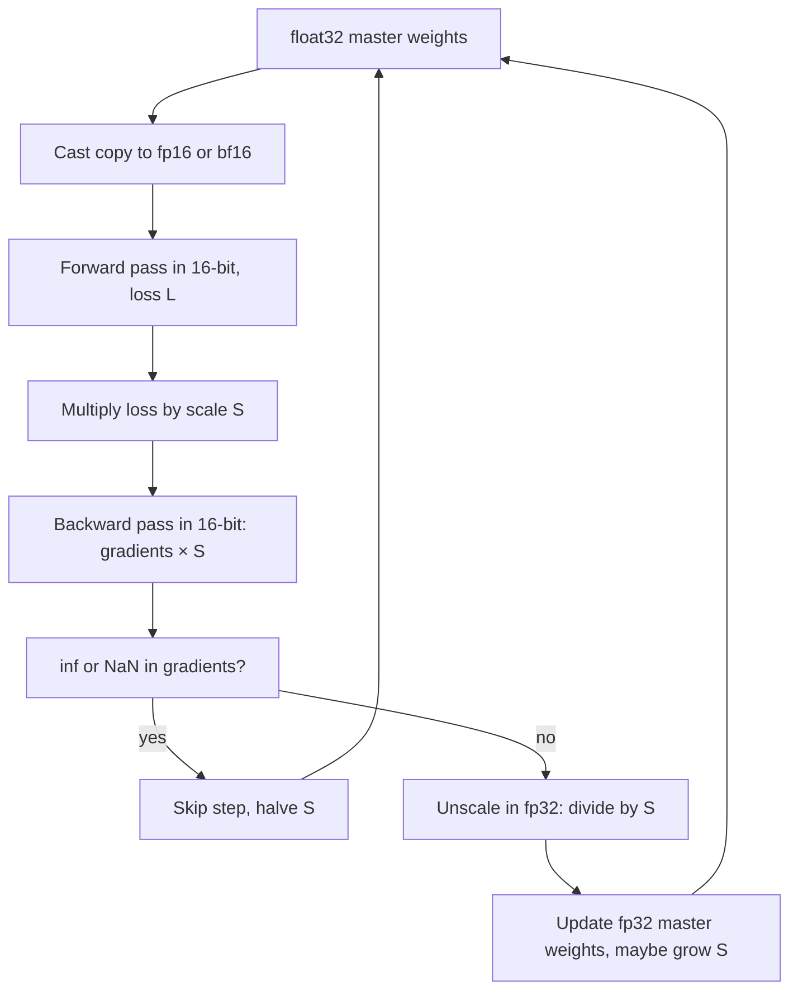

# Mixed Precision Training

$$
g_{16} = \nabla_{\theta}\big(S \cdot L(\text{fp16}(\theta_{32}))\big), \qquad \theta_{32} \leftarrow \theta_{32} - \eta \, \frac{\text{fp32}(g_{16})}{S}
$$

, where $\theta_{32}$ are the float32 master weights, the forward and backward passes run in float16 (or bfloat16), $S$ is the loss scale, and $\eta$ is the learning rate; a step is skipped and $S$ reduced if $g_{16}$ contains `inf` or `NaN`.

## Deep Breakdown

What it tells me *(Situation Awareness)*:
Mixed precision training runs the expensive parts of training — matrix multiplications in the forward and backward passes, activations stored for backprop — in a 16-bit format, while keeping the parts that need accuracy in float32: the master copy of the weights, the optimiser state, the weight update, and reductions such as sums in softmax or normalisation layers. 16-bit tensors halve memory and bandwidth and run on tensor cores several times faster, so larger models and batches fit on the same GPU. The price is a much smaller number format. Float16 has only 10 fraction bits ($\varepsilon \approx 9.8 \times 10^{-4}$) and a narrow range (normal numbers from about $6.1 \times 10^{-5}$ to $65504$, subnormals down to about $6 \times 10^{-8}$), so small gradients *underflow* to zero and tiny weight updates are *absorbed* ($1 - 10^{-4} = 1$ in float16). Two tricks fix this: float32 master weights (updates accumulate where they are not absorbed), and loss scaling (multiply the loss by $S$, e.g. $2^{16}$, so that by the chain rule every gradient is multiplied by $S$ and shifted into float16's range; divide by $S$ in float32 before the update). Dynamic loss scaling grows $S$ while steps are clean and halves it whenever an overflow appears. bfloat16 keeps float32's 8-bit exponent (same range, so usually no loss scaling needed) but has only 7 fraction bits. In DA/DS: training and fine-tuning transformers and LLMs (`torch.autocast` + `GradScaler`, `bf16=True` in Hugging Face), large tabular deep models, faster GPU inference, and debugging the classic "loss suddenly becomes NaN" or "model does not learn after switching to fp16".

## Flowchart



## Real-world use

### Where it is used

Training and fine-tuning large neural networks on GPUs and TPUs: transformers and LLMs (pre-training in bf16 is the norm), vision models, recommender systems with big embedding tables, speech models; implemented as PyTorch `torch.autocast` with `torch.cuda.amp.GradScaler`, TensorFlow `mixed_float16` policy, JAX dtype policies, DeepSpeed and Hugging Face `Trainer(fp16=True)` or `bf16=True`.

### Problem it solves

Pure float32 training is slow and memory-hungry; pure float16 training silently fails: gradients smaller than about $6 \times 10^{-8}$ become zero, small updates vanish into large weights, and large activations overflow to `inf`. Mixed precision gets most of the speed and memory benefit of 16-bit arithmetic with the accuracy of float32 training.

### How it solves the problem

Keep a float32 copy of the weights and do the update there, so updates far smaller than the weight are not absorbed. Scale the loss by $S$ so gradients live in float16's representable range; check for overflow; unscale in float32. Keep numerically sensitive operations (softmax, log, layer norm, loss, large reductions) in float32 via autocast lists. With bfloat16 the range problem largely disappears, so loss scaling is usually unnecessary, but the reduced precision still requires float32 master weights and accumulators.

### Example in a business

An e-commerce team fine-tunes a product-description language model on a single 24 GB GPU. In float32 the model, gradients and Adam state do not fit. Switching the forward and backward passes to float16 fits the model, but the loss stops decreasing after a few hundred steps: late-training gradients are below float16's smallest subnormal. Turning on dynamic loss scaling (PyTorch `GradScaler`) fixes it; training runs about twice as fast as float32 on the same card and reaches the same validation loss. Moving to a bfloat16-capable GPU later lets them drop the scaler entirely.

## The formula, piece by piece

- $\theta_{32}$: master weights in float32; the "real" parameters that persist across steps
- $\text{fp16}(\theta_{32})$: 16-bit copy used for the forward and backward passes (half the memory, tensor-core speed)
- $L$: the loss computed on the mini-batch (usually reduced in float32)
- $S$: loss scale, typically a power of two ($2^{8}$ to $2^{24}$) so that scaling is exact in binary
- $\nabla_\theta (S \cdot L) = S \cdot \nabla_\theta L$: by linearity of the derivative, scaling the loss scales every gradient by $S$, including the intermediate activation gradients that would otherwise underflow
- $g_{16}$: the scaled gradient as held in 16-bit
- $\text{fp32}(g_{16}) / S$: cast to float32 and unscale; recovers $\nabla_\theta L$ with small relative error
- $\eta$: learning rate; the update $\eta \cdot g$ is applied in float32 so it is not absorbed
- Overflow rule: if any $|S \cdot g| > 65504$ (float16 max) the gradient becomes `inf`; skip the step and halve $S$; after $N$ clean steps (e.g. 2,000) double $S$

## The formula in words

"Do the heavy maths in 16-bit to save time and memory, multiply the loss by a big power of two so small gradients don't round to zero, then divide that factor back out and apply the update to a float32 copy of the weights." Tiny example: a gradient of $10^{-8}$ becomes $0$ in float16. Multiply the loss by $S = 2^{16} = 65536$: the gradient becomes $6.5536 \times 10^{-4}$, which float16 stores as $6.552 \times 10^{-4}$; dividing by $65536$ in float32 gives $9.997 \times 10^{-9}$, within $0.03\%$ of the true value.

## Critical Concepts

- **Underflow vs absorption — two different failures:** underflow kills small *gradients* (fixed by loss scaling); absorption kills small *updates* to large weights (fixed by float32 master weights). Both are needed with float16.
- **Why scaling is exact:** $S$ is a power of two, so multiplying and dividing only changes the exponent; no mantissa bits are lost unless the result leaves the range.
- **Dynamic loss scaling:** start large (e.g. $2^{16}$), halve on overflow and skip that step, double after a run of clean steps. A few skipped steps early in training are normal.
- **bfloat16 trade-off:** 8 exponent bits like float32 (range up to about $3.4 \times 10^{38}$, so gradients rarely underflow) but 7 fraction bits ($\varepsilon = 2^{-7} \approx 0.0078$), so $1.001$ rounds to $1.0$. Master weights and accumulations must stay in float32.
- **Keep sensitive ops in float32:** softmax, log-sum-exp, cross-entropy, layer/batch norm statistics and large reductions are autocast to float32 because they involve exponentials, cancellation or long sums.
- **Memory arithmetic:** 16-bit activations and weight copies use 2 bytes per value instead of 4. The float32 master weights and optimiser state remain, so the saving comes mostly from activations and from faster matmuls.
- **Symptoms:** loss stuck at its initial value (underflow or absorption), loss suddenly `NaN` (overflow, scale too large, or an fp16-unsafe op), scaler stuck at a tiny $S$ (a genuine overflow bug in the model).

## Step-by-step calculation (tiny example)

*A gradient component of $g = 10^{-8}$ in float16, with and without loss scaling ($S = 2^{16}$).*

*Step 1: Float16 limits*
Smallest positive subnormal $= 2^{-24} \approx 5.96 \times 10^{-8}$. Anything below half of it, $2^{-25} \approx 2.98 \times 10^{-8}$, rounds to $0$.

*Step 2: Without scaling*
$10^{-8} \le 2.98 \times 10^{-8}$, so $\text{fp16}(g) = 0$. The weight never learns from this signal.

*Step 3: Scale*
$S \cdot g = 65536 \times 10^{-8} = 6.5536 \times 10^{-4}$, above the smallest normal $2^{-14} \approx 6.10 \times 10^{-5}$: full 11-bit precision. Float16 stores $6.552 \times 10^{-4}$.

*Step 4: Unscale in float32*
$6.552 \times 10^{-4} / 65536 \approx 9.997 \times 10^{-9}$. Relative error $\approx 0.03\%$. $\checkmark$

*Step 5: Overflow check*
With $S = 2^{16}$, any gradient larger than $65504 / 65536 \approx 0.9995$ would overflow to `inf` — that is what the dynamic scaler watches for.

## Code examples

### Beginner example (Python)

```python
import numpy as np

# Gradients of very different magnitudes, as in a deep network's backward pass
grads = np.array([1e-3, 1e-5, 1e-7, 1e-8, 1e-9], dtype=np.float32)
S = np.float32(2.0 ** 16)                      # loss scale 65536

g16 = grads.astype(np.float16)                 # plain float16: underflow
scaled16 = (grads * S).astype(np.float16)      # loss scaling: shift into fp16 range
recovered = scaled16.astype(np.float32) / S    # unscale in float32

print(f"{'true grad':>10}{'float16':>12}{'rel err':>9}{'scaled+unscaled':>17}{'rel err':>9}")
for g, a, b in zip(grads, g16, recovered):
    err_a = abs(float(a) - float(g)) / float(g)
    err_b = abs(float(b) - float(g)) / float(g)
    print(f"{g:>10.0e}{float(a):>12.3e}{err_a:>9.1%}{float(b):>17.3e}{err_b:>9.2%}")

# Why master weights stay in float32: tiny updates are absorbed in float16
w16, w32 = np.float16(1.0), np.float32(1.0)
update = 1e-4                                  # lr * grad
for _ in range(1000):
    w16 = np.float16(w16 - np.float16(update))
    w32 = np.float32(w32 - np.float32(update))
print(f"\nAfter 1000 updates of -1e-4: float16 weight = {float(w16):.4f}, "
      f"float32 weight = {float(w32):.4f} (exact 0.9)")
print(f"float16 spacing just below 1.0: {float(1 - np.nextafter(np.float16(1), np.float16(0))):.2e}")

# bfloat16 (emulated: keep the top 16 bits of a float32, round-to-nearest-even)
def to_bf16(x):
    u = np.asarray(x, dtype=np.float32).view(np.uint32)
    rounding = ((u >> 16) & 1) + np.uint32(0x7FFF)
    return ((u + rounding) & np.uint32(0xFFFF0000)).view(np.float32)

print("\nbfloat16 keeps float32's range but only ~3 significant digits:")
print("  1e-8 ->", to_bf16(np.float32(1e-8)), "(no underflow)")
print("  1.001 ->", to_bf16(np.float32(1.001)), "(precision lost)")
```

Gradients of $10^{-8}$ and $10^{-9}$ vanish in plain float16 and $10^{-7}$ is off by $19\%$ (it lands in the coarse subnormal range); after scaling by $2^{16}$ every one is recovered within $0.04\%$. The float16 weight never moves because $10^{-4}$ is less than half the spacing just below $1.0$ ($4.88 \times 10^{-4}$), while the float32 copy reaches $0.9$.

### Beginner example (R)

```r
# R has no native float16, so emulate rounding to float16's subnormal grid (step 2^-24)
fp16_subnormal <- function(x) round(x / 2^-24) * 2^-24
g <- c(1e-7, 1e-8, 1e-9)
S <- 2^16
cat("plain fp16 (subnormal range):", fp16_subnormal(g), "\n")   # 1.19e-07 0 0
# Scaled values (about 6.6e-3 .. 6.6e-5) are in fp16's normal range: kept to ~3 digits
scaled <- signif(g * S, 4)
cat("scaled then unscaled:", scaled / S, "\n")
cat("max safe gradient for S = 2^16:", 65504 / S, "\n")
```

### Professional example (Python)

```python
import warnings
import numpy as np

warnings.filterwarnings("ignore", category=RuntimeWarning)  # fp16 overflow is handled below

rng = np.random.default_rng(0)

# Synthetic churn data: 16,384 customers, 20 features
N, D = 16_384, 20
X = rng.normal(0, 1, (N, D)).astype(np.float32)
w_true = rng.normal(0, 0.5, D).astype(np.float32)
y = (rng.uniform(0, 1, N) < 1 / (1 + np.exp(-X @ w_true))).astype(np.float32)

# The log-loss is one term of a bigger objective with weight LAM = 1e-3 (like an
# auxiliary loss, or a layer deep inside a large network): its gradients are tiny.
LAM = 1e-3


def full_loss(w: np.ndarray) -> float:
    """Mean log-loss evaluated in float64 (the 'referee')."""
    z = X.astype(np.float64) @ w.astype(np.float64)
    return float(np.mean(np.logaddexp(0, z) - y * z))


def backward_fp16(w16: np.ndarray, scale: float) -> np.ndarray:
    """Forward and backward pass in float16 on the (scaled) mean log-loss.

    dL/dz_i = LAM * (p_i - y_i) / N (about 1e-8) is tiny when N is large: this is where fp16 underflows.
    """
    X16, y16 = X.astype(np.float16), y.astype(np.float16)
    z = X16 @ w16
    p = (1 / (1 + np.exp(-z.astype(np.float32)))).astype(np.float16)  # sigmoid
    dz = ((p - y16) * np.float16(scale * LAM / N)).astype(np.float16)        # scaled upstream grad
    return (X16.T @ dz).astype(np.float16)                             # float16 gradient


def train(mode: str, steps: int = 300, lr: float = 500.0):
    w32 = np.zeros(D, dtype=np.float32)        # float32 master weights
    w16 = np.zeros(D, dtype=np.float16)        # used only in pure fp16 mode
    scale, good_steps, skipped = 2.0 ** 32, 0, 0   # start too high on purpose
    for _ in range(steps):
        if mode == "fp32":
            p = 1 / (1 + np.exp(-(X @ w32)))
            w32 -= lr * (X.T @ (LAM * (p - y) / N))
        elif mode == "pure fp16":
            g16 = backward_fp16(w16, 1.0)
            w16 = (w16 - np.float16(lr) * g16).astype(np.float16)
        elif mode == "mixed, no scaling":
            g16 = backward_fp16(w32.astype(np.float16), 1.0)
            w32 -= lr * g16.astype(np.float32)
        else:  # mixed + dynamic loss scaling
            g16 = backward_fp16(w32.astype(np.float16), scale)
            g32 = g16.astype(np.float32)
            if not np.all(np.isfinite(g32)):   # overflow: skip step, halve the scale
                scale /= 2
                skipped += 1
                good_steps = 0
                continue
            w32 -= lr * (g32 / np.float32(scale))
            good_steps += 1
            if good_steps == 100:               # stable for a while: try a bigger scale
                scale *= 2
                good_steps = 0
    w_final = w16.astype(np.float32) if mode == "pure fp16" else w32
    return full_loss(w_final), skipped, scale


print(f"{'mode':<30}{'final log-loss':>15}{'skipped':>9}{'final scale':>13}")
for mode in ["fp32", "pure fp16", "mixed, no scaling", "mixed + dynamic loss scaling"]:
    loss, skipped, scale = train(mode)
    extra = f"{skipped:>9}{scale:>13.0f}" if mode.startswith("mixed +") else f"{'-':>9}{'-':>13}"
    print(f"{mode:<30}{loss:>15.4f}{extra}")
print(f"\nLoss at w = 0 (no learning): {full_loss(np.zeros(D, dtype=np.float32)):.4f}")
```

With upstream gradients around $3 \times 10^{-8}$, pure float16 and "mixed without scaling" both stay at the starting loss $0.6931$ — nothing is learned. Mixed precision with dynamic loss scaling matches float32 exactly ($0.4162$): it starts with $S = 2^{32}$ on purpose, overflows and skips 4 steps while halving down to a safe scale, then grows again, ending at $S = 2^{30}$.

---

*Source: domain knowledge*
