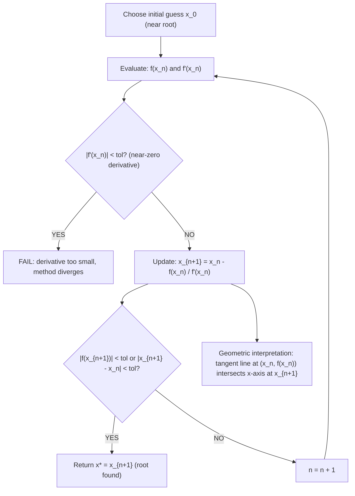

# Newton-Raphson Method

$$
x_{n+1} = x_n - \frac{f(x_n)}{f'(x_n)}
$$

## Deep Breakdown

What it tells me *(Situation Awareness)*:
The Newton-Raphson method is a root-finding algorithm: it finds $x^*$ such that $f(x^*) = 0$ by iteratively refining an estimate using the tangent line. At each step, it linearizes $f$ around $x_n$ and takes the zero of that linear approximation as the next estimate. Convergence is quadratic near the root (error squares at each step) — far faster than bisection ($O(2^{-n})$) or gradient descent ($O(1/n)$). In optimization, Newton's method for $\min f(x)$ applies Newton-Raphson to the derivative equation $f'(x) = 0$: the update becomes $x_{n+1} = x_n - f'(x_n)/f''(x_n)$. In multivariate optimization: $x_{n+1} = x_n - [\nabla^2 f(x_n)]^{-1} \nabla f(x_n)$ (Newton's method using the Hessian). In DA/DS: Newton-Raphson is used in logistic regression fitting (IRLS — Iteratively Reweighted Least Squares), GLM estimation, maximum likelihood estimation of distribution parameters, and as the basis of quasi-Newton methods (L-BFGS) used in scipy and sklearn.

## Flowchart



## Real-world use

### Where it is used

Logistic regression MLE via IRLS (Newton-Raphson applied to score equations); GLM parameter estimation in R (`glm()` uses IRLS internally); distribution parameter fitting (MLE of Beta, Gamma, Weibull shapes); root-finding for quantile functions; `scipy.optimize.newton` for scalar root-finding; as the basis of L-BFGS (limited-memory quasi-Newton) used in `sklearn.LogisticRegression(solver='lbfgs')`.

### Problem it solves

Gradient descent for optimization ($\min_x f(x)$) converges at rate $O(1/n)$ for convex $f$. Newton's method (applied to $f' = 0$) converges quadratically: $|x_{n+1} - x^*| \le C|x_n - x^*|^2$. For ML problems where high-precision parameter estimates are needed (GLMs, MLE fitting), Newton-Raphson converges in far fewer iterations than gradient descent, at the cost of computing the second derivative (Hessian).

### How it solves the problem

Taylor expand $f$ around $x_n$: $f(x) \approx f(x_n) + f'(x_n)(x-x_n)$. Setting this to zero: $0 = f(x_n) + f'(x_n)(x^* - x_n)$, giving $x^* \approx x_n - f(x_n)/f'(x_n)$. Geometrically: draw the tangent to $f$ at $x_n$; the next iterate is where that tangent crosses the x-axis. Each iteration doubles the number of correct digits near the root (quadratic convergence).

### Example in a business

A DS fits a logistic regression on 1M rows of fraud detection data. `sklearn.LogisticRegression(solver='lbfgs')` uses L-BFGS (a quasi-Newton method approximating the Hessian): converges in ~50 iterations. Plain gradient descent would require thousands of iterations for the same precision. The closed-form score equation for logistic regression is $\nabla_w \ell = X^T(y - p)$ and Hessian $H = X^T W X$ where $W = \text{diag}(p(1-p))$; IRLS = Newton-Raphson on this system.

## The formula, piece by piece

- $x_{n+1}$: the updated estimate of the root after iteration $n$
- $x_n$: the current estimate of the root at iteration $n$
- $f(x_n)$: value of the function at current estimate; should approach 0
- $f'(x_n)$: derivative of $f$ at current estimate; the slope of the tangent line
- $f(x_n)/f'(x_n)$: the step size; how far to move from $x_n$ toward the root
- $-f(x_n)/f'(x_n)$: the update; subtract to move in the direction that zeroes $f$
- For optimization (find zero of $f'$): replace $f$ with $f'$ and $f'$ with $f''$: $x_{n+1} = x_n - f'(x_n)/f''(x_n)$
- Multivariate: $x_{n+1} = x_n - [\nabla^2 f(x_n)]^{-1} \nabla f(x_n)$ (Newton step for optimization)
- Convergence rate: quadratic near root; $|e_{n+1}| \approx \frac{|f''(x^*)|}{2|f'(x^*)|} |e_n|^2$ where $e_n = x_n - x^*$
- Failure modes: $f'(x_n) = 0$ (vertical tangent); convergence to wrong root; divergence if initial guess too far

## The formula in words

"Given a current guess $x_n$ for where $f(x)=0$: draw the tangent line to $f$ at $x_n$ and find where that line crosses the x-axis. That crossing point is the next (better) guess. Repeat until the guess stops changing." Tiny example: find root of $f(x) = x^2 - 2$ (i.e., find $\sqrt{2}$). $f'(x) = 2x$. Start: $x_0 = 1$.
$x_1 = 1 - (1-2)/(2) = 1 + 0.5 = 1.5$.
$x_2 = 1.5 - (1.5^2 - 2)/(2 \cdot 1.5) = 1.5 - (2.25-2)/3 = 1.5 - 0.0833 = 1.4167$.
$x_3 = 1.4167 - (1.4167^2-2)/(2\cdot1.4167) = 1.4167 - 0.00174 = 1.41421$.
True $\sqrt{2} = 1.41421$. Three iterations; already 5-digit precision. $\checkmark$

## Critical Concepts

- **Quadratic vs linear convergence:** gradient descent on $f'(x) = 0$ converges linearly (error multiplied by constant $< 1$ each step). Newton converges quadratically: error squared each step. For $|e_0| = 0.1$: GD needs ~$10n$ steps; Newton needs ~$\log_2 \log_2(1/\text{tol})$ steps.
- **Hessian cost in high dimensions:** the multivariate Newton step requires inverting an $d \times d$ Hessian — $O(d^3)$ cost. For $d = 10^8$ (large neural net), this is infeasible. L-BFGS approximates the inverse Hessian using $m$ recent gradient pairs ($O(md)$ cost), making quasi-Newton practical for moderate $d$.
- **IRLS for logistic regression:** Newton-Raphson on the logistic log-likelihood leads to the IRLS algorithm: at each iteration, solve a weighted least squares problem $X^TWX\beta = X^TWz$ where $W$ and $z$ depend on current predictions. This is what `glm()` in R and scipy's logistic regression solvers use.
- **Saddle points and Newton:** in non-convex objectives (deep learning), $f''(x) < 0$ (negative curvature) causes Newton to move toward a saddle point or maximum, not a minimum. Gradient descent's behavior near saddle points is preferable. This is why Newton's method is not used for raw deep learning training.
- **Secant method:** approximates $f'(x_n)$ by finite difference when $f'$ is not available: $x_{n+1} = x_n - f(x_n)(x_n - x_{n-1})/(f(x_n)-f(x_{n-1}))$.

Superlinear convergence (order $\approx 1.618$, the golden ratio). Used when exact derivatives are expensive.

## Step-by-step calculation (tiny example)

*Find the root of $f(x) = e^x - 3$ using Newton-Raphson. $f'(x) = e^x$. Start: $x_0 = 1$. True root: $x^* = \ln(3) \approx 1.0986$.* | $n$ | $x_n$

| $f(x_n) = e^{x_n}-3$ | $f'(x_n) = e^{x_n}$ | $x_{n+1} = x_n - f/f'$ | $|x_n - x^*|$ |
|-----|--------|----------------------|---------------------|------------------------|----------------|
| 0 | 1.0000 | -0.2817 | 2.7183 | 1.1036 | 0.0986 |
| 1 | 1.1036 | 0.0147 | 3.0147 | 1.0987 | 0.0050 |
| 2 | 1.0987 | 0.000044 | 3.000044 | 1.09861 | 0.000014 |

Error reduces from ~0.1 to ~0.005 to ~0.00001: quadratic convergence visible.

## Code examples

### Beginner example (Python)

```python
import numpy as np

def newton_raphson( func, func_deriv, x_init: float, tol: float = 1e-10, max_iter: int = 50,
) -> float:
    """Newton-Raphson root finder: solve f(x) = 0."""
    x = x_init
    for iteration in range(max_iter):
        f_val = func(x)
    f_prime = func_deriv(x)
    if abs(f_prime) < 1e-14:
        raise ValueError(f"Derivative too small at x={x}; method diverges.")
    x_new = x - f_val / f_prime
    if abs(x_new - x) < tol:
        print(f" Converged at iteration {iteration + 1}")
    return x_new
x = x_new
raise RuntimeError(f"Newton-Raphson did not converge in {max_iter} iterations.")   # Example 1: find sqrt(2) via f(x) = x^2 - 2
print("=== Finding sqrt(2): f(x) = x^2 - 2 ===")
x_star = newton_raphson( func=lambda x: x**2 - 2, func_deriv=lambda x: 2 * x, x_init=1.0,
)
print(f"x* = {x_star:.15f}")
print(f"True sqrt(2) = {np.sqrt(2):.15f}")
print(f"Error = {abs(x_star - np.sqrt(2)):.2e}")   # Example 2: solve e^x = 3 (find ln(3))
print("\n=== Finding ln(3): f(x) = e^x - 3 ===")
x_star2 = newton_raphson( func=lambda x: np.exp(x) - 3, func_deriv=lambda x: np.exp(x), x_init=1.0,
)
print(f"x* = {x_star2:.15f}")
print(f"True ln(3) = {np.log(3):.15f}")   # Example 3: Newton's method for optimization: minimize f(x) = x^4 - 4x^2
# Apply NR to f'(x) = 4x^3 - 8x, f''(x) = 12x^2 - 8
print("\n=== Minimizing f(x) = x^4 - 4x^2 (finding zero of f') ===")
x_opt = newton_raphson( func=lambda x: 4*x**3 - 8*x,   # f'(x) func_deriv=lambda x: 12*x**2 -
    8,   # f''(x) x_init=1.5, # start near positive minimum at x = sqrt(2)
)
print(f"x* = {x_opt:.10f} (true: {np.sqrt(2):.10f})")
print(f"f(x*) = {x_opt**4 - 4*x_opt**2:.8f} (true: -4)")
```

### Beginner example (R)

```r
# Newton-Raphson root finding: x_{n+1} = x_n - f(x_n) / f'(x_n)
newton_raphson <- function(func, func_deriv, x_init, tol = 1e-10, max_iter = 50) { x <- x_init
  for (i in seq_len(max_iter)) { f_val <- func(x)
    f_prime <- func_deriv(x)
    if (abs(f_prime) < 1e-14) stop(sprintf("Derivative too small at x=%.4f", x))
    x_new <- x - f_val / f_prime
    if (abs(x_new - x) < tol) { cat(sprintf(" Converged at iteration %d\n", i))
      return(x_new)
    }
    x <- x_new
  } stop("Newton-Raphson did not converge")
}  # Find sqrt(2): f(x) = x^2 - 2
cat("=== Finding sqrt(2) ===\n")
x_star <- newton_raphson( func = function(x) x^2 - 2, func_deriv = function(x) 2 * x, x_init = 1.0
)
cat(sprintf("x* = %.15f\n", x_star))
cat(sprintf("True sqrt(2) = %.15f\n", sqrt(2)))
cat(sprintf("Error = %.2e\n", abs(x_star - sqrt(2))))  # Minimizing f(x) = x^4 - 4x^2 by solving f'(x) = 0
cat("\n=== Minimizing f(x) = x^4 - 4x^2 ===\n")
x_opt <- newton_raphson( func = function(x) 4*x^3 - 8*x,  # f'(x)
func_deriv = function(x) 12*x^2 - 8,  # f''(x)
x_init = 1.5
)
cat(sprintf("x* = %.10f (true: %.10f)\n", x_opt, sqrt(2)))
```

### Professional example (Python)

```python
import numpy as np
from scipy.optimize import newton
np.random.seed(42)   # -- IRLS: Newton-Raphson for logistic regression MLE --------------------------
# Logistic regression score equations solved via Newton-Raphson (IRLS)

def sigmoid(z: np.ndarray) -> np.ndarray:
    return 1 / (1 + np.exp(-np.clip(z, -500, 500)))

def irls_logistic_regression( X: np.ndarray, y: np.ndarray, max_iter: int = 20, tol: float = 1e-8,
) -> np.ndarray:
    """Iteratively Reweighted Least Squares (IRLS) for logistic regression. Newton-Raphson on log-likelihood: w_{n+1} = w_n - H^{-1} grad. H = X^T W X (Hessian, where W = diag(p(1-p))) grad = X^T (p - y) Equivalent to solving WLS: (X^T W X) w = X^T W z, z = Xw + W^{-1}(y-p). """
    n, d = X.shape
    w = np.zeros(d)
    for iteration in range(max_iter):
        p = sigmoid(X @ w)   # Working
        weights: W = diag(p * (1 - p))
        weights = p * (1 - p)
        weights = np.maximum(weights, 1e-10)   # numerical safety # Gradient of negative log-likelihood: X^T (p - y) grad = X.T @ (p - y) # Hessian: X^T W X
        W_sqrt = np.sqrt(weights)
        X_weighted = X * W_sqrt[:, np.newaxis]   # sqrt(W) X hessian = X_weighted.T @ X_weighted # X^T W X # Newton step: w_new = w - H^{-1} grad try:
        w_new = w - np.linalg.solve(hessian, grad)
    except np.linalg.LinAlgError:
        break
    if np.linalg.norm(w_new - w) < tol:
        print(f" IRLS converged at iteration {iteration + 1}")
    return w_new
w = w_new
return w   # Generate binary classification data
from sklearn.datasets import make_classification
from sklearn.preprocessing import StandardScaler
from sklearn.metrics import roc_auc_score
X_raw, y = make_classification(n_samples=500, n_features=8, n_informative=5, random_state=42)
scaler = StandardScaler()
X = np.hstack([np.ones((len(y), 1)), scaler.fit_transform(X_raw)])   # add bias
print("IRLS Logistic Regression (Newton-Raphson on score equations)")
w_irls = irls_logistic_regression(X, y, max_iter=25)   # Compare to scipy (also Newton-based)
from sklearn.linear_model import LogisticRegression
clf = LogisticRegression(fit_intercept=True, C=1e9, solver="lbfgs", max_iter=1000)
clf.fit(X[:, 1:], y)   # sklearn handles bias separately
auc_irls = roc_auc_score(y, sigmoid(X @ w_irls))
auc_sklearn = roc_auc_score(y, clf.predict_proba(X[:, 1:])[:, 1])
print(f"\nAUC (IRLS / Newton-Raphson): {auc_irls:.4f}")
print(f"AUC (sklearn lbfgs): {auc_sklearn:.4f}")
print(f"\nIRLS converges in <20 steps vs GD which needs >1000 steps.")
print(f"Quadratic convergence of Newton-Raphson is the key advantage.")   # Scalar demo: Newton-Raphson via scipy.optimize.newton
print("\n=== scipy.optimize.newton (scalar root finding) ===")
# Find MLE of Poisson lambda from data: solve d/d_lambda log L = n/lambda - sum(x) = 0
sample_data = np.random.poisson(lam=3.5, size=200)
n_data = len(sample_data)
sum_x = sample_data.sum()
poisson_score = lambda lam: n_data / lam - sum_x   # d/d_lambda log
L = 0
poisson_hess = lambda lam: -n_data / lam**2   # second derivative
lambda_mle = newton(poisson_score, x0=1.0, fprime=poisson_hess)
print(f"Poisson MLE via Newton-Raphson: lambda_hat = {lambda_mle:.6f}")
print(f"Sample mean (analytical MLE): {sample_data.mean():.6f}")
print(f"Difference: {abs(lambda_mle - sample_data.mean()):.2e}")
```

---

*Source: domain knowledge*
