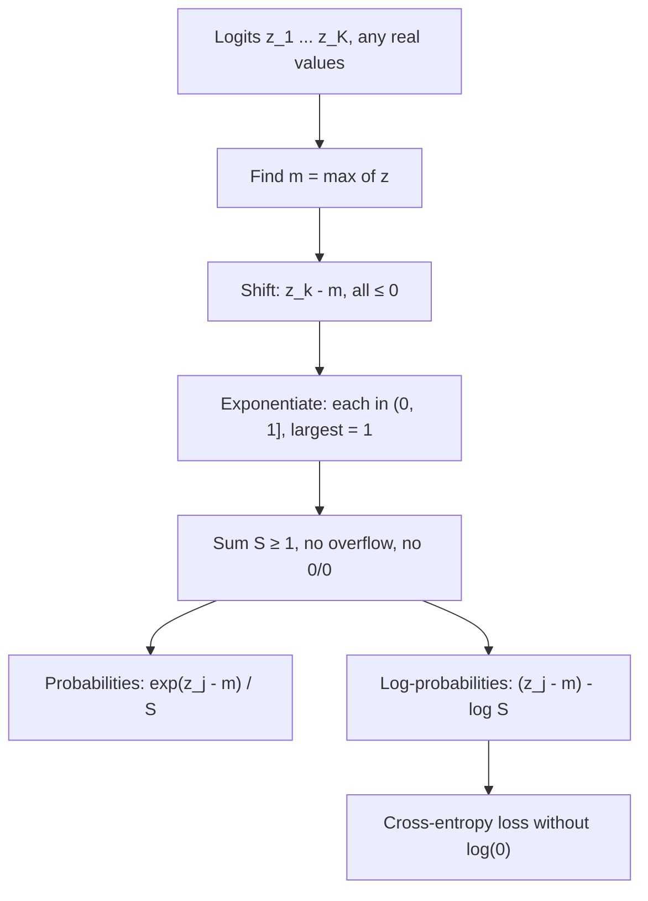

# Stable Softmax

$$
\text{softmax}(z)_j = \frac{e^{z_j - m}}{\sum_{k=1}^{K} e^{z_k - m}}, \qquad \log \text{softmax}(z)_j = (z_j - m) - \log \sum_{k=1}^{K} e^{z_k - m}
$$

, where $m = \max_k z_k$ and $z = (z_1, \dots, z_K)$ are the logits

## Deep Breakdown

What it tells me *(Situation Awareness)*:
Softmax turns a vector of arbitrary real scores (logits) into a probability distribution: every output is positive and they sum to 1, with bigger logits getting exponentially more mass. The textbook form $e^{z_j}/\sum_k e^{z_k}$ is mathematically fine but numerically fragile: a logit of 1000 overflows $e^{1000}$ to `inf` and the result becomes `nan`, while logits of $-1000$ underflow every exponential to 0 and give $0/0$. The stable version subtracts the largest logit first. Because softmax is *shift-invariant* (adding the same constant to every logit does not change the output), this changes nothing mathematically, but now the largest exponent is $e^0 = 1$, nothing can overflow, and the denominator is at least 1, so nothing divides by zero. For losses, the companion trick is to stay in log space with log-softmax, whose normalizer is exactly the [[log_sum_exp_trick_prevents_underflowoverflow]]; this avoids taking $\log$ of a probability that has underflowed to 0. In DA/DS: the output layer of every multi-class classifier, LLM next-token distributions (with temperature), attention weights in transformers, multinomial logistic regression, policy networks in RL, and turning model scores into "probabilities" for ranking or routing.

## Flowchart



## Real-world use

### Where it is used

Final layer of neural classifiers (product category, intent detection, churn reason); token sampling in LLMs (softmax of logits divided by temperature); scaled dot-product attention $\text{softmax}(QK^\top/\sqrt{d})$; multinomial logistic regression in scikit-learn; mixture-of-experts gating; converting recommendation scores into choice probabilities (conditional logit models in marketing).

### Problem it solves

Logits are unbounded. A large-vocabulary language model, an unregularized classifier or a low temperature easily produces logits in the hundreds; float64 overflows at $e^{709.8}$ and float32 (the usual training precision) at about $e^{88.7}$, and float16 at about $e^{11.1}$. The naive formula then returns `nan`, which silently poisons the loss, the gradients and every weight in the network.

### How it solves the problem

Subtract $m = \max_k z_k$ from every logit. Since $\frac{e^{z_j - m}}{\sum_k e^{z_k - m}} = \frac{e^{-m} e^{z_j}}{e^{-m} \sum_k e^{z_k}}$, the factor $e^{-m}$ cancels and the output is identical. After the shift every exponent is $\le 0$ (no overflow) and one term equals exactly 1 (the denominator cannot underflow to 0). For the loss, compute $\log \text{softmax}$ directly as shifted logit minus log-sum-exp, so tiny probabilities are represented by large negative logs instead of zeros.

### Example in a business

An e-commerce search team fine-tunes a classifier mapping queries to 5,000 product categories in mixed precision (float16). Early in training some logits reach 30; the naive softmax produces `inf/inf = nan` and the loss curve breaks after a few hundred steps. Switching to the framework's fused `log_softmax` + NLL loss (which uses the max-shift internally) removes the `nan`s with zero change to the model's predictions, and the run trains to completion.

## The formula, piece by piece

- $z_j$: logit (raw score) for class or token $j$; any real number
- $K$: number of classes (or vocabulary size for an LLM)
- $m = \max_k z_k$: the shift constant; the largest logit
- $z_j - m$: shifted logit; always $\le 0$, equal to 0 for the top class
- $e^{z_j - m}$: shifted exponential; in $(0, 1]$, so it cannot overflow
- $\sum_k e^{z_k - m}$: normalizer; in $[1, K]$, so it cannot be 0 and cannot overflow
- $\text{softmax}(z)_j$: probability of class $j$; positive, sums to 1 over $j$
- $\log \sum_k e^{z_k - m}$: log of the normalizer; $m$ plus this is the log-sum-exp of $z$
- $\log \text{softmax}(z)_j$: log-probability of class $j$; finite even when the probability itself would underflow
- Temperature $T$ (optional): use $z/T$ instead of $z$; $T \lt 1$ sharpens, $T \gt 1$ flattens the distribution

## The formula in words

"Shift all scores so the best one is zero, exponentiate, and divide each by the total; you get the same probabilities as the textbook softmax but nothing can blow up." Tiny example: logits $[1000, 999, 997]$. Naive: $e^{1000} = \infty$, output `nan`. Stable: shifted $[0, -1, -3]$, exponentials $[1, 0.3679, 0.0498]$, sum $1.4177$, probabilities $[0.7054, 0.2595, 0.0351]$.

## Critical Concepts

- **Shift invariance:** $\text{softmax}(z + c) = \text{softmax}(z)$ for any constant $c$. That is why the max-shift is free. It also means only *differences* between logits matter.
- **Why the max and not the mean:** shifting by the mean still allows overflow if one logit is far above the others; the max guarantees every exponent is $\le 0$ and the top term is exactly 1.
- **Log-softmax for losses:** cross-entropy is $-\log \text{softmax}(z)_y = \text{LSE}(z) - z_y$. Computing softmax first and then $\log$ fails when the true class probability underflows to 0 ($\log 0 = -\infty$). Frameworks fuse the two (`log_softmax`, `CrossEntropyLoss` on raw logits) for this reason. See [[cross_entropy]] and [[negative_log_likelihood]].
- **Do not double-apply:** passing probabilities (already softmaxed) to a loss that expects logits is a classic silent bug; the loss still decreases but the model is miscalibrated.
- **Gradient is simple:** $\partial \text{CE} / \partial z_j = \text{softmax}(z)_j - \mathbb{1}[j = y]$, bounded in $[-1, 1]$, which is part of why softmax + cross-entropy trains well.
- **Temperature and precision:** dividing by a small temperature (e.g. $T = 0.1$) multiplies the logits by 10, making overflow far more likely; the max-shift handles it.
- **Not calibrated by default:** softmax outputs sum to 1 but are not guaranteed to be calibrated probabilities; temperature scaling on a validation set is the usual fix.

## Step-by-step calculation (tiny example)

*Logits for three intents (refund, shipping, other): $z = [2.0, 1.0, 0.1]$.*

*Step 1: Find the max*
$m = 2.0$.

*Step 2: Shift*
$z - m = [0, -1.0, -1.9]$.

*Step 3: Exponentiate*
$e^{0} = 1$, $e^{-1} = 0.3679$, $e^{-1.9} = 0.1496$. Sum $S = 1.5174$.

*Step 4: Normalize*
$\text{softmax}(z) = [1/1.5174,\ 0.3679/1.5174,\ 0.1496/1.5174] = [0.6590, 0.2424, 0.0986]$, which sums to 1.

*Step 5: Log-softmax*
$\log S = \ln 1.5174 = 0.4170$.
$\log \text{softmax}(z) = [0 - 0.4170,\ -1 - 0.4170,\ -1.9 - 0.4170] = [-0.4170, -1.4170, -2.3170]$.
If the true intent is "refund", the cross-entropy loss is $0.4170$.

## Code examples

### Beginner example (Python)

```python
import numpy as np


def softmax_naive(z):
    e = np.exp(z)
    return e / e.sum()


def softmax_stable(z):
    shifted = z - np.max(z)
    e = np.exp(shifted)
    return e / e.sum()


def log_softmax(z):
    shifted = z - np.max(z)
    return shifted - np.log(np.exp(shifted).sum())


z = np.array([2.0, 1.0, 0.1])
print("softmax:     ", softmax_stable(z).round(4))   # [0.659  0.2424 0.0986]
print("log-softmax: ", log_softmax(z).round(4))      # [-0.417 -1.417 -2.317]

big = np.array([1000.0, 999.0, 997.0])
with np.errstate(over="ignore", invalid="ignore"):
    print("naive, big logits: ", softmax_naive(big))  # [nan nan nan]
print("stable, big logits:", softmax_stable(big).round(4))  # [0.7054 0.2595 0.0351]
```

### Beginner example (R)

```r
softmax_stable <- function(z) {
  e <- exp(z - max(z))
  e / sum(e)
}
log_softmax <- function(z) {
  s <- z - max(z)
  s - log(sum(exp(s)))
}
print(round(softmax_stable(c(2, 1, 0.1)), 4))        # 0.6590 0.2424 0.0986
print(round(log_softmax(c(2, 1, 0.1)), 4))           # -0.4170 -1.4170 -2.3170
print(round(softmax_stable(c(1000, 999, 997)), 4))   # 0.7054 0.2595 0.0351
```

### Professional example (Python)

```python
import numpy as np
from scipy.special import softmax as scipy_softmax, log_softmax as scipy_log_softmax

rng = np.random.default_rng(42)


def softmax(logits: np.ndarray, temperature: float = 1.0, axis: int = -1) -> np.ndarray:
    """Row-wise stable softmax with temperature."""
    z = logits / temperature
    z = z - z.max(axis=axis, keepdims=True)
    e = np.exp(z)
    return e / e.sum(axis=axis, keepdims=True)


def cross_entropy_from_logits(logits: np.ndarray, labels: np.ndarray) -> float:
    """Mean cross-entropy computed via log-softmax (never takes log of a probability)."""
    z = logits - logits.max(axis=1, keepdims=True)
    log_probs = z - np.log(np.exp(z).sum(axis=1, keepdims=True))
    return float(-log_probs[np.arange(len(labels)), labels].mean())


# Batch of 4 queries x 6 categories, with deliberately large logits
logits = rng.normal(0, 1, size=(4, 6)) * 400
labels = np.array([0, 3, 5, 2])

p = softmax(logits)
print("Rows sum to 1:", np.allclose(p.sum(axis=1), 1.0))
print("Matches scipy:", np.allclose(p, scipy_softmax(logits, axis=1)))
print("Any nan/inf:  ", bool(~np.isfinite(p).all()))

ce_stable = cross_entropy_from_logits(logits, labels)
ce_scipy = float(-scipy_log_softmax(logits, axis=1)[np.arange(4), labels].mean())
with np.errstate(divide="ignore", over="ignore", invalid="ignore"):
    ce_naive = float(-np.log(np.exp(logits) / np.exp(logits).sum(axis=1, keepdims=True))
                     [np.arange(4), labels].mean())
print(f"\nCross-entropy  stable={ce_stable:.2f}  scipy={ce_scipy:.2f}  naive={ce_naive}")

# Temperature: same ranking, different sharpness (LLM sampling)
token_logits = np.array([3.0, 2.5, 1.0, 0.2, -1.0])
for T in [0.2, 1.0, 2.0]:
    probs = softmax(token_logits, temperature=T)
    entropy = -(probs * np.log(probs)).sum()
    print(f"T={T:<4} probs={probs.round(3)}  entropy={entropy:.3f} nats")

# Gradient check: d CE / d z = softmax(z) - one_hot(y)
z0, y0 = np.array([2.0, 1.0, 0.1]), 0
grad = softmax(z0) - np.eye(3)[y0]
eps = 1e-6
num = np.array([(cross_entropy_from_logits((z0 + eps * np.eye(3)[j])[None], np.array([y0]))
                 - cross_entropy_from_logits((z0 - eps * np.eye(3)[j])[None], np.array([y0]))) / (2 * eps)
                for j in range(3)])
print(f"\nAnalytic grad {grad.round(4)} | numeric grad {num.round(4)}")
```

---

*Source: domain knowledge*
