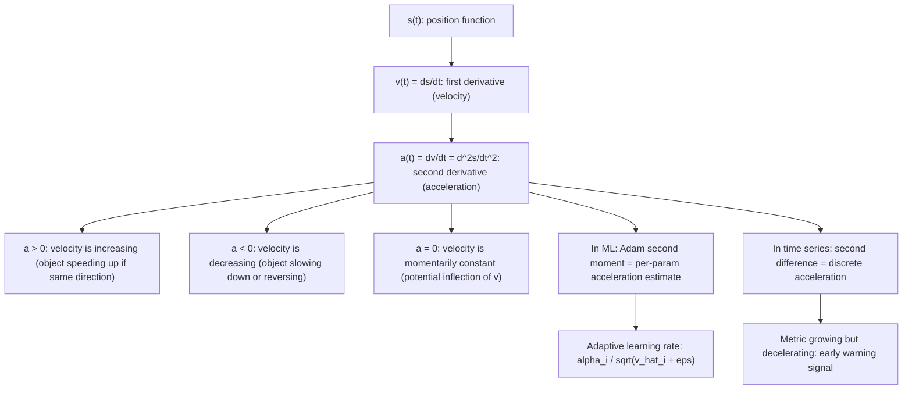

# Acceleration

$$
a = \frac{dv}{dt} = \frac{d^2s}{dt^2}
$$

## Deep Breakdown

What it tells me *(Situation Awareness)*:
Acceleration is the derivative of velocity with respect to time, or equivalently the second derivative of position. It measures how fast velocity is changing. In ML/DS, the "acceleration" metaphor is exact and directly implemented: the Adam optimizer uses a second moment estimate $v_t = \beta_2 v_{t-1} + (1-\beta_2)\nabla L^2$ that captures the curvature (acceleration) of the loss surface per-parameter. SGD with Nesterov momentum explicitly uses an accelerated gradient that "looks ahead" along the velocity direction. Second-order optimization (Newton's method, L-BFGS) uses the Hessian $H = \nabla^2 L$, which is the acceleration of the loss. In time series: the second difference $\Delta^2 s_t = s_t - 2s_{t-1} + s_{t-2}$ is discrete acceleration; it detects bends in trends — a metric can be growing (positive velocity) but decelerating (negative acceleration), which is a key early warning signal in KPI monitoring. Change-point detection often looks for sudden jumps in acceleration rather than velocity alone.

## Flowchart



## Real-world use

### Where it is used

Adam optimizer second moment: $v_t = \beta_2 v_{t-1} + (1-\beta_2)(\nabla L)^2$ — exponentially weighted average of squared gradients (acceleration proxy); Nesterov accelerated gradient: $v_{t+1} = \mu v_t - \alpha\nabla L(w_t + \mu v_t)$; Newton's method update $w \leftarrow w - H^{-1}\nabla L$ uses the Hessian (exact acceleration matrix of the loss); L-BFGS approximates the Hessian inverse for quasi-Newton optimization; KPI deceleration alerts in growth dashboards; jerk ($da/dt$) in robotics and autonomous vehicle control.

### Problem it solves

Velocity alone tells you whether a metric is growing or shrinking, but not whether that growth is strengthening or weakening. A product could have positive DAU velocity (growing) but negative acceleration (growth rate shrinking) — which is a critical early warning signal. Acceleration captures curvature in the trajectory, allowing better forecasts and earlier intervention.

### How it solves the problem

Differentiate velocity: $a(t) = dv/dt$. Since $v = ds/dt$, we have $a = d^2s/dt^2$. The sign of $a$ tells you whether velocity is increasing or decreasing; its magnitude tells you how rapidly. In discrete time: $\Delta^2 s_t = \Delta s_t - \Delta s_{t-1} = (s_t - s_{t-1}) - (s_{t-1} - s_{t-2}) = s_t - 2s_{t-1} + s_{t-2}$.

### Example in a business

A growth DS tracks Weekly Active Users (WAU). Week 1: WAU velocity is +5,000 (growing). Week 4: velocity is +2,000 — still positive (still growing!) but acceleration is $+2000 - +5000 = -3000$ (decelerating sharply). Without the acceleration signal, the dashboard shows "green" (growth). With acceleration, the DS raises an alert: growth is decelerating at -3,000 users/week², suggesting the product is plateauing. This is equivalent to finding where $d^2(\text{WAU})/dt^2 < 0$ with $d(\text{WAU})/dt > 0$ — a concave growth phase signaling saturation.

## The formula, piece by piece

- $a$: acceleration (signed), the rate of change of velocity
- $v$: velocity, itself the first derivative of position $s$
- $dv$: infinitesimal change in velocity
- $dt$: infinitesimal change in time
- $a = dv/dt$: first form — differentiate velocity once
- $a = d^2s/dt^2$: second form — differentiate position twice; the "2" in numerator and denominator both indicate second-order differentiation
- Units: velocity units per time unit (m/s²; or in DS: users/day² for DAU acceleration)
- Discrete: $\Delta^2 s_t = s_t - 2s_{t-1} + s_{t-2}$ (second difference operator)
- Sign: $a > 0$ means velocity is increasing; $a < 0$ means velocity is decreasing; $a = 0$ means velocity is at a local extremum (potential inflection point of $s$)
- In ML: the loss "acceleration" $d^2L/dw^2$ is the second derivative (curvature) used in second-order optimizers

## The formula in words

"Acceleration is the rate at which velocity changes. Differentiate velocity once (or position twice) to get acceleration. Positive acceleration means the object is speeding up; negative acceleration means it is slowing down. In ML, the second derivative of the loss is exactly the curvature that second-order optimizers exploit to take better steps." Tiny trace: $s(t) = t^3 - 6t^2 + 9t$. $v(t) = 3t^2 - 12t + 9$. $a(t) = 6t - 12$. At $t=1$: $a = -6$ (decelerating). At $t=2$: $a = 0$ (velocity at extremum). At $t=3$: $a = 6$ (accelerating). $\checkmark$

## Critical Concepts

- **Second derivative and concavity:** $a = d^2s/dt^2 > 0$ means $s(t)$ is concave up at that point (velocity increasing); $a < 0$ means concave down (velocity decreasing). This is the bridge from kinematics to the second derivative test for extrema: if $s'(t^*) = 0$ and $s''(t^*) > 0$, $t^*$ is a local minimum of $s$; if $s''(t^*) < 0$, it is a local maximum.
- **Adam optimizer as per-parameter acceleration:** Adam maintains $m_t$ (first moment, velocity) and $v_t$ (second moment, squared acceleration proxy). The update $w \leftarrow w - \alpha \hat{m}_t / (\sqrt{\hat{v}_t} + \epsilon)$ divides each parameter's velocity by a measure of its historical acceleration. Parameters with high, consistent gradients (high acceleration) get smaller effective learning rates — acceleration-aware adaptive scaling.
- **Nesterov momentum as predictive acceleration:** classical momentum updates $w$ using current velocity; Nesterov first "jumps" in the velocity direction, then computes the gradient at the lookahead position. This is equivalent to computing the gradient of velocity — a form of anticipating acceleration — which gives faster convergence, especially near minima.
- **Discrete second difference in time series:** $\Delta^2 s_t = s_t - 2s_{t-1} + s_{t-2}$ is the second difference operator. Applying $\Delta^2$ twice-differenced removes both linear and quadratic trends (ARIMA(0,2,0) models acceleration as noise). If $\Delta s_t$ is stationary (first difference sufficient), the series has velocity but not acceleration drift.
- **Jerk, snap, and higher derivatives:** $j = da/dt = d^3s/dt^3$ is called jerk; $d^4s/dt^4$ is snap (or jounce).

In DA: the third difference of a time series. Sudden jumps in jerk signal abrupt regime changes and are used in anomaly detection beyond what velocity or acceleration alone can detect.

## Step-by-step calculation (tiny example)

*Given $s(t) = 2t^3 - 9t^2 + 12t - 4$, find velocity and acceleration at $t = 1$, and determine whether the object is speeding up or slowing down at that moment.*

*Step 1: Differentiate position to get velocity.*
$v(t) = ds/dt = 6t^2 - 18t + 12$.
At $t = 1$: $v(1) = 6 - 18 + 12 = 0$. The object is instantaneously at rest.

*Step 2: Differentiate velocity to get acceleration.*
$a(t) = dv/dt = 12t - 18$.
At $t = 1$: $a(1) = 12 - 18 = -6$.

*Step 3: Interpret.*
$v(1) = 0$ and $a(1) = -6 < 0$: velocity is zero and decreasing. The object just reversed direction. Since $v = 0$ at $t = 1$ and $a = d^2s/dt^2 = -6 < 0$, this is a local maximum of $s$ (position peaks here). Verify: $s(1) = 2 - 9 + 12 - 4 = 1$. For $t$ slightly less than 1: $v > 0$ (moving forward); for $t$ slightly greater than 1: $v < 0$ (reversed). $\checkmark$

## Code examples

### Beginner example (Python)

```python
import numpy as np

def compute_acceleration( s_fn, t: float, h: float = 1e-5 ) -> tuple[float, float, float]:
    """ Velocity and acceleration via central finite differences. v(t) = ds/dt ≈ [s(t+h) - s(t-h)] / (2h) a(t) = d²s/dt² ≈ [s(t+h) - 2s(t) + s(t-h)] / h² """
    v = (s_fn(t + h) - s_fn(t - h)) / (2 * h)
    a = (s_fn(t + h) - 2 * s_fn(t) + s_fn(t - h)) / (h**2)
    return s_fn(t), v, a
examples = [ { "name": "s = 2t^3 - 9t^2 + 12t - 4", "s_fn": lambda t: 2*t**3 - 9*t**2 + 12*t - 4, "v_analytic": lambda t: 6*t**2 - 18*t + 12, "a_analytic": lambda t: 12*t - 18, }, { "name": "s = sin(t) * exp(-0.1t)", "s_fn": lambda t: np.sin(t) * np.exp(-0.1 * t), "v_analytic": lambda t: np.exp(-0.1*t) * (np.cos(t) - 0.1*np.sin(t)), "a_analytic": lambda t: np.exp(-0.1*t) * (-np.sin(t) - 0.2*np.cos(t) + 0.01*np.sin(t)), },
]
print("Acceleration: a(t) = dv/dt = d²s/dt²")
print(f"\n{'Function':>30} {'t':>5} {'s(t)':>8} {'v(t)':>10} {'a(t)':>10} {'a_exact':>10}")
for ex in examples:
    for t_val in [0.5, 1.0, 2.0]:
        s_val, v_num, a_num = compute_acceleration(ex["s_fn"], t_val)
    a_exact = ex["a_analytic"](t_val)
print(f"{ex['name']:>30} {t_val:>5.1f} {s_val:>8.4f} {v_num:>10.4f} {a_num:>10.4f} {a_exact:>10.4f}")   # Discrete acceleration: second difference of a time series
print("\n--- Discrete acceleration: Δ²s_t = s_t - 2*s_{t-1} + s_{t-2} ---")
np.random.seed(42)
n_weeks = 15
# Simulate: rapid growth then deceleration
t_weeks = np.arange(n_weeks)
wau = 50_000 + 5000 * t_weeks - 300 * t_weeks**2 + np.random.randn(n_weeks) * 500
velocity = np.diff(wau)   # first difference
acceleration = np.diff(velocity)   # second difference
print(f"{'Week':>6} {'WAU':>9} {'Velocity':>12} {'Acceleration':>14} {'Signal':>20}")
for i in range(min(10, n_weeks - 2)):
    signal = ""
    if velocity[i] > 0 and acceleration[i] < 0:
        signal = "Growing but DECELERATING"
    elif velocity[i] > 0 and acceleration[i] > 0:
        signal = "Growing and accelerating"
    elif velocity[i] < 0:
        signal = "Declining"
    print(f"{i+1:>6} {wau[i]:>9.0f} {velocity[i]:>12.1f} {acceleration[i]:>14.1f} {signal:>20}")
```

### Beginner example (R)

```r
# Acceleration: a(t) = dv/dt = d²s/dt²
compute_acceleration <- function(s_fn, t, h = 1e-5) { s_val <- s_fn(t)
  v <- (s_fn(t + h) - s_fn(t - h)) / (2 * h)
  a <- (s_fn(t + h) - 2 * s_fn(t) + s_fn(t - h)) / h^2 list(s = s_val, v = v, a = a)
}
s_fn <- function(t) 2*t^3 - 9*t^2 + 12*t - 4
v_exact <- function(t) 6*t^2 - 18*t + 12
a_exact <- function(t) 12*t - 18
cat("Acceleration: a(t) = d²s/dt²\n\n")
cat(sprintf("%-5s %-8s %-10s %-10s %-10s\n", "t", "s(t)", "v(t)", "a(t)", "a_exact"))
for (t_val in c(0.5, 1.0, 1.5, 2.0, 3.0)) { res <- compute_acceleration(s_fn, t_val)
  cat(sprintf("%-5.2f %-8.4f %-10.4f %-10.4f %-10.4f\n", t_val, res$s, res$v, res$a, a_exact(t_val)))
}  # Discrete acceleration: second difference
cat("\n--- Discrete acceleration: second difference of WAU ---\n")
set.seed(42)
n_weeks <- 15
t_weeks <- 0:(n_weeks - 1)
wau <- 50000 + 5000 * t_weeks - 300 * t_weeks^2 + rnorm(n_weeks, sd = 500)
vel <- diff(wau)
acc <- diff(vel)
cat(sprintf("%-6s %-9s %-12s %-14s\n", "Week", "WAU", "Velocity", "Acceleration"))
for (i in 1:min(10, n_weeks - 2)) { cat(sprintf("%-6d %-9.0f %-12.1f %-14.1f\n", i, wau[i], vel[i], acc[i]))
}
```

### Professional example (Python)

```python
import numpy as np
from sklearn.datasets import make_regression
from sklearn.preprocessing import StandardScaler
np.random.seed(42)   # -- Acceleration = d²L/dw²: Adam's second moment as per-parameter acceleration --
# Use case: A DS trains a neural net with Adam and diagnoses which parameters
# are in "high-curvature" (high acceleration) vs "flat" (low acceleration) regions.
# The second moment v_t ≈ E[(dL/dw)^2] is the squared gradient = proxy for curvature.
# Insight: parameters with high v_t need smaller learning rates (Adam divides by sqrt(v_t));
# parameters in flat regions (low v_t) need larger learning rates.
# This is exactly the physics: high acceleration = large response to small force.
#
# Kinematic analogy:
#
w_t = position (weights)
# m_t = first moment = velocity (accumulated gradient direction)
# v_t = second moment = acceleration proxy (accumulated squared gradient magnitude)
# alpha / sqrt(v_hat) = effective step = force / acceleration = inverse mass
N = 200
DIM = 8
ALPHA = 0.01
BETA1 = 0.9   # momentum for first moment (velocity)
BETA2 = 0.999   # momentum for second moment (acceleration)
EPS = 1e-8
N_STEPS = 500

def mse_grad(w: np.ndarray, X: np.ndarray, y: np.ndarray) -> tuple[float, np.ndarray]:
    """MSE loss and gradient."""
    residuals = y - X @ w
    loss = float(np.mean(residuals**2))
    grad = -2.0 / len(y) * X.T @ residuals
    return loss, grad
X_raw, y = make_regression(n_samples=N, n_features=DIM, noise=1.0, random_state=42)
scaler = StandardScaler()
X = scaler.fit_transform(X_raw)
y = y / y.std()
w = np.zeros(DIM)
m = np.zeros(DIM)   # first moment (velocity)
v = np.zeros(DIM)   # second moment (acceleration proxy)
losses = []
velocities = []   # |m_hat|: magnitude of velocity vector
accelerations = []   # |v_hat|: magnitude of acceleration proxy vector
for step in range(1, N_STEPS + 1):
    loss, grad = mse_grad(w, X, y)   # Adam update
m = BETA1 * m + (1 - BETA1) * grad   # velocity: gradient direction v = BETA2 * v + (1 - BETA2) * grad**2 # acceleration: gradient magnitude²
m_hat = m / (1 - BETA1**step)   # bias-corrected velocity
v_hat = v / (1 - BETA2**step)   # bias-corrected acceleration proxy
w = w - ALPHA * m_hat / (np.sqrt(v_hat) + EPS)   # position update
losses.append(loss)
velocities.append(float(np.linalg.norm(m_hat)))
accelerations.append(float(np.linalg.norm(v_hat)))
print("Acceleration = d²L/dw²: Adam Second Moment as Per-Parameter Curvature")
print(f"\nN={N}, DIM={DIM}, alpha={ALPHA}, beta1={BETA1}, beta2={BETA2}")
print(f"\nPhysical interpretation:")
print(f" w(t) = position (weights) v = ds/dt")
print(f" m_hat(t) = velocity (gradient direction) a = dv/dt")
print(f" v_hat(t) = acceleration proxy (squared gradient magnitude)")
print(f" step_i = alpha / (sqrt(v_hat_i) + eps): force / acceleration = inverse mass")
print(f"\n{'Step':>6} {'Loss':>10} {'|Velocity|':>12} {'|Acceleration|':>16} {'Effective LR (mean)':>20}")
for step in [1, 5, 10, 50, 100, 200, 499]:
    # effective learning rate = alpha / (sqrt(v_hat) + eps): per-parameter
    loss, grad = mse_grad(w, X, y)
_, g = mse_grad(w, X, y)
v_est = BETA2**step if step < N_STEPS else v
eff_lr_mean = float(ALPHA / (np.sqrt(accelerations[step]) + EPS))
print(f"{step+1:>6} {losses[step]:>10.5f} {velocities[step]:>12.6f} " f"{accelerations[step]:>16.6f} {eff_lr_mean:>20.8f}")   # Final per-parameter acceleration diagnosis
_, final_grad = mse_grad(w, X, y)
v_final = BETA2 * v + (1 - BETA2) * final_grad**2
v_hat_final = v_final / (1 - BETA2**N_STEPS)
eff_lr_per_param = ALPHA / (np.sqrt(v_hat_final) + EPS)
print(f"\nPer-parameter acceleration diagnosis at final step:")
print(f"{'Param':>7} {'v_hat (accel)':>15} {'Effective LR':>14} {'Interpretation':>30}")
for i in range(DIM):
    interpretation = "high curvature, small step" if v_hat_final[i] > np.median(v_hat_final) \ else "flat region, large step"
print(f"w[{i}]: {v_hat_final[i]:>13.6f} {eff_lr_per_param[i]:>14.8f} {interpretation:>30}")
print(f"\nAcceleration physics summary:")
print(f" Velocity |m_hat| at step 1: {velocities[0]:.6f} (high: large initial gradient)")
print(f" Velocity |m_hat| at final: {velocities[-1]:.8f} (low: near convergence)")
print(f" Acceleration |v_hat| decays as gradient magnitude decreases -> adaptive LR grows")
print(f" This is why Adam converges faster than vanilla SGD near the optimum.")
```

---

*Source: 1300 p. 225*
