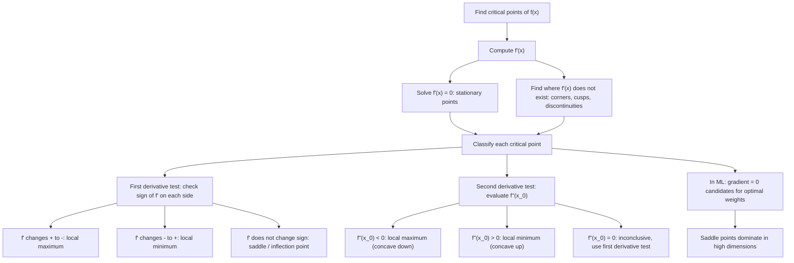

# Critical Points

Occur where $f'(x_0) = 0$ or $f'(x_0)$ does not exist.

## Deep Breakdown

What it tells me *(Situation Awareness)*:
Critical points are the candidates for local maxima, local minima, and inflection points of a function. A point $x_0$ is critical when the derivative is zero (stationary point) or undefined (corner, cusp, vertical tangent). Finding critical points is the necessary first step in optimization: you can only have an extremum at a critical point (Fermat's theorem). In ML: every loss minimization problem is fundamentally "find the critical points of $L(w)$." Gradient descent navigates toward a critical point by following $-\nabla L$. In practice, deep neural network loss surfaces have exponentially many critical points (saddle points dominate over true minima in high dimensions — Dauphin et al. 2014). In DA: critical points of a KPI curve are trend reversals (growth peaks, decline troughs). In feature engineering: the critical points of a signal are the extrema used in peak detection, envelope extraction, and event segmentation.

## Flowchart



## Real-world use

### Where it is used

Loss minimization: $\nabla_w L(w^*) = 0$ at optimum; gradient descent convergence criterion $\|\nabla L\| < \epsilon$ — stops near a critical point; support vector machine dual: $\partial\mathcal{L}/\partial\alpha_i = 0$ for KKT conditions; logistic regression MLE: $\partial\ell/\partial w = X^T(y - \hat{p}) = 0$ at the MLE; peak detection in time series (ECG R-peaks, sensor events, traffic spikes); feature engineering: local maxima/minima as shape descriptors; hyperparameter optimization: finding the minimum of cross-validation loss over a learning rate grid.

### Problem it solves

Optimization requires finding where the function is "flat" — where the tangent is horizontal or the derivative fails to exist. Without systematically finding critical points, you cannot reliably locate minima or maxima. Gradient descent is blind to whether it has reached a true minimum vs. a saddle point vs. a local minimum; critical point analysis provides the diagnostic.

### How it solves the problem

Fermat's theorem states: if $f$ has a local extremum at $x_0$ and $f'(x_0)$ exists, then $f'(x_0) = 0$. So all extrema are among the critical points. Algorithm: (1) compute $f'$; (2) solve $f' = 0$ and find where $f'$ is undefined; (3) classify each candidate via the first or second derivative test; (4) compare candidate values and boundary values for global extrema.

### Example in a business

A DS fits a polynomial trend to quarterly revenue: $R(t) = -0.5t^3 + 6t^2 - 12t + 20$. To find the revenue peak: $R'(t) = -1.5t^2 + 12t - 12 = 0 \Rightarrow t = (−12 \pm \sqrt{144 - 72}) / (−3) = 2$ or $t = 6$. $R''(t) = -3t + 12$. At $t=2$: $R''(2) = 6 > 0$ — local minimum. At $t=6$: $R''(6) = -6 < 0$ — local maximum. Revenue peaks at $t = 6$ quarters. The DS alerts: after $t=6$, trend reverses. This is a direct application of finding critical points to make a business decision.

## The formula, piece by piece

- $f'(x_0) = 0$: the derivative vanishes — the tangent line is horizontal at $x_0$ ("stationary point")
- $f'(x_0)$ does not exist: the function has a corner (e.g., $|x|$ at 0), cusp, or vertical tangent — still a critical point
- "Critical point": the $x$-value $x_0$; the corresponding point on the curve is $(x_0, f(x_0))$
- Necessary condition for extremum (Fermat): if $f$ has a local max/min at interior point $x_0$, then $x_0$ is critical
- NOT sufficient: $f'(x_0) = 0$ does not guarantee an extremum (e.g., $f(x) = x^3$ at $x=0$: critical but not an extremum)
- Second derivative test: if $f'(x_0) = 0$ then: $f''(x_0) > 0 \Rightarrow$ local min; $f''(x_0) < 0 \Rightarrow$ local max; $f''(x_0) = 0 \Rightarrow$ inconclusive
- In $\mathbb{R}^n$: critical point when $\nabla f = \mathbf{0}$; classified via the Hessian $H$: all eigenvalues positive $\Rightarrow$ local min; all negative $\Rightarrow$ local max; mixed signs $\Rightarrow$ saddle point

## The formula in words

"A critical point is any location where the function's slope is exactly zero (flat tangent) or the slope is undefined (sharp corner). Every peak and valley must be a critical point, but not every critical point is a peak or valley — some are saddle points where the function neither rises nor falls." Tiny trace: $f(x) = x^3 - 3x$. $f'(x) = 3x^2 - 3 = 0 \Rightarrow x = \pm 1$. $f''(x) = 6x$. At $x = -1$: $f''(-1) = -6 < 0$: local max, $f(-1) = 2$. At $x = 1$: $f''(1) = 6 > 0$: local min, $f(1) = -2$. $\checkmark$

## Critical Concepts

- **Fermat's theorem: necessary, not sufficient.** $f'(x_0) = 0$ means $x_0$ is a candidate extremum, not a confirmed one. Example: $f(x) = x^3$ has $f'(0) = 0$ but $f$ is strictly increasing — no extremum at 0. This is why you must classify after finding critical points.
- **Saddle points dominate in high dimensions:** for a random smooth function in $\mathbb{R}^n$, the ratio of saddle points to minima grows exponentially with $n$. For deep neural networks, critical points with gradient zero are overwhelmingly saddle points, not local minima. This is key: gradient descent in practice does not "get stuck" at saddle points — the gradient is nonzero in at least one direction, and numerical noise causes escape. The real concern is slow progress in flat saddle-adjacent regions.
- **Non-differentiable critical points in ML:** the ReLU activation $\max(0, x)$ has a critical point at $x = 0$ where it is not differentiable. The subgradient (set $[0, 1]$) is used instead of the derivative. L1 regularization introduces a non-differentiable critical point at $w_i = 0$ for each weight — this is what produces sparsity in Lasso, since the subgradient condition at 0 is satisfied by a range of gradients.
- **Closed interval method for global extrema:** on $[a, b]$, the global minimum and maximum must occur at critical points in $(a, b)$ or at the endpoints $a$ and $b$. In hyperparameter optimization over a bounded range, always evaluate at the boundaries of the search space, not only at the interior critical points of the CV loss curve.
- **Gradient norm as convergence monitor:** in practice, you cannot solve $\nabla L = 0$ analytically; gradient descent approaches a critical point asymptotically.

The convergence criterion is $\|\nabla L(w_t)\| < \epsilon$ (gradient norm below tolerance). Plotting $\|\nabla L\|$ over steps is the practical proxy for tracking proximity to a critical point.

## Step-by-step calculation (tiny example)

*Find and classify all critical points of $f(x) = x^4 - 8x^2 + 3$.*

*Step 1: Compute the first derivative.*
$f'(x) = 4x^3 - 16x = 4x(x^2 - 4) = 4x(x-2)(x+2)$.

*Step 2: Solve $f'(x) = 0$.*
$4x(x-2)(x+2) = 0 \Rightarrow x \in \{-2, 0, 2\}$. Three critical points. $f'$ exists everywhere (polynomial), so no additional non-differentiable candidates.

*Step 3: Classify via second derivative test.*
$f''(x) = 12x^2 - 16$.
- $x = -2$: $f''(-2) = 48 - 16 = 32 > 0$ — local minimum. $f(-2) = 16 - 32 + 3 = -13$.
- $x = 0$: $f''(0) = -16 < 0$ — local maximum. $f(0) = 3$.
- $x = 2$: $f''(2) = 48 - 16 = 32 > 0$ — local minimum. $f(2) = 16 - 32 + 3 = -13$.

The two local minima at $x = \pm 2$ are equal (by symmetry). $f(0) = 3$ is a local max between them. $\checkmark$

## Code examples

### Beginner example (Python)

```python
import numpy as np
from scipy.optimize import brentq


def find_critical_points(f_prime, search_range: tuple[float, float], n_grid: int = 1000) -> list[float]:
    """Numerically find zeros of f_prime in search_range using sign-change bracketing.

    Returns list of critical point x-values.
    """
    x_grid = np.linspace(search_range[0], search_range[1], n_grid)
    fp_vals = f_prime(x_grid)
    critical_points = []
    for i in range(len(x_grid) - 1):
        if fp_vals[i] * fp_vals[i + 1] < 0:
            # sign change: zero crossing
            x_crit = brentq(f_prime, x_grid[i], x_grid[i + 1])
            critical_points.append(x_crit)
    return critical_points


def classify_critical_point(f_double_prime, x_crit: float) -> str:
    """Second derivative test classification."""
    fpp = f_double_prime(x_crit)
    if fpp > 1e-8:
        return "local minimum"
    elif fpp < -1e-8:
        return "local maximum"
    else:
        return "inconclusive (f''=0)"


# Example 1: polynomial
f = lambda x: x**4 - 8*x**2 + 3
f_prime = lambda x: 4*x**3 - 16*x
f_prime2 = lambda x: 12*x**2 - 16
print("Critical Points: f'(x_0) = 0 or f'(x_0) undefined")
print(f"\nf(x) = x^4 - 8x^2 + 3")
print(f"f'(x) = 4x^3 - 16x")
print(f"\n{'x_crit':>10} {'f(x_crit)':>12} {'f''(x_crit)':>14} {'Type':>20}")
for x_crit in find_critical_points(f_prime, (-3.0, 3.0)):
    classification = classify_critical_point(f_prime2, x_crit)
    print(f"{x_crit:>10.4f} {f(x_crit):>12.4f} {f_prime2(x_crit):>14.4f} {classification:>20}")

# Example 2: non-differentiable critical point (L1 = |x|)
print(f"\n--- Non-differentiable critical point: f(x) = |x| at x=0 ---")
print(f"f'(0) does not exist (left derivative = -1, right derivative = +1)")
print(f"Subgradient at x=0: [-1, 1]. x=0 is still a critical point.")
print(f"f(0) = 0 is the global minimum.")

# Gradient norm as convergence indicator
print(f"\n--- Gradient norm toward critical point (gradient descent on f) ---")
x = 3.0   # start far from critical point
lr = 0.05
print(f"{'Step':>6} {'x':>8} {'f(x)':>10} {'f_prime(x)':>12} {'|grad|':>10}")
for step in range(20):
    grad = f_prime(x)
    if step % 4 == 0:
        print(f"{step:>6} {x:>8.4f} {f(x):>10.4f} {grad:>12.4f} {abs(grad):>10.4f}")
    x -= lr * grad
print(f" Converged to x = {x:.4f}, |grad| = {abs(f_prime(x)):.2e}")
```

### Beginner example (R)

```r
# Critical points: f'(x_0) = 0 or f'(x_0) undefined
f <- function(x) x^4 - 8*x^2 + 3
f_prime <- function(x) 4*x^3 - 16*x
f_pp <- function(x) 12*x^2 - 16

# Find zeros of f' numerically using sign changes on a grid
x_grid <- seq(-3, 3, length.out = 1000)
fp_vals <- f_prime(x_grid)
cat("Critical Points: f'(x) = 4x^3 - 16x\n\n")
cat(sprintf("%-10s %-12s %-14s %-20s\n", "x_crit", "f(x_crit)", "f''(x_crit)", "Type"))
for (i in 1:(length(x_grid) - 1)) {
  if (fp_vals[i] * fp_vals[i + 1] < 0) {
    x_crit <- uniroot(f_prime, lower = x_grid[i], upper = x_grid[i + 1])$root
    fpp <- f_pp(x_crit)
    type <- if (fpp > 1e-8) "local minimum" else if (fpp < -1e-8) "local maximum" else "inconclusive"
    cat(sprintf("%-10.4f %-12.4f %-14.4f %-20s\n", x_crit, f(x_crit), fpp, type))
  }
}

# Gradient descent convergence to critical point
cat("\n--- Gradient descent convergence ---\n")
x <- 3.0
lr <- 0.05
cat(sprintf("%-6s %-8s %-10s %-12s\n", "Step", "x", "f(x)", "|grad|"))
for (step in 0:19) {
  grad <- f_prime(x)
  if (step %% 4 == 0) {
    cat(sprintf("%-6d %-8.4f %-10.4f %-12.4f\n", step, x, f(x), abs(grad)))
  }
  x <- x - lr * grad
}
cat(sprintf("Converged: x = %.4f, |grad| = %.2e\n", x, abs(f_prime(x))))
```

### Professional example (Python)

```python
import numpy as np
from sklearn.datasets import make_classification
from sklearn.preprocessing import StandardScaler
np.random.seed(42)

# -- Critical points: gradient norm and saddle-point diagnosis in logistic regression --
# Use case: A DS trains logistic regression and diagnoses the optimization landscape
# at convergence: is the gradient truly near zero? Is the critical point a minimum
# (Hessian positive definite) or a saddle point (Hessian indefinite)?
#
# MLE critical point condition: dL/dw = X^T(y - sigma(Xw)) = 0
# Second-order check: Hessian H = X^T diag(p*(1-p)) X (always PSD for log-reg,
# so critical point is always a global minimum -- no saddle points in convex loss)
N = 300
DIM = 5
X_raw, y = make_classification(
    n_samples=N, n_features=DIM, n_informative=DIM, n_redundant=0, random_state=42
)
scaler = StandardScaler()
X = scaler.fit_transform(X_raw)


def sigmoid(z: np.ndarray) -> np.ndarray:
    """Numerically stable sigmoid."""
    return np.where(z >= 0, 1.0 / (1.0 + np.exp(-z)), np.exp(z) / (1.0 + np.exp(z)))


def log_loss_grad(w: np.ndarray, X: np.ndarray, y: np.ndarray) -> tuple[float, np.ndarray]:
    """Binary cross-entropy loss and score function gradient."""
    p = sigmoid(X @ w)
    p = np.clip(p, 1e-12, 1 - 1e-12)
    loss = -float(np.mean(y * np.log(p) + (1 - y) * np.log(1 - p)))
    grad = X.T @ (p - y) / len(y)   # gradient = 0 at MLE critical point
    return loss, grad


def log_loss_hessian(w: np.ndarray, X: np.ndarray) -> np.ndarray:
    """Hessian H = X^T diag(p*(1-p)) X / N. PSD => global minimum, no saddles."""
    p = sigmoid(X @ w)
    weights = p * (1 - p)
    return (X * weights[:, None]).T @ X / len(X)


# Gradient descent to find the critical point (MLE)
ALPHA = 0.5
N_STEPS = 200
w = np.zeros(DIM)
losses = []
grad_norms = []
for step in range(N_STEPS):
    loss, grad = log_loss_grad(w, X, y)
    losses.append(loss)
    grad_norms.append(float(np.linalg.norm(grad)))
    w -= ALPHA * grad

# Evaluate at converged critical point
loss_final, grad_final = log_loss_grad(w, X, y)
H = log_loss_hessian(w, X)
eigenvalues = np.linalg.eigvalsh(H)

print("Critical Points: Loss Landscape Diagnosis for Logistic Regression MLE")
print(f"\nN={N}, DIM={DIM}, alpha={ALPHA}, steps={N_STEPS}")
print(f"\nConvergence to critical point (gradient -> 0):")
print(f"{'Step':>6} {'Loss':>10} {'|grad|':>12} {'Status':>25}")
for step in [0, 10, 30, 50, 100, 199]:
    status = "near critical point" if grad_norms[step] < 0.01 else "converging"
    print(f"{step+1:>6} {losses[step]:>10.6f} {grad_norms[step]:>12.8f} {status:>25}")

print(f"\nCritical point diagnosis (second-order test):")
print(f" Gradient norm at convergence: {np.linalg.norm(grad_final):.2e} (~ 0: critical point reached)")
print(f" Hessian eigenvalues: {np.round(eigenvalues, 4)}")
print(f" All eigenvalues positive: {np.all(eigenvalues > 0)}")
print(f" Conclusion: {'Global minimum (PSD Hessian, convex loss)' if np.all(eigenvalues > 0) else 'Saddle point (indefinite Hessian)'}")
print(f"\nNote: logistic regression has a CONVEX loss -> only one critical point")
print(f" -> no saddle points; no local minima distinct from the global minimum.")
print(f" Neural networks are NON-convex: exponentially many saddle points exist.")
print(f" In high dimensions, |eigenvalues of H with mixed sign| >> |all-positive H|.")
```

---

*Source: domain knowledge*
