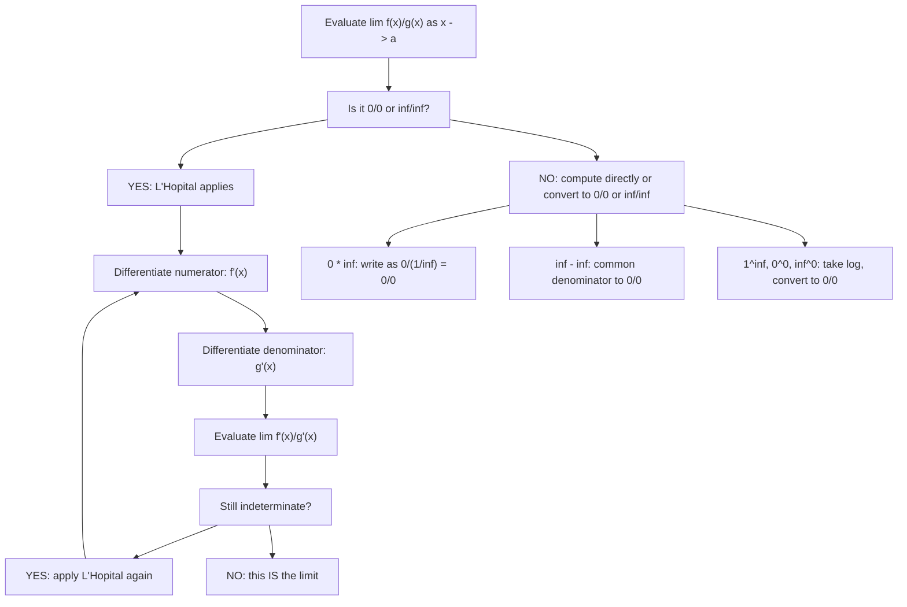

# L'Hôpital's Rule

$$
\lim_{x \to a} \frac{f(x)}{g(x)} = \lim_{x \to a} \frac{f'(x)}{g'(x)}
$$

(for $\frac{0}{0}$ or $\frac{\infty}{\infty}$ forms)

## Deep Breakdown

What it tells me *(Situation Awareness)*:
L'Hôpital's Rule (Guillaume de l'Hôpital, 1696 — though proven by Johann Bernoulli) resolves indeterminate forms $0/0$ and $\infty/\infty$ by replacing the ratio of functions with the ratio of their derivatives. It applies at any limit point $a$ (finite, $+\infty$, $-\infty$). It is repeatable: if the new ratio is still indeterminate, apply again. In ML/DS: every derivative is originally a $0/0$ form (the definition of the derivative IS L'Hôpital's rule applied to $[f(x+h)-f(x)]/h$ as $h\to 0$); cross-entropy loss stability at boundaries $p \to 0$ or $p \to 1$ (the numerically dangerous $0 \cdot \log 0$ resolved via L'Hôpital to 0); KL divergence limit when distributions approach equality; convergence rate comparisons of learning rate schedules ($\alpha_1/\alpha_2$ as $t \to \infty$); entropy $-p\log p$ as $p \to 0$; the softmax temperature limit as $T \to 0$ (argmax) or $T \to \infty$ (uniform) — all use L'Hôpital.

## Flowchart



## Real-world use

### Where it is used

$-p\log p \to 0$ as $p \to 0$: entropy boundary, resolved as $\lim_{p\to 0}(-p\log p) = \lim_{p\to 0}-\log p / (1/p) = \lim_{p\to 0}-p = 0$ via L'Hôpital; cross-entropy loss: $y\log(p) + (1-y)\log(1-p)$ is $0 \cdot (-\infty)$ at $p=0, y=0$ — L'Hôpital confirms limit = 0; softmax temperature limit $\lim_{T\to 0}\text{softmax}(z/T)$; convergence rate comparison of algorithms; KL divergence $\lim_{q\to p} D_{KL}(p\|q) = 0$ (confirmed via Taylor, which is L'Hôpital applied twice); standard limits $\sin x/x$, $(e^x-1)/x$, $\ln(1+x)/x$ (all proved via L'Hôpital); derivative definition itself.

### Problem it solves

$0/0$ and $\infty/\infty$ are undefined as fractions — you cannot determine the limit by plugging in $x = a$ directly. Yet the limit often exists and equals a meaningful value. L'Hôpital provides a systematic algebraic procedure to extract it without geometric arguments or Taylor series.

### How it solves the problem

If $\lim_{x\to a} f(x) = 0$ and $\lim_{x\to a} g(x) = 0$ (or both $\pm\infty$), and $g'(x) \ne 0$ near $a$, and $\lim_{x\to a} f'(x)/g'(x)$ exists (or is $\pm\infty$), then $\lim_{x\to a} f(x)/g(x) = \lim_{x\to a} f'(x)/g'(x)$. Mechanically: differentiate numerator and denominator separately (NOT the quotient rule), then re-evaluate.

### Example in a business

A DS computes information-theoretic model comparison using entropy. The entropy formula contains $p \log p$, which is undefined at $p = 0$ but should be treated as 0 (zero probability contributes zero entropy). Formal verification: $\lim_{p\to 0^+} p \log p = \lim_{p\to 0^+} \log p / (1/p)$ — indeterminate $-\infty / +\infty$. Applying L'Hôpital: $= \lim_{p\to 0^+} (1/p) / (-1/p^2) = \lim_{p\to 0^+} (-p) = 0$. The DS codes `0 * log(0) = 0` in their entropy implementation. This is the direct calculation justifying `np.where(p > 0, p * np.log(p), 0.0)` in Shannon entropy.

## The formula, piece by piece

- $f(x)$: numerator function; $g(x)$: denominator function
- $a$: the limit point (finite value, $+\infty$, or $-\infty$)
- $f'(x)$: derivative of the numerator (not the derivative of the ratio)
- $g'(x)$: derivative of the denominator
- Condition 1: $\lim_{x\to a} f(x)/g(x)$ is $0/0$ or $\pm\infty/\pm\infty$
- Condition 2: $g'(x) \ne 0$ in a punctured neighborhood of $a$
- Condition 3: $\lim_{x\to a} f'(x)/g'(x)$ exists (possibly $\pm\infty$)
- Then: $\lim_{x\to a} f(x)/g(x) = \lim_{x\to a} f'(x)/g'(x)$
- Other indeterminate forms reducible to $0/0$ or $\infty/\infty$: $0 \cdot \infty$, $\infty - \infty$, $1^\infty$, $0^0$, $\infty^0$
- Reduction of $0 \cdot \infty$: write $f \cdot g = f / (1/g)$ or $g / (1/f)$
- Reduction of $1^\infty$, $0^0$, $\infty^0$: take logarithm, reduce to $0/0$ or $\infty/\infty$

## The formula in words

"When a limit gives $0/0$ or $\infty/\infty$, you cannot determine the limit from the values alone. Replace both numerator and denominator by their derivatives — not the derivative of the whole fraction — and re-evaluate. Repeat if needed. This works because near the indeterminate point, both functions behave like their derivatives." Tiny trace: $\lim_{x\to 0}(e^x - 1)/x$. Direct: $0/0$. Apply L'Hôpital: differentiate top ($e^x$) and bottom (1). $\lim_{x\to 0} e^x / 1 = e^0 = 1$. $\checkmark$

## Critical Concepts

- **Differentiate top and bottom separately — not the quotient rule.** This is the most common error. $d/dx[f/g] \ne f'/g'$. L'Hôpital says $\lim f/g = \lim f'/g'$; the differentiation applies to numerator and denominator independently, not to their ratio.
- **Verify indeterminate form before applying.** L'Hôpital does NOT apply when the limit is not $0/0$ or $\infty/\infty$. Example: $\lim_{x\to 0} x / (x + 1) = 0/1 = 0$ — direct substitution works. Applying L'Hôpital here would give $1/1 = 1$, which is wrong. Always check first.
- **Circular argument with trig derivatives.** The standard proof of $d/dx[\sin x] = \cos x$ uses $\lim_{x\to 0}\sin(x)/x = 1$, which is proved geometrically (squeeze theorem). Applying L'Hôpital to $\sin(x)/x$ gives $\lim \cos(x)/1 = 1$ — correct result, but circular reasoning (you need the derivative of $\sin$ to differentiate the numerator, which requires the limit you are trying to compute). In practice, this is fine for computation; for rigorous proof, use the squeeze theorem.
- **Multiple applications and convergence.** Some limits require L'Hôpital multiple times: $\lim_{x\to\infty} x^n / e^x = 0$ requires applying $n$ times. After $n$ applications, numerator becomes $n!$ (constant) and denominator is still $e^x \to \infty$, giving $n!/\infty = 0$. This proves $e^x$ grows faster than any polynomial — fundamental for analyzing algorithm complexity and model convergence rates.
- **$0/0$ in numerical software:** `np.log1p(x)/x` as `x -> 0` is $0/0 \to 1$ (L'Hôpital).

The implementation uses `np.log1p` rather than `np.log(1+x)` to avoid cancellation. The limit value 1 is what makes `np.log1p(x)/x ≈ 1` valid for `|x| << 1`, justifying the log-return approximation $\ln(1+r) \approx r$ in finance.

## Step-by-step calculation (tiny example)

*Evaluate $\lim_{x \to 0} \frac{e^{2x} - 1 - 2x}{x^2}$.*

*Step 1: Check indeterminate form.*
At $x = 0$: numerator $= e^0 - 1 - 0 = 0$. Denominator $= 0$. Form: $0/0$. L'Hôpital applies.

*Step 2: First application.*
Differentiate numerator: $d/dx[e^{2x} - 1 - 2x] = 2e^{2x} - 2$.
Differentiate denominator: $d/dx[x^2] = 2x$.
New limit: $\lim_{x\to 0}(2e^{2x} - 2)/(2x)$. At $x=0$: $(2-2)/0 = 0/0$. Still indeterminate.

*Step 3: Second application.*
Differentiate again: numerator $= 4e^{2x}$; denominator $= 2$.
$\lim_{x\to 0} 4e^{2x}/2 = 4/2 = 2$. The limit is $2$. Verification via Taylor: $e^{2x} = 1 + 2x + (2x)^2/2 + \ldots = 1 + 2x + 2x^2 + \ldots$, so $(e^{2x} - 1 - 2x)/x^2 \approx 2x^2/x^2 = 2$. $\checkmark$

## Code examples

### Beginner example (Python)

```python
import numpy as np

def numerical_limit(f, x_values: np.ndarray) -> np.ndarray:
    """Evaluate f at an array of x values approaching the limit point."""
    return np.array([f(x) for x in x_values])
print("L'Hopital's Rule: resolving indeterminate forms")   # Case 1: (e^x - 1)/x -> 1 as x -> 0
print("\nCase 1: lim_{x->0} (e^x - 1)/x [0/0 form, L'Hopital: e^x/1 -> 1]")
x_near_0 = np.array([0.1, 0.01, 1e-4, 1e-7, 1e-10])
print(f"{'x':>12} {'(e^x-1)/x':>14} {'log1p stable':>15}")
for x in x_near_0:
    naive = (np.exp(x) - 1) / x
stable = np.expm1(x) / x   # numerically equivalent, more stable
print(f"{x:>12.2e} {naive:>14.10f} {stable:>15.10f}")   # Case 2: p*log(p) -> 0 as p -> 0 (entropy boundary)
print("\nCase 2: lim_{p->0+} p*log(p) = 0 [0*inf form, L'Hopital: log(p)/(1/p) -> 0]")
p_near_0 = np.array([0.5, 0.1, 0.01, 1e-5, 1e-10])
print(f"{'p':>12} {'p*log(p)':>14} {'L Hopital says':>16}")
for p in p_near_0:
    val = p * np.log(p)
print(f"{p:>12.2e} {val:>14.8f} {'-> 0' if abs(val) < 0.01 else '':>16}")   # Shannon entropy with correct 0*log(0) = 0 boundary

def shannon_entropy(probs: np.ndarray) -> float:
    """H(p) = -sum p_i log p_i. Uses L'Hopital: 0*log(0) = 0."""
    return float(-np.sum(np.where(probs > 0, probs * np.log(probs), 0.0)))
print(f"\nEntropy of [0.5, 0.5]: {shannon_entropy(np.array([0.5, 0.5])):.4f} (log 2 = {np.log(2):.4f})")
print(f"Entropy of [1.0, 0.0]: {shannon_entropy(np.array([1.0, 0.0])):.4f} (deterministic = 0)")
print(f"Entropy of [0.9, 0.1]: {shannon_entropy(np.array([0.9, 0.1])):.4f}")   # Case 3: x^n / e^x -> 0 as x -> inf (polynomial vs exponential)
print("\nCase 3: lim_{x->inf} x^n / e^x = 0 [apply L'Hopital n times]")
print(f"{'n':>5} {'x=5':>10} {'x=10':>10} {'x=20':>10} {'x=50':>10}")
for n in [1, 2, 3, 5, 10]:
    vals = [x**n / np.exp(x) for x in [5, 10, 20, 50]]
print(f"{n:>5} {vals[0]:>10.6f} {vals[1]:>10.6f} {vals[2]:>10.2e} {vals[3]:>10.2e}")
```

### Beginner example (R)

```r
# L'Hopital's Rule: indeterminate forms
cat("L'Hopital's Rule: resolving indeterminate forms\n")  # Case 1: (e^x - 1)/x -> 1 as x -> 0
cat("\nCase 1: lim_{x->0} (e^x-1)/x = 1\n")
cat(sprintf("%-12s %-14s %-15s\n", "x", "(e^x-1)/x", "expm1 stable"))
for (x in c(0.1, 0.01, 1e-4, 1e-7, 1e-10)) { naive <- (exp(x) - 1) / x
  stable <- expm1(x) / x
  cat(sprintf("%-12.2e %-14.10f %-15.10f\n", x, naive, stable))
}  # Case 2: p*log(p) -> 0 as p -> 0 (entropy boundary)
cat("\nCase 2: lim_{p->0+} p*log(p) = 0\n")
cat(sprintf("%-12s %-14s\n", "p", "p*log(p)"))
for (p in c(0.5, 0.1, 0.01, 1e-5, 1e-10)) { cat(sprintf("%-12.2e %-14.8f\n", p, p * log(p)))
}  # Shannon entropy with correct boundary
shannon_entropy <- function(probs) { -sum(ifelse(probs > 0, probs * log(probs), 0))
}
cat(sprintf("\nEntropy [0.5,0.5]: %.4f\n", shannon_entropy(c(0.5, 0.5))))
cat(sprintf("Entropy [1.0,0.0]: %.4f\n", shannon_entropy(c(1.0, 0.0))))  # Case 3: x^n/e^x -> 0 as x -> inf
cat("\nCase 3: lim_{x->inf} x^n/e^x = 0\n")
cat(sprintf("%-5s %-10s %-10s %-10s\n", "n", "x=10", "x=20", "x=50"))
for (n in c(1, 2, 3, 5, 10)) { vals <- sapply(c(10, 20, 50), function(x) x^n / exp(x))
  cat(sprintf("%-5d %-10.6f %-10.2e %-10.2e\n", n, vals[1], vals[2], vals[3]))
}
```

### Professional example (Python)

```python
import numpy as np
from sklearn.datasets import make_classification
from sklearn.preprocessing import StandardScaler
np.random.seed(42)   # -- L'Hopital's Rule: softmax temperature limits and stable cross-entropy --
# Two direct applications:
# (A) Softmax temperature: lim_{T->0}
softmax(z/T) = argmax (L'Hopital-style reasoning)   # lim_{T->inf} softmax(z/T) = uniform
(1/n for all classes)   #
(B) Cross-entropy stable boundary: lim_{p->0} -y*log(p) handled via clipping   #
(the 0*log(0) = 0 limit, proved via L'Hopital, justifies the epsilon clipping trick)   #
   # The softmax temperature limit analysis is L'Hopital in spirit:
   # As T->0: exp(z_i/T)/sum(exp(z_j/T)) = 1^inf/1^inf form per class
   # Taking logs and differentiating shows only the argmax term survives. def softmax_temperature(logits: np.ndarray, temperature: float) -> np.ndarray:
"""Softmax with temperature scaling. T->0 -> argmax, T->inf -> uniform.""" if temperature < 1e-10:   # Numerical argmax limit: one-hot result = np.zeros_like(logits) result[np.argmax(logits)] = 1.0 return result scaled = logits / temperature scaled -= scaled.max() # numerical stability exp_vals = np.exp(scaled) return exp_vals / exp_vals.sum() def cross_entropy_stable(y_true: np.ndarray, probs: np.ndarray, eps: float = 1e-12) -> float:
""" Stable binary cross-entropy. Clips p to [eps, 1-eps]. Justified by L'Hopital: lim_{p->0} p*log(p) = 0, so 0*log(0) := 0. """ p_clipped = np.clip(probs, eps, 1.0 - eps) return float(-np.mean(y_true * np.log(p_clipped) + (1 - y_true) * np.log(1 - p_clipped)))   # Generate data and compute probabilities from a simple dot product
 N = 200 DIM = 4 X_raw, y = make_classification(n_samples=N, n_features=DIM, n_informative=DIM, n_redundant=0, random_state=42) scaler = StandardScaler() X = scaler.fit_transform(X_raw) w = np.random.randn(DIM) * 0.5 def sigmoid_stable(z: np.ndarray) -> np.ndarray: return np.where(z >= 0, 1.0 / (1.0 + np.exp(-z)), np.exp(z) / (1.0 + np.exp(z))) probs = sigmoid_stable(X @ w)   # Part A: Softmax temperature limits
 print("L'Hopital's Rule: Softmax Temperature and Stable Cross-Entropy") print("\n--- Part A: Softmax temperature limits ---") sample_logits = np.array([2.0, 1.0, 0.5, -1.0]) print(f"Logits: {sample_logits}") print(f"\nL'Hopital: as T->0: softmax -> argmax (class {np.argmax(sample_logits)})") print(f" as T->inf: softmax -> uniform ([{1/len(sample_logits):.3f}] for each class)") print(f"\n{'T':>8} {'class 0':>10} {'class 1':>10} {'class 2':>10} {'class 3':>10}") for T in [100.0, 10.0, 1.0, 0.5, 0.1, 0.01, 0.001]: sm = softmax_temperature(sample_logits, T) print(f"{T:>8.3f} {sm[0]:>10.6f} {sm[1]:>10.6f} {sm[2]:>10.6f} {sm[3]:>10.6f}")   # Part B: Cross-entropy boundary stability
 print(f"\n--- Part B: Cross-entropy stability at p -> 0 ---") print(f"L'Hopital: lim_{{p->0+}} -y*log(p) = lim_{{p->0+}} -log(p)/(1/y)") print(f" -> not 0*inf but handled: for y=0: lim_{{p->0+}} -(1-y)*log(1-p) = 0") print(f" -> for y=1: lim_{{p->0+}} -log(p) = +inf (true prediction failure)") print(f"\nNumerical stability of cross-entropy vs naive:") print(f"{'Prob':>10} {'y':>5} {'Stable CE':>12} {'Naive CE':>12}") for prob, label in [(0.5, 1), (0.1, 1), (1e-7, 1), (1e-15, 1), (1e-7, 0), (1e-15, 0)]: p_arr = np.array([prob]) y_arr = np.array([float(label)]) stable = cross_entropy_stable(y_arr, p_arr) try: naive = float(-(label * np.log(prob) + (1 - label) * np.log(1 - prob))) except Exception: naive = float('nan') print(f"{prob:>10.2e} {label:>5} {stable:>12.4f} {naive:>12.4f}")
```

---

*Source: 1300 p. 228*
