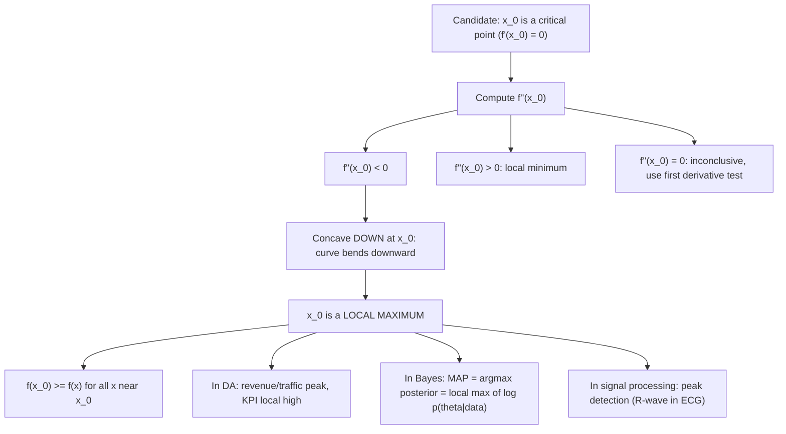

# Local Maximum

$$
f'(x_0) = 0
$$

and $f''(x_0) < 0$ (Concave downward).

## Deep Breakdown

What it tells me *(Situation Awareness)*:
A local maximum at $x_0$ occurs when the function peaks in a neighborhood of $x_0$: nearby values are lower. The second derivative test gives a clean algebraic condition: $f'(x_0) = 0$ (flat tangent — critical point) AND $f''(x_0) < 0$ (concave down — the curve is "bending downward"). Geometrically: an upside-down bowl shape at $x_0$. In DA/DS: local maxima are directly relevant to peak detection in time series (traffic spikes, revenue peaks, sensor bursts); KPI analysis (day with highest conversion rate in a campaign); in ML, the loss function has NO local maxima that matter — you want minima. But the negative of the loss ($-L$) has local maxima at the same points as $L$'s local minima. In Bayesian inference, the MAP estimate maximizes the posterior, which has a local maximum at the mode. In feature engineering: local maxima are used as shape descriptors for one-dimensional signals (EEG, audio, accelerometer).

## Flowchart



## Real-world use

### Where it is used

MAP estimation: $\hat{\theta}_{MAP} = \text{argmax}_\theta[\log p(\theta|X)] = \text{argmax}_\theta[\log p(X|\theta) + \log p(\theta)]$ — the MAP is a local maximum of the log-posterior; ROC curve: the optimal threshold maximizes the difference $\text{TPR} - \text{FPR}$, found at the local max of a derived curve; A/B test metric: day with maximum conversion rate in a time series; revenue seasonality: quarterly peak; peak detection algorithms (scipy `find_peaks`) implement the local max condition numerically; gradient ascent maximizes a function (e.g., policy gradient in RL: maximize expected reward).

### Problem it solves

Given a function, identify where it achieves a local peak — useful for finding optimal operating points, detecting events in time series, and computing MAP estimates. The second derivative test provides a one-shot algebraic classification: rather than plotting the function or testing neighborhood points, you evaluate two derivatives at one point.

### How it solves the problem

Combine two conditions: (1) $f'(x_0) = 0$ — the function is flat at $x_0$, so it is not currently rising or falling; (2) $f''(x_0) < 0$ — the rate of change of the slope is negative, meaning the function is curving downward. Together: the function was rising before $x_0$ (since $f' > 0$ to the left of $x_0$ when $f'' < 0$) and falling after (since $f' < 0$ to the right of $x_0$) — a peak.

### Example in a business

A DS models daily conversion rate $C(t) = -0.002t^2 + 0.12t + 0.5$ during a 30-day campaign. $C'(t) = -0.004t + 0.12 = 0 \Rightarrow t = 30$. $C''(t) = -0.004 < 0$ at all $t$. By the second derivative test: $t = 30$ is a local maximum. $C(30) = -0.002(900) + 0.12(30) + 0.5 = -1.8 + 3.6 + 0.5 = 2.3$. The DS concludes: conversion peaks at day 30 and reports this to the campaign manager as the optimal ad spend window.

## The formula, piece by piece

- $f'(x_0) = 0$: the derivative is zero — $x_0$ is a critical point, the tangent is horizontal
- $f''(x_0) < 0$: the second derivative is strictly negative — the function is concave down at $x_0$
- Local maximum: $f(x_0) \geq f(x)$ for all $x$ in some open interval around $x_0$
- "Local": the peak is relative to nearby values; there may be larger values elsewhere (global maximum is elsewhere)
- The condition is sufficient (not necessary): $f''(x_0) < 0$ guarantees a local max; some local maxima have $f''(x_0) = 0$ (test inconclusive)
- In $\mathbb{R}^n$: local max when $\nabla f(x_0) = \mathbf{0}$ and Hessian $H(x_0)$ is negative definite (all eigenvalues strictly negative)
- Gradient ascent analog: update $x \leftarrow x + \alpha \nabla f$ to climb toward a local maximum

## The formula in words

"A local maximum occurs when the function has a flat tangent (derivative = 0) and is bending downward (second derivative < 0). It is like standing at the top of a hill: the slope is zero at the summit, and the ground curves downward in all directions around you." Tiny trace: $f(x) = -x^2 + 4x$. $f'(x) = -2x + 4 = 0 \Rightarrow x = 2$. $f''(x) = -2 < 0$. Local max at $x = 2$, $f(2) = -4 + 8 = 4$. Nearby: $f(1) = 3 < 4$, $f(3) = 3 < 4$. $\checkmark$

## Critical Concepts

- **Local vs. global maximum:** a local max is only a peak in a neighborhood; a global max is the highest value on the entire domain. For convex functions, every local min is global; for concave functions, every local max is global. In ML: the loss is typically non-convex; gradient descent may find different local minima depending on initialization. For likelihood-based models, the log-posterior is often concave (for well-specified GLMs), so local maxima of the log-posterior are global maxima.
- **Second derivative test failure:** if $f''(x_0) = 0$, the test gives no information. Example: $f(x) = x^4$ has $f'(0) = f''(0) = 0$, but $x = 0$ is a global minimum. $f(x) = -x^4$ has the same derivatives, but $x = 0$ is a global maximum. $f(x) = x^3$ has the same, but $x = 0$ is neither. Must use the first derivative test (sign of $f'$ on each side) to classify.
- **MAP estimation = local max of log-posterior:** in Bayesian ML, the MAP estimate satisfies $\nabla_\theta[\log p(X|\theta) + \log p(\theta)] = 0$ and the Hessian of the log-posterior is negative definite (for strictly log-concave posteriors). The negative of the Hessian is the observed Fisher information plus the prior precision — this is the curvature used in the Laplace approximation to the posterior. The Laplace approximation fits a Gaussian at the MAP, using $-H^{-1}$ as the covariance.
- **Gradient ascent vs. gradient descent:** to find a local maximum of $f$, use gradient ascent: $x_{t+1} = x_t + \alpha \nabla f(x_t)$. This is gradient descent on $-f$. In RL (policy gradient methods), you maximize expected reward $J(\theta)$ using gradient ascent: $\theta_{t+1} = \theta_t + \alpha \nabla J(\theta_t)$. The convergence criterion is $\|\nabla J\| \approx 0$ — near a critical point (hopefully a local maximum of $J$).
- **Concavity and Jensen's inequality:** a function that is concave ($f'' < 0$ everywhere, i.e., all local maxima, no local minima) satisfies Jensen's inequality in the reverse direction: $f(\mathbb{E}[X]) \geq \mathbb{E}[f(X)]$.

Log is concave, which is why $\log(\mathbb{E}[X]) \geq \mathbb{E}[\log X]$ (Jensen applied to $\log$). This inequality is used in deriving the ELBO in variational inference and the EM algorithm.

## Step-by-step calculation (tiny example)

*Find and verify the local maximum of $f(x) = 2x^3 - 3x^2 - 12x + 5$ on $\mathbb{R}$.*

*Step 1: Find critical points.*
$f'(x) = 6x^2 - 6x - 12 = 6(x^2 - x - 2) = 6(x-2)(x+1) = 0$.
Critical points: $x = -1$ and $x = 2$.

*Step 2: Second derivative test.*
$f''(x) = 12x - 6$.
At $x = -1$: $f''(-1) = -12 - 6 = -18 < 0$. Local maximum.
At $x = 2$: $f''(2) = 24 - 6 = 18 > 0$. Local minimum.

*Step 3: Compute function values.*
$f(-1) = 2(-1) - 3(1) - 12(-1) + 5 = -2 - 3 + 12 + 5 = 12$. Local max value.
$f(2) = 2(8) - 3(4) - 12(2) + 5 = 16 - 12 - 24 + 5 = -15$. Local min value. Verify: $f(0) = 5 < 12 = f(-1)$ and $f(-2) = 2(-8) - 3(4) + 24 + 5 = -16 - 12 + 24 + 5 = 1 < 12$. Local max confirmed. $\checkmark$

## Code examples

### Beginner example (Python)

```python
import numpy as np
from scipy.signal import find_peaks   # Second derivative test for local maxima

def classify_critical_points( f, f_prime, f_double_prime, search_range: tuple[float, float], n_grid: int = 2000 ) -> None:
    """Find and classify critical points of f using the second derivative test."""
    from scipy.optimize import brentq
    x_grid = np.linspace(search_range[0], search_range[1], n_grid)
    fp_vals = f_prime(x_grid)
    print(f"{'x_crit':>10} {'f(x)':>10} {'f_prime':>10} {'f_pp':>10} {'Type':>15}")
    for i in range(len(x_grid) - 1):
        if fp_vals[i] * fp_vals[i + 1] < 0:
            x_crit = brentq(f_prime, x_grid[i], x_grid[i + 1])
            fpp = f_double_prime(x_crit)
            if fpp < -1e-8:
                label = "LOCAL MAX"
            elif fpp > 1e-8:
                label = "LOCAL MIN"
            else:
                label = "inconclusive"
            print(f"{x_crit:>10.4f} {f(x_crit):>10.4f} {f_prime(x_crit):>10.2e} {fpp:>10.4f} {label:>15}")
        f = lambda x: 2*x**3 - 3*x**2 - 12*x + 5
fp = lambda x: 6*x**2 - 6*x - 12
fpp = lambda x: 12*x - 6
print("Local Maximum: f'(x0) = 0 and f''(x0) < 0")
print("\nf(x) = 2x^3 - 3x^2 - 12x + 5")
classify_critical_points(f, fp, fpp, (-3.0, 4.0))   # Peak detection in a time series (local max condition numerically)
print("\n--- Peak detection in a time series ---")
np.random.seed(42)
n_days = 60
dau = ( 10000 + 2000 * np.sin(2 * np.pi * np.arange(n_days) / 20)   # ~20-day cycle + 500 * np.sin(2 * np.pi * np.arange(n_days) /
    7)   # weekly pattern +
np.random.randn(n_days) * 150
)
peak_indices, peak_properties = find_peaks(dau, prominence=400, distance=5)
print(f"{'Peak day':>10} {'DAU':>10} {'Context':>30}")
for idx in peak_indices: context = "local max (f'>0 before, f'<0 after)" print(f"{idx+1:>10} {dau[idx]:>10.0f} {context:>30}")
print(f"\nTotal peaks found: {len(peak_indices)}")
print(f"Average DAU at peaks: {dau[peak_indices].mean():.0f}")
print(f"Average DAU overall: {dau.mean():.0f}")
```

### Beginner example (R)

```r
# Local Maximum: f'(x0) = 0, f''(x0) < 0
f <- function(x) 2*x^3 - 3*x^2 - 12*x + 5
fp <- function(x) 6*x^2 - 6*x - 12
fpp <- function(x) 12*x - 6  # Find critical points via sign changes in f'
x_grid <- seq(-3, 4, length.out = 2000)
fp_vals <- fp(x_grid)
cat("Local Maximum: f'(x0)=0 and f''(x0)<0\n\n")
cat(sprintf("%-10s %-10s %-10s %-10s %-15s\n", "x_crit", "f(x)", "f'(x)", "f''(x)", "Type"))
for (i in 1:(length(x_grid) - 1)) { if (fp_vals[i] * fp_vals[i + 1] < 0) { x_crit <- uniroot(fp, lower = x_grid[i], upper = x_grid[i + 1])$root
    fpp_val <- fpp(x_crit)
    type <- if (fpp_val < -1e-8) "LOCAL MAX"
    else
    if (fpp_val > 1e-8) "LOCAL MIN"
    else "inconclusive"
    cat(sprintf("%-10.4f %-10.4f %-10.4f %-10.4f %-15s\n", x_crit, f(x_crit), fp(x_crit), fpp_val, type))
  }
}  # Simple peak detection: find local maxima in a vector
find_local_maxima <- function(x_vec) { which(x_vec > c(-Inf, x_vec[-length(x_vec)]) & x_vec > c(x_vec[-1], -Inf))
}
set.seed(42)
dau <- 10000 + 2000 * sin(2 * pi * 1:60 / 20) + rnorm(60, sd = 150)
peaks <- find_local_maxima(dau)
cat(sprintf("\nPeak days: %s\n", paste(peaks, collapse=", ")))
cat(sprintf("DAU at peaks: %s\n", paste(round(dau[peaks]), collapse=", ")))
```

### Professional example (Python)

```python
import numpy as np
from scipy.optimize import minimize_scalar
from sklearn.datasets import make_classification
from sklearn.preprocessing import StandardScaler
from sklearn.linear_model import LogisticRegression
np.random.seed(42)   # -- Local Maximum: MAP estimate as local max of log-posterior --
# Use case: A DS fits a Bayesian logistic regression with a Gaussian prior.
# The MAP estimate is the local maximum of the log-posterior:
# log p(w|X, y) = log
p(y|X, w) + log
p(w) - log
p(y|X)
# At MAP: gradient = 0, Hessian = negative definite (local max of log-posterior).
# The Hessian at MAP = -(Fisher information + prior precision) = curvature of the peak.
N = 300
DIM = 4
PRIOR_PRECISION = 1.0   # L2 regularization = prior precision
X_raw, y = make_classification(n_samples=N, n_features=DIM, n_informative=DIM, n_redundant=0, random_state=42)
scaler = StandardScaler()
X = scaler.fit_transform(X_raw)

def sigmoid_stable(z: np.ndarray) -> np.ndarray:
    return np.where(z >= 0, 1.0 / (1.0 + np.exp(-z)), np.exp(z) / (1.0 + np.exp(z)))

def log_posterior(w: np.ndarray, X: np.ndarray, y: np.ndarray, precision: float) -> float:
    """log p(w|X,y) = log-likelihood + log-prior (Gaussian N(0,1/precision))."""
    p = sigmoid_stable(X @ w)
    p = np.clip(p, 1e-12, 1 - 1e-12)
    log_lik = float(np.sum(y * np.log(p) + (1 - y) * np.log(1 - p)))
    log_prior = -0.5 * precision * float(np.dot(w, w))
    return log_lik + log_prior

def log_posterior_gradient(w: np.ndarray, X: np.ndarray, y: np.ndarray, precision: float) -> np.ndarray:
    """Gradient = 0 at the MAP (local max of log-posterior)."""
    p = sigmoid_stable(X @ w)
    return X.T @ (y - p) - precision * w   # score function - ridge penalty

def log_posterior_hessian(w: np.ndarray, X: np.ndarray, precision: float) -> np.ndarray:
    """H = -X^T diag(p*(1-p)) X - precision*I. Negative definite at MAP => local max."""
    p = sigmoid_stable(X @ w)
    weights = p * (1 - p)
    return -(X * weights[:, None]).T @ X - precision * np.eye(len(w))   # Gradient ascent to find MAP (local max of log-posterior)
ALPHA = 0.1
N_STEPS = 300
w_map = np.zeros(DIM)
log_posts = []
grad_norms = []
for step in range(N_STEPS):
    lp = log_posterior(w_map, X, y, PRIOR_PRECISION)
grad = log_posterior_gradient(w_map, X, y, PRIOR_PRECISION)
log_posts.append(lp)
grad_norms.append(float(np.linalg.norm(grad)))
w_map += ALPHA * grad   # gradient ASCENT: climb to local max # Evaluate at MAP
H = log_posterior_hessian(w_map, X, PRIOR_PRECISION)
eigenvalues = np.linalg.eigvalsh(H)
lp_final = log_posterior(w_map, X, y, PRIOR_PRECISION)
grad_final = log_posterior_gradient(w_map, X, y, PRIOR_PRECISION)
print("Local Maximum: MAP Estimate as Local Max of Log-Posterior")
print(f"\nN={N}, DIM={DIM}, prior precision={PRIOR_PRECISION}")
print(f"\nGradient ascent convergence to local max (log-posterior peak):")
print(f"{'Step':>6} {'log-posterior':>15} {'|grad|':>12} {'Status':>20}")
for step in [0, 10, 30, 100, 200, 299]:
    status = "at local max" if grad_norms[step] < 0.05 else "ascending"
print(f"{step+1:>6} {log_posts[step]:>15.4f} {grad_norms[step]:>12.6f} {status:>20}")
print(f"\nVerification of local maximum at MAP:")
print(f" Gradient norm: {np.linalg.norm(grad_final):.2e} (≈ 0: critical point)")
print(f" Hessian eigenvalues: {np.round(eigenvalues, 4)}")
print(f" All negative: {np.all(eigenvalues < 0)}")
print(f" Conclusion: {'Local MAXIMUM of log-posterior (MAP estimate)' if np.all(eigenvalues < 0) else 'NOT a local max'}")
print(f"\nLaplace approximation: posterior ≈ N(w_MAP, -H^(-1))")
posterior_cov = np.linalg.inv(-H)
print(f" Posterior variance per parameter: {np.diag(posterior_cov).round(4)}")
print(f" (Higher variance = less curvature = flatter peak at MAP)")
```

---

*Source: 1300 p. 228*
