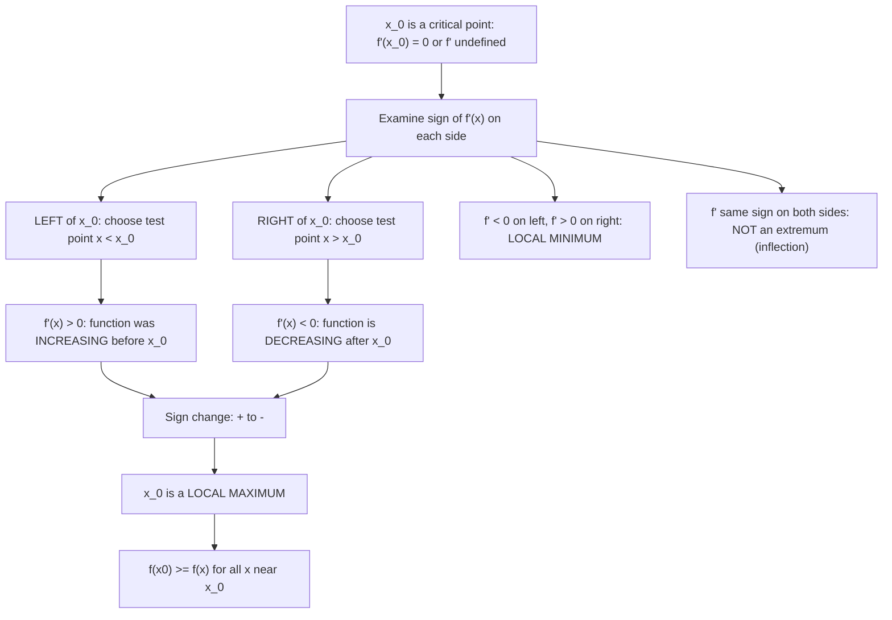

# Maximum at $x 0$

$$
f'(x)
$$

changes from $+$ to $-$ across $x_0$.

## Deep Breakdown

What it tells me *(Situation Awareness)*:
This is the first derivative test for a local maximum. Rather than computing a second derivative, you examine the sign of $f'$ on both sides of the critical point $x_0$: if $f' > 0$ immediately to the left (function was rising) and $f' < 0$ immediately to the right (function starts falling), then $x_0$ is a local maximum. This is the more general and robust test: it works even when $f''(x_0) = 0$ or $f''$ does not exist. In DA/DS: this is the computational analog of `find_peaks` — a peak is any index where the signal transitions from increasing to decreasing. In practice, discrete time series peak detection is always the first derivative test: check if $s_{t} > s_{t-1}$ (positive finite difference = positive "derivative") and $s_{t} > s_{t+1}$ (next step is falling). Gradient descent plateaus can exhibit a sign change in the directional derivative, signaling a local maximum in the loss path (which should not happen in properly functioning gradient descent, so a sign change in the gradient along the search direction is a diagnostic).

## Flowchart



## Real-world use

### Where it is used

Peak detection in time series: $s_t > s_{t-1}$ and $s_t > s_{t+1}$ is the discrete first derivative test for maximum; works for non-differentiable or piecewise-defined functions (ReLU networks, absolute value regularization); polynomial regression: when $f''$ is complicated or zero, sign test of $f'$ is more reliable; scipy `find_peaks` implements this sign test; ROC analysis: the Youden J statistic finds the optimal threshold at the maximum of $(TPR - FPR)$, identified via sign change of the derivative of $(TPR - FPR)$; gradient sign analysis in training runs (detecting divergence).

### Problem it solves

The second derivative test fails (is inconclusive) when $f''(x_0) = 0$, and is inapplicable when $f''$ does not exist. The first derivative test always works, requires only the sign of $f'$ near $x_0$, and handles corners and cusps where $f'$ is undefined at $x_0$ but exists on both sides.

### How it solves the problem

Pick a test point $x_L < x_0$ close to $x_0$ and check $\text{sign}(f'(x_L))$. Pick $x_R > x_0$ and check $\text{sign}(f'(x_R))$. If $f'(x_L) > 0$ and $f'(x_R) < 0$: local max. If $f'(x_L) < 0$ and $f'(x_R) > 0$: local min. If same sign: neither (inflection).

### Example in a business

A DS computes $f'(x) = x^{1/3}(x-4)$, which is zero at $x = 0$ and $x = 4$, and undefined at $x = 0$ (corner). At $x = 0$: test $x_L = -0.1$: $f'(-0.1) = (-0.1)^{1/3}(-4.1) = (\text{neg})(\text{neg}) > 0$. Test $x_R = 0.1$: $f'(0.1) = (0.1)^{1/3}(-3.9) < 0$. Sign change $+ \to -$: local max. The second derivative at $x=0$ is undefined. The first derivative test is the only applicable test here.

## The formula, piece by piece

- $f'(x)$: the derivative, encoding the slope of $f$ at each point
- "changes from $+$ to $-$": strictly, there exists $\delta > 0$ such that $f'(x) > 0$ for $x \in (x_0 - \delta, x_0)$ and $f'(x) < 0$ for $x \in (x_0, x_0 + \delta)$
- "across $x_0$": at or around the critical point $x_0$ — $f'$ may be zero or undefined at $x_0$ itself
- Sign convention: $f' > 0 \Leftrightarrow f$ is increasing; $f' < 0 \Leftrightarrow f$ is decreasing
- Discrete analog: for a sequence $\{s_t\}$: local max at index $t^*$ if $s_{t^*} > s_{t^*-1}$ AND $s_{t^*} > s_{t^*+1}$
- This is equivalent to: $\Delta s_{t^*} = s_{t^*} - s_{t^*-1} > 0$ (positive finite difference before) and $\Delta s_{t^*+1} = s_{t^*+1} - s_{t^*} < 0$ (negative finite difference after)
- Relationship to second derivative test: if $f'(x_0) = 0$ and $f'' $ exists and is continuous, sign change $+ \to -$ implies $f''(x_0) \leq 0$

## The formula in words

"A local maximum at $x_0$ is identified by watching whether the function was rising just before $x_0$ and falling just after. If the slope changes from positive to negative as you cross $x_0$, you have found a peak — like cresting a hill." Tiny trace: $f(x) = -(x-2)^2 + 3$. $f'(x) = -2(x-2)$. Left of $x=2$: $x=1$, $f'(1) = 2 > 0$ (rising). Right of $x=2$: $x=3$, $f'(3) = -2 < 0$ (falling). Sign change $+ \to -$: local max at $x=2$. $f(2) = 3$. $\checkmark$

## Critical Concepts

- **Handles non-differentiable critical points:** the absolute value $f(x) = -|x|$ has a local max at $x=0$ where $f'(0)$ does not exist. Left: $f'(x) = 1 > 0$. Right: $f'(x) = -1 < 0$. Sign change $+ \to -$: local max at $x=0$. The second derivative test cannot handle this case.
- **Strictly superior to the second derivative test in ambiguous cases:** when $f''(x_0) = 0$, the second derivative test fails. Example: $f(x) = -x^4$. $f'(0) = 0$, $f''(0) = 0$ (inconclusive). First derivative test: $f'(x) = -4x^3$. Left ($x < 0$): $-4x^3 > 0$. Right ($x > 0$): $-4x^3 < 0$. Sign change $+ \to -$: local (and global) maximum at $x = 0$.
- **Discrete peak detection is the first derivative test:** `scipy.signal.find_peaks` checks that $s[i] > s[i-1]$ and $s[i] > s[i+1]$ (with optional additional constraints on prominence, width, height). This is exactly the discrete first derivative test. Adding a `prominence` parameter filters out shallow local maxima — equivalent to requiring the sign change to be "significant enough."
- **Sign of gradient in gradient descent:** if the gradient $\nabla L$ changes sign along the update trajectory (parameter overshoots), the loss has been momentarily maximized along that direction, then the optimizer is descending again. Oscillation in the loss curve corresponds to the gradient repeatedly changing sign. Momentum dampens this by accumulating velocity and reducing sign changes.
- **First derivative test for non-stationary time series trends:** in trend analysis, a business metric that has $\Delta s_t > 0$ for several weeks then $\Delta s_t < 0$ is "peaked." The week of the sign change is the local maximum.

This is the operational definition of a peak in a KPI dashboard, without any calculus being explicitly computed.

## Step-by-step calculation (tiny example)

*Apply the first derivative test to classify all critical points of $f(x) = x^{2/3}(x - 5)$.*

*Step 1: Find critical points.*
$f'(x) = \frac{2}{3}x^{-1/3}(x-5) + x^{2/3} = x^{-1/3}\left[\frac{2}{3}(x-5) + x\right] = x^{-1/3}\left[\frac{5}{3}x - \frac{10}{3}\right] = \frac{5(x-2)}{3x^{1/3}}$.
$f'(x) = 0$ at $x = 2$. $f'$ undefined at $x = 0$. Critical points: $x = 0$ and $x = 2$.

*Step 2: Sign of $f'$ in each interval.*
Intervals: $(-\infty, 0)$, $(0, 2)$, $(2, \infty)$.
- $x = -1$: $f'(-1) = 5(-3)/(3(-1)) = (-15)/(-3) = 5 > 0$.
- $x = 1$: $f'(1) = 5(-1)/(3\cdot1) = -5/3 < 0$.
- $x = 3$: $f'(3) = 5(1)/(3\cdot3^{1/3}) > 0$.

*Step 3: Classify.*
- At $x = 0$: $f'$ changes $+ \to -$. Local maximum. $f(0) = 0$.
- At $x = 2$: $f'$ changes $- \to +$.

Local minimum. $f(2) = 2^{2/3}(-3) \approx -4.76$. $\checkmark$

## Code examples

### Beginner example (Python)

```python
import numpy as np
from scipy.signal import find_peaks

def first_derivative_test(f_prime, x_crit: float, delta: float = 0.01) -> str:
    """ First derivative test: check sign of f' just left and just right of x_crit. Handles non-differentiable critical points. """
    sign_left = np.sign(f_prime(x_crit - delta))
    sign_right = np.sign(f_prime(x_crit + delta))
    if sign_left > 0 and sign_right < 0:
        return "LOCAL MAXIMUM (+ -> -)"
    elif sign_left < 0 and sign_right > 0:
        return "LOCAL MINIMUM (- -> +)"
    else:
        return f"NOT an extremum (no sign change: {'+' if sign_left > 0 else '-'} -> {'+' if sign_right > 0 else '-'})"   # Example 1: f(x) = -(x-2)^2 + 3 (standard case)
f = lambda x: -(x - 2)**2 + 3
f_prime = lambda x: -2 * (x - 2)
print("First Derivative Test for Local Maximum: f' changes + to -")
print("\nf(x) = -(x-2)^2 + 3")
for x_crit in [2.0]:
    result = first_derivative_test(f_prime, x_crit)
print(f" x = {x_crit}: {result}, f(x0) = {f(x_crit):.4f}")   # Example 2: -x^4 (second derivative test fails: f''(0) = 0)
f2 = lambda x: -x**4
f2_prime = lambda x: -4 * x**3
f2_pp = lambda x: -12 * x**2
print("\nf(x) = -x^4 (second derivative test inconclusive at x=0)")
print(f" f''(0) = {f2_pp(0):.1f} (inconclusive: both +/- possible)")
result = first_derivative_test(f2_prime, 0.0)
print(f" First derivative test: {result}")   # Example 3: Discrete first derivative test = peak detection in time series
print("\n--- Discrete first derivative test: peak detection in campaign CTR ---")
np.random.seed(42)
n_days = 30
ctr = 0.02 + 0.015 * np.sin(2 * np.pi * np.arange(n_days) / 10) + np.random.randn(n_days) * 0.003
peak_indices, _ = find_peaks(ctr, prominence=0.005)
print(f"Campaign daily CTR (30 days)")
print(f"{'Day':>6} {'CTR':>10} {'Delta_prev':>12} {'Delta_next':>12} {'Peak?':>8}")
for i in range(1, n_days - 1):
    delta_prev = ctr[i] - ctr[i - 1]
delta_next = ctr[i + 1] - ctr[i]
is_peak = (delta_prev > 0) and (delta_next < 0) and (i in peak_indices)
if is_peak or abs(delta_prev) > 0.008:
    print(f"{i+1:>6} {ctr[i]:>10.5f} {delta_prev:>12.5f} {delta_next:>12.5f} {'PEAK' if is_peak else '':>8}")
print(f"\nPeak CTR days: {[p+1 for p in peak_indices]}")
print(f"Max CTR: {ctr.max():.5f} on day {np.argmax(ctr)+1}")
```

### Beginner example (R)

```r
# First derivative test for local maximum: f' changes + to -
first_derivative_test <- function(f_prime, x_crit, delta = 0.01) { sign_left <- sign(f_prime(x_crit - delta))
  sign_right <- sign(f_prime(x_crit + delta))
  if (sign_left > 0 && sign_right < 0) "LOCAL MAX (+ -> -)"
  else
  if (sign_left < 0 && sign_right > 0) "LOCAL MIN (- -> +)"
  else "NOT an extremum"
}  # Standard case
f <- function(x) -(x - 2)^2 + 3
f_prime <- function(x) -2 * (x - 2)
result <- first_derivative_test(f_prime, 2.0)
cat(sprintf("f(x) = -(x-2)^2+3, x=2: %s, f(2)=%.1f\n\n", result, f(2.0)))  # Case where second derivative test fails
f2 <- function(x) -x^4
f2_prime <- function(x) -4 * x^3
f2_pp <- function(x) -12 * x^2
cat(sprintf("f(x) = -x^4, f''(0) = %.1f (inconclusive)\n", f2_pp(0)))
cat(sprintf("First derivative test at x=0: %s\n\n", first_derivative_test(f2_prime, 0.0)))  # Discrete: peak detection in time series
set.seed(42)
n_days <- 30
ctr <- 0.02 + 0.015 * sin(2 * pi * 1:n_days / 10) + rnorm(n_days, sd = 0.003)
cat("Discrete first derivative test: peaks in CTR time series\n")
cat(sprintf("%-6s %-10s %-12s %-12s %-8s\n", "Day", "CTR", "Delta_prev", "Delta_next", "Peak?"))
for (i in 2:(n_days - 1)) { d_prev <- ctr[i] - ctr[i - 1]
  d_next <- ctr[i + 1] - ctr[i]
  if (d_prev > 0 && d_next < 0) { cat(sprintf("%-6d %-10.5f %-12.5f %-12.5f %-8s\n", i, ctr[i], d_prev, d_next, "PEAK"))
  }
}
```

### Professional example (Python)

```python
import numpy as np
from sklearn.datasets import make_regression
from sklearn.preprocessing import StandardScaler
np.random.seed(42)   # -- First derivative test: gradient sign analysis in training to detect loss maxima --
# Use case: A DS monitors the sign of the gradient component along the update direction.
# In well-behaved gradient descent, the directional derivative dL/dt = grad . update_dir
# should always be negative (descending). If a sign change is detected (gradient dot
# update direction changes from neg to pos), the optimizer has overshot a minimum --
# the loss locally maximized along that direction momentarily (first deriv test: + to -)
# then starts descending again. This is a diagnostic for oscillation and too-large LR.
N = 150
DIM = 4
X_raw, y = make_regression(n_samples=N, n_features=DIM, noise=0.5, random_state=42)
scaler = StandardScaler()
X = scaler.fit_transform(X_raw)
y = y / y.std()

def mse_loss_grad(w: np.ndarray, X: np.ndarray, y: np.ndarray) -> tuple[float, np.ndarray]:
    r = y - X @ w
    return float(np.mean(r**2)), -2.0 / len(y) * X.T @ r   # Run gradient descent with two learning rates: stable and too-large
print("First Derivative Test: Gradient Sign Analysis in Training")
for alpha, label in [(0.05, "stable LR"), (0.8, "overshooting LR")]:
    w = np.zeros(DIM)
losses = []
sign_changes = []   # sign changes in directional derivative = loss local max along path
prev_grad = None
for step in range(60):
    loss, grad = mse_loss_grad(w, X, y)
update_dir = -grad   # gradient descent update direction
if prev_grad is not None:
    # Directional
    derivative = grad . update_dir   # If dot(prev_grad, grad) < 0: gradient reversed
sign = OVERSHOOT   # Geometrically: loss had a local MAX between prev step and current step
dot = float(np.dot(prev_grad, grad))
sign_changed = dot < 0
sign_changes.append((step, sign_changed, loss))
prev_grad = grad.copy()
losses.append(loss)
w += alpha * update_dir   # descent
n_overshoots = sum(1 for _, changed, _ in sign_changes if changed)
print(f"\nalpha = {alpha} ({label})[[")
print(f"]] Overshoots (gradient sign changes = loss local max along path): {n_overshoots}")
print(f" Final loss: {losses[-1]:.6f}")
print(f" {'Step':>6} {'Loss':>10} {'Overshoot?':>12}")
for step in range(min(15, len(sign_changes))):
    _, changed, loss_val = sign_changes[step]
if changed:
    print(f" {step+1:>6} {loss_val:>10.6f} {'YES (+ -> -)':>12}")
if n_overshoots == 0:
    print(f" No overshoots: directional gradient consistently negative (descending)")
```

---

*Source: 1300 p. 227*
