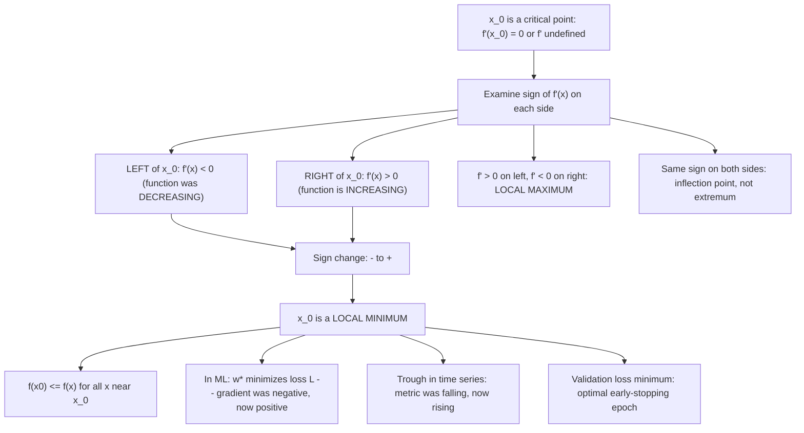

# Minimum at $x 0$

$$
f'(x)
$$

changes from $-$ to $+$ across $x_0$.

## Deep Breakdown

What it tells me *(Situation Awareness)*:
This is the first derivative test for a local minimum. The sign of $f'$ transitions from negative (function was decreasing) to positive (function is increasing) as you cross $x_0$: the function descends into a valley, touches the floor at $x_0$, then rises again. This is the most general test for a local minimum — more robust than the second derivative test because it works when $f''(x_0) = 0$ or $f''$ does not exist. In ML: gradient descent converges to a point where $\nabla L \approx 0$ with sign change of the component gradients (locally). In practice, gradient descent oscillates across a minimum in directions of high curvature until momentum or adaptive step sizes smooth it out. In DA: trough detection in time series is the discrete version — a point is a trough if $s_t < s_{t-1}$ (was falling) and $s_t < s_{t+1}$ (starts rising). Identifying local minima in a cost or bounce-rate time series signals operational issues; finding the minimum of a validation loss curve over epochs determines the optimal model checkpoint.

## Flowchart



## Real-world use

### Where it is used

Early stopping: the validation loss minimum is the epoch where $\Delta\text{val_loss}$ changes sign from $-$ to $+$ (was decreasing, starts increasing) — the first derivative test applied to the loss-vs-epoch curve; gradient descent convergence: the loss descends, reaches a trough ($-$ to $+$ sign change), indicating a local minimum was found; scipy `find_peaks(-signal)` = trough detection; support level analysis in financial time series; minimum of cross-validation error over a hyperparameter grid; minimum bounce rate or maximum session duration day in product analytics.

### Problem it solves

The second derivative test is inconclusive when $f''(x_0) = 0$ and inapplicable when $f''$ doesn't exist. The first derivative test handles all cases: you only need to know the sign of $f'$ on each side, not its rate of change.

### How it solves the problem

Choose test points $x_L < x_0 < x_R$ close to $x_0$. Compute $\text{sign}(f'(x_L))$ and $\text{sign}(f'(x_R))$. If $f'(x_L) < 0$ and $f'(x_R) > 0$: local minimum at $x_0$. The function was descending toward $x_0$ and is now ascending away — $x_0$ is the bottom of a valley.

### Example in a business

A DS monitors validation loss over 50 training epochs: $\text{val_loss} = [0.8, 0.75, 0.65, ..., 0.31, 0.30, 0.31, 0.33, ...]$. The sign of $\Delta\text{val_loss}$ changes from $-$ to $+$ at epoch 28. By the first derivative test: epoch 28 is a local minimum of the validation loss. The DS sets early stopping to restore the checkpoint at epoch 28. This is the first derivative test applied to a discrete sequence — no calculus needed, just detecting the sign change.

## The formula, piece by piece

- $f'(x)$: the derivative, encoding whether $f$ is increasing or decreasing at each point
- "changes from $-$ to $+$": there exists $\delta > 0$ such that $f'(x) < 0$ for $x \in (x_0 - \delta, x_0)$ and $f'(x) > 0$ for $x \in (x_0, x_0 + \delta)$
- "across $x_0$": the critical point itself may have $f'(x_0) = 0$ (stationary) or $f'(x_0)$ undefined (corner/cusp)
- Sign convention: $f' < 0 \Leftrightarrow f$ is decreasing; $f' > 0 \Leftrightarrow f$ is increasing
- Discrete analog: local min at index $t^*$ if $s_{t^*} < s_{t^*-1}$ AND $s_{t^*} < s_{t^*+1}$ (equivalently: $\Delta s_{t^*} < 0$ and $\Delta s_{t^*+1} > 0$)
- Relationship to second derivative test: sign change $- \to +$ at a differentiable critical point implies $f''(x_0) \geq 0$; strict sign change implies $f''(x_0) > 0$ if $f''$ exists and is nonzero
- Complete first derivative test: combine both directions — $(-\to+)$: min; $(+\to-)$: max; no change: saddle/inflection

## The formula in words

"A local minimum occurs when the function arrives at $x_0$ from below (decreasing, slope negative) and then starts rising again (slope positive) after $x_0$. It is the bottom of a valley: you were going down the hill, you hit the lowest point, and now you are climbing again." Tiny trace: $f(x) = (x-3)^2$. $f'(x) = 2(x-3)$. At $x_L = 2$: $f'(2) = -2 < 0$. At $x_R = 4$: $f'(4) = 2 > 0$. Sign change $- \to +$: local min at $x=3$. $f(3) = 0$. $\checkmark$

## Critical Concepts

- **Works for non-smooth functions.** $f(x) = |x-2|$ has a local (global) minimum at $x=2$ where $f'(2)$ does not exist. Left derivative: $-1 < 0$. Right derivative: $+1 > 0$. Sign change $- \to +$: local minimum. The second derivative test cannot handle this.
- **Early stopping as the discrete first derivative test.** Training a neural network and saving the checkpoint at the minimum validation loss is operationally the first derivative test: stop when $\Delta\text{val_loss}$ changes from $-$ to $+$ (patience=1) or use patience $>1$ to confirm the sign change is not noise. The patience parameter is analogous to requiring the sign change to persist over several points.
- **Gradient descent oscillation.** If the learning rate is too large, gradient descent overshoots the minimum repeatedly. The gradient (first derivative of loss) alternates sign at each step near the minimum — the optimizer crosses the valley floor back and forth. This is a sequence of first-derivative-test failures: the minimum is never "settled into." Smaller $\alpha$ or momentum prevents this.
- **Lasso non-differentiable minimum.** The Lasso penalty $|w_i|$ has a non-differentiable minimum at $w_i = 0$. The subgradient test: for a minimum at $w_i^* = 0$, the subdifferential condition requires $0 \in \partial(|w_i|)|_{w_i=0} = [-1, 1]$, i.e., the gradient of the data loss at $w_i = 0$ must be in $[-\lambda, \lambda]$. This is the generalized first derivative test for non-smooth functions.
- **Validation curve minimum = optimal hyperparameter.** When tuning a regularization strength $\lambda$ over a grid, the validation error forms a U-shape (convex) in $\log\lambda$: decreasing for small $\lambda$ (underfitting) and increasing for large $\lambda$ (overfitting).

The optimal $\lambda^*$ is the local minimum of the validation error curve, identified by the $- \to +$ sign change in $\Delta\text{val_error}$ across consecutive grid points.

## Step-by-step calculation (tiny example)

*Apply the first derivative test to classify all critical points of $f(x) = x^4 - 4x^3$.*

*Step 1: Find critical points.*
$f'(x) = 4x^3 - 12x^2 = 4x^2(x - 3) = 0$.
Critical points: $x = 0$ (double root, $f' = 0$ but also $f'' = 0$ here) and $x = 3$.

*Step 2: Sign of $f'$ in each interval.*
Intervals: $(-\infty, 0)$, $(0, 3)$, $(3, \infty)$.
- $x = -1$: $f'(-1) = 4(1)(-4) = -16 < 0$.
- $x = 1$: $f'(1) = 4(1)(-2) = -8 < 0$.
- $x = 4$: $f'(4) = 4(16)(1) = 64 > 0$.

*Step 3: Classify.*
- At $x = 0$: $f'$ goes $- \to -$. No sign change. Not an extremum (inflection point despite $f' = 0$). Second derivative test would give $f''(0) = 0$, confirming it is inconclusive.
- At $x = 3$: $f'$ changes $- \to +$.

Local minimum. $f(3) = 81 - 108 = -27$. $\checkmark$

## Code examples

### Beginner example (Python)

```python
import numpy as np

def first_derivative_test_min(f_prime, x_crit: float, delta: float = 0.01) -> str:
    """ First derivative test at x_crit. Returns classification based on sign of f' on each side. """
    sl = np.sign(f_prime(x_crit - delta))
    sr = np.sign(f_prime(x_crit + delta))
    if sl < 0 and sr > 0:
        return "LOCAL MIN (- -> +)"
    elif sl > 0 and sr < 0:
        return "LOCAL MAX (+ -> -)"
    else:
        return f"NOT extremum (no sign change: {'+' if sl > 0 else '-'} -> {'+' if sr > 0 else '-'})"   # Example 1: f(x) = x^4 - 4x^3 (second derivative test fails at x=0)
f = lambda x: x**4 - 4*x**3
f_prime = lambda x: 4*x**3 - 12*x**2
f_pp = lambda x: 12*x**2 - 24*x
print("First Derivative Test for Local Minimum: f' changes - to +")
print("\nf(x) = x^4 - 4x^3")
for x_crit in [0.0, 3.0]:
    result = first_derivative_test_min(f_prime, x_crit)
print(f" x = {x_crit}: {result}")
print(f" f(x0) = {f(x_crit):.4f}, f''(x0) = {f_pp(x_crit):.4f}")   # Example 2: |x - 2| (non-differentiable min)
f2 = lambda x: abs(x - 2)
f2_prime = lambda x: np.where(x < 2, -1.0, np.where(x > 2, 1.0, 0.0))
print("\nf(x) = |x - 2| (non-differentiable at x=2)")
result = first_derivative_test_min(f2_prime, 2.0)
print(f" x = 2: {result}, f(2) = {f2(2):.1f}")   # Example 3: Early stopping via discrete first derivative test
print("\n--- Early stopping: validation loss minimum via - -> + sign change ---")
np.random.seed(42)
n_epochs = 50   # Simulate val loss: decreases then increases (U-shape)
epoch_arr = np.arange(n_epochs)
val_loss = 1.0 / (1.0 + 0.1 * epoch_arr) + 0.015 * (epoch_arr - 25)**2 / 25 + np.random.randn(n_epochs) * 0.01
delta_loss = np.diff(val_loss)   # first differences
print(f"{'Epoch':>7} {'Val Loss':>10} {'Delta':>10} {'Sign':>6} {'Status':>20}")
best_epoch = None
for i in range(1, min(40, len(delta_loss))):
    sign_change = (delta_loss[i - 1] < 0) and (delta_loss[i] > 0)
    if sign_change and best_epoch is None:
        best_epoch = i
        status = "*** LOCAL MIN (- -> +) ***"
    elif abs(delta_loss[i]) > 0.005 or sign_change:
        status = "decreasing" if delta_loss[i] < 0 else "increasing"
    else:
        status = ""
    if status:
        print(f"{i+1:>7} {val_loss[i]:>10.5f} {delta_loss[i]:>10.5f} {'+' if delta_loss[i] > 0 else '-':>6} {status:>20}")
    print(f"\nOptimal checkpoint (early stopping): epoch {best_epoch + 1 if best_epoch else 'N/A'}")
print(f"Min val loss: {val_loss.min():.5f} at epoch {np.argmin(val_loss)+1}")
```

### Beginner example (R)

```r
# First derivative test for local minimum: f' changes - to +
first_deriv_test <- function(f_prime, x_crit, delta = 0.01) { sl <- sign(f_prime(x_crit - delta))
  sr <- sign(f_prime(x_crit + delta))
  if (sl < 0 && sr > 0) "LOCAL MIN (- -> +)"
  else
  if (sl > 0 && sr < 0) "LOCAL MAX (+ -> -)"
  else "NOT an extremum"
}  # f(x) = x^4 - 4x^3
f <- function(x) x^4 - 4*x^3
f_prime <- function(x) 4*x^3 - 12*x^2
f_pp <- function(x) 12*x^2 - 24*x
cat("First Derivative Test for Local Minimum\n\n")
for (x_crit in c(0.0, 3.0)) { result <- first_deriv_test(f_prime, x_crit)
  cat(sprintf("x = %.1f: %s (f = %.1f, f'' = %.1f)\n", x_crit, result, f(x_crit), f_pp(x_crit)))
}  # Early stopping via discrete first derivative test
cat("\n--- Early stopping: val loss minimum ---\n")
set.seed(42)
n_epochs <- 50
epoch <- 1:n_epochs
val_loss <- 1 / (1 + 0.1 * epoch) + 0.015 * (epoch - 25)^2 / 25 + rnorm(n_epochs, sd = 0.01)
d_loss <- diff(val_loss)
cat(sprintf("%-7s %-10s %-10s %-20s\n", "Epoch", "Val Loss", "Delta", "Status"))
best_epoch <- NULL
for (i in 2:(n_epochs - 1)) { sign_change <- d_loss[i - 1] < 0 && d_loss[i] > 0
  if (sign_change && is.null(best_epoch)) { best_epoch <- i
    cat(sprintf("%-7d %-10.5f %-10.5f %-20s\n", i+1, val_loss[i], d_loss[i], "*** LOCAL MIN ***"))
  }
}
cat(sprintf("Best checkpoint: epoch %d, val loss = %.5f\n", best_epoch + 1, val_loss[best_epoch]))
```

### Professional example (Python)

```python
import numpy as np
from sklearn.datasets import make_regression
from sklearn.preprocessing import StandardScaler
np.random.seed(42)   # -- First Derivative Test: finding the minimum validation loss over a lambda grid --
# Use case: A DS tunes Ridge regression regularization strength lambda via k-fold CV.
# The CV error forms a curve over log(lambda). The DS identifies the local minimum
# of this curve using the discrete first derivative test (sign change - to +).
# This is the continuous first derivative test applied to a discrete sequence.
N = 300
DIM = 8
K_FOLDS = 5
X_raw, y = make_regression(n_samples=N, n_features=DIM, noise=2.0, random_state=42)
scaler = StandardScaler()
X = scaler.fit_transform(X_raw)
y = y / y.std()

def ridge_cv_error(X: np.ndarray, y: np.ndarray, lam: float, k: int = 5) -> float:
    """K-fold cross-validation MSE for Ridge regression with regularization lam."""
    n = len(y)
    fold_size = n // k
    errors = []
    for fold in range(k):
        val_idx = np.arange(fold * fold_size, (fold + 1) * fold_size)
    train_idx = np.setdiff1d(np.arange(n), val_idx)
    X_tr, y_tr = X[train_idx], y[train_idx]
    X_va, y_va = X[val_idx], y[val_idx]
    A = X_tr.T @ X_tr / len(y_tr) + lam * np.eye(DIM)
    b = X_tr.T @ y_tr / len(y_tr)
    w_hat = np.linalg.solve(A, b)
    errors.append(float(np.mean((y_va - X_va @ w_hat)**2)))
    return float(np.mean(errors))
lambda_grid = np.logspace(-3, 2, 40)
cv_errors = np.array([ridge_cv_error(X, y, lam, K_FOLDS) for lam in lambda_grid])
delta_errors = np.diff(cv_errors)   # discrete first derivative of CV error curve # Apply first derivative test: find - to + sign change
optimal_lambda_idx = None
for i in range(1, len(delta_errors)):
    if delta_errors[i - 1] < 0 and delta_errors[i] > 0:
        optimal_lambda_idx = i
    break
print("First Derivative Test: Optimal Lambda via CV Error Minimum")
print(f"\nN={N}, DIM={DIM}, K={K_FOLDS} folds, lambda grid: 10^(-3) to 10^2")
print(f"\nDiscrete first derivative test on CV error curve:")
print(f"{'lambda':>12} {'CV Error':>12} {'Delta':>12} {'Sign':>6} {'Status':>25}")
for i in range(len(lambda_grid) - 1):
    delta = delta_errors[i]
is_min = (i == optimal_lambda_idx)
if is_min or abs(delta) > 0.003 or i < 3 or i > len(lambda_grid) - 4:
    status = "*** LOCAL MIN (- -> +) ***" if is_min else ("decreasing" if delta < 0 else "increasing")
print(f"{lambda_grid[i]:>12.5f} {cv_errors[i]:>12.6f} {delta:>12.6f} " f"{'+' if delta > 0 else '-':>6} {status:>25}")
if optimal_lambda_idx is not None:
    lam_opt = lambda_grid[optimal_lambda_idx]
print(f"\nOptimal lambda (first derivative test): {lam_opt:.5f}")
print(f"Minimum CV error: {cv_errors[optimal_lambda_idx]:.6f}")
print(f"Argmin CV error: {lambda_grid[np.argmin(cv_errors)]:.5f} (direct search, same)")
else:
    print("\nNo sign change found in range (monotone curve)")
```

---

*Source: 1300 p. 228*
