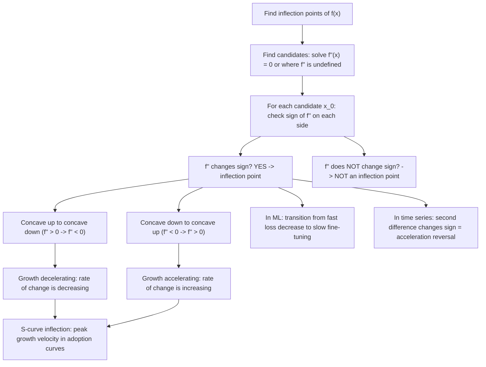

# Points of Inflection

$$
f''(x_0) = 0
$$

and $f''(x)$ changes sign across $x_0$.

## Deep Breakdown

What it tells me *(Situation Awareness)*:
A point of inflection (inflection point) at $x_0$ is where the concavity of $f$ reverses — from concave up to concave down (or vice versa). The second derivative is zero at $x_0$ AND changes sign across it. Neither a maximum nor a minimum: it is where the acceleration of change reverses direction. In DS/DA, inflection points are among the most actionable signals: an inflection point in a growth curve is where the growth rate peaks — the "S-curve" inflection point in product adoption is the moment of maximum velocity, after which growth begins to decelerate. In ML: the loss curve often has an inflection point early in training (the loss was accelerating downward, now decelerating — a transition to the fine-tuning phase). In epidemiology and market analysis: the inflection point of the cumulative case/revenue curve is the peak of the marginal rate — the point of maximum growth velocity before slowdown. Detecting inflection points is a leading indicator of trend reversal.

## Flowchart



## Real-world use

### Where it is used

S-curve (logistic) product adoption: the inflection point at $S(t) = K/2$ (half capacity) is where adoption velocity is maximum; epidemic curve inflection point: the date where new case growth starts decelerating (vaccine effectiveness signal); revenue growth inflection: market saturation detection; neural network training: inflection in the loss curve separates the "rapid descent" phase from "fine-tuning"; sigmoid activation: inflection point at $z = 0$ where $\sigma''(0) = 0$; ReLU non-linearity: has no inflection (piecewise linear); batch normalization: the running statistics change most rapidly at the inflection point of the input distribution.

### Problem it solves

A metric can be growing (positive velocity) AND have its growth rate accelerating or decelerating. The inflection point identifies the exact moment when growth transitions from "speeding up" to "slowing down." This is critical for forecasting: after the inflection point, growth will decelerate, which should change resource allocation and projection assumptions.

### How it solves the problem

Compute $f''(x)$. Find where $f''(x) = 0$ or $f''$ is undefined. For each candidate, check whether $f''$ changes sign. If it does, the concavity reverses — inflection point. The $y$-value at the inflection is $f(x_0)$; the function is still monotone there (neither max nor min of $f$), but the second-order behavior flips.

### Example in a business

A DS models cumulative app downloads: $D(t) = 100000 / (1 + e^{-0.2(t-30)})$ (logistic). $D'(t) = 20000 e^{-0.2(t-30)} / (1 + e^{-0.2(t-30)})^2$ (velocity, bell-shaped). $D''(t) = 0$ when $e^{-0.2(t-30)} = 1 \Rightarrow t = 30$. $D''$ changes sign at $t = 30$: for $t < 30$, $D'' > 0$ (accelerating growth); for $t > 30$, $D'' < 0$ (decelerating growth). Inflection point at $t = 30$ days: peak daily downloads, maximum growth velocity. The DS reports: "Peak growth moment was day 30. Allocate support resources accordingly; after day 30, growth will decelerate."

## The formula, piece by piece

- $f''(x_0) = 0$: the second derivative vanishes at $x_0$ — necessary but NOT sufficient for inflection
- "changes sign": $f''(x) > 0$ on one side of $x_0$ and $f''(x) < 0$ on the other — this is the sufficient condition
- Concavity: $f'' > 0 \Leftrightarrow$ concave up (bowl-shaped); $f'' < 0 \Leftrightarrow$ concave down (cap-shaped)
- Point of inflection: $(x_0, f(x_0))$ — the point on the curve where concavity changes
- NOT necessarily an extremum: at an inflection point, $f'$ does NOT need to be zero; the function can be monotone at the inflection
- Counter-example: $f(x) = x^4$ has $f''(0) = 0$ but $f''$ does NOT change sign ($f'' = 12x^2 \geq 0$ everywhere) — no inflection at $x=0$
- Discrete analog: inflection at $t^*$ if $\Delta^2 s_t = s_t - 2s_{t-1} + s_{t-2}$ changes sign at $t^*$ (second difference changes sign)
- In logistic growth $S(t) = K/(1+e^{-rt})$: inflection at $t = t_0$ (midpoint) where $S(t_0) = K/2$ (half capacity)

## The formula in words

"An inflection point is where the curve bends the other way. Before the inflection, the function curves upward (acceleration positive). After the inflection, it curves downward (acceleration negative), or vice versa. The inflection is neither a peak nor a valley — it is the point of maximum or minimum rate of acceleration." Tiny trace: $f(x) = x^3$. $f''(x) = 6x$. At $x=0$: $f''(0) = 0$. Left: $f''(-1) = -6 < 0$ (concave down). Right: $f''(1) = 6 > 0$ (concave up). Sign change $- \to +$: inflection at $(0, 0)$. $\checkmark$

## Critical Concepts

- **$f''(x_0) = 0$ is necessary but not sufficient.** Example: $f(x) = x^4$. $f''(0) = 12(0)^2 = 0$, but $f''(x) = 12x^2 \geq 0$ for all $x$ — no sign change, no inflection. $x=0$ is actually the global minimum. Always verify the sign change.
- **The inflection point of a logistic curve is the growth peak.** For $S(t) = K/(1+e^{-r(t-t_0)})$ (logistic growth): $S'(t)$ is maximized at the inflection point $t_0$. This is the point of maximum growth velocity: the moment when a product, disease, or trend is spreading fastest. After $t_0$, growth decelerates. For product analytics, detecting this inflection is a critical signal for resource planning.
- **Sigmoid activation: inflection at $z = 0$.** $\sigma(z) = 1/(1+e^{-z})$. $\sigma'(z) = \sigma(z)(1-\sigma(z))$. $\sigma''(z) = \sigma'(z)(1-2\sigma(z)) = 0 \Leftrightarrow \sigma(z) = 1/2 \Leftrightarrow z = 0$. At $z=0$: the sigmoid transitions from concave up ($z < 0$) to concave down ($z > 0$). This inflection is why the sigmoid has maximum "discriminability" (steepest gradient) at $z=0$ — logistic regression is most sensitive to inputs near the decision boundary.
- **Loss curve inflection as training phase transition.** In neural network training, the loss curve often exhibits an inflection point early in training: initially, $d^2L/dt^2 > 0$ (loss decreasing but deceleration not yet dominant), then $d^2L/dt^2 < 0$ (loss still decreasing but increasingly slowly). The inflection separates "bulk learning" from "fine-tuning." Learning rate schedules (warmup + decay) are often designed around this inflection.
- **Discrete second difference sign change.** In a time series, an inflection point corresponds to a sign change in the second difference: $\Delta^2 s_t = s_t - 2s_{t-1} + s_{t-2}$.

If $\Delta^2 s_t$ changes from positive to negative, the growth rate was accelerating but is now decelerating — an S-curve inflection. ARIMA modeling: if the second difference is stationary but the first difference is not, the series has a quadratic trend with an inflection, and an ARIMA(p,2,q) model is appropriate.

## Step-by-step calculation (tiny example)

*Find all inflection points of $f(x) = x^4 - 6x^2 + 1$.*

*Step 1: Compute the second derivative.*
$f'(x) = 4x^3 - 12x$.
$f''(x) = 12x^2 - 12 = 12(x^2 - 1) = 12(x-1)(x+1)$.

*Step 2: Find candidates where $f''(x) = 0$.*
$12(x-1)(x+1) = 0 \Rightarrow x = -1$ and $x = 1$.

*Step 3: Check sign change of $f''$ at each candidate.*
- At $x = -1$: $f''(-2) = 12(4-1) = 36 > 0$; $f''(0) = -12 < 0$. Sign change $+ \to -$: inflection.
- At $x = 1$: $f''(0) = -12 < 0$; $f''(2) = 36 > 0$.

Sign change $- \to +$: inflection. Inflection points: $(-1, f(-1)) = (-1, 1-6+1) = (-1, -4)$ and $(1, -4)$ (symmetric). At $x = -1$: concavity changes from up to down (deceleration). At $x = 1$: from down to up (acceleration resumes). $\checkmark$

## Code examples

### Beginner example (Python)

```python
import numpy as np
from scipy.signal import find_peaks

def find_inflection_points(
    f_double_prime, search_range: tuple[float, float], n_grid: int = 2000
) -> list[float]:
    """Find inflection points via sign changes of f''.

    Returns list of x-values where f'' changes sign.
    """
    from scipy.optimize import brentq
    x_grid = np.linspace(search_range[0], search_range[1], n_grid)
    fpp_vals = f_double_prime(x_grid)
    inflections = []
    for i in range(len(x_grid) - 1):
        if fpp_vals[i] * fpp_vals[i + 1] < 0:
            x_infl = brentq(f_double_prime, x_grid[i], x_grid[i + 1])
            inflections.append(x_infl)
    return inflections


f = lambda x: x**4 - 6*x**2 + 1
fp = lambda x: 4*x**3 - 12*x
fpp = lambda x: 12*x**2 - 12
print("Points of Inflection: f''(x0) = 0 and f'' changes sign")
print("\nf(x) = x^4 - 6x^2 + 1")
print(f"{'x_infl':>10} {'f(x)':>10} {'f_pp':>10} {'Concavity change':>25}")
for x_infl in find_inflection_points(fpp, (-3.0, 3.0)):
    left_concavity = "concave up" if fpp(x_infl - 0.01) > 0 else "concave down"
    right_concavity = "concave up" if fpp(x_infl + 0.01) > 0 else "concave down"
    change = f"{left_concavity} -> {right_concavity}"
    print(f"{x_infl:>10.4f} {f(x_infl):>10.4f} {fpp(x_infl):>10.2e} {change:>25}")

# Logistic growth: inflection at K/2 = maximum growth velocity
print("\n--- Logistic S-curve: inflection = peak growth velocity ---")
K, r, t0 = 100_000.0, 0.15, 30.0  # capacity, growth rate, midpoint
t = np.linspace(0, 60, 200)
S = K / (1 + np.exp(-r * (t - t0)))  # cumulative
dS = r * S * (1 - S / K)             # velocity (growth rate)
d2S = r * dS * (1 - 2 * S / K)       # acceleration

# Inflection where d2S changes sign: at t0 = 30, S(t0) = K/2
infl_idx = np.argmin(np.abs(d2S))  # closest to zero acceleration
print(f"Inflection at t = {t[infl_idx]:.1f} days (theoretical: {t0})")
print(f"S(t_infl) = {S[infl_idx]:.0f} = K/2 = {K/2:.0f} (should match)")
print(f"Peak daily growth: {dS[infl_idx]:.0f} units/day (at inflection)")
print(f"Growth before inflection: accelerating (d2S > 0)")
print(f"Growth after inflection: decelerating (d2S < 0)")

# Discrete: second difference sign change in cumulative downloads
np.random.seed(42)
n_days = 60
downloads_daily = (
    K * r * np.exp(-r * (np.arange(n_days) - t0))
    / (1 + np.exp(-r * (np.arange(n_days) - t0)))**2
    + np.random.randn(n_days) * 200
)
cumulative = np.cumsum(downloads_daily)
second_diff = np.diff(np.diff(cumulative))
sign_changes = np.where(np.diff(np.sign(second_diff)) != 0)[0]
print(f"\nDiscrete inflection (second difference sign change): day {sign_changes[0]+2 if len(sign_changes) > 0 else 'N/A'}")
```

### Beginner example (R)

```r
# Points of inflection: f''(x0) = 0 and f'' changes sign
f <- function(x) x^4 - 6*x^2 + 1
fpp <- function(x) 12*x^2 - 12

# Find sign changes of f''
x_grid <- seq(-3, 3, length.out = 2000)
fpp_vals <- fpp(x_grid)
cat("Points of Inflection\n\n")
cat(sprintf("%-10s %-10s %-10s %-30s\n", "x_infl", "f(x)", "f''(x)", "Concavity"))
for (i in 1:(length(x_grid) - 1)) {
  if (fpp_vals[i] * fpp_vals[i + 1] < 0) {
    x_infl <- uniroot(fpp, lower = x_grid[i], upper = x_grid[i + 1])$root
    left <- if (fpp(x_infl - 0.01) > 0) "up" else "down"
    right <- if (fpp(x_infl + 0.01) > 0) "up" else "down"
    cat(sprintf("%-10.4f %-10.4f %-10.4f concave %s -> %s\n", x_infl, f(x_infl), fpp(x_infl), left, right))
  }
}

# Logistic curve: inflection at S = K/2
K <- 100000; r <- 0.15; t0 <- 30
t <- seq(0, 60, length.out = 200)
S <- K / (1 + exp(-r * (t - t0)))
dS <- r * S * (1 - S / K)
d2S <- r * dS * (1 - 2 * S / K)
infl <- which.min(abs(d2S))
cat(sprintf("\nLogistic inflection: t = %.1f days, S = %.0f = K/2 = %.0f\n", t[infl], S[infl], K/2))
cat(sprintf("Peak daily growth at inflection: %.0f units/day\n", dS[infl]))
```

### Professional example (Python)

```python
import numpy as np
from sklearn.datasets import make_classification
from sklearn.preprocessing import StandardScaler
np.random.seed(42)   # -- Points of Inflection: detecting growth deceleration in a product adoption curve --
# Use case: A growth DS models cumulative MAU using a logistic function fitted to 90 days
# of data. The key deliverable: identify the inflection point (day of peak growth velocity)
# and forecast when growth will fall below a threshold (deceleration warning).
#
# Logistic model: S(t) = K / (1 + exp(-r*(t-t0)))
# Inflection: t_infl = t0 (midpoint), S(t_infl) = K/2
# Second derivative = 0 at t0, changes sign from + to -
# Velocity at inflection = r*K/4 (maximum possible daily growth rate for this model)
# Fit a logistic model to simulated MAU data
from scipy.optimize import curve_fit
K_TRUE, R_TRUE, T0_TRUE = 500_000.0, 0.08, 45.0   # true parameters
N_DAYS = 90
t_data = np.arange(1, N_DAYS + 1, dtype=float)   # Simulate noisy cumulative MAU
mau_true = K_TRUE / (1 + np.exp(-R_TRUE * (t_data - T0_TRUE)))
mau_obs = mau_true + np.random.randn(N_DAYS) * 3000

def logistic_model(t: np.ndarray, K: float, r: float, t0: float) -> np.ndarray:
    """S(t) = K / (1 + exp(-r*(t-t0))): logistic growth model."""
    return K / (1 + np.exp(-r * (t - t0)))

def logistic_velocity(t: np.ndarray, K: float, r: float, t0: float) -> np.ndarray:
    """S'(t) = r*S*(1 - S/K): daily MAU growth rate."""
    S = logistic_model(t, K, r, t0)
    return r * S * (1.0 - S / K)

def logistic_acceleration(t: np.ndarray, K: float, r: float, t0: float) -> np.ndarray:
    """S''(t) = r*S'*(1 - 2*S/K): change in growth rate (+ = accelerating, - = decelerating)."""
    S = logistic_model(t, K, r, t0)
    Sp = logistic_velocity(t, K, r, t0)
    return r * Sp * (1.0 - 2.0 * S / K)   # Fit logistic model
params_init = [400_000, 0.05, 50]
params_fit, _ = curve_fit(logistic_model, t_data, mau_obs, p0=params_init, bounds=([1e4, 0.01, 10], [1e7, 0.5, 120]), maxfev=5000)
K_fit, r_fit, t0_fit = params_fit   # Inflection point: t0_fit (analytical)
t_inflection = t0_fit
s_inflection = logistic_model(np.array([t_inflection]), K_fit, r_fit, t0_fit)[0]
v_inflection = logistic_velocity(np.array([t_inflection]), K_fit, r_fit, t0_fit)[0]
a_inflection = logistic_acceleration(np.array([t_inflection]), K_fit, r_fit, t0_fit)[0]
print("Points of Inflection: Logistic Growth Inflection = Peak Growth Velocity")
print(f"\nFitted logistic model: K={K_fit:.0f}, r={r_fit:.4f}, t0={t0_fit:.1f}")
print(f"\nInflection point analysis:")
print(f" Day of inflection: {t_inflection:.1f} (theoretical t0)")
print(f" MAU at inflection: {s_inflection:.0f} = K/2 = {K_fit/2:.0f}")
print(f" Peak daily growth rate: {v_inflection:.0f} users/day (max possible)")
print(f" Acceleration at inflection: {a_inflection:.2e} (should be ~0)")
print(f"\nGrowth phases:")
print(f" Days 1-{t_inflection:.0f}: ACCELERATING growth (f'' > 0)")
print(f" Day {t_inflection:.0f}: INFLECTION POINT (f'' = 0, peak velocity)")
print(f" Days {t_inflection:.0f}-90: DECELERATING growth (f'' < 0, S-curve tail)")   # Summary table: velocity and acceleration over time
t_forecast = np.array([10, 20, 30, int(t_inflection), 60, 75, 90], dtype=float)
print(f"\n{'Day':>6} {'MAU':>10} {'Velocity':>12} {'Acceleration':>15} {'Phase':>20}")
for t_val in t_forecast:
    s = logistic_model(np.array([t_val]), K_fit, r_fit, t0_fit)[0]
    v = logistic_velocity(np.array([t_val]), K_fit, r_fit, t0_fit)[0]
    a = logistic_acceleration(np.array([t_val]), K_fit, r_fit, t0_fit)[0]
    phase = "accelerating" if a > 100 else ("peak velocity" if abs(a) < 200 else "decelerating")
    print(f"{t_val:>6.0f} {s:>10.0f} {v:>12.0f} {a:>15.0f} {phase:>20}")

# Deceleration warning: day when velocity drops below 50% of peak
peak_v = v_inflection
t_fine = np.linspace(1, 120, 1000)
v_fine = logistic_velocity(t_fine, K_fit, r_fit, t0_fit)
decel_50_idx = np.where(t_fine > t_inflection)[0]
decel_50_day = t_fine[decel_50_idx[np.argmax(v_fine[decel_50_idx] < 0.5 * peak_v)]]
print(f"\nGrowth falls below 50% of peak velocity on day: {decel_50_day:.1f}")
print(f" -> Signal to reduce acquisition spend and focus on retention")
```

---

*Source: domain knowledge*
