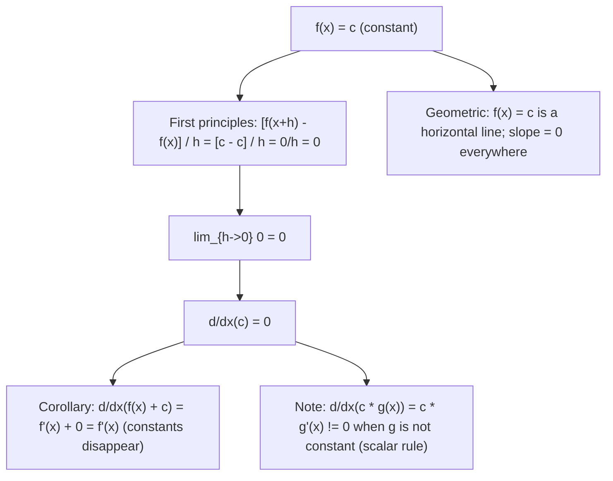

# Constant Rule

$$
\frac{d}{dx}(c) = 0
$$

## Deep Breakdown

What it tells me *(Situation Awareness)*:
The derivative of a constant is zero. A constant function $f(x) = c$ has a flat graph — it never changes, so its instantaneous rate of change is 0 everywhere. This is the simplest differentiation rule, but it is used in every non-trivial differentiation: whenever a term in a function is a pure constant (a bias term, a regularization coefficient, a fixed parameter), its derivative vanishes. In DA/DS: bias terms in linear models ($f(x) = wx + b$, $d/dx(b) = 0$) do not contribute to the gradient with respect to inputs; constant regularization terms like $\lambda$ in $\lambda \|w\|^2$ vanish when differentiating with respect to model inputs rather than weights; the constant rule is applied every time a partial derivative is taken, eliminating all terms that do not depend on the differentiation variable.

## Flowchart



## Real-world use

### Where it is used

Computing gradients in linear regression ($\partial/\partial w_j(w_0) = 0$ for the bias $w_0$ when differentiating w.r.t. $w_j$); partial differentiation of multivariate functions; showing that adding a constant to a loss function does not change its gradient; deriving that the regularization coefficient $\lambda$ is a constant multiplier in $\lambda \|w\|^2$; proving that the gradient of $L(w) + C$ equals the gradient of $L(w)$ for any constant $C$.

### Problem it solves

When differentiating a multivariate function, all terms not involving the differentiation variable become constants and vanish. Without the constant rule, every partial derivative computation would be unclear about what to do with irrelevant terms.

### How it solves the problem

From first principles: $[f(x+h) - f(x)]/h = [c - c]/h = 0$. Taking the limit gives $0$. Geometrically: a horizontal line has zero slope everywhere.

### Example in a business

A DS differentiates the ridge regression loss $L(w) = \|y - Xw\|^2 + \lambda\|w\|^2$ with respect to $w_1$ specifically. The term $w_2^2$ is a constant with respect to $w_1$: $\partial/\partial w_1(w_2^2) = 0$. This is the constant rule in action within a partial derivative. Every other weight's squared term vanishes, leaving only the $w_1$-dependent terms.

## The formula, piece by piece

- $c$: any constant (a number that does not depend on $x$)
- $d/dx(c) = 0$: the rate of change of a constant is always 0
- Proof: $[c - c]/h = 0/h = 0 \to 0$ as $h \to 0$
- Combined with sum rule: $d/dx(f(x) + c) = f'(x) + 0 = f'(x)$
- Combined with scalar rule: $d/dx(c \cdot f(x)) = c \cdot f'(x) \ne 0$ (when $f$ is not constant)
- In partial derivatives: $\partial/\partial x_i(c) = 0$ for any $c$ not depending on $x_i$
- In partial derivatives: $\partial/\partial x_i(f(x_j)) = 0$ when $j \ne i$ (different variable)

## The formula in words

"The slope of a flat line is zero. Constants don't change, so their rate of change is zero. When you differentiate and encounter a term that has no $x$ in it, it disappears (contributes zero to the derivative)." Tiny examples:
$d/dx(5) = 0$.
$d/dx(\pi) = 0$.
$d/dx(e^2) = 0$ (not $e^x$, but $e$ squared, a number).
$d/dx(x^2 + 7) = 2x + 0 = 2x$.
$\partial/\partial x(3x + 5y^2) = 3$ ($5y^2$ is constant w.r.t. $x$, so $0$).

## Critical Concepts

- **Constants vs constant multiples:** $d/dx(c) = 0$ but $d/dx(c \cdot x^2) = 2cx \ne 0$. The constant rule only applies to terms that are pure numbers, not to constants multiplying a function.
- **Partial derivatives eliminate cross-terms:** in $\partial/\partial w_1 (w_1^2 + w_2^2 + w_3^2)$, the terms $w_2^2$ and $w_3^2$ are constants with respect to $w_1$ and vanish. Result: $2w_1$. This is the backbone of gradient computation in multivariate optimization.
- **Bias terms in neural networks:** the bias $b$ in $f(x) = wx + b$ satisfies $\partial f/\partial x = w$ (bias vanishes from input gradient), but $\partial f/\partial b = 1$ (bias is not constant w.r.t. itself). The constant rule applies only when the differentiation variable truly does not appear.
- **Shifting a loss function:** if $L'(w) = L(w) + C$ for any constant $C$, then $\nabla L' = \nabla L$. The gradient is identical. Shifting a loss by a constant does not affect optimization at all.
- **Integration reversal:** since $d/dx(c) = 0$, the constant of integration $+C$ always appears in indefinite integrals: $\int f(x)dx = F(x) + C$, because $d/dx(C) = 0$ and $F(x) + C$ satisfies $d/dx = f(x)$ for any $C$.

## Step-by-step calculation (tiny example)

*Differentiate $f(x) = 3x^2 + 2x + 7$.*

*Step 1: Sum rule — differentiate each term separately.*

*Step 2: $d/dx(3x^2) = 6x$ (power and scalar rule).*

*Step 3: $d/dx(2x) = 2$ (power and scalar rule: $d/dx(x^1) = 1$).*

*Step 4: $d/dx(7) = 0$ (constant rule).*

*Step 5: Combine.* $f'(x) = 6x + 2 + 0 = 6x + 2$. At $x = 3$: $f'(3) = 18 + 2 = 20$.

## Code examples

### Beginner example (Python)

```python
import numpy as np

def f(x: float, c: float = 7.0) -> float:
    """f(x) = 3x^2 + 2x + c. Derivative w.r.t. x is 6x + 2 (constant c vanishes)."""
    return 3 * x**2 + 2 * x + c

def f_prime(x: float) -> float:
    """Analytic: d/dx(3x^2 + 2x + c) = 6x + 2. Constant c does not appear."""
    return 6 * x + 2   # Show that gradient is the same regardless of constant c
h = 1e-7
x0 = 2.0
print("Constant rule: d/dx(f(x) + c) = d/dx(f(x)), regardless of c")
print(f"\nAt x={x0}, analytic f'(x) = {f_prime(x0)}")
print(f"\n{'c value':>10} {'Numerical grad':>16} {'Difference from analytic':>25}")
for c in [0.0, 7.0, -100.0, 1e6]:
    f_c = lambda x, c=c: f(x, c)
numerical = (f_c(x0 + h) - f_c(x0 - h)) / (2 * h)
print(f"{c:>10.1f} {numerical:>16.8f} {abs(numerical - f_prime(x0)):>25.2e}")
print("\nKey: all numericals match. The constant c has no effect on the derivative.")   # Partial derivative example: d/dw_1 of (w_1^2 + w_2^2)
w = np.array([3.0, 4.0])
grad_w1 = 2 * w[0]   # constant rule: d/dw_1(w_2^2) = 0
grad_w2 = 2 * w[1]   # constant rule: d/dw_2(w_1^2) = 0
print(f"\nPartial derivatives of w_1^2 + w_2^2 at w=[3,4]:")
print(f" d/dw_1 = 2*w_1 = {grad_w1} (w_2^2 term vanishes by constant rule)")
print(f" d/dw_2 = 2*w_2 = {grad_w2} (w_1^2 term vanishes by constant rule)")
```

### Beginner example (R)

```r
# Constant rule: d/dx(c) = 0
f <- function(x, c = 7) 3*x^2 + 2*x + c
f_prime <- function(x) 6*x + 2  # c disappears
h <- 1e-7
x0 <- 2.0
cat("Constant rule: gradient is same for any constant c\n")
cat(sprintf("Analytic f'(%.1f) = %.4f\n\n", x0, f_prime(x0)))
cat(sprintf("%-10s %-16s %-20s\n", "c value", "Numerical grad", "Difference"))
for (c_val in c(0, 7, -100, 1e6)) { numerical <- (f(x0 + h, c_val) - f(x0 - h, c_val)) / (2 * h)
  cat(sprintf("%-10.1f %-16.8f %-20.2e\n", c_val, numerical, abs(numerical - f_prime(x0))))
}
```

### Professional example (Python)

```python
import numpy as np
from sklearn.datasets import make_regression
import functools
np.random.seed(42)   # -- Constant rule in partial gradient: ridge regression --
# Demonstrates that d/dw_j of (lambda * w_k^2) = 0 for k != j.
N, D = 200, 4
X, y = make_regression(n_samples=N, n_features=D, noise=5.0, random_state=42)
LAMBDA = 0.1

def ridge_loss(w: np.ndarray, X: np.ndarray, y: np.ndarray, lam: float) -> float:
    """L(w) = (1/N) * ||y - Xw||^2 + lambda * ||w||^2."""
    residuals = y - X @ w
    return float(np.mean(residuals**2) + lam * np.dot(w, w))

def ridge_gradient(w: np.ndarray, X: np.ndarray, y: np.ndarray, lam: float) -> np.ndarray:
    """Gradient: dL/dw_j = (-2/N) * X_j^T * (y - Xw) + 2*lambda*w_j. Constant rule: d/dw_j(lambda * w_k^2) = 0 for k != j. Only the w_j^2 term survives the partial derivative. """
    residuals = y - X @ w
    return -2.0 / N * X.T @ residuals + 2.0 * lam * w

def numerical_gradient(loss_fn, w: np.ndarray, h: float = 1e-5) -> np.ndarray:
    """Numerical gradient via central differences."""
    grad = np.zeros_like(w)
    for i in range(len(w)):
        w_plus = w.copy(); w_plus[i] += h
    w_minus = w.copy(); w_minus[i] -= h
    grad[i] = (loss_fn(w_plus) - loss_fn(w_minus)) / (2 * h)
    return grad
w_test = np.random.randn(D) * 0.5
loss_fn = functools.partial(ridge_loss, X=X, y=y, lam=LAMBDA)
g_analytic = ridge_gradient(w_test, X, y, LAMBDA)
g_numeric = numerical_gradient(loss_fn, w_test)
print("Constant Rule in Partial Gradient: Ridge Regression")
print(f"\nLoss = (1/N)||y-Xw||^2 + lambda*||w||^2, lambda={LAMBDA}")
print(f"Gradient: dL/dw_j = (-2/N)*X_j^T*(y-Xw) + 2*lambda*w_j\n")
print(f"{'Param':>8} {'w_j':>8} {'Analytic':>14} {'Numerical':>14} {'Abs err':>12}")
for j in range(D):
    print(f"{'w['+str(j)+']':>8} {w_test[j]:>8.4f} {g_analytic[j]:>14.8f} " f"{g_numeric[j]:>14.8f} {abs(g_analytic[j]-g_numeric[j]):>12.2e}")   # Show that shifting loss by a constant does not change gradient
CONSTANT_SHIFT = 500.0
loss_fn_shifted = functools.partial( lambda w, X, y, lam, shift: ridge_loss(w, X, y, lam) + shift, X=X, y=y, lam=LAMBDA, shift=CONSTANT_SHIFT )
g_shifted = numerical_gradient(loss_fn_shifted, w_test)
max_diff = np.max(np.abs(g_analytic - g_shifted))
print(f"\nAdding constant {CONSTANT_SHIFT} to loss: max gradient change = {max_diff:.2e}")
print(f"Key: d/dw(L(w) + {CONSTANT_SHIFT}) = d/dw(L(w)). Constant disappears.")
```

---

*Source: 1300 p. 218*
