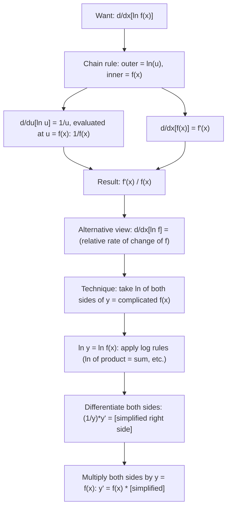

# Logarithmic Differentiation

$$
\frac{d}{dx}[\ln f(x)] = \frac{f'(x)}{f(x)}
$$

## Deep Breakdown

What it tells me *(Situation Awareness)*:
Logarithmic differentiation (log-diff) is the result of applying the chain rule to $\ln f(x)$: outer $\ln u$ has derivative $1/u$, inner $f(x)$ has derivative $f'(x)$, giving $f'(x)/f(x)$. More broadly, "logarithmic differentiation" refers to the technique: take $\ln$ of both sides of $y = f(x)$, differentiate implicitly, then solve for $y'$. This is indispensable when $f(x)$ is a product of many terms, a variable exponent ($x^x$, $x^{\sin x}$), or a complex ratio — because $\ln$ converts products into sums and exponents into multiplications, both of which are easier to differentiate. In DS/DA: log-likelihood differentiation is log-diff; MLE for any model with a product likelihood (Gaussian, Bernoulli, Poisson) uses $d/d\theta[\ln \prod p_i] = \sum d/d\theta[\ln p_i]$; Fisher information is $\mathbb{E}[(d/d\theta \ln p)^2]$; the score function $\nabla_\theta \log p(x;\theta)$ is log-diff applied to the likelihood.

## Flowchart



## Real-world use

### Where it is used

Maximum likelihood estimation: $d/d\theta[\ln L(\theta)] = d/d\theta[\sum_i \ln p(x_i;\theta)]$ — taking the log converts the likelihood product into a sum, then log-diff gives the score function per observation; Fisher information matrix: $\mathcal{I}(\theta) = \mathbb{E}[(d\ln p/d\theta)^2]$; differentiating $y = x^x$ or $y = f(x)^{g(x)}$ (variable base AND exponent — neither power rule nor exponential rule applies directly); differentiating large products like $y = \prod_{i=1}^{n} f_i(x)$; deriving the gradient of the log-determinant $d/dA[\ln\det A] = A^{-T}$ used in Gaussian log-likelihoods and normalizing flows.

### Problem it solves

When $f(x)$ is a product of many factors, a ratio of products, or has a variable exponent, direct differentiation is algebraically complex. The product rule for 5+ terms is cumbersome; the power rule does not apply when the exponent itself is a function of $x$. Log-diff collapses products into sums and moves exponents to coefficients — two manipulations that make differentiation tractable.

### How it solves the problem

Take $\ln$ of both sides: $\ln y = \ln f(x)$. Apply log rules to simplify (product rule of logs: $\ln(ABC) = \ln A + \ln B + \ln C$; power rule of logs: $\ln(u^n) = n\ln u$). Differentiate both sides implicitly with respect to $x$: $(1/y)y' = [\text{differentiated RHS}]$. Multiply both sides by $y = f(x)$ to recover $y'$.

### Example in a business

A DS derives the MLE update for a Poisson regression model. Log-likelihood: $\ell(\lambda) = \sum_i [y_i \ln\lambda_i - \lambda_i]$ where $\lambda_i = \exp(w^Tx_i)$. The score: $d\ell/dw = \sum_i (y_i - \lambda_i) x_i$. The $d/dw[\ln\lambda_i] = d/dw[w^Tx_i] = x_i$ (log-diff of $\exp(w^Tx_i)$ gives $x_i$ via chain rule: $f'(x)/f(x) = \exp(w^Tx_i) \cdot x_i / \exp(w^Tx_i) = x_i$). Without log-diff the score derivation would require applying the product rule to the likelihood directly.

## The formula, piece by piece

- $\ln f(x)$: natural log applied to the function $f(x)$
- $d/dx[\ln f(x)]$: differentiate the log of $f$
- $f'(x)$: derivative of $f$ with respect to $x$ (numerator)
- $f(x)$: the original function (denominator)
- $f'(x)/f(x)$: the "relative rate of change" or "logarithmic derivative" of $f$ — how fast $\ln f$ grows, equivalently, the fractional change in $f$ per unit change in $x$
- Key log properties used in the technique: $\ln(uv) = \ln u + \ln v$; $\ln(u/v) = \ln u - \ln v$; $\ln(u^n) = n\ln u$
- For variable exponent $y = u^v$ (both $u, v$ functions of $x$): $\ln y = v\ln u$; differentiate: $y'/y = v'(\ln u) + v(u'/u)$; so $y' = u^v[v'\ln u + vu'/u]$

## The formula in words

"The derivative of the log of a function equals the derivative of the function divided by the function itself — the function's relative rate of change." Tiny trace: $f(x) = x^3 + 1$. $\ln f(x) = \ln(x^3 + 1)$.
$d/dx[\ln(x^3+1)] = (3x^2)/(x^3+1)$.
At $x = 1$: $(3 \cdot 1)/(1+1) = 3/2 = 1.5$. Numerical: $[\ln(2+h) - \ln(2-h)]/(2h) \approx 1.5$. $\checkmark$

## Critical Concepts

- **Log-likelihood is the most important application:** in ML and statistics, the likelihood $L(\theta) = \prod_i p(x_i;\theta)$ is differentiated by first taking $\log$: $\ell(\theta) = \sum_i \log p(x_i;\theta)$. Then $d\ell/d\theta = \sum_i d/d\theta[\log p(x_i;\theta)]$. Each term is log-diff of the per-sample probability. MLE for logistic regression, Poisson regression, Gaussian regression, CRFs — all derive their parameter updates this way.
- **The score function:** $s(\theta; x) = \nabla_\theta \ln p(x;\theta)$ is the log-diff of the density. Its expectation under $p$ is zero: $\mathbb{E}[s] = 0$. Its variance is the Fisher information: $\mathcal{I}(\theta) = \mathbb{E}[s^2]$. This is why Newton-Raphson and natural gradient methods in ML use the Fisher information matrix as a preconditioner.
- **Variable exponents require log-diff:** $y = x^x$ — neither power rule ($d/dx[x^n] = nx^{n-1}$, only for constant $n$) nor exponential rule ($d/dx[a^x] = a^x \ln a$, only for constant base $a$) applies. Both the base and exponent are $x$. Log-diff: $\ln y = x\ln x$; differentiate: $(1/y)y' = \ln x + 1$; so $y' = x^x(\ln x + 1)$.
- **Relative rate of change:** $f'(x)/f(x) = d/dx[\ln f(x)]$ is the proportional (percentage) rate of change of $f$. In economics this is the elasticity; in ML it appears as the gradient of the log-partition function in exponential family models; in statistics it is the hazard rate in survival analysis. Whenever a "rate of change relative to the current value" is meaningful, log-diff appears.
- **Log-det gradient:** $d/dA[\ln\det A] = A^{-T}$ (proved via log-diff of the eigenvalue product: $\ln\det A = \sum_i \ln\lambda_i$, differentiate with respect to matrix elements).

This gradient is used in Gaussian log-likelihood optimization, kernel learning (optimizing GP marginal likelihood), and log-determinant-regularized objectives in normalizing flows.

## Step-by-step calculation (tiny example)

*Differentiate $y = x^x$ using logarithmic differentiation.*

*Step 1: Take ln of both sides.*
$\ln y = \ln(x^x) = x\ln x$.

*Step 2: Differentiate both sides with respect to $x$ (implicit diff on left).*
$d/dx[\ln y] = (1/y)(dy/dx)$.
$d/dx[x\ln x] = 1 \cdot \ln x + x \cdot (1/x) = \ln x + 1$ (product rule on right).

*Step 3: Set them equal and solve for $dy/dx$.*
$(1/y)(dy/dx) = \ln x + 1$.
$dy/dx = y(\ln x + 1) = x^x(\ln x + 1)$. *Verify at $x = 2$:* $y'(2) = 4(\ln 2 + 1) \approx 4(0.693 + 1) = 4 \times 1.693 \approx 6.77$.
Numerical: $[(2+h)^{(2+h)} - (2-h)^{(2-h)}]/(2h) \approx 6.77$. $\checkmark$

## Code examples

### Beginner example (Python)

```python
import numpy as np

def log_diff(f_val: float, f_prime_val: float) -> float:
    """Logarithmic derivative: d/dx[ln f(x)] = f'(x) / f(x)."""
    return f_prime_val / f_val

def log_diff_technique(ln_y_prime_fn, y_fn, x: float) -> float:
    """Full log-diff technique: (1/y)*y' = d/dx[ln y], so y' = y * d/dx[ln y]."""
    return y_fn(x) * ln_y_prime_fn(x)


# Concrete examples
# ---------------------------------------------------------------
# f(x) = x^3 + 1 -> d/dx[ln(x^3+1)] = 3x^2 / (x^3+1)
# y = x^x -> y' = x^x (ln x + 1)
# y = x^(sin x) -> y' = x^(sin x) * (cos(x)*ln(x) + sin(x)/x)
h = 1e-7
examples = [
    {
        "name": "ln(x^3 + 1)",
        "f": lambda x: x**3 + 1,
        "f_prime": lambda x: 3 * x**2,
        "analytic": lambda x: 3 * x**2 / (x**3 + 1),
    },
    {
        "name": "ln(sin^2(x))",
        "f": lambda x: np.sin(x)**2,
        "f_prime": lambda x: 2 * np.sin(x) * np.cos(x),
        "analytic": lambda x: 2 * np.cos(x) / np.sin(x),
    },
    {
        "name": "ln(exp(x^2))",
        "f": lambda x: np.exp(x**2),
        "f_prime": lambda x: 2 * x * np.exp(x**2),
        "analytic": lambda x: 2 * x,   # ln(exp(x^2)) = x^2, derivative = 2x
    },
]
print("--- Formula: d/dx[ln f(x)] = f'(x) / f(x) ---")
print(f"{'Function':>22} {'x':>5} {'LogDiff':>10} {'Analytic':>10} {'Agree':>7}")
for ex in examples:
    for x_val in [0.5, 1.5]:
        try:
            ld = log_diff(ex["f"](x_val), ex["f_prime"](x_val))
            an = ex["analytic"](x_val)
            print(f"{ex['name']:>22} {x_val:>5.2f} {ld:>10.5f} {an:>10.5f} {str(abs(ld - an) < 1e-5):>7}")
        except Exception:
            pass

# Variable exponent: y = x^x, y' = x^x * (ln x + 1)
print("\n--- Variable exponent: y = x^x ---")
print(f"{'x':>5} {'y=x^x':>10} {'y (log-diff)':>14} {'Numerical':>12}")
for x_val in [0.5, 1.0, 2.0]:
    y = x_val**x_val
    yd_logdiff = y * (np.log(x_val) + 1)
    yd_num = ((x_val + h)**(x_val + h) - (x_val - h)**(x_val - h)) / (2 * h)
    print(f"{x_val:>5.1f} {y:>10.5f} {yd_logdiff:>14.5f} {yd_num:>12.5f}")
```

### Beginner example (R)

```r
# Logarithmic differentiation: d/dx[ln(f(x))] = f'(x) / f(x)
log_diff <- function(f_val, f_prime_val) {
  f_prime_val / f_val
}
examples <- list(
  list(name = "ln(x^3+1)", f = function(x) x^3 + 1, f_prime = function(x) 3 * x^2,
       analytic = function(x) 3 * x^2 / (x^3 + 1)),
  list(name = "ln(sin^2(x))", f = function(x) sin(x)^2, f_prime = function(x) 2 * sin(x) * cos(x),
       analytic = function(x) 2 * cos(x) / sin(x)),
  list(name = "ln(exp(x^2))", f = function(x) exp(x^2), f_prime = function(x) 2 * x * exp(x^2),
       analytic = function(x) 2 * x)
)
cat(sprintf("%-22s %-5s %-12s %-12s\n", "Function", "x", "LogDiff", "Analytic"))
for (ex in examples) {
  for (x_val in c(0.5, 1.5)) {
    ld <- tryCatch(log_diff(ex$f(x_val), ex$f_prime(x_val)), error = function(e) NA)
    an <- tryCatch(ex$analytic(x_val), error = function(e) NA)
    if (!is.na(ld) && !is.na(an)) {
      cat(sprintf("%-22s %-5.2f %-12.5f %-12.5f\n", ex$name, x_val, ld, an))
    }
  }
}

# Variable exponent demo: y = x^x
cat("\n--- y = x^x: log-diff gives y' = x^x * (ln(x) + 1) ---\n")
h <- 1e-7
for (x_val in c(0.5, 1.0, 2.0)) {
  y <- x_val^x_val
  yd_ld <- y * (log(x_val) + 1)
  yd_num <- ((x_val + h)^(x_val + h) - (x_val - h)^(x_val - h)) / (2 * h)
  cat(sprintf("x = %.1f y = %.4f log-diff y' = %.5f numerical = %.5f\n", x_val, y, yd_ld, yd_num))
}
```

### Professional example (Python)

```python
import numpy as np
from sklearn.datasets import make_classification
from sklearn.preprocessing import StandardScaler
np.random.seed(42)

# -- Log-differentiation in MLE: logistic regression score and Fisher information --
# Use case: a DS derives and verifies the score function and Fisher information
# for logistic regression using log-diff of the Bernoulli likelihood.
#
# Model: p(y=1|x,w) = sigma(w^T x), sigma(z) = 1/(1+exp(-z))
# Log-likelihood (single obs): ell(w) = y*log(sigma) + (1-y)*log(1-sigma)
#
# Score (log-diff of likelihood):
# d(ell)/dw = [d(ell)/d(sigma)] * [d(sigma)/dz] * [dz/dw] <- Leibniz + log-diff
# = (y/sigma - (1-y)/(1-sigma)) * sigma*(1-sigma) * x
# = (y - sigma) * x
#
# Fisher info (expected squared score): I(w) = E[((y-sigma)*x)^2]
# = E[sigma*(1-sigma)] * x*x^T (since Var(y) = sigma*(1-sigma) for Bernoulli)
N = 300
DIM = 4

def sigmoid(z: np.ndarray) -> np.ndarray:
    """Numerically stable sigmoid."""
    return np.where(z >= 0, 1 / (1 + np.exp(-z)), np.exp(z) / (1 + np.exp(z)))

def log_likelihood(w: np.ndarray, X: np.ndarray, y: np.ndarray) -> float:
    """Bernoulli log-likelihood: sum_i [y_i log sigma_i + (1-y_i) log(1-sigma_i)]."""
    z = X @ w
    p = sigmoid(z)
    p = np.clip(p, 1e-10, 1 - 1e-10)
    return float(np.sum(y * np.log(p) + (1 - y) * np.log(1 - p)))

def score_function(w: np.ndarray, X: np.ndarray, y: np.ndarray) -> np.ndarray:
    """
    Score = d(log L)/dw, derived via log-differentiation of Bernoulli likelihood.

    Log-diff of p(y|x,w):
        d/dw[y*log(sigma) + (1-y)*log(1-sigma)] = (y - sigma(w^T x)) * x   <- see derivation above
    Summed over all observations.
    """
    p = sigmoid(X @ w)
    return X.T @ (y - p)   # shape: (DIM,)


def fisher_information(w: np.ndarray, X: np.ndarray) -> np.ndarray:
    """
    Fisher info matrix: I(w) = E[(score)(score)^T] = X^T * diag(p*(1-p)) * X

    Derived from Var[y_i] = sigma_i*(1-sigma_i) for Bernoulli.
    """
    p = sigmoid(X @ w)
    weights = p * (1 - p)   # shape: (N,) -- Bernoulli variance = sigma*(1-sigma)
    return X.T @ (weights[:, None] * X)   # X^T diag(weights) X, shape (DIM, DIM)


def numerical_score(w, X, y, h=1e-5):
    """Finite-difference score for verification."""
    grad = np.zeros_like(w)
    for i in range(len(w)):
        w_plus = w.copy()
        w_plus[i] += h
        w_minus = w.copy()
        w_minus[i] -= h
        grad[i] = (log_likelihood(w_plus, X, y) - log_likelihood(w_minus, X, y)) / (2 * h)
    return grad


# Data
X_raw, y_raw = make_classification(
    n_samples=N, n_features=DIM, n_redundant=0, n_informative=DIM, random_state=42
)
scaler = StandardScaler()
X = scaler.fit_transform(X_raw)
y = y_raw.astype(float)

# Evaluate at a fixed weight vector
w0 = np.array([0.3, -0.5, 0.2, 0.1])
score_analytic = score_function(w0, X, y)
score_numerical = numerical_score(w0, X, y)
fisher_mat = fisher_information(w0, X)
max_score_err = float(np.max(np.abs(score_analytic - score_numerical)))
print("Log-Differentiation: Logistic Regression Score and Fisher Information")
print(f"\nDataset: N={N}, DIM={DIM}")
print(f"Weight vector w0 = {w0}")
print(f"\nLog-likelihood at w0: {log_likelihood(w0, X, y):.4f}")
print(f"\nScore (analytic, log-diff of Bernoulli likelihood):")
print(f" d(log L)/dw = X^T (y - sigma(Xw)) = {np.round(score_analytic, 4)}")
print(f"\nScore (numerical, finite differences):")
print(f" {np.round(score_numerical, 4)}")
print(f"Max absolute error: {max_score_err:.2e} --> {'PASS' if max_score_err < 1e-3 else 'FAIL'}")
print(f"\nFisher Information Matrix I(w) [shape {fisher_mat.shape}]:")
print(np.round(fisher_mat, 3))
print(f"\nKey log-diff steps:")
print(f" 1. d/dw[y*log(sigma)] = y * (1/sigma) * sigma*(1-sigma) * x = y*(1-sigma)*x")
print(f" 2. d/dw[(1-y)*log(1-sigma)] = -(1-y)*sigma*x")
print(f" 3. Sum: [y*(1-sigma) - (1-y)*sigma]*x = (y - sigma)*x")
print(f" 4. This is log-diff: f'(w)/f(w) at each observation, summed.")
```

---

*Source: 1300 p. 219*
