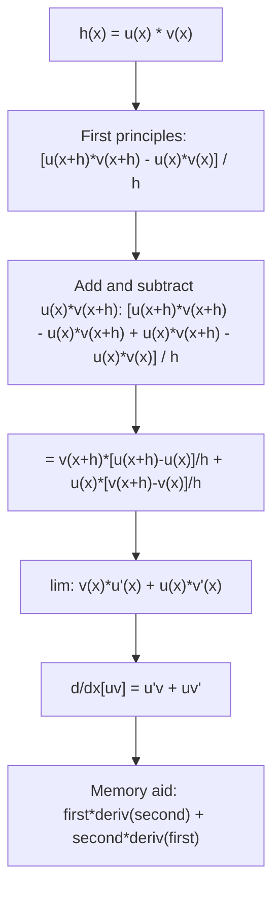

# Product Rule

$$
\frac{d}{dx}[uv] = u\frac{dv}{dx} + v\frac{du}{dx} = u'v + uv'
$$

## Deep Breakdown

What it tells me *(Situation Awareness)*:
The product rule gives the derivative of a product of two functions. Unlike the sum rule (where derivatives simply add), the product of two functions produces two terms via the product rule: $d/dx[uv] = u'v + uv'$. Mnemonic: "first times derivative of second, plus second times derivative of first." In DA/DS: the product rule is applied in deriving the Mish activation gradient ($\text{Mish}(x) = x \cdot \tanh(\text{softplus}(x))$, where the product $x \cdot f(x)$ triggers the product rule); in the entropy derivative $d/dp(-p\log p) = -(\log p + 1)$ (product $p \cdot \log p$); in computing gradients through attention scores (product of query and key vectors scaled by a function); and in deriving integration by parts ($\int u \, dv = uv - \int v \, du$).

## Flowchart



## Real-world use

### Where it is used

Mish activation gradient: $\text{Mish}(x) = x \cdot \tanh(\text{softplus}(x))$, product rule gives $\text{Mish}'(x) = \tanh(\text{softplus}(x)) + x \cdot \text{sech}^2(\text{softplus}(x)) \cdot \sigma(x)$; entropy derivative: $d/dp(-p\log p) = -\log p - 1$; attention score: $d/dx(qk/\sqrt{d})$; logarithmic differentiation uses product rule implicitly; integration by parts is product rule reversed.

### Problem it solves

When two non-constant functions are multiplied together, the derivative cannot simply be the product of the individual derivatives: $(uv)' \ne u'v'$ in general. The product rule provides the correct formula.

### How it solves the problem

Add and subtract the bridge term $u(x)v(x+h)$ in the numerator: $[u(x+h)v(x+h) - u(x)v(x)] = [u(x+h)-u(x)]v(x+h) + u(x)[v(x+h)-v(x)]$. Dividing by $h$ and taking the limit: first term gives $u'(x) \cdot v(x)$ (since $v(x+h) \to v(x)$ as $h \to 0$); second term gives $u(x) \cdot v'(x)$.

### Example in a business

A DS derives the gradient of the entropy term $-p \log p$ used in a decision tree impurity criterion. Let $u = p$, $v = \log p$: $d/dp(p \log p) = (\log p)(1) + p(1/p) = \log p + 1$. So $d/dp(-p \log p) = -\log p - 1$. This is used to compute the optimal split threshold for information gain maximization.

## The formula, piece by piece

- $u = u(x)$: first function; differentiable
- $v = v(x)$: second function; differentiable
- $u' = du/dx$: derivative of the first function
- $v' = dv/dx$: derivative of the second function
- $u'v$: "derivative of first, times second"
- $uv'$: "first, times derivative of second"
- $(uv)' = u'v + uv'$: the full product rule
- Extension (three functions): $(uvw)' = u'vw + uv'w + uvw'$
- Common mistake: $(uv)' \ne u'v'$. Always two terms, not one.

## The formula in words

"The derivative of a product has two parts: put a prime on the first factor and leave the second alone, then leave the first alone and put a prime on the second. Add the two parts. This is because both factors are changing, and each factor's change contributes to the overall rate of change of the product." Tiny trace: $h(x) = x^2 \sin x$. $u = x^2$, $v = \sin x$, $u' = 2x$, $v' = \cos x$.
$(x^2 \sin x)' = 2x \sin x + x^2 \cos x$.
At $x = \pi/2$: $= 2(\pi/2)(1) + (\pi/2)^2(0) = \pi$.

## Critical Concepts

- **Two terms, not one:** $(uv)' = u'v + uv'$. A common beginner error is writing $(uv)' = u'v'$. Always check: there must be two terms.
- **Mish activation:** $\text{Mish}(x) = x \cdot \tanh(\text{softplus}(x))$. Product rule: $\text{Mish}'(x) = \tanh(\text{softplus}(x)) + x \cdot \text{sech}^2(\text{softplus}(x)) \cdot \sigma(x)$, where $\sigma(x) = d/dx(\text{softplus}(x)) = 1/(1+e^{-x})$.
- **Integration by parts:** $\int u \, dv = uv - \int v \, du$ is the product rule rearranged and integrated: $\int (uv)' dx = uv = \int u'v \, dx + \int uv' \, dx$. Rearranging: $\int uv' \, dx = uv - \int u'v \, dx$. Used in computing moments, computing the expectation of complex distributions.
- **Entropy derivative:** $d/dp(p\log_2 p) = \log_2 p + 1/\ln 2$ (product rule with $u=p$, $v=\log_2 p$). This appears in gradient boosting impurity and information gain.
- **Triple product rule:** $(uvw)' = u'vw + uv'w + uvw'$.

Three terms. In general, for $n$ factors, the product rule gives $n$ terms, each with exactly one factor differentiated.

## Step-by-step calculation (tiny example)

*Differentiate $f(x) = x^3 \cdot e^x$ using the product rule.*

*Step 1: Identify $u$ and $v$.* $u = x^3$, $v = e^x$.

*Step 2: Compute $u'$ and $v'$.* $u' = 3x^2$, $v' = e^x$.

*Step 3: Apply product rule.* $f'(x) = u'v + uv' = 3x^2 e^x + x^3 e^x = e^x(3x^2 + x^3) = x^2 e^x(3 + x)$. *Verify at $x = 1$:* $f'(1) = 1 \cdot e \cdot 4 = 4e \approx 10.873$.
Numerical: $(2^3 e^2 - 0^3 e^0) / 2 \approx (8 \cdot 7.389 - 0)/2 \approx$ wait, use $h = 0.001$:
$f(1.001) = 1.001^3 \cdot e^{1.001} \approx 1.003 \cdot 2.7205 = 2.7286$.
$f(0.999) = 0.999^3 \cdot e^{0.999} \approx 0.997 \cdot 2.7151 = 2.7069$.
$(2.7286 - 2.7069)/0.002 \approx 10.85 \approx 4e$. $\checkmark$

## Code examples

### Beginner example (Python)

```python
import numpy as np   # Product rule: d/dx[u*v] = u'v + uv'

def product_rule_deriv( u: float, v: float, u_prime: float, v_prime: float ) -> float:
    """d/dx[u*v] = u'*v + u*v'."""
    return u_prime * v + u * v_prime   # Example 1: d/dx[x^3 * e^x] at
x=1
x = 1.0
u, v = x**3, np.exp(x)
u_prime, v_prime = 3*x**2, np.exp(x)
analytic = product_rule_deriv(u, v, u_prime, v_prime)
print(f"d/dx[x^3 * e^x] at x=1: {analytic:.6f} (= 4e = {4*np.e:.6f})")   # Verify numerically
h = 1e-7
f = lambda x: x**3 * np.exp(x)
numerical = (f(x + h) - f(x - h)) / (2 * h)
print(f"Numerical check: {numerical:.6f}")   # Example 2: d/dp[-p*log(p)] = entropy gradient
print("\nEntropy gradient: d/dp[-p*log(p)] = -(log(p) + 1)")
for p in [0.1, 0.25, 0.5, 0.75, 0.9]:
    # Product rule: u=p, v=-log(p); u'=1, v'=-1/p
    u, v = p, -np.log(p)
u_prime, v_prime = 1.0, -1.0/p
grad = product_rule_deriv(u, v, u_prime, v_prime)
analytic_formula = -(np.log(p) + 1)
print(f" p={p:.2f}: product rule={grad:.4f}, formula -(log(p)+1)={analytic_formula:.4f}")   # Mish activation and its product-rule gradient

def mish(x: np.ndarray) -> np.ndarray:
    """Mish(x) = x * tanh(softplus(x))."""
    return x * np.tanh(np.log1p(np.exp(x)))

def mish_gradient(x: np.ndarray) -> np.ndarray:
    """d/dx[Mish(x)] via product rule: u=x, v=tanh(softplus(x)). = tanh(softplus(x)) + x * sech^2(softplus(x)) * sigmoid(x). """
    sp = np.log1p(np.exp(x))
    tanh_sp = np.tanh(sp)
    sech2_sp = 1.0 - tanh_sp**2
    sig_x = 1.0 / (1.0 + np.exp(-x))
    return tanh_sp + x * sech2_sp * sig_x
x_test = np.array([-2.0, -1.0, 0.0, 1.0, 2.0])
h = 1e-7
print("\nMish activation gradient (product rule):")
print(f"{'x':>6} {'Analytic':>12} {'Numerical':>12}")
for xi in x_test:
    analytic_g = mish_gradient(np.array([xi]))[0]
numerical_g = (mish(np.array([xi + h]))[0] - mish(np.array([xi - h]))[0]) / (2 * h)
print(f"{xi:>6.1f} {analytic_g:>12.6f} {numerical_g:>12.6f}")
```

### Beginner example (R)

```r
# Product rule: d/dx[u*v] = u'*v + u*v'
product_rule <- function(u, v, u_prime, v_prime) u_prime * v + u * v_prime  # d/dx[x^3 * exp(x)] at
x=1
x <- 1.0
cat(sprintf("d/dx[x^3*exp(x)] at x=1: %.6f (= 4e = %.6f)\n", product_rule(x^3, exp(x), 3*x^2, exp(x)), 4*exp(1)))  # Entropy gradient: d/dp[-p*log(p)] = -(log(p)+1)
cat("\nEntropy gradient d/dp[-p*log(p)]:\n")
for (p in c(0.1, 0.25, 0.5, 0.75, 0.9)) { grad <- product_rule(p, -log(p), 1, -1/p)
  cat(sprintf(" p=%.2f: %.4f\n", p, grad))
}
```

### Professional example (Python)

```python
import numpy as np
from sklearn.datasets import make_classification
from sklearn.preprocessing import StandardScaler
np.random.seed(42)   # -- Product rule: Mish activation forward and backward pass --
# Use case: a DS implements Mish from scratch and verifies its gradient
# using the product rule. Mish(x) = x * tanh(softplus(x)).

def softplus(x: np.ndarray) -> np.ndarray:
    """log(1 + e^x), numerically stable."""
    return np.log1p(np.exp(np.clip(x, -500, 500)))

def sigmoid(x: np.ndarray) -> np.ndarray:
    """Numerically stable sigmoid."""
    return np.where(x >= 0, 1 / (1 + np.exp(-x)), np.exp(x) / (1 + np.exp(x)))

def mish_forward(x: np.ndarray) -> np.ndarray:
    """Mish(x) = x * tanh(softplus(x)). Product of u=x and v=tanh(softplus(x))."""
    return x * np.tanh(softplus(x))

def mish_backward(x: np.ndarray) -> np.ndarray:
    """d/dx[Mish(x)] via product rule: d/dx[u*v] = u'v + uv'. u = x, u' = 1 v = tanh(softplus(x)), v' = sech^2(softplus(x)) * sigmoid(x) Result: tanh(softplus(x)) + x * sech^2(softplus(x)) * sigmoid(x) """
    sp = softplus(x)
    tanh_sp = np.tanh(sp)
    sech2_sp = 1.0 - tanh_sp**2   # d/d(sp)[tanh(sp)] = sech^2(sp) = 1 - tanh^2(sp)
    dsig = sigmoid(x)   # d/dx[softplus(x)] =
    sigmoid(x)   # Product rule: u'*v + u*v'
    return tanh_sp * 1.0 + x * sech2_sp * dsig   # Verify gradient against finite differences
x_range = np.linspace(-4, 4, 200)
h = 1e-5
grad_analytic = mish_backward(x_range)
grad_numerical = (mish_forward(x_range + h) - mish_forward(x_range - h)) / (2 * h)
max_error = np.max(np.abs(grad_analytic - grad_numerical))
print("Mish Activation Gradient: Product Rule d/dx[x * tanh(softplus(x))]")
print(f"\nMax gradient error (analytic vs numerical): {max_error:.2e}")
print(f"Gradient check: {'PASSED' if max_error < 1e-4 else 'FAILED'}")   # Show gradient values at key points
print(f"\n{'x':>6} {'Mish(x)':>10} {'Mish\'(x)':>12} {'Numerical':>12}")
for xi in [-3.0, -1.0, 0.0, 1.0, 2.0, 3.0]:
    mish_val = mish_forward(np.array([xi]))[0]
grad_val = mish_backward(np.array([xi]))[0]
num_val = grad_numerical[np.argmin(np.abs(x_range - xi))]
print(f"{xi:>6.1f} {mish_val:>10.4f} {grad_val:>12.6f} {num_val:>12.6f}")
print(f"\nKey: Mish gradient uses product rule on u=x and v=tanh(softplus(x)).")
print(f" u'=1 (constant), v'=sech^2(softplus)*sigmoid (chain rule on v).")
```

---

*Source: 1300 p. 218*
