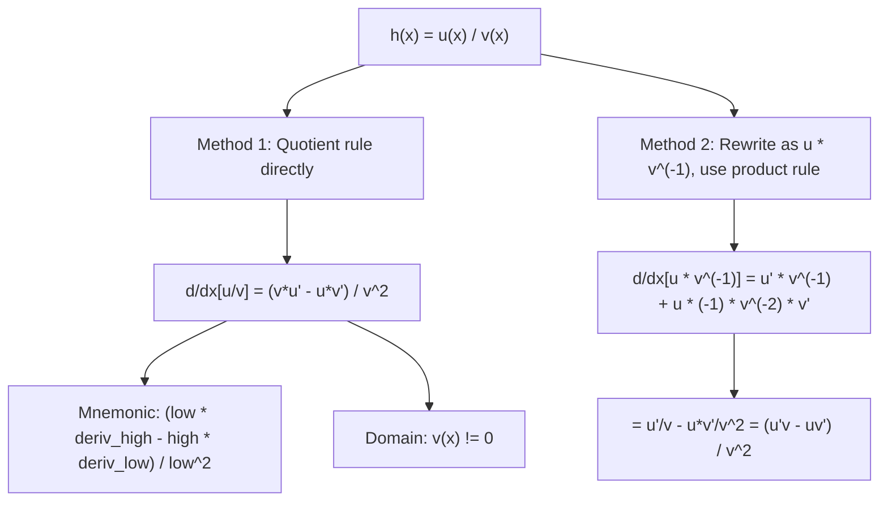

# Quotient Rule

$$
\frac{d}{dx}\!\left[\frac{u}{v}\right] = \frac{v\frac{du}{dx} - u\frac{dv}{dx}}{v^2} = \frac{vu' - uv'}{v^2}
$$

## Deep Breakdown

What it tells me *(Situation Awareness)*:
The quotient rule gives the derivative of $u/v$ as $(vu' - uv')/v^2$. Mnemonic: "low dee high minus high dee low, over low squared" where "high" is the numerator and "low" is the denominator. The denominator $v^2$ is always positive (for real $v \ne 0$) and the sign of the numerator determines whether the quotient is increasing or decreasing. In DA/DS: the quotient rule is applied in deriving the derivative of $\tan x = \sin x / \cos x$ (which was done in the Standard Derivatives table); in deriving the gradient of softmax $\partial \text{softmax}_j / \partial z_k$; in attention score normalization gradients; in computing the gradient of evaluation metrics expressed as ratios (precision, recall, F1 as $2PR/(P+R)$); and in deriving the $\arctan$ and $\arcsin$ derivatives via implicit differentiation.

## Flowchart



## Real-world use

### Where it is used

Deriving $d/dx(\tan x) = \sec^2 x$ (from $\sin x/\cos x$); deriving softmax Jacobian: $\partial \sigma_j / \partial z_k = \sigma_j(\delta_{jk} - \sigma_k)$, where the softmax $e^{z_j}/\sum e^{z_k}$ is a ratio; computing gradient of F1 score formula $2PR/(P+R)$; gradient of normalized dot-product attention $\text{softmax}(QK^T/\sqrt{d})$; deriving gradients of any normalized output.

### Problem it solves

When a function is expressed as a fraction of two non-constant functions, the derivative cannot be computed as the ratio of the individual derivatives. The quotient rule provides the correct formula.

### How it solves the problem

Two equivalent methods: (1) Direct derivation from first principles using the bridge term trick, similar to the product rule. (2) Rewrite $u/v$ as $u \cdot v^{-1}$ and apply the product rule: $d/dx[u \cdot v^{-1}] = u' v^{-1} + u(-1)v^{-2}v' = u'/v - uv'/v^2 = (u'v - uv')/v^2$.

### Example in a business

A DS computes the gradient of the F1 score $F1 = 2PR/(P+R)$ with respect to precision $P$: $dF1/dP = d/dP[2PR/(P+R)]$. Here $u = 2PR$, $v = P+R$: $u' = 2R$, $v' = 1$. $dF1/dP = [(P+R)(2R) - 2PR(1)]/(P+R)^2 = [2R(P+R) - 2PR]/(P+R)^2 = 2R^2/(P+R)^2$. This gradient is needed in differentiable approximations of F1 for threshold optimization.

## The formula, piece by piece

- $u = u(x)$: numerator function; differentiable
- $v = v(x)$: denominator function; differentiable and $v \ne 0$
- $u'$, $v'$: derivatives of numerator and denominator
- $vu'$: "denominator times derivative of numerator"
- $-uv'$: "minus numerator times derivative of denominator" (note the minus sign)
- $v^2$: square of the denominator
- Order matters: $vu' - uv'$ not $uv' - vu'$ (the minus sign is on the denominator's derivative term)
- Equivalent form: $d/dx[u/v] = u'/v - uv'/v^2$ (from product rule on $u \cdot v^{-1}$)

## The formula in words

"For a fraction, the derivative is: denominator times derivative of numerator, minus numerator times derivative of denominator, all divided by denominator squared. The subtraction order matters: numerator derivative term comes first (gets added), denominator derivative term comes second (gets subtracted)." Tiny trace: $h(x) = x^2 / (x+1)$. $u = x^2$, $v = x+1$, $u' = 2x$, $v' = 1$.
$h'(x) = [(x+1)(2x) - x^2(1)] / (x+1)^2 = [2x^2 + 2x - x^2]/(x+1)^2 = (x^2 + 2x)/(x+1)^2$.
At $x = 2$: $h'(2) = (4+4)/9 = 8/9 \approx 0.889$.

## Critical Concepts

- **Minus sign is critical:** in $(vu' - uv')/v^2$, the minus sign is on the denominator's derivative term. Writing $+uv'$ instead of $-uv'$ is the most common error. Verify by checking the $\tan x$ derivation: $(\cos x)^2 + (\sin x)^2 = 1$ only works with the correct sign.
- **Quotient rule is product rule:** $d/dx[u/v] = d/dx[u \cdot v^{-1}]$. Product rule: $u' v^{-1} + u \cdot (-v^{-2} v') = u'/v - uv'/v^2 = (u'v - uv')/v^2$. This derivation is often simpler to remember.
- **Softmax Jacobian derivation:** $\partial/\partial z_k (e^{z_j}/\sum_i e^{z_i})$. Numerator $u = e^{z_j}$, denominator $v = \sum_i e^{z_i} = S$. For $k = j$: $u' = e^{z_j}$; for $k \ne j$: $u' = 0$. And $v' = e^{z_k}$ always. Result: $\sigma_j \delta_{jk} - \sigma_j \sigma_k = \sigma_j(\delta_{jk} - \sigma_k)$.
- **Stability concern:** when $v(x)$ is close to 0, $v^2$ is very small and the quotient rule result can be large. In softmax with large logit differences, the denominator $\sum e^{z_i}$ is dominated by one term; use the numerically stable log-sum-exp trick before applying the quotient rule conceptually.
- **F1 and other ratio metrics:** metrics expressed as $2AB/(A+B)$ (F1), $\text{TP}/(P+N)$ (accuracy), etc. have gradients derivable via the quotient rule.

These gradients are used in differentiable approximations for threshold optimization.

## Step-by-step calculation (tiny example)

*Derive $d/dx(\tan x) = \sec^2 x$ using the quotient rule.*

*Step 1: Write $\tan x = \sin x / \cos x$. Set $u = \sin x$, $v = \cos x$.*

*Step 2: Derivatives.* $u' = \cos x$, $v' = -\sin x$.

*Step 3: Apply quotient rule.*
$d/dx(\tan x) = [(\cos x)(\cos x) - (\sin x)(-\sin x)] / \cos^2 x$.
$= (\cos^2 x + \sin^2 x) / \cos^2 x$.

*Step 4: Use Pythagorean identity.* $\cos^2 x + \sin^2 x = 1$.
$= 1/\cos^2 x = \sec^2 x$. $\checkmark$

## Code examples

### Beginner example (Python)

```python
import numpy as np

def quotient_rule_deriv(u: float, v: float, u_prime: float, v_prime: float) -> float:
    """d/dx[u/v] = (v*u' - u*v') / v^2. Requires v != 0."""
    if abs(v) < 1e-12:
        raise ValueError(f"v = {v:.2e} is too close to 0.")
    return (v * u_prime - u * v_prime) / v**2


# Example 1: d/dx[tan(x)] = sec^2(x), derived from sin(x)/cos(x)
x_vals = np.array([-1.0, -0.5, 0.0, 0.5, 1.0])
h = 1e-7
print("Quotient rule for d/dx[tan(x)] = (cos*cos - sin*(-sin)) / cos^2 = sec^2(x)")
print(f"{'x':>6} {'Quotient rule':>14} {'1/cos^2(x)':>12} {'Numerical':>12}")
for x in x_vals:
    qr = quotient_rule_deriv(np.sin(x), np.cos(x), np.cos(x), -np.sin(x))
    sec2 = 1 / np.cos(x)**2
    num = (np.tan(x + h) - np.tan(x - h)) / (2 * h)
    print(f"{x:>6.2f} {qr:>14.6f} {sec2:>12.6f} {num:>12.6f}")

# Example 2: d/dx[x^2 / (x+1)]
print("\nd/dx[x^2 / (x+1)] = (x^2 + 2x) / (x+1)^2")
for x in [0.5, 1.0, 2.0, 3.0]:
    qr = quotient_rule_deriv(x**2, x+1, 2*x, 1.0)
    formula = (x**2 + 2*x) / (x+1)**2
    print(f" x={x:.1f}: quotient rule={qr:.4f}, formula={formula:.4f}")
```

### Beginner example (R)

```r
# Quotient rule: d/dx[u/v] = (v*u' - u*v') / v^2
quotient_rule <- function(u, v, u_prime, v_prime) (v * u_prime - u * v_prime) / v^2

# d/dx[sin(x)/cos(x)] = sec^2(x)
x_vals <- c(-1.0, -0.5, 0.0, 0.5, 1.0)
cat("d/dx[tan(x)] via quotient rule:\n")
cat(sprintf("%-6s %-14s %-12s\n", "x", "Quotient rule", "1/cos^2(x)"))
for (x in x_vals) {
  qr <- quotient_rule(sin(x), cos(x), cos(x), -sin(x))
  sec2 <- 1 / cos(x)^2
  cat(sprintf("%-6.2f %-14.6f %-12.6f\n", x, qr, sec2))
}

# F1 score gradient w.r.t. precision
cat("\ndF1/dP where F1 = 2PR/(P+R):\n")
for (P in c(0.5, 0.7, 0.8, 0.9)) {
  R <- 0.75  # fixed recall
  u <- 2 * P * R
  v <- P + R
  u_prime <- 2 * R
  v_prime <- 1.0
  dF1_dP <- quotient_rule(u, v, u_prime, v_prime)
  cat(sprintf(" P=%.2f, R=%.2f: dF1/dP = %.4f\n", P, R, dF1_dP))
}
```

### Professional example (Python)

```python
import numpy as np
np.random.seed(42)

# -- Quotient rule: softmax Jacobian derivation from scratch --
# Use case: a DS implements manual backprop through a softmax layer.
# The softmax Jacobian d(sigma_j)/d(z_k) uses the quotient rule.


def softmax(z: np.ndarray) -> np.ndarray:
    """Numerically stable softmax."""
    z_shift = z - np.max(z)
    exp_z = np.exp(z_shift)
    return exp_z / exp_z.sum()


def softmax_jacobian(z: np.ndarray) -> np.ndarray:
    """Jacobian of softmax: J[j,k] = sigma_j * (delta_{jk} - sigma_k).

    Derived via quotient rule on e^z_j / sum_k e^z_k.
    Numerator u = e^z_j, denominator v = S = sum_k e^z_k.
    d/dz_k[u/v]:
        For k=j:  (S*e^z_j - e^z_j*e^z_k) / S^2 = sigma_j*(1 - sigma_j)
        For k!=j: (S*0 - e^z_j*e^z_k) / S^2 = -sigma_j*sigma_k
    Result: sigma_j*(delta_{jk} - sigma_k)
    """
    sigma = softmax(z)
    K = len(sigma)
    jac = np.zeros((K, K))
    for j in range(K):
        for k in range(K):
            delta = 1.0 if j == k else 0.0
            jac[j, k] = sigma[j] * (delta - sigma[k])
    return jac


def softmax_jacobian_vectorized(z: np.ndarray) -> np.ndarray:
    """Vectorized version: J = diag(sigma) - sigma @ sigma.T."""
    sigma = softmax(z)
    return np.diag(sigma) - np.outer(sigma, sigma)


# Verify Jacobian against numerical Jacobian
K = 5
z = np.random.randn(K) * 2.0
sigma = softmax(z)
jac_analytic = softmax_jacobian_vectorized(z)
h = 1e-6
jac_numerical = np.zeros((K, K))
for k in range(K):
    z_plus = z.copy()
    z_plus[k] += h
    z_minus = z.copy()
    z_minus[k] -= h
    jac_numerical[:, k] = (softmax(z_plus) - softmax(z_minus)) / (2 * h)

max_err = np.max(np.abs(jac_analytic - jac_numerical))
print("Softmax Jacobian via Quotient Rule: d(sigma_j)/d(z_k) = sigma_j*(delta_{jk} - sigma_k)")
print(f"\nz = {z.round(4)}")
print(f"sigma = {sigma.round(4)}")
print(f"\nAnalytic Jacobian (5x5):")
print(np.round(jac_analytic, 6))
print(f"\nMax error vs numerical Jacobian: {max_err:.2e}")
print(f"Jacobian check: {'PASSED' if max_err < 1e-4 else 'FAILED'}")
print(f"\nRow sums (should all = 0): {jac_analytic.sum(axis=1).round(8)}")
print(f"(Row sum = 0 means gradients w.r.t. all logits sum to 0 for any sigma_j)")
```

---

*Source: 1300 p. 219*
